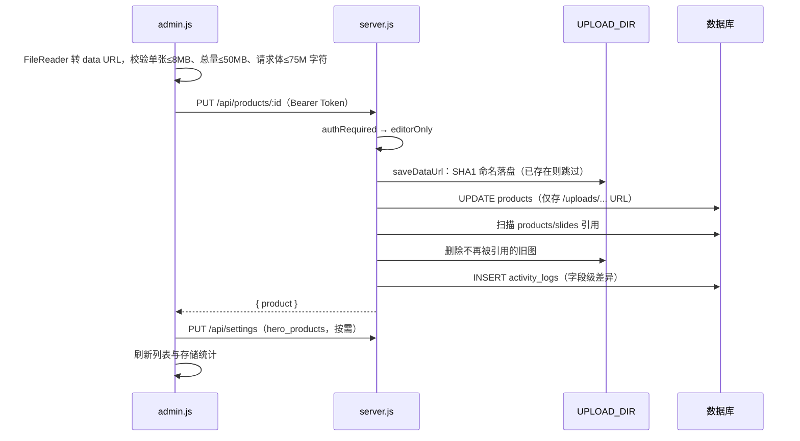

# LeapShop 最终架构文档（生产版本）

> **文档定位**：本文档梳理 LeapShop（对外品牌 LeapChess / LEAP）当前生产版本的完整架构，涵盖项目结构、前后端设计、数据库方案、性能优化与部署方案。
>
> **基线版本**：分支 `feat/test-login-system`，提交 `0476933`（含其上的全部已提交代码）。
>
> **整理原则**：只描述当前代码中真实生效的最终实现，已废弃的方案（如 base64 图片入库、`hero_product_id` 单主推款、`C001` 客户账户、前台 sign-in 入口、表单内 Weight 输入框等）一律不再记录。凡与 `README.md` 描述不一致之处，以源码为准（差异汇总见第 11 章）。

---

## 目录

1. [项目概览](#1-项目概览)
2. [项目结构](#2-项目结构)
3. [总体架构](#3-总体架构)
4. [前端架构](#4-前端架构)
5. [后端架构](#5-后端架构)
6. [数据库方案](#6-数据库方案)
7. [数据流与运维工具](#7-数据流与运维工具)
8. [性能优化策略](#8-性能优化策略)
9. [部署方案](#9-部署方案)
10. [安全设计](#10-安全设计)
11. [已知问题与改进建议](#11-已知问题与改进建议)
12. [附录：常用命令速查](#12-附录常用命令速查)

---

## 1. 项目概览

### 1.1 项目定位

LeapShop 是一个国际象棋装备主题的全栈电商展示站，视觉风格为“方案 F：白底金黑轻奢编辑画廊”（Affordable Luxury Editorial Gallery）。系统由三部分组成：

- **前台官网**：八个公开页面，无登录门槛，支持跨页购物车与购物清单导出（无在线支付）。
- **隐藏管理后台**：`/admin.html`，站内无任何可见链接，通过直接访问或键盘手势进入，提供轮播图、商品、全站设置、主推款、账户、审计日志与存储监控的管理能力。
- **后端 API**：Express 单进程同时提供 REST 接口、上传图片静态服务与前端静态页面托管。

### 1.2 技术栈

| 层级 | 技术选型 | 说明 |
| --- | --- | --- |
| 前端 | 原生 HTML5 / CSS3 / ES Module | 无框架、无构建工具，浏览器直接加载模块 |
| 后端 | Node.js ≥ 18、Express 4 | 单文件入口 `server.js` |
| 认证 | jsonwebtoken（JWT，12 小时有效）、bcryptjs | 无状态 Bearer Token |
| 数据库（生产） | PostgreSQL（`pg` 连接池） | Zeabur 托管 PostgreSQL 服务 |
| 数据库（开发） | SQLite（`sql.js`，纯 WASM） | 零安装、零编译，自动回退 |
| 文件存储 | 本地文件系统 / Zeabur Volume | 图片按 SHA1 内容哈希落盘 |
| 部署 | Docker（`node:20-alpine`）+ Zeabur | 单镜像同时承载前后端 |

后端运行时依赖仅 6 个，全部为纯 JavaScript 实现（无 native 模块）：

```json
{
  "bcryptjs": "^2.4.3",
  "cors": "^2.8.5",
  "express": "^4.21.2",
  "jsonwebtoken": "^9.0.2",
  "pg": "^8.13.1",
  "sql.js": "^1.13.0"
}
```

### 1.3 核心功能清单

| 模块 | 功能 |
| --- | --- |
| 首页 | 服务端轮播图（8 秒自动切换 + 手动圆点）、Featured 四卡（主推款优先 + 系列代表品补位）、品牌价值主张、计数动画 |
| 商品浏览 | 全部商品按四大系列分区瀑布流；四个分类页；商品详情页（1:1 主图横滑 + 详情长图 + Markdown 卖点） |
| 详情交互 | 悬停圆形放大镜（2.5 倍）、Lightbox 全屏查看（键盘导航、焦点圈定、相邻图预加载） |
| 购物车 | 跨页 `localStorage` 持久化、数量步进、移除、一键导出 `.txt` 购物清单后自动清空 |
| 全站设置 | 网站标题、LOGO、首页公告（白名单 HTML）、页脚联系方式；后台保存后经 BroadcastChannel 免刷新同步到已打开的前台标签页 |
| 商品管理 | 新增/编辑/删除、主图集与详情图集（各最多 10 张）、卖点文案、分页与分类筛选、↑↓ 调整排序、主推款设置 |
| 轮播管理 | 上传、替代文本编辑、↑↓ 排序、启用/停用、删除 |
| 账户体系 | admin / tester / demo 三角色；管理员创建与删除测试账户、重置密码 |
| 审计日志 | 登录、页面浏览、加购、商品/轮播/设置变更（字段级差异摘要） |
| 存储监控 | 数据库体积、图片文件占用、商品数据占比、数据库开销占比、Volume 磁盘容量与剩余、单商品存储明细 |

---

## 2. 项目结构

### 2.1 目录树（仅列出生产相关与运维相关内容）

```
LeapShop/
├── Dockerfile                    # 单服务镜像：后端 API + 前端静态托管
├── .dockerignore                 # 排除 node_modules、backend/data、测试脚本、日志
├── .gitignore                    # 排除 node_modules、backend/data、.env、.gh-cli、.qoder
├── README.md                     # 项目说明与部署指引
├── GIT_HISTORY.md                # 提交历史导出
│
├── backend/                      # —— 后端（进入镜像）——
│   ├── server.js                 # Express 入口：中间件、全部路由、图片落盘、静态托管、启动自检
│   ├── db.js                     # 数据库抽象层：PostgreSQL / SQLite 双驱动、建表与迁移、存储统计
│   ├── seed.js                   # 幂等种子：7 个账户 + 16 件商品 + 3 帧轮播 + 默认设置
│   ├── package.json              # 依赖与脚本（start / dev / seed）
│   ├── test-api.ps1              # API 冒烟测试（不进镜像）
│   ├── test-crud.js              # 中文数据 CRUD 测试（不进镜像）
│   └── data/                     # 本地开发数据（git 与镜像均忽略）
│       ├── leapchess.db          # SQLite 数据文件
│       └── uploads/<2位哈希>/    # 本地图片落盘目录
│
├── frontend/                     # —— 前端（进入镜像，由后端托管）——
│   ├── index.html                # 首页
│   ├── products.html             # 商品总览
│   ├── chess-clock.html          # 分类页：棋钟
│   ├── chess-board.html          # 分类页：棋盘
│   ├── stopwatch.html            # 分类页：秒表
│   ├── lifestyle.html            # 分类页：生活周边
│   ├── product.html              # 商品详情（?id=N）
│   ├── journey.html              # 品牌历程
│   ├── login.html                # 内部测试登录页
│   ├── admin.html                # 隐藏管理后台
│   ├── assets/                   # logo.svg、placeholder.svg（静态品牌资产）
│   ├── css/style.css             # 全站唯一样式表（前台 + 后台）
│   ├── js/
│   │   ├── site.js               # 全站共享层：导航/购物车/页脚/设置/滚动显现/隐蔽入口
│   │   ├── store.js              # 前台只读数据层（公开接口 + 模块级缓存）
│   │   ├── api.js                # 带 Token 的通用 API 客户端（后台与登录使用）
│   │   ├── auth.js               # 会话读取与行为日志上报
│   │   ├── data.js               # 编辑性常量：分类元数据、品牌文案、统计数字
│   │   ├── markdown.js           # 零依赖安全 Markdown 渲染器
│   │   ├── home.js / products.js / category.js / product.js / journey.js
│   │   └── admin.js              # 后台全部逻辑
│   └── sandbox/                  # 设计原型沙箱（随镜像发布，但不参与业务运行）
│       ├── portal.html           # 方案总览入口
│       ├── schemes.js            # 方案注册表
│       ├── prototype-a … f/      # 六套独立原型，各含 scheme.json
│       └── prototype-f/assets/   # ★ 种子数据图片来源（seed.js 依赖，不可删除）
│
├── tools/                        # —— 本地运维工具（不进镜像）——
│   ├── sync-images.js            # 本地素材一键同步至生产环境
│   ├── sync-manifest.example.json
│   └── sync-manifest.json        # 由 --gen-manifest 自动生成
│
└── LeapChess Product/            # —— 本地商品素材库（不进镜像、未纳入 git）——
    ├── Chess_Board/<商品目录>/{product_info.txt, images/}
    ├── Chess_Clock/…
    ├── Chess_Lifestyle/…
    └── Stopwatch/…
```

### 2.2 目录运行时归属

| 目录 / 文件 | 进入 git | 进入 Docker 镜像 | 运行时角色 |
| --- | --- | --- | --- |
| `backend/*.js`、`package*.json` | ✅ | ✅ | API 进程 |
| `backend/test-*` | ✅ | ❌ | 本地测试 |
| `backend/data/` | ❌ | ❌ | 本地 SQLite 与图片 |
| `frontend/`（含 `sandbox/`） | ✅ | ✅ | 由 Express 静态托管 |
| `tools/` | 未提交 | ❌（Dockerfile 未复制） | 本地运维 |
| `LeapChess Product/` | 未提交 | ❌ | 商品素材源 |
| 根目录 `*.png` 截图 | 未提交 | ❌ | 设计验证留档 |

> 说明：Dockerfile 只复制 `backend/` 与 `frontend/`，因此 `tools/`、素材库及截图天然被隔离在镜像之外。`frontend/sandbox/prototype-f/assets/` 是 `seed.js` 的种子图片来源，必须随镜像发布。

---

## 3. 总体架构

### 3.1 系统拓扑

```
                         浏览器
   ┌──────────────────────────────────────────────────────────┐
   │  前台 8 页（site.js + 页面脚本）     后台 admin.html       │
   │  store.js ── 只读公开接口           api.js ── Bearer Token │
   │  localStorage: pf_cart              localStorage: lc_token │
   │                                     lc_user                │
   │        ▲  BroadcastChannel('leap_settings')  │             │
   │        └─────────────────────────────────────┘             │
   └───────────────┬───────────────────────────┬──────────────┘
                   │ 同源 HTTP/JSON             │ GET /uploads/*
                   ▼                           ▼
   ┌──────────────────────────────────────────────────────────┐
   │              Express 单进程（backend/server.js）           │
   │  cors → express.json(80mb) → 路由 → 鉴权中间件              │
   │  ├─ /api/auth、/api/users、/api/activity                   │
   │  ├─ /api/products、/api/slides、/api/settings              │
   │  ├─ /api/stats/storage、/api/health                        │
   │  ├─ /uploads      → express.static(UPLOAD_DIR, 30d 不可变) │
   │  └─ /*            → express.static(frontend/) + 回退首页   │
   └───────────────┬───────────────────────────┬──────────────┘
                   │ db.query / db.run          │ fs 读写
                   ▼                           ▼
   ┌──────────────────────────┐   ┌──────────────────────────┐
   │ db.js 抽象层              │   │ UPLOAD_DIR                │
   │ ├─ PostgreSQL（pg.Pool）  │   │ 生产：/data/uploads(Volume)│
   │ └─ SQLite（sql.js WASM）  │   │ 本地：backend/data/uploads │
   └──────────────────────────┘   └──────────────────────────┘
```

### 3.2 一次商品保存的端到端时序



### 3.3 设计原则

1. **单一进程、同源部署**：前端与 API 同源，免除跨域与多服务编排成本。
2. **数据库只存引用**：图片二进制落盘，数据库只保留 `/uploads/...` URL。
3. **双驱动零配置**：有 PostgreSQL 环境变量即走 PG，否则自动回退 SQLite。
4. **JS 只切换状态类，动效全部交给 CSS**：减少主线程开销，便于统一降级。
5. **幂等启动**：建表、补列、种子写入全部可重复执行。

---

## 4. 前端架构

### 4.1 分层与依赖方向

```
HTML 骨架层   index.html / products.html / … （<body data-page data-cat> 声明路由）
     │  <script type="module">
     ▼
共享布局层   site.js ── 注入导航、购物车抽屉、页脚；应用全站设置；滚动显现；暴露 window.PF
     │
     ├── 页面脚本层  home.js / products.js / category.js / product.js / journey.js
     │        │
     ▼        ▼
数据访问层   store.js（公开只读 + 缓存）      api.js（Token + 写操作，仅后台/登录）
     │                                        ▲
     └── auth.js（读取会话、上报行为日志）────┘
常量层       data.js（分类元数据、品牌文案）   markdown.js（安全渲染）
样式层       css/style.css（CSS 变量主题 + 组件类 + 后台区块）
```

依赖严格单向：页面脚本只依赖 `store.js` / `data.js` / `markdown.js` 与 `window.PF`，不互相引用；前台从不携带 Token 调用写接口。

### 4.2 页面清单

| 页面 | `data-page` | 页面脚本 | 数据来源 |
| --- | --- | --- | --- |
| `index.html` | `home` | `home.js` | `/slides`、`/products`、`/settings` |
| `products.html` | `products` | `products.js` | `/products`、`/settings` |
| `chess-clock.html` 等 4 页 | 同分类 id，另带 `data-cat` | `category.js`（四页共用） | `/products` |
| `product.html?id=N` | `product` | `product.js` | `/products/:id` |
| `journey.html` | `journey` | `journey.js` | `data.js` 常量 |
| `login.html` | — | 内联模块 | `/auth/login` |
| `admin.html` | — | `admin.js` | 全部后台接口 |

分类页 HTML 极简，仅提供挂载点，内容全部由共用脚本渲染：

```html
<body data-page="chess-clock" data-cat="chess-clock">
  <main id="catRoot"></main>
  <script type="module" src="js/site.js"></script>
  <script type="module" src="js/category.js"></script>
</body>
```

### 4.3 共享层 `site.js`

**（1）布局注入**：七项导航由数组生成，根据 `data-page` 高亮当前项（详情页高亮“Product Overview”）。

```js
const NAV = [
  ['index.html', 'home', 'Home'],
  ['products.html', 'products', 'Product Overview'],
  ['chess-clock.html', 'chess-clock', 'Chess Clock'],
  // …
];
const activeKey = PAGE === 'product' ? 'products' : PAGE;
```

**（2）跨页购物车**：使用 `Map<id, qty>`，持久化到 `localStorage` 的 `pf_cart` 键。读取时强制数值化并限制在 1～999，防止经存储通道注入；存储不可用时自动降级为内存态。

```js
Object.entries(JSON.parse(localStorage.getItem(KEY) || '{}')).forEach(([id, q]) => {
  const n = Math.floor(Number(q));
  if (Number.isFinite(n) && n > 0) cart.set(+id, Math.min(n, 999));
});
```

导出购物清单完全在本地完成（`Blob` + `URL.createObjectURL`），导出后购物车清零并关闭抽屉。

**（3）全站事件委托**：一个 `document` 级 `click` 监听统一处理 `[data-add]`、`[data-step]`、`[data-remove]`、购物车开关、汉堡菜单，页面脚本只需输出带 `data-*` 属性的 HTML，无需逐个绑定。

**（4）隐蔽后台入口**：2 秒内连续敲击 5 次空格（输入框内无效），按角色分流：

| 当前状态 | 行为 |
| --- | --- |
| 未登录 | 跳转 `login.html` |
| `demo` 角色 | 弹出“Access Denied”提示 |
| `admin` / `tester` | 跳转 `admin.html` |

后台页同样的手势跳回前台首页。

**（5）全站设置应用**：拉取 `/api/settings` 后，替换标题前缀（保留“·”后的页面后缀）、导航与页脚 LOGO、首页公告条、页脚联系方式；并监听 `BroadcastChannel('leap_settings')`，收到后台通知后强制刷新设置缓存并重新应用。

**（6）滚动显现**：

```js
const io = new IntersectionObserver((es) => es.forEach((e) => {
  if (e.isIntersecting) { e.target.classList.add('in-view'); io.unobserve(e.target); }
}), { threshold: .15 });
```

元素进入视口后立即 `unobserve`，每个元素只触发一次。

**（7）对页面脚本暴露最小 API**：

```js
window.PF = { addToCart, observeReveals, money, escapeHtml, findProduct: find };
```

页面脚本在异步渲染完成后调用 `window.PF.observeReveals()` 注册新生成的 `.reveal` 元素。

### 4.4 数据访问层

#### `store.js`：前台只读数据层

- **后端探测**：首次请求 `/api/health`，成功则使用同源 `/api`，失败回退到 `当前主机:3000/api`（前后端分离的本地开发）；探测结果缓存于模块变量。
- **模块级缓存**：`fetchProducts()` 与 `fetchSettings()` 各缓存一份，同一页面内 `site.js`（购物车）与页面脚本共享同一次网络请求的结果；传入 `force = true` 时强制刷新。
- **数据增强**：`withCover` 为每件商品补充 `img` 字段（主图首张或占位图）；`withRatios` 按 `['4/3','1/1','4/5','3/4']` 循环分配瀑布流宽高比（仅前端呈现，不入库）。

```js
let cache = null;
export async function fetchProducts(force = false) {
  if (cache && !force) return cache;
  const { products } = await get('/products');
  cache = products.map(withCover);
  return cache;
}
```

#### `api.js`：带 Token 的通用客户端

- Token 与用户信息分别存放在 `lc_token`、`lc_user`。
- `api(path, options)` 自动附加 `Content-Type` 与 `Authorization: Bearer`，非 2xx 响应统一抛出后端 `error` 字段内容。
- 提供 `escapeHtml`、`productImage`、`renderNavUser`（后台导航用户状态 + 退出按钮）。

#### `auth.js`：会话与行为日志

`logActivity(action, detail)` 仅在本地存在 Token 时上报 `/api/activity`，失败静默忽略。前台目前上报两类事件：`page_view`（每次页面加载）与 `add_to_cart`。

### 4.5 页面脚本

#### `home.js`

- **轮播**：从 `/api/slides` 获取启用项；首帧立即加载，其余帧 `loading="lazy"`；8 秒自动切换，点击圆点后重置计时；`visibilitychange` 时页面隐藏即暂停、可见再恢复；无数据时隐藏整个 Hero 区。
- **Featured 四卡**算法：

```js
const heroes = products.filter((p) => heroIdSet.has(String(p.id)));   // 1. 主推款（保持后端排序）
let featured = [...heroes];
for (const c of CATS) {                                               // 2. 每个系列补一件代表品
  if (featured.length >= CATS.length) break;
  if (featured.some((p) => p.category === c.id)) continue;
  const rep = products.find((p) => p.category === c.id && !heroIdSet.has(String(p.id)));
  if (rep) featured.push(rep);
}
featured = featured.slice(0, CATS.length);                            // 3. 截断为 4 张
```

主推款卡片直接链接到详情页且不显示描述；补位卡片链接到所属分类页。

- **统计计数**：数字动画由 CSS `@property` 完成，JS 只写入 `--to` 目标值。

#### `products.js` 与 `category.js`

- 商品总览按 `CATS` 固定顺序（棋钟 → 棋盘 → 秒表 → 生活）分区渲染；系列内顺序完全沿用后端排序。
- 分类页读取 `body[data-cat]`，渲染分类 Hero、棋盘格装饰带与该系列瀑布流。
- 瀑布流使用 CSS `columns`（3 → 2 → 1 列响应式），商品名过长时截断并以 `title` 提示全名。

#### `product.js`：商品详情

页面结构：左栏为主图横滑（`scroll-snap`，1:1）+ 详情长图；右栏为分类标签、名称、价格、描述、数量步进与加购、Markdown 渲染的“Product Information”。

关键实现：

| 功能 | 实现要点 |
| --- | --- |
| 主图切换 | 由 `scrollLeft / (图宽 + 12px 间距)` 推断当前索引，左右箭头循环切换；仅 1 张图时不渲染箭头 |
| 悬停放大镜 | 直径 200px、2.5 倍；`mousemove` 只记录事件，位置计算放入 `requestAnimationFrame`；触屏或宽度 ≤ 768px 时禁用；滚动或缩放时立即隐藏 |
| Lightbox | 主图与详情图组成统一浏览序列；`Esc` 关闭、`←/→` 切换、`Tab` 焦点圈定；打开时锁定页面滚动，关闭后焦点归还原位置；切换时预加载相邻两张 |
| 防误触 | 记录 `pointerdown` 坐标，位移超过 8px 视为拖拽，不打开 Lightbox |
| 无障碍 | 图片设置 `role="button"`、`tabIndex=0`，支持 `Enter`/空格打开 |

放大镜的 rAF 节流写法：

```js
img.addEventListener('mousemove', (e) => {
  if (!lensEl || !lensEl.classList.contains('on')) return;
  lensEvt = e;
  if (!lensRaf) lensRaf = requestAnimationFrame(lensPaint); // 每帧最多重绘一次
});
```

#### `markdown.js`：安全 Markdown 渲染

先对每行做 HTML 转义，再做语法替换；链接只放行 `http/https`，并加 `rel="noopener noreferrer"`。支持 `#`～`###` 标题（映射为 `h4`～`h6`）、加粗、斜体、行内代码、链接、有序/无序列表与段落。

### 4.6 管理后台 `admin.js`

#### 访问守卫

```
detectApiBase() → 无 Token：显示登录面板
               → GET /auth/me 失败：清除会话，显示登录面板
               → 角色非 admin/tester：显示无权限面板
               → tester：隐藏 statsPanel / usersPanel / activityPanel 及侧栏锚点
               → admin：全部面板
```

> 面板隐藏只是界面层控制，真正的权限由后端中间件保证（见 5.3）。

#### 面板与职责

| 面板 | 可见角色 | 主要能力 |
| --- | --- | --- |
| 存储统计 `statsPanel` | admin | 双口径进度条：商品数据占应用数据比例、Volume 磁盘使用率 |
| 测试账户 `usersPanel` | admin | 创建 tester/demo 账户、删除非管理员账户 |
| 审计日志 `activityPanel` | admin | 按用户筛选、条数限制 |
| 全站设置 `settingsPanel` | admin、tester | 标题/公告/联系方式逐项保存、LOGO 上传，保存后广播通知前台 |
| 轮播图 `slidesPanel` | admin、tester | 上传、alt 失焦即保存、↑↓ 交换 sort、启用/停用、删除 |
| 商品管理 | admin、tester | 上下分栏：上方表单（编辑态切换深色 `is-editing` 主题）、下方分页列表 |

#### 图片上传前置校验（三道闸）

```js
const MAX_IMAGE_SIZE = 8 * 1024 * 1024;        // 单张 ≤ 8MB
const MAX_TOTAL_IMAGE_SIZE = 50 * 1024 * 1024; // 单商品待上传图片总量 ≤ 50MB（二进制口径）
const MAX_BODY_CHARS = 75 * 1024 * 1024;       // 提交前 JSON 字符数终检（后端上限 80mb）
```

已是服务器 URL 的图片不计入总量，因为它们不会重复传输原始字节。

#### 排序与主推款

- **列表 ↑↓**：交换相邻两件商品的 `sort_weight`（未设置时以当前行号兜底），各发一次 `PUT`。
- **主推款**：列表中的“Set/Clear”按钮或表单中的“Hero”复选框，维护 `settings.hero_products` 数组。
- **字段保留策略**：表单不提交 `sort_weight` 与 `variants`，后端对未提交的字段保留原值。

#### 列表存储明细

列表渲染后并行请求每一行的 `/api/products/:id/storage`，回填单元格大小，并在 Tooltip 中展示“图片文件数 / 磁盘字节 / JSON 字节 / 合计”。

### 4.7 样式体系

- **设计令牌**（CSS 自定义属性）：

```css
:root {
  --white: #FFFFFF;  --paper: #FAF8F3;  --ink: #12100E;  --ink-2: #423D34;
  --muted: #837B6D;  --gold: #D4AF37;   --gold-deep: #A9822A; --gold-soft: #F1D27E;
  --line: rgba(18, 16, 14, .14);
  --serif: Georgia, 'Times New Roman', 'Noto Serif SC', 'Songti SC', serif;
  --sans: 'Helvetica Neue', Helvetica, Arial, 'PingFang SC', 'Microsoft YaHei', sans-serif;
  --wrap: 1160px;  --sec: 100px;
}
```

- **版式语言**：1160px 容器、100px 区块节奏（窄屏 72px）、直角按钮、金色宽字距微标签、发丝分割线、`repeating-conic-gradient` 棋盘格装饰带。
- **响应式断点**：1080 / 1000 / 960 / 768 / 720px；960px 以下导航折叠为汉堡菜单，详情页改为单栏自然滚动。
- **布局细节**：
  - `html, body { overflow-x: clip; }`：吸收 full-bleed `100vw` 溢出，同时不破坏 sticky 导航（`hidden` 会破坏）。
  - 后台网格轨道使用 `minmax(0, 1fr)` 防止宽表格撑破布局。
  - 详情页左栏滚动条槽位常驻（`scrollbar-width: thin`），静止时只把滑块设为透明，悬停/聚焦时显现，避免宽度变化导致内容跳动；WebKit 内核以 5px `::-webkit-scrollbar` 等效实现。
- **动效降级**：

```css
@media (prefers-reduced-motion: reduce) {
  html { scroll-behavior: auto; }
  *, *::before, *::after { transition-duration: .01ms !important; animation-duration: .01ms !important; }
  .stats .stat-num { --n: var(--to); }
  .reveal { opacity: 1; transform: none; }
}
```

### 4.8 沙箱原型系统

`frontend/sandbox/` 是纯静态的设计验证区，与生产页面完全解耦（不调用 API、不引用生产脚本）。

```
sandbox/
├── portal.html     # 方案总览：读取注册表 → 逐个 fetch scheme.json → 渲染卡片与对比表
├── schemes.js      # 注册表：export const SCHEMES = [{ id: 'prototype-a' }, …]
└── prototype-x/
    ├── scheme.json # 元数据（单一事实源）：id/name/title/description/status/entry/pages/updated
    ├── index.html …
    └── css/ js/ assets/
```

- **新增方案**：创建独立子目录并编写 `scheme.json`，再在 `SCHEMES` 中追加一行即可。
- **状态取值**：`active`（实验中）、`candidate`（待采纳）、`adopted`（已采纳）、`dropped`（已废弃）；portal 按此排序并着色，清单缺失时显示错误卡片。
- **隔离约束**：方案之间互不引用，沙箱根层不放共享资源。
- **生产关系**：方案 F 已整体落地为当前生产前台；`prototype-f/assets/` 仍作为种子图片来源被 `seed.js` 引用。

---

## 5. 后端架构

后端全部逻辑集中在 `backend/server.js`（路由、中间件、图片管线、静态托管、启动自检），数据访问抽象在 `backend/db.js`，种子数据在 `backend/seed.js`。

### 5.1 启动流程

```
connect()                    建立数据库连接（PG 连接池 或 SQLite 内存库 + 文件快照）
   │
   ├─ SQLite 模式自检         设置了 DATA_DIR → 提示已启用 Volume 持久化
   │                          未设置        → 警告“重新部署会丢失数据”
   ▼
initSchema()                 CREATE TABLE IF NOT EXISTS + ensureColumn 幂等补列
   ▼
seed()                       缺失账户逐个补齐；商品/轮播/设置仅在表为空时写入
   ▼
UPLOAD_DIR 挂载自检           仅当显式设置 UPLOAD_DIR：比较目录与根分区的 stat.dev，
                             相同即说明图片落在临时盘 → 打印警告
   ▼
app.listen(PORT)             PORT 由 Zeabur 注入（镜像默认 8080，本地默认 3000）
```

任一步骤抛错即 `process.exit(1)`，由容器平台负责重启，避免以“半初始化”状态对外服务。

```js
(async () => {
  await connect();
  // …SQLite 警告
  await initSchema();
  await seed();
  // …UPLOAD_DIR Volume 检测
  app.listen(PORT, () => console.log(`[leapchess] API 已启动 …`));
})().catch((err) => { console.error('[leapchess] 启动失败:', err); process.exit(1); });
```

### 5.2 中间件链

```
请求 ─► cors()                         全开放（同源部署时不起作用，分离部署时放行）
     ─► express.json({ limit: '80mb' }) 容纳多图 base64 内嵌提交
     ─► /api/* 路由
     │     └─ 按需挂载 authRequired → adminOnly | editorOnly
     ─► /uploads    express.static(UPLOAD_DIR, { maxAge: '30d', immutable: true })
     ─► /           express.static(frontend/)
     ─► /^\/(?!api\/).*/  存在的静态文件直接返回，否则回退 index.html
```

`80mb` 的推导：单商品图片总量上限 50MB（二进制口径）× base64 膨胀 4/3 ≈ 67MB，再预留 JSON 结构开销。

### 5.3 认证与权限

#### JWT 签发

```js
const token = jwt.sign(
  { id: user.id, username: user.username, role: user.role, display_name: user.display_name },
  JWT_SECRET,
  { expiresIn: '12h' }
);
```

- 无状态：服务端不保存会话，角色直接写入载荷，中间件无需查库。
- 密码使用 `bcryptjs`（cost = 10）哈希存储，登录时 `compareSync` 比对。
- 登录成功后写入一条 `login` 审计日志。

#### 四个鉴权构件

| 构件 | 类型 | 行为 |
| --- | --- | --- |
| `authRequired` | 中间件 | 解析 `Authorization: Bearer <token>`；缺失返回 401 `Not signed in`，过期/伪造返回 401 `Session expired` |
| `adminOnly` | 中间件 | 仅 `role === 'admin'` 放行，否则 403 |
| `editorOnly` | 中间件 | `admin` 或 `tester` 放行，否则 403 |
| `bearerEditor(req)` | 普通函数 | **不阻断请求**，仅返回布尔值，用于公开接口的“编辑增强”（如 `GET /api/slides?all=1`） |

```js
function editorOnly(req, res, next) {
  if (req.user && (req.user.role === 'admin' || req.user.role === 'tester')) return next();
  res.status(403).json({ error: 'Editor access required (admin or tester)' });
}
```

#### 角色权限矩阵

| 能力 | 游客 | demo | tester | admin |
| --- | :---: | :---: | :---: | :---: |
| 浏览前台、读公开接口 | ✅ | ✅ | ✅ | ✅ |
| 上报行为日志 `POST /api/activity` | ❌ | ✅ | ✅ | ✅ |
| 修改自己的密码 | ❌ | ✅ | ✅ | ✅ |
| 商品 / 轮播 / 设置 / LOGO 增删改 | ❌ | ❌ | ✅ | ✅ |
| 查看未启用轮播（`?all=1`） | ❌ | ❌ | ✅ | ✅ |
| 账户管理（创建、删除、重置密码） | ❌ | ❌ | ❌ | ✅ |
| 审计日志查询 | ❌ | ❌ | ❌ | ✅ |
| 存储统计、单商品存储明细 | ❌ | ❌ | ❌ | ✅ |

> 管理员账户不可被删除；注册接口只能创建 `tester` / `demo` 角色（传入其他值一律降级为 `tester`），因此无法通过接口再造一个 `admin`。

### 5.4 API 全量清单

所有接口前缀为 `/api`，请求与响应均为 JSON，错误统一为 `{ "error": "..." }`。

#### 认证与账户

| 方法 | 路径 | 权限 | 说明 |
| --- | --- | --- | --- |
| POST | `/auth/login` | 公开 | `{ username, password }` → `{ token, user }` |
| GET | `/auth/me` | 登录 | 返回 Token 载荷中的用户信息 |
| POST | `/auth/register` | admin | 创建 tester/demo；密码 ≥ 4 位；重名返回 409 |
| PUT | `/auth/password` | 登录 | `{ old_password, new_password }` 修改本人密码 |
| GET | `/users` | admin | 账户列表（不含密码哈希），按 id 升序 |
| DELETE | `/users/:id` | admin | 删除账户；目标为 admin 时 403 |
| PUT | `/users/:id/password` | admin | 重置指定账户密码 |

#### 审计日志

| 方法 | 路径 | 权限 | 说明 |
| --- | --- | --- | --- |
| POST | `/activity` | 登录 | `{ action, detail }` 前台行为上报 |
| GET | `/activity` | admin | `?limit=`（默认 100，上限 500）、`?user_id=`；按时间倒序并联表带出用户名 |

#### 商品

| 方法 | 路径 | 权限 | 说明 |
| --- | --- | --- | --- |
| GET | `/products` | 公开 | `?category=` 过滤；传入 `?limit=`（上限 100，默认 25）与 `?page=` 时返回分页结构 `{ products, total, page, limit }`，否则返回全量 `{ products }` |
| GET | `/products/:id` | 公开 | 单品详情 |
| GET | `/products/:id/storage` | admin | 单品存储明细：图片文件数、磁盘字节、JSON 字节、合计 |
| POST | `/products` | editor | 新建；`name` 必填、至少 1 张主图 |
| PUT | `/products/:id` | editor | 部分更新：未提交字段保留原值 |
| DELETE | `/products/:id` | editor | 删除；同步从 `hero_products` 中移除，并清理无引用图片 |

#### 轮播图

| 方法 | 路径 | 权限 | 说明 |
| --- | --- | --- | --- |
| GET | `/slides` | 公开 | 默认仅返回 `enabled = 1`；编辑者携 Token 加 `?all=1` 返回全部；按 `sort, id` 升序 |
| POST | `/slides` | editor | `image` 支持 data URL 自动落盘；未传 `sort` 时追加到末尾（`MAX(sort) + 1`） |
| PUT | `/slides/:id` | editor | 更新 `image / alt / sort / enabled`；换图后清理旧文件 |
| DELETE | `/slides/:id` | editor | 删除并清理无引用文件 |

#### 全站设置与系统

| 方法 | 路径 | 权限 | 说明 |
| --- | --- | --- | --- |
| GET | `/settings` | 公开 | 返回键值对象；`hero_products` 已解析为数组 |
| PUT | `/settings` | editor | `{ key, value }` 单项更新（白名单 + 64KB 上限 + 主推款校验） |
| POST | `/settings/logo` | editor | `{ image: dataURL }` 落盘并写入 `logo_url`，清理旧 LOGO |
| GET | `/stats/storage` | admin | 全站存储统计（见 5.9） |
| GET | `/health` | 公开 | `{ status: 'ok', db, time }`，供容器健康检查与前端探测 |

### 5.5 数据规整层

数据库中的图片集、变体、详情图、卖点均以 JSON 文本存储，出入库统一经过以下归一函数，保证前端拿到的永远是数组：

| 函数 | 输入 | 输出 |
| --- | --- | --- |
| `toImages(value, legacySingle)` | 数组 / JSON 字符串 / 单个字符串 / 旧单图字段 | 非空字符串数组，最多 `MAX_IMAGES = 10` 张 |
| `toVariants(value)` | 数组 / JSON 字符串 | `[{ color, style, images[] }]`，三者皆空的项被丢弃 |
| `toInfo(value)` | 数组 / JSON 字符串 | 去空白、去空项的字符串数组 |
| `toSortWeight(v, fallback)` | 任意 | `undefined` → 保持原值；`null` / `''` → 清除；其余 → 截断为整数 |
| `parseProduct(row)` | 数据库行 | 上述四类字段解析后的商品对象 |

```js
function toSortWeight(v, fallback = null) {
  if (v === undefined) return fallback;        // 未提交：不改动
  if (v === null || v === '') return null;     // 显式清除
  const n = Number(v);
  return Number.isFinite(n) ? Math.trunc(n) : null;
}
```

“`undefined` = 不改动”这一约定贯穿 `PUT /products/:id` 的所有字段，是后台表单可以只提交部分字段的基础。

### 5.6 图片处理管线

#### 设计目标

数据库只存 URL，二进制落盘；同一张图无论上传多少次只存一份；文件名即内容指纹，因此可以放心设置长期不可变缓存。

#### 处理流程

```
客户端 data URL ──► DATA_URL_RE 校验 ──► Buffer.from(base64)
                                          │
                                          ▼
                              SHA1(内容) → hash（40 位十六进制）
                                          │
                       扩展名归一：jpeg → jpg，svg+xml → svg
                                          │
                                          ▼
                  UPLOAD_DIR/<hash 前 2 位>/<hash>.<ext>
                  （文件已存在则跳过写入 → 天然去重、重复提交幂等）
                                          │
                                          ▼
                          返回 /uploads/<hash 前 2 位>/<hash>.<ext>
```

```js
const DATA_URL_RE = /^data:image\/([\w.+-]+);base64,([\s\S]+)$/;

function saveDataUrl(dataUrl) {
  const m = DATA_URL_RE.exec(dataUrl);
  if (!m) return null;
  const buf = Buffer.from(m[2], 'base64');
  if (!buf.length) return null;
  const hash = crypto.createHash('sha1').update(buf).digest('hex');
  const rawExt = m[1].toLowerCase();
  const ext = rawExt === 'jpeg' ? 'jpg' : rawExt === 'svg+xml' ? 'svg' : rawExt;
  const sub = hash.slice(0, 2);
  const abs = path.join(UPLOAD_DIR, sub, `${hash}.${ext}`);
  fs.mkdirSync(path.dirname(abs), { recursive: true });
  if (!fs.existsSync(abs)) fs.writeFileSync(abs, buf);
  return `/uploads/${sub}/${hash}.${ext}`;
}
```

- **两级目录分片**：以哈希前 2 位作为子目录，单目录文件数被均摊到 256 个桶中。
- **物化**：`materializeImages(list)` 把列表中的 data URL 落盘替换为 URL，已是 URL 的原样保留，落盘失败的 data URL 直接丢弃（绝不把长串 base64 写进数据库）；`materializeVariants` 对每个变体的图集做同样处理。
- **引用收集**：`productUploadUrls(p)` 汇总一件商品主图集 + 变体图集 + 详情图中所有 `/uploads/` 开头的 URL。

#### 无引用清理

商品更新/删除、轮播换图/删除、LOGO 替换后调用 `removeUnreferenced(urls)`：扫描全部商品的 `images / variants / details` 文本与全部轮播的 `image`，只有不再被任何记录引用的文件才删除。由于文件按内容哈希命名，多个商品共用同一张图时不会误删。清理是 best-effort 的：异常只打印警告，不影响主流程。

```
PUT /products/:id
  ├─ oldUrls = productUploadUrls(旧记录)
  ├─ UPDATE products …
  └─ removeUnreferenced(oldUrls)   // 新记录仍引用的旧图会被保留
```

### 5.7 排序与主推款

#### 统一排序规则

```js
const PRODUCTS_ORDER =
  'ORDER BY (sort_weight IS NULL) ASC, sort_weight ASC, created_at DESC, id DESC';
```

| 优先级 | 规则 | 含义 |
| --- | --- | --- |
| 1 | `(sort_weight IS NULL) ASC` | 设置了权重的商品排在前面 |
| 2 | `sort_weight ASC` | 权重越小越靠前 |
| 3 | `created_at DESC` | 同权重或均无权重时，新上传的在前 |
| 4 | `id DESC` | 兜底，保证结果稳定 |

`(sort_weight IS NULL)` 写法在 PostgreSQL 与 SQLite 中语义一致，避免了 `NULLS LAST` 的方言差异。前台所有列表、分类页、后台列表都直接沿用这一顺序；后台 ↑↓ 按钮通过交换相邻商品的 `sort_weight` 实现调序。

#### 主推款 `hero_products`

- 存储：`settings` 表中 `key = 'hero_products'`，值为商品 ID 的 JSON 数组，例如 `["12","3","7"]`。
- 写入校验：必须是合法 JSON 数组、最多 4 项、每项为纯数字且对应商品真实存在。
- 读取：`GET /api/settings` 直接返回解析后的数组。
- 级联：删除商品时自动从数组中移除该 ID。
- 前台消费：首页 Featured 四卡优先展示主推款，不足 4 张时按系列补位（算法见 4.5）。

### 5.8 审计日志

#### 写入函数

```js
async function logActivity(userId, action, detail, targetType = '', targetId = '') {
  try {
    await db.run(
      'INSERT INTO activity_logs (user_id, action, detail, target_type, target_id) VALUES (?, ?, ?, ?, ?)',
      [userId, action, detail || '', targetType, String(targetId)]
    );
  } catch (err) {
    console.warn('[leapchess] 活动日志写入失败（忽略）:', err.message);
  }
}
```

日志写入失败绝不影响业务请求。

#### 事件类型

| action | 触发点 | target_type |
| --- | --- | --- |
| `login` | 登录成功 | — |
| `page_view` / `add_to_cart` | 前台上报（仅已登录用户） | — |
| `product_create` / `product_update` / `product_delete` | 商品 CRUD | `product` |
| `slide_create` / `slide_update` / `slide_delete` | 轮播 CRUD | `slide` |
| `setting_update` | 设置项变更、LOGO 上传 | `setting` |

#### 字段级差异摘要

更新类操作在落库前对新旧快照执行 `diffChanges`，只记录真正变化的字段，每个值截断至 80 字符，避免日志膨胀；没有任何字段变化时不写日志。

```js
function diffChanges(oldObj, newObj, fields) {
  const changes = [];
  for (const f of fields) {
    const oldStr = oldObj[f] != null ? String(oldObj[f]) : '';
    const newStr = newObj[f] != null ? String(newObj[f]) : '';
    if (oldStr !== newStr) changes.push(`${f}: "${oldStr.slice(0, 80)}" → "${newStr.slice(0, 80)}"`);
  }
  return changes.join('; ');
}
```

商品更新比对的字段为 `name / category / price / stock / description / sku / sort_weight`；轮播比对 `alt / sort / enabled`，换图另记 `image: replaced`；设置变更记录新旧值的前 60 字符（`logo_url` 记录完整 URL）。

### 5.9 存储统计

`GET /api/stats/storage` 同时给出“应用数据占用”与“磁盘容量”两种口径：

| 字段 | 计算方式 |
| --- | --- |
| `dbType` | `postgresql` / `sqlite` |
| `totalBytes` | 数据库体积 + `UPLOAD_DIR` 目录总字节（含轮播图、LOGO） |
| `productBytes` | 数据库中商品表占用 + 商品引用的图片文件字节 |
| `productImageBytes` | 仅统计被商品引用的图片（按 URL 去重），不含轮播与 LOGO |
| `imageFileCount` / `imageFileBytes` | `UPLOAD_DIR` 递归统计的文件数与字节数 |
| `overheadBytes` / `overheadRatio` | `数据库体积 − 商品表体积`，以及它占 `totalBytes` 的百分比（保留 1 位小数） |
| `volumeTotalBytes` / `volumeFreeBytes` | `fs.statfsSync(UPLOAD_DIR)`：所在分区（生产即 Volume）的总容量与可用空间；Node 版本不支持时返回 0 |

数据库体积的来源因驱动而异：

| 驱动 | 整库体积 | 商品表体积 |
| --- | --- | --- |
| PostgreSQL | `pg_database_size(current_database())` | `pg_total_relation_size('products')`（含索引与 TOAST） |
| SQLite | 数据文件 `leapchess.db` 的字节数 | 各 JSON 文本列 `LENGTH` 之和 |

单商品明细 `GET /api/products/:id/storage` 的口径为：图片文件数（URL 去重）、图片磁盘字节、`JSON.stringify(商品)` 的 UTF-8 字节、两者之和。读取文件大小时会拒绝包含 `..` 或绝对路径的 URL。

### 5.10 静态资源托管

```js
// 上传图片：文件名即内容哈希，内容永不变化 → 30 天不可变缓存
app.use('/uploads', express.static(UPLOAD_DIR, { maxAge: '30d', immutable: true }));

// 前端页面：同源托管
const frontendDir = path.join(__dirname, '..', 'frontend');
if (fs.existsSync(frontendDir)) {
  app.use(express.static(frontendDir));
  app.get(/^\/(?!api\/).*/, (req, res) => {
    const candidate = path.join(frontendDir, req.path);
    if (!req.path.includes('..') && fs.existsSync(candidate) && fs.statSync(candidate).isFile()) {
      return res.sendFile(candidate);
    }
    res.sendFile(path.join(frontendDir, 'index.html'));
  });
}
```

- 回退路由用负向前瞻 `(?!api\/)` 排除接口路径，未知的 `/api/*` 不会被误回退为首页。
- `frontend/` 目录不存在时（例如前后端分离部署的后端服务）自动跳过，只提供 API。

---

## 6. 数据库方案

### 6.1 驱动选择

`db.js` 在模块加载时根据环境变量一次性决定驱动：

```js
const usePg = Boolean(
  process.env.DATABASE_URL || process.env.PGHOST ||
  process.env.POSTGRES_URI || process.env.POSTGRES_HOST
);
```

| 场景 | 驱动 | 数据位置 |
| --- | --- | --- |
| Zeabur 生产（已接入 PostgreSQL 服务） | `pg` 连接池 | 托管 PostgreSQL |
| 本地开发（无任何 PG 变量） | `sql.js`（WASM） | `backend/data/leapchess.db` |
| 无 PG 但挂载了 Volume | `sql.js` | `$DATA_DIR/leapchess.db` |

`sql.js` 是纯 WASM 实现，无需 `node-gyp` 编译，`npm install` 即可运行；`pg` 也是纯 JS 驱动。这使得 Alpine 镜像无需安装任何构建工具链。

### 6.2 PostgreSQL 连接配置

连接参数按以下优先级解析：

```
1. DATABASE_URL / POSTGRES_URI   → connectionString（单一连接串）
2. POSTGRES_HOST 等分散变量       → host / port / user / password / database（Zeabur 新版命名）
3. 以上都没有，但存在 PGHOST      → 传入空配置，由 pg 自动读取 PGHOST/PGPORT/PGUSER/PGPASSWORD/PGDATABASE（Zeabur 旧版命名）
```

SSL 策略专门适配 Zeabur：

```js
const needsSsl =
  /sslmode=(require|verify-ca|verify-full)/i.test(url) ||
  /^(true|1|on)$/i.test(process.env.PGSSL || '');
return {
  connectionString: url,
  ...(needsSsl ? { ssl: { rejectUnauthorized: false } } : {}),
};
```

- Zeabur 内网 PostgreSQL（`*.zeabur.internal`）不支持 SSL，强制开启会报 `The server does not support SSL connections`，因此**默认关闭**。
- 连接外部托管库时，在连接串中带 `sslmode=require` 或设置 `PGSSL=true` 即可开启。

连接池使用 `pg.Pool` 默认参数（最大 10 个连接、空闲自动回收），所有查询经由 `pool.query` 自动借还连接，业务代码无需手动管理。

### 6.3 统一访问接口

两种驱动对上层暴露完全相同的接口，业务 SQL 一律使用 `?` 占位符：

| 方法 | 返回 | PostgreSQL 实现 | SQLite 实现 |
| --- | --- | --- | --- |
| `db.query(sql, params)` | 行对象数组 | `?` → `$1, $2…` 后执行 `pool.query` | `prepare → bind → step → getAsObject` |
| `db.run(sql, params)` | `{ id }` | INSERT 自动追加 `RETURNING id` | `run` 后取 `last_insert_rowid()`，并落盘快照 |
| `db.type` | 字符串 | `'postgresql'` | `'sqlite'` |

```js
/** 将 ? 占位符转换为 PostgreSQL 的 $n 占位符 */
function toPgSql(sql) {
  let i = 0;
  return sql.replace(/\?/g, () => `$${++i}`);
}

async run(sql, params = []) {
  const withReturning =
    /^\s*insert/i.test(sql) && !/returning/i.test(sql)
      ? sql.replace(/;?\s*$/, ' RETURNING id')
      : sql;
  const rows = await this.query(withReturning, params);
  return rows[0] && rows[0].id !== undefined ? { id: rows[0].id } : {};
}
```

导出的 `db` 是一个代理对象：`connect()` 之前调用会直接抛出“数据库尚未连接”，避免启动顺序错误被静默吞掉。

#### 方言差异的处理位置

| 差异点 | 处理方式 |
| --- | --- |
| 自增主键 | PG `SERIAL`；SQLite `INTEGER PRIMARY KEY AUTOINCREMENT` |
| 时间类型 | PG `TIMESTAMPTZ DEFAULT NOW()`；SQLite `TEXT DEFAULT CURRENT_TIMESTAMP` |
| 价格类型 | PG `NUMERIC(10,2)`；SQLite `REAL` |
| upsert | PG `ON CONFLICT (key) DO UPDATE`（必须用 `db.query`，因为 `db.run` 会追加 `RETURNING id`，而 `settings` 表没有 `id` 列）；SQLite `INSERT OR REPLACE` |
| 列存在性检测 | PG 查 `information_schema.columns`；SQLite 用 `PRAGMA table_info` |
| 存储体积 | PG 系统函数；SQLite 文件大小 + 列长度 |

```js
async function upsertSetting(key, value) {
  if (db.type === 'postgresql') {
    await db.query(
      'INSERT INTO settings (key, value) VALUES (?, ?) ON CONFLICT (key) DO UPDATE SET value = EXCLUDED.value',
      [key, value]
    );
  } else {
    await db.run('INSERT OR REPLACE INTO settings (key, value) VALUES (?, ?)', [key, value]);
  }
}
```

### 6.4 SQLite 持久化机制

`sql.js` 在内存中运行完整的 SQLite 引擎。启动时若存在数据文件则整体读入内存；每次 `run()`（写操作）后把整个内存库导出并覆盖写回文件：

```js
function persist() {
  fs.writeFileSync(dbFile, Buffer.from(sqliteDb.export()));
}
```

该机制实现简单、零依赖，适合开发与演示规模；数据量增大后每次写入的开销随库体积线性增长，生产环境应使用 PostgreSQL（见第 11 章）。

### 6.5 数据模型

```
┌──────────────┐        ┌────────────────────┐
│ users        │ 1    n │ activity_logs      │
│──────────────│◄───────│────────────────────│
│ id PK        │        │ id PK              │
│ username UQ  │        │ user_id FK → users │  ON DELETE SET NULL
│ password_hash│        │ action             │
│ role         │        │ detail             │
│ display_name │        │ target_type        │
│ created_at   │        │ target_id          │
└──────────────┘        │ created_at         │
                        └────────────────────┘
┌──────────────────────┐  ┌──────────────┐  ┌──────────────┐
│ products             │  │ slides       │  │ settings     │
│──────────────────────│  │──────────────│  │──────────────│
│ id PK                │  │ id PK        │  │ key PK       │
│ sku                  │  │ image        │  │ value        │
│ name                 │  │ alt          │  └──────────────┘
│ category             │  │ sort         │
│ price                │  │ enabled      │   hero_products 以 JSON 数组
│ description          │  │ created_at   │   形式存于 settings，逻辑上
│ image   (首图冗余)    │  └──────────────┘   引用 products.id
│ images  (JSON)       │
│ variants(JSON)       │
│ details (JSON)       │
│ info    (JSON)       │
│ stock                │
│ sort_weight (可空)    │
│ created_at/updated_at│
└──────────────────────┘
```

#### 表字段说明

**users**

| 字段 | 说明 |
| --- | --- |
| `username` | 唯一登录名（如 `P001`、`T001`） |
| `password_hash` | bcrypt 哈希 |
| `role` | `admin` / `tester` / `demo` |
| `display_name` | 显示名称，审计日志与后台导航展示用 |

**products**

| 字段 | 说明 |
| --- | --- |
| `sku` | 外部素材同步键（`sync-images.js` 按此匹配更新或新建） |
| `category` | `chess-clock` / `chess-board` / `stopwatch` / `lifestyle` |
| `image` | 主图首张的冗余字段，保持与 `images[0]` 一致 |
| `images` | 主图集 JSON 数组（URL），最多 10 张 |
| `variants` | 变体 JSON：`[{ color, style, images[] }]` |
| `details` | 详情长图 JSON 数组（URL） |
| `info` | 卖点文案 JSON 字符串数组（前台以 Markdown 渲染） |
| `sort_weight` | 人工排序权重，`NULL` 表示未设置 |

**slides**：`image`（URL）、`alt`（替代文本）、`sort`（升序）、`enabled`（0/1）。

**settings**：键值表，有效键由后端白名单限定：

| key | 用途 |
| --- | --- |
| `site_title` | 网站标题（替换 `<title>` 前缀与导航文字） |
| `logo_url` | LOGO 图片 URL（空值时使用 `assets/logo.svg`） |
| `announcement_html` | 首页公告（仅允许 `<strong>/<b>/<em>/<br>`） |
| `contact_email` / `contact_social` | 页脚联系方式 |
| `hero_products` | 主推款商品 ID 数组 |

**activity_logs**：PostgreSQL 额外建有 `user_id` 与 `created_at DESC` 两个索引，支撑按用户筛选与按时间倒序分页。

### 6.6 幂等迁移

建表全部使用 `CREATE TABLE IF NOT EXISTS`，新增列通过 `ensureColumn` 平滑补齐，旧库升级无需手工执行任何 SQL：

```js
async function ensureColumn(table, column, definition) {
  let has;
  if (usePg) {
    const rows = await db.query(
      'SELECT 1 FROM information_schema.columns WHERE table_name = ? AND column_name = ?',
      [table, column]);
    has = rows.length > 0;
  } else {
    const rows = await db.query(`PRAGMA table_info(${table})`);
    has = rows.some((r) => r.name === column);
  }
  if (!has) await db.query(`ALTER TABLE ${table} ADD COLUMN ${column} ${definition}`);
}
```

当前受迁移保护的列：`users.display_name`、`activity_logs.target_type / target_id`、`products.sku / images / variants / details / info / sort_weight`。

### 6.7 种子数据

`seed()` 在每次启动时执行，全部幂等：

| 数据 | 写入条件 | 内容 |
| --- | --- | --- |
| 账户 | 按用户名逐个检查，缺失才创建 | `P001`（admin）、`T001`～`T005`（tester）、`D001`（demo） |
| 商品 | `products` 表为空 | 4 个系列共 16 件；带 `timer` 标记的商品（Portable 3D-Printed Stopwatch）使用 5 张主图 + 3 张详情图，其余使用占位图 |
| 轮播 | `slides` 表为空 | 3 帧（`hero-board.png`、`hero-clock.png`、`hero-mug.png`） |
| 设置 | `settings` 表为空 | `site_title = LEAP`、`contact_email = hello@leapchess.example`，其余为空 |

种子图片从 `frontend/sandbox/prototype-f/assets/` 读取，使用与 `saveDataUrl` 相同的 SHA1 命名规则导入 `UPLOAD_DIR`，重复执行不会产生重复文件。也可以通过 `npm run seed` 单独执行。

---

## 7. 数据流与运维工具

### 7.1 核心数据流总览

```
              ┌──────────────── 写入路径 ────────────────┐
后台 admin.js ─┤ FileReader → data URL → PUT/POST JSON    ├─► server.js ─► saveDataUrl ─► UPLOAD_DIR
sync-images.js ┤ fs.readFile → data URL → PUT/POST JSON   │              └► db.run ─────► 数据库（只存 URL）
              └──────────────────────────────────────────┘
                                                              │
              ┌──────────────── 读取路径 ────────────────┐     │
前台 store.js ─┤ GET /api/products|slides|settings（JSON）├◄────┘
浏览器    ┤ GET /uploads/xx/<sha1>.ext（30 天不可变缓存）│
              └──────────────────────────────────────────┘
                                                              │
              ┌──────────────── 同步路径 ────────────────┐     │
后台保存设置 ──┤ BroadcastChannel('leap_settings')         ├─► 已打开的前台标签页重新拉取设置并渲染
              └──────────────────────────────────────────┘
```

后台上传与批量同步工具走的是**同一条 API 链路**，服务端不区分来源，因此去重、落盘、审计、无引用清理等逻辑只需实现一次。

### 7.2 素材同步工具 `tools/sync-images.js`

用于把本地素材库 `LeapChess Product/` 批量同步到任意环境（本地或生产）。零第三方依赖，只需 Node ≥ 18（内置 `fetch` 与 `crypto`）。

#### 工作流程

```
① --gen-manifest
   扫描 LeapChess Product/{Chess_Board, Chess_Clock, Stopwatch}/<商品目录>/
     ├─ product_info.txt  → 解析标题、SKU、价格、描述、卖点
     └─ images/*          → 按文件名排序作为主图集
   → 写出 tools/sync-manifest.json

② 同步（默认模式）
   读取 manifest → POST /api/auth/login 获取 Token
   → GET /api/products 拉取现有商品
   → 逐条：图片转 data URL → 体积预检 → 按 sku 匹配
           ├─ 已存在：PUT /api/products/:id
           └─ 不存在：POST /api/products
   → 对返回的每个 /uploads URL 发 HEAD 请求验证可访问
   → 汇总成功/失败数；有失败时退出码为 1
```

#### `product_info.txt` 解析规则

素材文件格式示例：

```
【Basic Info】
- Product Title : LEAP KK9908 FIDE Certified Digital Timer - Ultra Portable Tournament Clock
- Category      : Chess_Clock
- Model/SKU     : KK9908 / CC-9908
- Price         : $38.99 USD

【Description】
FIDE Certified. Ultra-Portable. Absolute Precision.
…

【Features / Highlights】
- …
```

| 字段 | 提取规则 | 落库字段 |
| --- | --- | --- |
| 标题 | `Product Title :` 后的整行 | `name`（缺失时使用目录名） |
| SKU | `Model/SKU :` 后、第一个 `/` 之前的部分（示例得到 `KK9908`） | `sku` |
| 价格 | `Price :` 后的数字，忽略 `$` | `price` |
| 描述 | `【Description】` 段至下一个 `【` 或 `===`，多行合并为一行，过滤 `N/A` | `description` |
| 卖点 | `【Features / Highlights】` 段，去掉行首 `-`，最多 4 条 | `info` |
| 分类 | 目录映射：`Chess_Board → chess-board`、`Chess_Clock → chess-clock`、`Stopwatch → stopwatch` | `category` |
| 库存 | 固定 100 | `stock` |

- `Chess_Lifestyle` 不在同步白名单内，生活周边商品通过后台人工维护。
- 缺少 `product_info.txt`、SKU 或图片的目录会被跳过并打印原因。
- SKU 重复时自动追加 `-1`、`-2` 后缀并提示人工检查。
- 生成的 manifest 按“分类 → SKU”排序，图片路径为绝对路径。

#### manifest 结构

```json
{
  "_comment": "由 sync-images.js --gen-manifest 自动生成 (…)",
  "_hint": "images = 主图轮播（必填）；details = 详情页长图（可选）。",
  "base": "https://your-app.zeabur.app",
  "entries": [
    {
      "sku": "KK9908",
      "category": "chess-clock",
      "name": "LEAP KK9908 FIDE Certified Digital Timer - Ultra Portable Tournament Clock",
      "price": 38.99,
      "description": "…",
      "info": ["…"],
      "stock": 100,
      "images": ["…/images/01.jpg", "…"],
      "details": []
    }
  ]
}
```

#### 安全与容量控制

- **目标地址优先级**：环境变量 `LEAP_BASE` > 参数 `--base` > manifest 中的 `base` > `http://localhost:3000`。
- **凭据**：推荐使用 `LEAP_USER` / `LEAP_PASS` 环境变量，避免密码进入 shell 历史；非 `--dry-run` 模式下未提供密码会直接报错退出。
- **体积预检**：按 `二进制字节 × 4/3` 估算 base64 体积，超过 60MB（`SAFE_PAYLOAD_MB`）的条目在本地即拒绝，不会触发服务端 80MB 上限。
- **预期 URL 一致性**：工具在本地以同样的 SHA1 规则计算 `expectedUrl`，与服务端落盘路径完全一致。
- **字段边界**：工具不提交 `variants` 与 `sort_weight`，更新时这两个字段保持服务端原值。

---

## 8. 性能优化策略

### 8.1 后端与存储

| 策略 | 实现 | 收益 |
| --- | --- | --- |
| 内容哈希去重 | SHA1 命名，文件已存在即跳过写入 | 同一图片无论被多少商品引用、提交多少次都只存一份；重复同步零写盘 |
| 数据库只存 URL | 图片二进制落盘，行内仅保留 `/uploads/...` | 商品行体积从 MB 级降到 KB 级，列表查询与 JSON 序列化开销大幅下降 |
| 不可变长缓存 | `/uploads` 设置 `maxAge: 30d` + `immutable` | 文件名即指纹，浏览器与 CDN 可放心缓存，二次访问不再回源，也不会发起条件请求 |
| 两级目录分片 | `uploads/<hash 前 2 位>/` | 避免单目录文件过多导致的文件系统性能退化 |
| 无引用清理 | 更新/删除后只删除不再被引用的旧文件 | 磁盘占用与实际数据保持一致 |
| 增量传图 | 后台与同步工具只对新图片发送 data URL，已存在的服务器 URL 原样回传 | 编辑商品文字信息时请求体极小 |
| 连接池 | `pg.Pool` 复用连接 | 避免每次请求建立 TCP 与认证握手 |
| 日志索引 | PostgreSQL 为 `activity_logs.user_id`、`created_at DESC` 建索引 | 审计查询按用户筛选与倒序取前 N 条可走索引 |
| 精简审计 | 只记录变化字段、值截断 80 字符；无变化不写 | 控制日志表膨胀速度 |
| 快速失败 | 后台三道上传闸（单张 8MB / 总量 50MB / 请求体 75M 字符）+ 同步工具 60MB 预检 | 超限请求在客户端即被拦截，不占用服务器带宽与内存 |

### 8.2 前端运行时

| 策略 | 实现 | 收益 |
| --- | --- | --- |
| 模块级数据缓存 | `store.js` 缓存商品与设置，`force` 参数按需刷新 | 同一页面内 `site.js` 与页面脚本共享一次请求 |
| 并行请求 | `Promise.all([fetchProducts(), fetchSettings()])` | 首屏数据请求并发完成 |
| 原生懒加载 | 商品卡片、详情长图、非首帧轮播图使用 `loading="lazy"` | 首屏只下载可见图片 |
| 首帧优先 | 轮播首帧不加 `lazy` | 保证 Hero 区首屏即可见，不拖慢 LCP |
| 滚动显现一次性观察 | `IntersectionObserver`（`threshold: .15`），进入视口即 `unobserve` | 不绑定 `scroll` 事件，元素触发后立即释放观察 |
| 后台标签页暂停 | 轮播监听 `visibilitychange`，页面隐藏时停止计时器 | 节省 CPU 与电量 |
| rAF 节流 | 放大镜 `mousemove` 只记录事件，位置计算放在 `requestAnimationFrame` 中 | 每帧最多一次样式写入，避免布局抖动 |
| 相邻图预加载 | Lightbox 切换时 `new Image()` 预取前后两张 | 翻页无白屏等待 |
| 全局事件委托 | 一个 `document` 级 `click` 监听处理全部加购/步进/删除 | 动态渲染的列表无需重复绑定监听器 |
| 动效交给 CSS | JS 只切换 `.in-view`、`.is-active`、`.open` 等状态类；计数动画使用 `@property` 由 CSS 插值 | 动画可由合成线程执行，主线程负担更低 |
| 原生滚动吸附 | 主图横滑使用 `scroll-snap`，不引入轮播库 | 零依赖，触控惯性由浏览器原生处理 |
| 稳定滚动槽 | 详情页左栏常驻 thin 滚动条，仅切换滑块颜色 | 悬停时不发生重排与内容跳动 |
| 减少动效降级 | `prefers-reduced-motion` 下动画时长压到 0.01ms，直接呈现最终状态 | 兼顾无障碍与低端设备 |
| 本地化导出 | 购物清单通过 `Blob` 在浏览器本地生成下载 | 无网络请求 |

### 8.3 构建与交付

| 策略 | 实现 | 收益 |
| --- | --- | --- |
| 无构建前端 | 原生 ES Module，浏览器直接加载 | 无打包步骤，修改即生效，部署产物即源码 |
| 纯 JS 依赖 | `sql.js`（WASM）、`pg`、`bcryptjs` 均无 native 模块 | Alpine 镜像无需安装 `python/make/g++` |
| 依赖层缓存 | Dockerfile 先复制 `package*.json` 并安装，再复制源码 | 只改代码时复用依赖层，构建更快 |
| 精简镜像 | `node:20-alpine` + `npm install --omit=dev` + `.dockerignore` | 镜像体积小、拉取快 |
| 单服务部署 | 同一进程托管 API 与前端 | 无跨域预检请求，少一个服务的冷启动 |

---

## 9. 部署方案

### 9.1 Dockerfile 解析

```dockerfile
# LeapChess 全栈应用（单服务镜像：后端 API + 静态前端）
FROM node:20-alpine

WORKDIR /app/backend

# 依赖层缓存
COPY backend/package.json backend/package-lock.json* ./
RUN npm install --omit=dev --no-audit --no-fund

# 后端代码
COPY backend/ ./

# 前端静态资源（后端以单服务模式托管）
COPY frontend/ ../frontend/

ENV NODE_ENV=production
# Zeabur 会注入 PORT（Git 服务默认 8080），此处声明与之一致以供路由发现
ENV PORT=8080
EXPOSE 8080

# 健康检查（供 Zeabur/容器编排探测 /api/health）
HEALTHCHECK --interval=30s --timeout=5s --start-period=10s \
  CMD wget -q --spider "http://127.0.0.1:${PORT:-8080}/api/health" || exit 1

CMD ["node", "server.js"]
```

| 要点 | 说明 |
| --- | --- |
| 目录布局 | 镜像内为 `/app/backend` + `/app/frontend`，与仓库相对位置一致，`server.js` 中的 `path.join(__dirname, '..', 'frontend')` 无需改动 |
| `package-lock.json*` | 通配写法：锁文件缺失时构建也不会失败 |
| 端口 | 显式声明 `PORT=8080` 与 `EXPOSE 8080`，与 Zeabur Git 服务默认端口一致 |
| 健康检查 | Alpine 自带 `wget`，无需额外安装 `curl`；启动后 10 秒宽限期 |
| 不进入镜像的内容 | `.dockerignore` 排除 `.git`、`node_modules`、`backend/data`、测试脚本、`*.log`；`tools/` 与素材库因未被 `COPY` 天然排除 |

### 9.2 Zeabur 平台适配

#### 推荐拓扑（方案 A：单服务）

```
Zeabur 项目
├── 服务：LeapShop（Git 来源，仓库根目录，自动识别 Dockerfile）
│     ├── 环境变量：JWT_SECRET、UPLOAD_DIR=/data/uploads、DATABASE_URL=${POSTGRES_URI}
│     ├── 硬盘（Volume）：挂载目录 /data
│     └── 域名：xxx.zeabur.app
└── 服务：PostgreSQL（Zeabur 预置模板）
      └── 向同项目服务注入连接变量
```

#### 环境变量

| 变量 | 是否必需 | 说明 |
| --- | --- | --- |
| `PORT` | 平台注入 | 监听端口，镜像默认 8080 |
| `DATABASE_URL` / `POSTGRES_URI` | 二选一 | 连接串；推荐通过变量引用 PostgreSQL 服务的连接串 |
| `POSTGRES_HOST` / `POSTGRES_PORT` / `POSTGRES_USERNAME` / `POSTGRES_PASSWORD` / `POSTGRES_DATABASE` | 可选 | Zeabur 新版分散变量，无连接串时使用 |
| `PGHOST` / `PGPORT` / `PGUSER` / `PGPASSWORD` / `PGDATABASE` | 可选 | Zeabur 旧版分散变量，由 `pg` 自动读取 |
| `PGSSL` | 可选 | `true` / `1` / `on` 时启用 SSL（连接外部托管库时使用） |
| `JWT_SECRET` | **必须设置** | 未设置时回退到源码中的开发默认值，存在 Token 伪造风险 |
| `UPLOAD_DIR` | **必须设置** | 图片目录，必须位于 Volume 内，如 `/data/uploads` |
| `DATA_DIR` | 仅 SQLite 模式 | SQLite 数据文件目录（如 `/data`）；使用 PostgreSQL 时无需设置 |

#### 持久化要点

Zeabur 容器文件系统是临时的，**重新部署即清空**。两类数据必须分别持久化：

| 数据 | 持久化方式 | 未正确配置时的启动提示 |
| --- | --- | --- |
| 结构化数据 | PostgreSQL 服务（或 SQLite + `DATA_DIR` 指向 Volume） | “未检测到 DATABASE_URL/PGHOST，当前使用 SQLite 回退……” |
| 图片文件 | Volume 挂载 `/data`，`UPLOAD_DIR=/data/uploads` | “UPLOAD_DIR 不在 Volume 挂载点上……重新部署将全部丢失！” |

Volume 检测原理：比较 `UPLOAD_DIR` 与根分区的设备号 `stat.dev`，两者相同说明目录仍在容器根文件系统上。

```js
const stDir = fs.statSync(UPLOAD_DIR);
const stRoot = fs.statSync(path.parse(UPLOAD_DIR).root || '/');
if (stDir.dev === stRoot.dev) console.warn('[leapchess] 警告: UPLOAD_DIR 不在 Volume 挂载点上 …');
```

#### 发布流程

1. 推送代码到 Git 仓库 → Zeabur 自动拉取并按 Dockerfile 构建。
2. 容器启动 → 连接数据库 → 建表/补列 → 种子补齐 → 挂载自检 → 监听端口。
3. `HEALTHCHECK` 探测 `/api/health` 返回 `{"status":"ok","db":"postgresql"}`，即表示已切换到 PostgreSQL 并就绪。
4. 首次部署后立即登录后台修改默认管理员密码。

PostgreSQL 与 Volume 中的数据不受重新部署影响；`ensureColumn` 保证新版本代码能在旧库上平滑升级。

#### 方案 B：前后端分离双服务（可选）

| 服务 | 配置 |
| --- | --- |
| 后端 | Git 来源，Root Directory 设为 `backend`；该目录下无 `frontend/` 时 `server.js` 自动只提供 API |
| 前端 | Zeabur Static Hosting，Root Directory 设为 `frontend` |

前端 `store.js` / `admin.js` 先探测同源 `/api/health`，失败后回退到 `当前主机:3000/api`；分离部署到不同域名时需要调整前端的 API 地址探测逻辑，并依赖后端已全开的 CORS。单服务方案更简单，是当前生产采用的方式。

### 9.3 本地运行

```powershell
cd backend
npm install
npm start            # http://localhost:3000，自动使用 SQLite
```

本地无需任何环境变量：数据库为 `backend/data/leapchess.db`，图片目录为 `backend/data/uploads/`。如需在本地连接 PostgreSQL，设置 `DATABASE_URL` 后再启动即可。

---

## 10. 安全设计

### 10.1 已实现的防护

| 威胁 | 防护措施 | 位置 |
| --- | --- | --- |
| 存储型 XSS（商品名、alt 等） | 所有动态文本插入 HTML 前统一经过 `escapeHtml` | `site.js`、`api.js`、各页面脚本 |
| 公告 HTML 注入 | 先全量转义，再只还原 `<strong>/<b>/<em>/<br>` 四种标签 | `site.js` 的 `sanitizeAnnouncement` |
| Markdown 注入 | 先转义后解析；链接只放行 `http/https`，附加 `rel="noopener noreferrer"` | `markdown.js` |
| 本地存储篡改 | 购物车读取时强制数值化，数量限制在 1～999，非法项丢弃 | `site.js` |
| 密码泄露 | bcrypt 哈希存储；用户列表接口不返回哈希 | `server.js` |
| 越权操作 | 写接口全部挂载 `authRequired + editorOnly/adminOnly`；前端面板隐藏只是辅助 | `server.js` |
| 权限提升 | 注册接口只能创建 tester/demo；admin 账户不可删除 | `server.js` |
| 静态资源路径穿越 | 回退路由拒绝含 `..` 的路径；`uploadFileBytes` 拒绝 `..` 与绝对路径 | `server.js` |
| 设置项滥用 | 键名白名单、值必须为字符串、64KB 上限、`hero_products` 结构与存在性校验 | `server.js` |
| 非法图片数据 | 严格匹配 `data:image/*;base64,`，解码为空或写盘失败的数据直接丢弃 | `saveDataUrl` |
| 超大请求 | 服务端 80MB 请求体上限 + 客户端三道上传闸 | `server.js`、`admin.js` |
| 凭据进入 shell 历史 | 同步工具通过环境变量读取密码 | `sync-images.js` |

### 10.2 认证生命周期

```
login.html ── POST /auth/login ──► JWT（12h）存入 localStorage: lc_token / lc_user
     │
     ├─ 前台：auth.js 仅在存在 Token 时上报行为日志
     ├─ 后台：admin.js 启动时 GET /auth/me 校验，失败即清除会话
     └─ 过期：任意受保护接口返回 401 → 重新登录
```

Token 无服务端撤销机制：修改密码或删除账户后，已签发的 Token 在 12 小时内仍然有效（删除账户后其日志的 `user_id` 会被置空）。

---

## 11. 已知问题与改进建议

以下问题均基于当前源码核实，按优先级排列。本文档只记录问题，未修改代码。

### 11.1 高优先级

#### ① `materializeVariiants` 拼写错误

`server.js` 的 `PUT /api/products/:id` 中：

```js
const variantList = b.variants !== undefined ? materializeVariiants(toVariants(b.variants)) : p.variants;
//                                                   ^^^^^^^^^^^^^^^^^^^^ 函数名多一个 i
```

- **影响**：只要请求体包含 `variants` 字段就会抛出 `ReferenceError`。当前后台表单与同步工具都不提交 `variants`，所以尚未触发，但任何携带变体的更新都会失败（结合下一条，可能导致进程退出）。
- **修复**：改为 `materializeVariants`。

#### ② 缺少异步错误兜底

Express 4 不会捕获 `async` 路由处理器抛出的异常。数据库断连、SQL 错误或上一条的拼写错误，都会变成未处理的 Promise rejection。Node 15+ 默认对未处理的 rejection 直接终止进程，表现为服务被平台反复重启；即使不终止，该请求也会一直挂起直到超时。

**建议**：用统一包装函数处理所有异步路由，并在末尾注册错误中间件：

```js
const wrap = (fn) => (req, res, next) => Promise.resolve(fn(req, res, next)).catch(next);
app.use((err, req, res, next) => {
  console.error('[leapchess]', err);
  res.status(500).json({ error: 'Internal server error' });
});
```

#### ③ 无引用清理缺少路径校验

`removeUnreferenced` 直接以 `path.join(UPLOAD_DIR, url.slice('/uploads/'.length))` 拼接后删除文件，既没有检查 URL 是否以 `/uploads/` 开头，也没有拦截 `..`。而轮播 `image`、`logo_url`、商品图片列表都可以由编辑者（含 tester）提交任意字符串。构造形如 `/uploads/../../xxx` 的值后再删除或替换该记录，就能删除 `UPLOAD_DIR` 之外、进程有写权限的文件。

**建议**：复用 `uploadFileBytes` 中的校验逻辑（只处理 `/uploads/` 前缀、拒绝 `..` 与绝对路径），并校验解析后的绝对路径仍在 `UPLOAD_DIR` 内；同时在写入接口限制非 data URL 的图片值只能是 `/uploads/` 开头的 URL。

#### ④ 默认凭据与密钥

| 风险点 | 现状 | 建议 |
| --- | --- | --- |
| `JWT_SECRET` | 未设置时回退为源码中的固定字符串 | 生产环境缺失时拒绝启动 |
| 种子账户 | `P001/123456`、`T00x/test123`、`D001/demo123` 写死在 `seed.js` | 首次部署后立即修改；或改为从环境变量读取初始密码 |
| 登录页 | `login.html` 页面上展示测试账户与密码 | 正式对外前移除 |
| CORS | `cors()` 全开放 | 单服务同源部署时可移除，或限定为自有域名 |

### 11.2 中优先级

| # | 问题 | 影响 | 建议 |
| --- | --- | --- | --- |
| ⑤ | `GET /api/products` 分页在内存中进行：先查询全部行并解析 JSON，再 `slice` | 商品数量增长后，每次分页请求的成本随总量线性增长 | 改为 SQL `LIMIT/OFFSET` + 单独 `COUNT(*)` |
| ⑥ | `removeUnreferenced` 与存储统计全表扫描，并以字符串 `includes` 判断引用 | 商品多时更新/删除变慢 | 引入图片引用表，或在内存中维护引用计数 |
| ⑦ | SQLite 每次 `run()` 都导出整库并覆盖写入 | 库体积越大写入越慢；写入过程中崩溃有损坏风险 | 生产只用 PostgreSQL；SQLite 可改为防抖批量落盘 + 临时文件原子替换 |
| ⑧ | `site.js` 的 `addToCart` 中 `find(id)` 可能返回 `undefined`（商品数据尚未加载完成时），随后读取 `p.name` 抛出 `TypeError` | 详情页数据未就绪时快速点击加购会在控制台报错，日志不会上报 | 改为 `p ? p.name : '#' + id` |
| ⑨ | `activity_logs` 索引只在 PostgreSQL 上创建；每次前台页面加载都会写一条 `page_view` | SQLite 模式下日志查询无索引；日志表无限增长 | 两种驱动都建索引；增加日志保留期限或定期归档 |
| ⑩ | 后端不校验 `category`，前台只渲染 `data.js` 中的四个固定分类 | 写入其他分类值的商品在前台不可见 | 后端增加分类白名单，或由前端动态生成分类 |
| ⑪ | `removeUnreferenced` 不检查 `settings.logo_url` | LOGO 与某商品图片内容完全相同时（哈希相同），删除该商品会连带删除 LOGO 文件 | 引用扫描中加入 `logo_url` |
| ⑫ | 登录、注册、改密使用 `bcrypt.compareSync / hashSync` | 同步计算会阻塞事件循环数十毫秒 | 改用异步 `compare / hash` |

### 11.3 低优先级与文档不一致

| # | 位置 | 现状 | 以源码为准的实际行为 |
| --- | --- | --- | --- |
| ⑬ | `README.md` 商品排序描述 | “按 id 升序” | `sort_weight` 优先，其次上传时间倒序（见 5.7） |
| ⑭ | `README.md` 主推款描述 | `settings.hero_product_id` 全局唯一 | `hero_products` 数组，最多 4 项 |
| ⑮ | `README.md` API 表权限列 | 商品/轮播/设置写接口标注为“管理员” | `editorOnly`：admin 与 tester 均可写 |
| ⑯ | `README.md` 隐藏入口描述 | 空格手势直接进入 `admin.html` | 未登录跳转 `login.html`，demo 被拒绝，仅 admin/tester 进入后台 |
| ⑰ | `server.js` 文件头注释 | “写仅管理员” | 同 ⑮ |
| ⑱ | `store.js` 注释 | “按 id 升序” | 同 ⑬ |
| ⑲ | `db.js` 的 `users.role` 默认值 | `'customer'`（历史遗留） | 当前系统不存在 customer 角色，应改为 `'demo'` |
| ⑳ | `diffChanges` 注释 | 称使用 `JSON.stringify` 比较 | 实际使用 `String()` 比较 |
| ㉑ | `sync-manifest.json` 的 `_hint` | “路径相对本文件” | 生成的是绝对路径；手写的相对路径按执行目录（`process.cwd()`）解析 |

### 11.4 演进方向建议

1. **路由拆分**：`server.js` 已超过 850 行，可按 `routes/auth.js`、`routes/products.js`、`routes/slides.js`、`routes/settings.js`、`services/images.js` 拆分，入口只负责组装中间件。
2. **输入校验集中化**：为各写接口定义统一的校验函数（价格非负、库存整数、分类白名单、图片 URL 格式）。
3. **图片衍生规格**：落盘时额外生成缩略图（如 WebP 480px），列表页使用缩略图，详情页使用原图。
4. **Token 撤销**：在 `users` 表增加 `token_version` 字段，修改密码时递增，并在中间件中比对。

---

## 12. 附录：常用命令速查

### 12.1 本地开发

```powershell
# 安装依赖并启动（SQLite，http://localhost:3000）
cd backend; npm install; npm start

# 监听文件变化自动重启（Node ≥ 18 内置 --watch）
npm run dev

# 单独执行种子数据（幂等）
npm run seed
```

### 12.2 测试

```powershell
# 需先启动后端（默认 http://localhost:3000）
powershell -ExecutionPolicy Bypass -File backend\test-api.ps1   # API 流程冒烟测试
node backend\test-crud.js                                       # 中文数据 CRUD 测试
```

### 12.3 素材同步

```powershell
# 1. 从 LeapChess Product 生成 manifest
node tools/sync-images.js --gen-manifest

# 2. 预览（不登录、不提交）
node tools/sync-images.js --dry-run

# 3. 同步到生产环境（凭据经环境变量传入）
$env:LEAP_BASE = "https://your-app.zeabur.app"
$env:LEAP_USER = "P001"
$env:LEAP_PASS = "<管理员密码>"
node tools/sync-images.js

# 仅同步单个 SKU
node tools/sync-images.js --sku KK9908

# 使用自定义 manifest
node tools/sync-images.js --manifest path/to/manifest.json
```

### 12.4 部署检查

```powershell
# 健康检查：db 字段应为 postgresql
curl.exe https://your-app.zeabur.app/api/health

# 本地构建并运行镜像
docker build -t leapshop .
docker run -p 8080:8080 -e JWT_SECRET=<随机长串> leapshop
```

### 12.5 关键常量速查

| 常量 | 值 | 位置 |
| --- | --- | --- |
| Token 有效期 | 12h | `server.js` `TOKEN_TTL` |
| 单商品最大图片数 | 10 | `server.js` `MAX_IMAGES` |
| 请求体上限 | 80mb | `server.js` `express.json` |
| 设置值上限 | 64KB | `PUT /api/settings` |
| 主推款上限 | 4 | `PUT /api/settings` |
| 分页大小 | 默认 25，上限 100 | `GET /api/products` |
| 日志查询条数 | 默认 100，上限 500 | `GET /api/activity` |
| 上传图片缓存 | 30 天 + immutable | `/uploads` 静态服务 |
| 单张图片上限 | 8MB | `admin.js` |
| 单商品图片总量 | 50MB | `admin.js` |
| 同步工具单条上限 | 60MB（base64 估算） | `sync-images.js` |
| 购物车数量范围 | 1～999 | `site.js` |
| 轮播切换间隔 | 8 秒 | `home.js` |
| 放大镜 | 直径 200px，2.5 倍 | `product.js` |

---

*本文档基于当前源码整理，内容与代码不一致时以源码为准；后续架构变更时请同步更新对应章节。*
