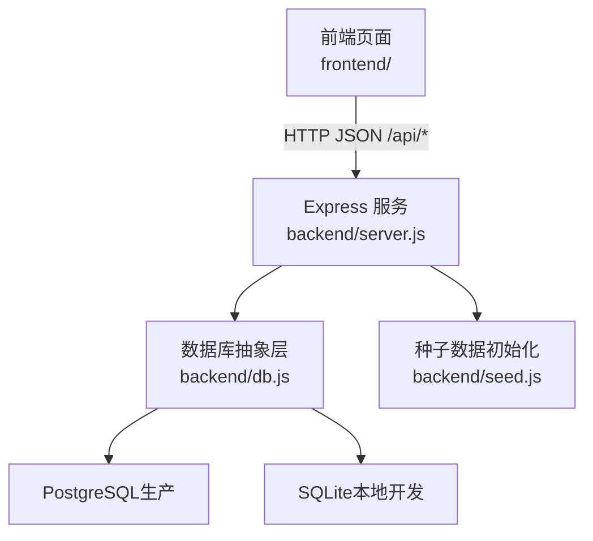
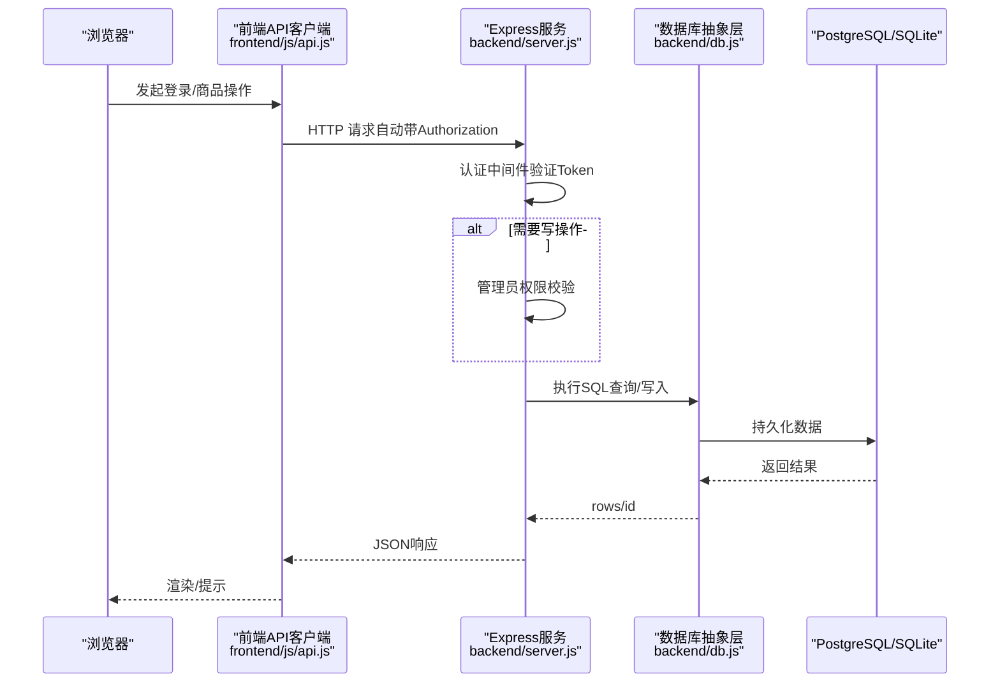
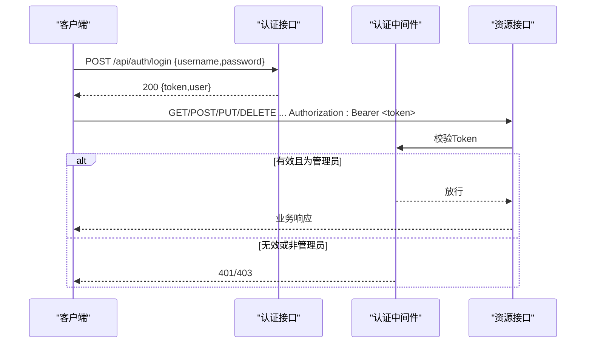
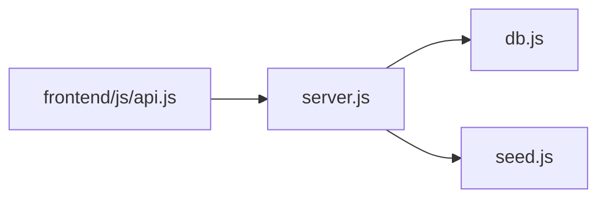

# API接口文档

<cite>
**本文引用的文件**
- [backend/server.js](file://backend/server.js)
- [backend/db.js](file://backend/db.js)
- [backend/seed.js](file://backend/seed.js)
- [frontend/js/api.js](file://frontend/js/api.js)
- [frontend/js/auth.js](file://frontend/js/auth.js)
- [frontend/js/admin.js](file://frontend/js/admin.js)
- [backend/test-api.ps1](file://backend/test-api.ps1)
- [backend/test-crud.js](file://backend/test-crud.js)
- [README.md](file://README.md)
</cite>

## 目录
1. [简介](#简介)
2. [项目结构](#项目结构)
3. [核心组件](#核心组件)
4. [架构总览](#架构总览)
5. [详细接口说明](#详细接口说明)
6. [依赖关系分析](#依赖关系分析)
7. [性能与限制](#性能与限制)
8. [故障排查指南](#故障排查指南)
9. [结论](#结论)
10. [附录：测试与调试](#附录测试与调试)

## 简介
本文件为 LeapShop 项目的完整 RESTful API 文档，覆盖认证、商品管理（CRUD）与健康检查等端点。文档包含 HTTP 方法、URL 模式、请求参数、响应格式、状态码与错误处理说明，并提供跨域配置、JWT 认证流程、示例调用与调试方法。

## 项目结构
后端基于 Express 提供 REST API，使用 JWT 进行认证与角色鉴权；数据库抽象层支持 PostgreSQL（生产）与 SQLite（本地开发）。前端通过共享 API 客户端自动携带 Token 并统一错误处理。

图表来源
- [backend/server.js:1-169](file://backend/server.js#L1-L169)
- [backend/db.js:1-176](file://backend/db.js#L1-L176)
- [backend/seed.js:1-129](file://backend/seed.js#L1-L129)

章节来源
- [README.md:1-127](file://README.md#L1-L127)

## 核心组件
- 认证中间件：校验 Authorization 头中的 Bearer Token，解析用户身份；管理员权限校验。
- 路由层：定义认证、商品 CRUD、健康检查等端点。
- 数据库抽象层：统一 query/run 接口，自动适配 PostgreSQL 或 SQLite。
- 前端 API 客户端：自动注入 Token、统一错误抛出、会话管理。

章节来源
- [backend/server.js:25-41](file://backend/server.js#L25-L41)
- [backend/server.js:43-140](file://backend/server.js#L43-L140)
- [backend/db.js:44-110](file://backend/db.js#L44-L110)
- [frontend/js/api.js:40-49](file://frontend/js/api.js#L40-L49)

## 架构总览
下图展示从浏览器到后端的典型请求链路，包括认证、鉴权与数据访问。

图表来源
- [backend/server.js:25-41](file://backend/server.js#L25-L41)
- [backend/server.js:43-140](file://backend/server.js#L43-L140)
- [backend/db.js:44-110](file://backend/db.js#L44-L110)
- [frontend/js/api.js:40-49](file://frontend/js/api.js#L40-L49)

## 详细接口说明

### 通用约定
- 基础路径：/api
- 内容类型：application/json
- 认证方式：Bearer Token（Authorization 头）
- 跨域：已启用 CORS，允许跨域请求
- 错误响应体：{ error: "描述信息" }
- 成功响应体：各端点见下表

章节来源
- [backend/server.js:21-23](file://backend/server.js#L21-L23)
- [backend/server.js:25-41](file://backend/server.js#L25-L41)
- [backend/server.js:137-140](file://backend/server.js#L137-L140)

### 认证相关

#### POST /api/auth/login
- 功能：用户登录，返回 JWT 令牌与用户基本信息
- 权限：公开
- 请求体字段
  - username: string（必填）
  - password: string（必填）
- 成功响应（200）
  - token: string（JWT）
  - user: { id, username, role }
- 失败响应
  - 400：缺少用户名或密码
  - 401：用户名或密码错误
- 示例
  - 请求：POST /api/auth/login，Body: { username: "P001", password: "123456" }
  - 响应：{ token: "...", user: { id: 1, username: "P001", role: "admin" } }

章节来源
- [backend/server.js:43-60](file://backend/server.js#L43-L60)
- [backend/seed.js:9-12](file://backend/seed.js#L9-L12)
- [frontend/js/auth.js:9-25](file://frontend/js/auth.js#L9-L25)

#### GET /api/auth/me
- 功能：校验当前 Token 并返回用户信息
- 权限：需登录
- 请求头：Authorization: Bearer <token>
- 成功响应（200）
  - user: { id, username, role }
- 失败响应
  - 401：未登录或会话过期
- 示例
  - 请求：GET /api/auth/me，Header: Authorization: Bearer <token>
  - 响应：{ user: { id: 1, username: "P001", role: "admin" } }

章节来源
- [backend/server.js:62-64](file://backend/server.js#L62-L64)
- [backend/server.js:25-36](file://backend/server.js#L25-L36)

### 商品管理（CRUD）

#### GET /api/products
- 功能：获取商品列表（公开），支持按分类过滤
- 权限：公开
- 查询参数
  - category: string（可选）
- 成功响应（200）
  - products: array of product objects
- 示例
  - 请求：GET /api/products?category=chess-timer
  - 响应：{ products: [...] }

章节来源
- [backend/server.js:67-77](file://backend/server.js#L67-L77)

#### GET /api/products/:id
- 功能：获取单个商品详情（公开）
- 权限：公开
- 路径参数
  - id: number/string（必填）
- 成功响应（200）
  - product: object
- 失败响应
  - 404：商品不存在
- 示例
  - 请求：GET /api/products/1
  - 响应：{ product: { id: 1, name: "...", ... } }

章节来源
- [backend/server.js:79-84](file://backend/server.js#L79-L84)

#### POST /api/products
- 功能：新增商品（仅管理员）
- 权限：管理员
- 请求头：Authorization: Bearer <token>（需管理员角色）
- 请求体字段
  - name: string（必填，去除首尾空白）
  - category: string（可选，默认 "chess-timer"）
  - price: number（可选，默认 0）
  - description: string（可选，默认 ""）
  - image: string（可选，base64 data URL，默认 ""）
  - stock: number（可选，默认 0）
- 成功响应（201）
  - product: object（包含新记录主键 id）
- 失败响应
  - 400：缺少商品名称
  - 401：未登录
  - 403：非管理员
- 示例
  - 请求：POST /api/products，Body: { name: "测试棋钟 QA-1", category: "chess-timer", price: 99.5, stock: 8, description: "自动化测试商品" }
  - 响应：{ product: { id: 12, name: "测试棋钟 QA-1", ... } }

章节来源
- [backend/server.js:86-105](file://backend/server.js#L86-L105)
- [backend/server.js:25-41](file://backend/server.js#L25-L41)

#### PUT /api/products/:id
- 功能：更新商品（仅管理员）
- 权限：管理员
- 请求头：Authorization: Bearer <token>（需管理员角色）
- 路径参数
  - id: number/string（必填）
- 请求体字段（均为可选，未提供的字段保持原值）
  - name, category, price, description, image, stock
- 成功响应（200）
  - product: object（更新后的记录）
- 失败响应
  - 404：商品不存在
  - 401：未登录
  - 403：非管理员
- 示例
  - 请求：PUT /api/products/12，Body: { price: 88.0, stock: 10 }
  - 响应：{ product: { id: 12, price: 88.0, stock: 10, ... } }

章节来源
- [backend/server.js:107-127](file://backend/server.js#L107-L127)
- [backend/server.js:25-41](file://backend/server.js#L25-L41)

#### DELETE /api/products/:id
- 功能：删除商品（仅管理员）
- 权限：管理员
- 请求头：Authorization: Bearer <token>（需管理员角色）
- 路径参数
  - id: number/string（必填）
- 成功响应（200）
  - ok: true
- 失败响应
  - 404：商品不存在
  - 401：未登录
  - 403：非管理员
- 示例
  - 请求：DELETE /api/products/12
  - 响应：{ ok: true }

章节来源
- [backend/server.js:129-135](file://backend/server.js#L129-L135)
- [backend/server.js:25-41](file://backend/server.js#L25-L41)

### 健康检查

#### GET /api/health
- 功能：服务健康检查，返回数据库类型与时间戳
- 权限：公开
- 成功响应（200）
  - status: "ok"
  - db: "postgresql" | "sqlite"
  - time: ISO 时间字符串
- 示例
  - 请求：GET /api/health
  - 响应：{ status: "ok", db: "sqlite", time: "2024-01-01T00:00:00.000Z" }

章节来源
- [backend/server.js:137-140](file://backend/server.js#L137-L140)

### 认证机制与JWT流程
- 获取令牌：调用 POST /api/auth/login，成功后保存 token 与用户信息至本地存储
- 传递令牌：后续请求在 Authorization 头中携带 Bearer <token>
- 验证过程：服务端中间件解析并验证 Token，失败返回 401
- 管理员权限：写操作需额外校验角色为 admin，否则返回 403

图表来源
- [backend/server.js:25-41](file://backend/server.js#L25-L41)
- [backend/server.js:43-64](file://backend/server.js#L43-L64)
- [frontend/js/api.js:40-49](file://frontend/js/api.js#L40-L49)

章节来源
- [backend/server.js:25-41](file://backend/server.js#L25-L41)
- [frontend/js/api.js:40-49](file://frontend/js/api.js#L40-L49)

### CORS与跨域
- 已启用 CORS，允许跨域请求
- 单服务模式：前后端同源，直接访问 /api
- 分离部署：确保后端域名可被浏览器访问，CORS 全开以支持跨域

章节来源
- [backend/server.js:21-23](file://backend/server.js#L21-L23)
- [README.md:92-97](file://README.md#L92-L97)

## 依赖关系分析
- server.js 依赖 db.js 的 connect/initSchema/usePg 与 seed.js 的 seed
- 前端 api.js 封装 fetch，自动注入 Authorization 头
- 数据库抽象层根据环境变量选择 PostgreSQL 或 SQLite

图表来源
- [backend/server.js:14-15](file://backend/server.js#L14-L15)
- [backend/db.js:1-176](file://backend/db.js#L1-L176)
- [backend/seed.js:1-129](file://backend/seed.js#L1-L129)
- [frontend/js/api.js:1-76](file://frontend/js/api.js#L1-L76)

章节来源
- [backend/server.js:14-15](file://backend/server.js#L14-L15)
- [backend/db.js:12-176](file://backend/db.js#L12-L176)
- [backend/seed.js:87-114](file://backend/seed.js#L87-L114)
- [frontend/js/api.js:40-49](file://frontend/js/api.js#L40-L49)

## 性能与限制
- 图片上传：以 base64 data URL 内嵌存储，上限约 1.5MB（前端校验），适合演示规模；生产建议对象存储
- 请求体大小：服务端限制 4MB，满足 base64 图片场景
- 数据库：生产环境建议使用 PostgreSQL；本地开发回退 SQLite
- 并发与连接池：PostgreSQL 使用连接池；SQLite 为单进程文件库，适合低并发

章节来源
- [backend/server.js:23](file://backend/server.js#L23)
- [backend/db.js:48-67](file://backend/db.js#L48-L67)
- [backend/db.js:70-109](file://backend/db.js#L70-L109)
- [frontend/js/admin.js:110-126](file://frontend/js/admin.js#L110-L126)

## 故障排查指南
- 401 未登录或会话过期：检查 Authorization 头是否携带有效 Token
- 403 非管理员：确认当前用户角色为 admin
- 404 资源不存在：检查商品 ID 是否正确
- 400 参数缺失：检查请求体必填字段
- 健康检查失败：检查数据库连接与环境变量（DATABASE_URL/PGHOST）

章节来源
- [backend/server.js:25-41](file://backend/server.js#L25-L41)
- [backend/server.js:43-64](file://backend/server.js#L43-L64)
- [backend/server.js:67-135](file://backend/server.js#L67-L135)
- [backend/db.js:12-42](file://backend/db.js#L12-L42)

## 结论
LeapShop 提供了完整的认证与商品管理 API，采用 JWT 与角色鉴权，支持跨域与多数据库环境。通过统一的错误响应与健壮的前端客户端，便于集成与扩展。建议在生产环境使用 PostgreSQL 并配置安全的 JWT_SECRET。

## 附录：测试与调试
- 冒烟测试脚本（PowerShell）：运行 backend/test-api.ps1，覆盖健康检查、登录、权限、CRUD 与静态托管
- 中文数据测试脚本（Node）：运行 backend/test-crud.js，验证 Unicode 内容与 base64 图片字段
- 手动调试：使用浏览器开发者工具或 curl/Postman，设置 Authorization: Bearer <token>

章节来源
- [backend/test-api.ps1:1-101](file://backend/test-api.ps1#L1-L101)
- [backend/test-crud.js:1-54](file://backend/test-crud.js#L1-L54)
- [README.md:46-52](file://README.md#L46-L52)