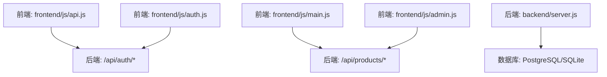
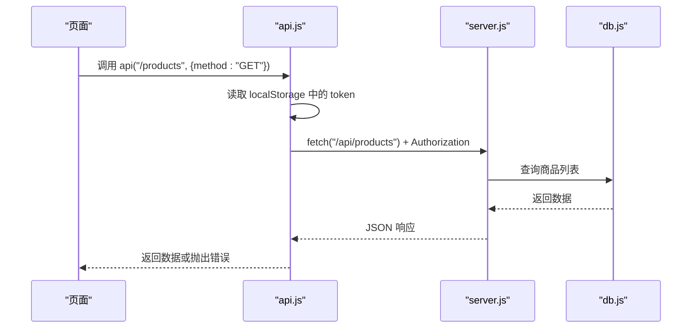
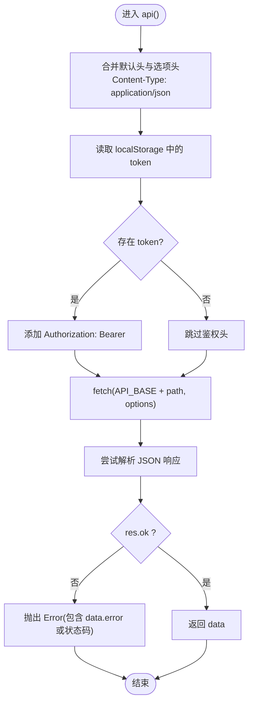
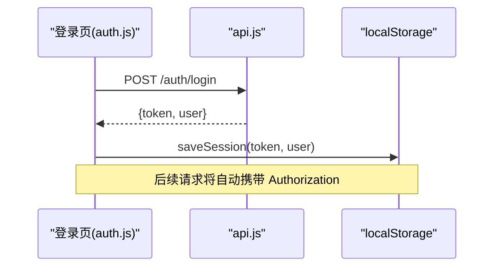
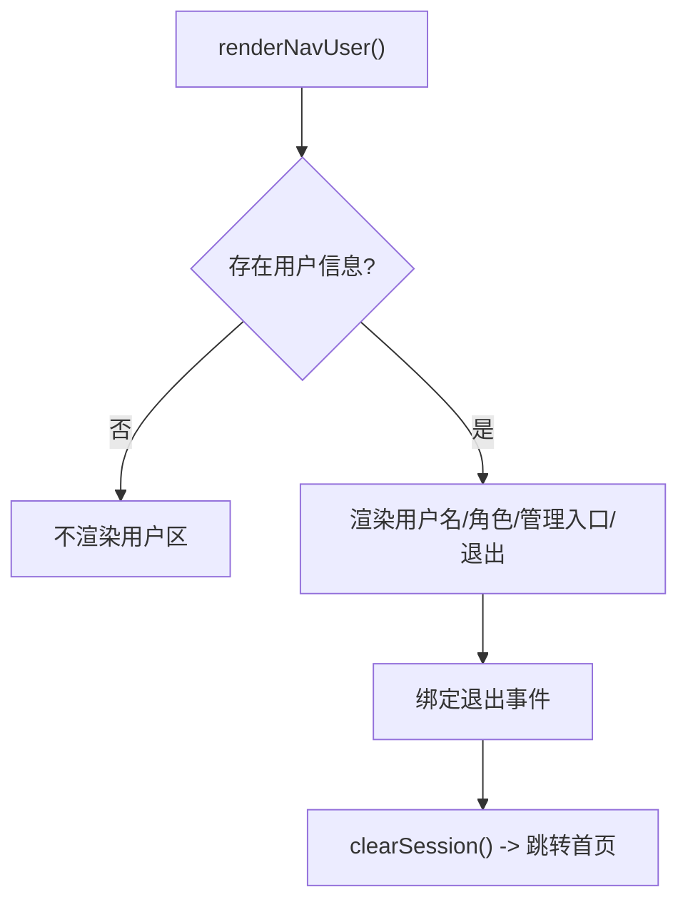
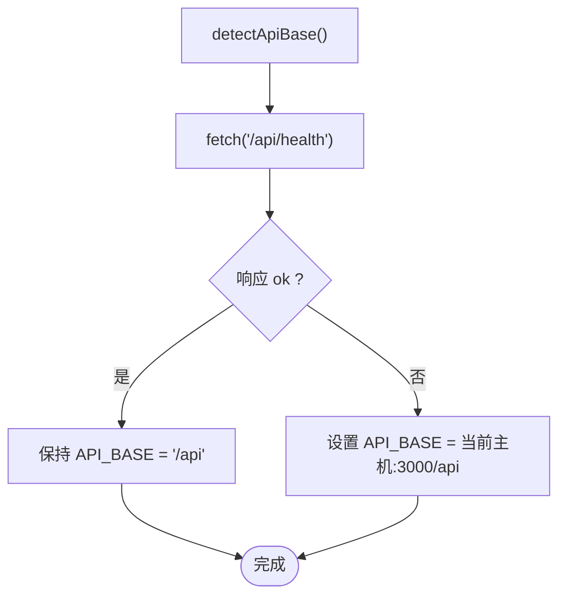
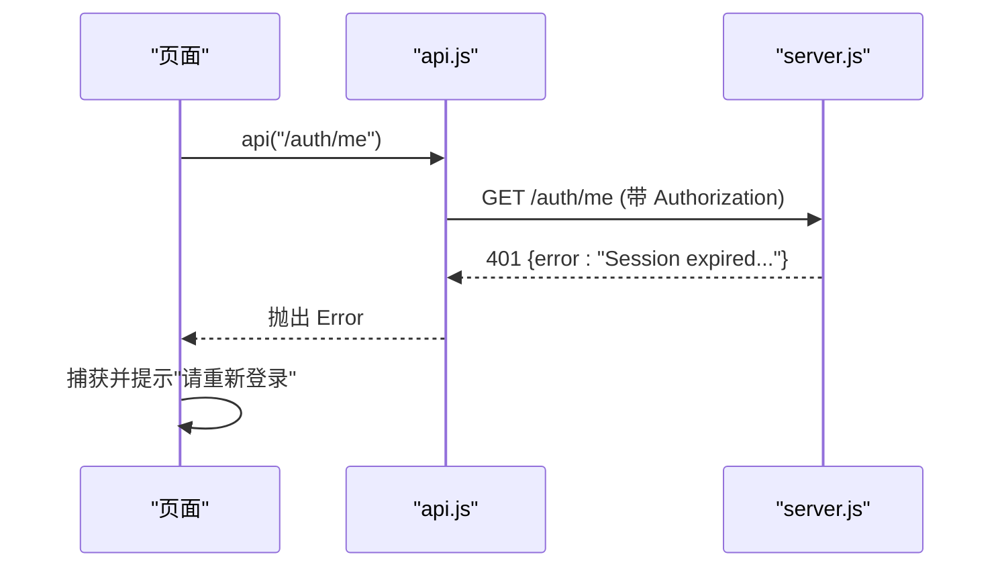
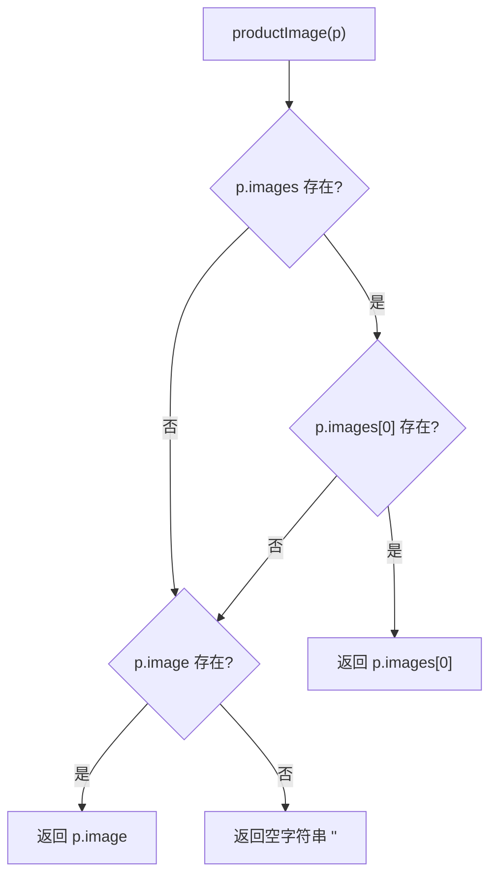
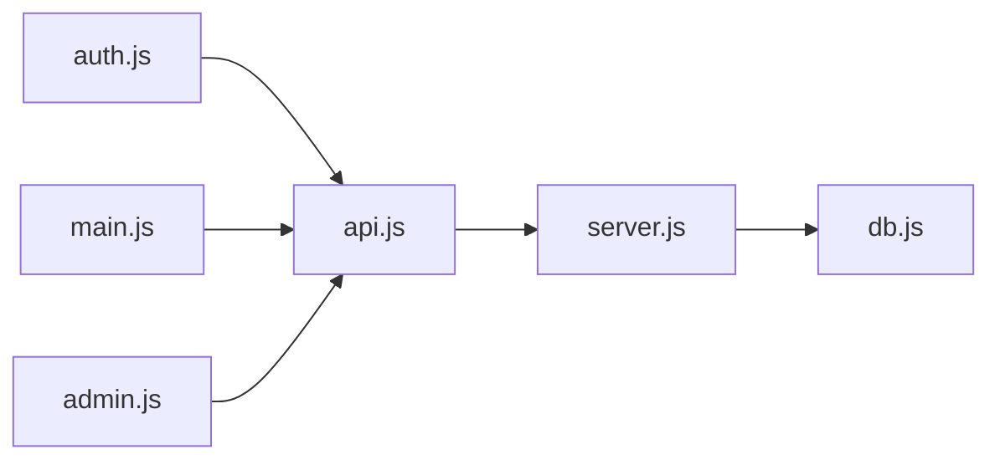

# API客户端封装

<cite>
**本文引用的文件**
- [frontend/js/api.js](file://frontend/js/api.js)
- [frontend/js/auth.js](file://frontend/js/auth.js)
- [frontend/js/main.js](file://frontend/js/main.js)
- [frontend/js/admin.js](file://frontend/js/admin.js)
- [backend/server.js](file://backend/server.js)
- [backend/db.js](file://backend/db.js)
- [README.md](file://README.md)
</cite>

## 更新摘要
**变更内容**
- 新增 productImage 辅助函数，用于处理商品图片的统一解析和向后兼容性
- 更新了前端组件对商品图片的处理逻辑
- 增强了数据结构的兼容性和健壮性

## 目录
1. [简介](#简介)
2. [项目结构](#项目结构)
3. [核心组件](#核心组件)
4. [架构总览](#架构总览)
5. [详细组件分析](#详细组件分析)
6. [依赖关系分析](#依赖关系分析)
7. [性能与可靠性](#性能与可靠性)
8. [故障排查指南](#故障排查指南)
9. [结论](#结论)
10. [附录：API调用示例](#附录api调用示例)

## 简介
本文件为 LeapShop 前端 API 客户端的完整实现文档，聚焦统一请求封装、自动 Token 注入、错误处理、JWT 令牌管理、用户会话管理、跨域与本地开发环境 API 地址探测机制，以及完整的 API 调用示例。该客户端基于浏览器原生 fetch 构建，提供最小化但实用的能力，便于在前后端分离或单服务部署模式下稳定工作。

## 项目结构
前端通过 ES Module 组织逻辑：
- api.js：共享 API 客户端（Token 管理、请求封装、会话渲染、图片辅助）
- auth.js：登录流程（调用 /auth/login，保存会话并跳转）
- main.js：首页逻辑（商品加载、健康检查、导航交互）
- admin.js：后台管理（权限校验、商品 CRUD、图片上传）

后端 Express 服务提供认证、商品 CRUD、健康检查等接口，并支持 CORS 与静态资源托管。



**图表来源**
- [frontend/js/api.js:1-81](file://frontend/js/api.js#L1-L81)
- [frontend/js/auth.js:1-30](file://frontend/js/auth.js#L1-L30)
- [frontend/js/main.js:1-93](file://frontend/js/main.js#L1-L93)
- [frontend/js/admin.js:1-354](file://frontend/js/admin.js#L1-L354)
- [backend/server.js:1-169](file://backend/server.js#L1-L169)
- [backend/db.js:1-176](file://backend/db.js#L1-L176)

**章节来源**
- [README.md:1-127](file://README.md#L1-L127)

## 核心组件
- 统一请求封装函数：提供自动携带 Token、统一错误抛出、JSON 响应解析
- JWT 令牌管理：获取、保存、清除
- 用户会话管理：用户信息存储、状态同步、导航渲染
- 跨域与地址探测：同源直连失败时回退到本地开发端口
- 安全辅助：HTML 转义防止 XSS
- **新增** 图片辅助函数：统一处理商品图片解析，支持多图列表和单图字段兼容

**章节来源**
- [frontend/js/api.js:1-81](file://frontend/js/api.js#L1-L81)

## 架构总览
前端通过 detectApiBase 探测后端可用性；若同源 /api 不可用，则切换至本地开发后端地址。所有业务页面通过统一的 api(path, options) 发起请求，自动附加 Authorization 头，并在非成功状态码时抛出错误。后端对写操作启用鉴权中间件，确保仅管理员可执行修改。



**图表来源**
- [frontend/js/api.js:40-49](file://frontend/js/api.js#L40-L49)
- [backend/server.js:66-77](file://backend/server.js#L66-L77)
- [backend/db.js:44-110](file://backend/db.js#L44-L110)

## 详细组件分析

### 统一请求封装函数
- 功能要点
  - 自动设置 Content-Type 为 application/json
  - 从本地存储读取 Token，并注入 Authorization: Bearer <token>
  - 拼接 API_BASE 与 path，发起 fetch 请求
  - 解析 JSON 响应，非 ok 状态码时抛出包含错误信息的 Error
- 适用场景
  - GET/POST/PUT/DELETE 等任意 HTTP 方法
  - 需要鉴权的受保护接口
  - 需要统一错误处理的业务模块



**图表来源**
- [frontend/js/api.js:40-49](file://frontend/js/api.js#L40-L49)

**章节来源**
- [frontend/js/api.js:40-49](file://frontend/js/api.js#L40-L49)

### JWT 令牌管理
- 获取：getToken() 从 localStorage 读取 lc_token
- 保存：saveSession(token, user) 同时持久化 token 和用户信息
- 清除：clearSession() 移除 token 和用户信息
- 使用位置
  - 登录成功后保存会话并跳转
  - 退出时清除会话并返回首页
  - 管理页守卫中校验登录态与角色



**图表来源**
- [frontend/js/auth.js:9-25](file://frontend/js/auth.js#L9-L25)
- [frontend/js/api.js:18-38](file://frontend/js/api.js#L18-L38)

**章节来源**
- [frontend/js/api.js:18-38](file://frontend/js/api.js#L18-L38)
- [frontend/js/auth.js:9-25](file://frontend/js/auth.js#L9-L25)

### 用户会话管理与状态同步
- 存储键
  - lc_token：JWT 令牌
  - lc_user：用户对象（id、username、role）
- 状态同步
  - renderNavUser() 根据用户角色渲染导航栏，显示用户名、角色、管理入口和退出按钮
  - 退出点击事件触发 clearSession() 并跳转首页
- 管理页守卫
  - 先检测 API 可用性，再校验登录态与角色，未授权显示提示面板



**图表来源**
- [frontend/js/api.js:62-80](file://frontend/js/api.js#L62-L80)
- [frontend/js/admin.js:11-34](file://frontend/js/admin.js#L11-L34)

**章节来源**
- [frontend/js/api.js:62-80](file://frontend/js/api.js#L62-L80)
- [frontend/js/admin.js:11-34](file://frontend/js/admin.js#L11-L34)

### 跨域请求与本地开发 API 地址探测
- 探测逻辑
  - 优先尝试同源 /api/health
  - 若失败或不可达，则切换至本地开发后端地址（当前主机:3000/api）
- 使用场景
  - 前后端分离部署时，前端域名与后端不同源
  - 本地开发时，后端运行在 3000 端口
- 效果
  - 无需手动配置 baseURL，自动适配部署环境



**图表来源**
- [frontend/js/api.js:9-16](file://frontend/js/api.js#L9-L16)

**章节来源**
- [frontend/js/api.js:9-16](file://frontend/js/api.js#L9-L16)

### 错误处理策略
- 统一错误抛出
  - 当 res.ok 为 false 时，抛出包含 data.error 或状态码的 Error
- 业务层捕获
  - 登录页：捕获错误并展示给用户
  - 首页：捕获错误并提示后端服务状态
  - 管理页：捕获错误并更新表单消息
- 服务端错误语义
  - 未登录：401 Not signed in
  - 会话过期：401 Session expired
  - 无管理员权限：403 Super admin access required
  - 参数缺失：400 具体字段提示
  - 资源不存在：404 Product not found



**图表来源**
- [frontend/js/api.js:40-49](file://frontend/js/api.js#L40-L49)
- [backend/server.js:25-41](file://backend/server.js#L25-L41)

**章节来源**
- [frontend/js/api.js:40-49](file://frontend/js/api.js#L40-L49)
- [backend/server.js:25-41](file://backend/server.js#L25-L41)

### 重试机制说明
- 当前实现
  - 统一请求封装不包含内置重试逻辑
- 建议扩展
  - 针对幂等请求（GET/HEAD/OPTIONS）可在上层封装指数退避重试
  - 针对网络抖动或临时 5xx 错误，可结合超时与重试策略提升鲁棒性
  - 注意避免对非幂等请求（POST/PUT/DELETE）重复提交导致副作用

[本节为通用建议，不直接分析具体代码]

### **新增：商品图片辅助函数**
- **功能特性**
  - 智能图片解析：优先使用 images 数组的第一项作为主图
  - 向后兼容：如果 images 数组不存在，回退到传统的 image 字段
  - 空值处理：当没有可用图片时返回空字符串
  - 类型安全：支持多种数据结构格式
- **实现逻辑**
  ```javascript
  export function productImage(p) {
    return (p.images && p.images[0]) || p.image || '';
  }
  ```
- **使用场景**
  - 首页商品卡片展示
  - 管理后台商品列表缩略图
  - 任何需要显示商品主图的场景
- **兼容性优势**
  - 支持新的多图结构：`{ images: ['url1', 'url2'] }`
  - 兼容旧的单图结构：`{ image: 'url' }`
  - 无缝迁移现有产品数据



**图表来源**
- [frontend/js/api.js:57-60](file://frontend/js/api.js#L57-L60)

**章节来源**
- [frontend/js/api.js:57-60](file://frontend/js/api.js#L57-L60)
- [frontend/js/main.js:19-20](file://frontend/js/main.js#L19-L20)
- [frontend/js/admin.js:77-78](file://frontend/js/admin.js#L77-L78)

## 依赖关系分析
- 前端模块依赖
  - auth.js 依赖 api.js 的 detectApiBase、api、saveSession
  - main.js 依赖 api.js 的 detectApiBase、api、renderNavUser、escapeHtml、productImage
  - admin.js 依赖 api.js 的 detectApiBase、api、getToken、renderNavUser、escapeHtml、productImage
- 后端路由与中间件
  - server.js 定义认证、商品 CRUD、健康检查路由
  - 认证中间件校验 Authorization 头并验证 JWT
  - 管理员中间件限制写操作仅管理员可用
- 数据库抽象
  - db.js 提供 connect、query、run，自动选择 PostgreSQL 或 SQLite



**图表来源**
- [frontend/js/auth.js:1-30](file://frontend/js/auth.js#L1-L30)
- [frontend/js/main.js:1-93](file://frontend/js/main.js#L1-L93)
- [frontend/js/admin.js:1-354](file://frontend/js/admin.js#L1-L354)
- [backend/server.js:1-169](file://backend/server.js#L1-L169)
- [backend/db.js:1-176](file://backend/db.js#L1-L176)

**章节来源**
- [frontend/js/auth.js:1-30](file://frontend/js/auth.js#L1-L30)
- [frontend/js/main.js:1-93](file://frontend/js/main.js#L1-L93)
- [frontend/js/admin.js:1-354](file://frontend/js/admin.js#L1-L354)
- [backend/server.js:1-169](file://backend/server.js#L1-L169)
- [backend/db.js:1-176](file://backend/db.js#L1-L176)

## 性能与可靠性
- 请求开销
  - 每次请求均读取 localStorage 中的 token，开销极低
  - JSON 解析与错误判断在单次请求路径内完成
- 并发与缓存
  - 当前未实现请求去重或缓存；如需优化可引入内存缓存或 Service Worker
- 稳定性
  - 地址探测降低部署差异带来的连通性问题
  - 统一错误抛出便于上层集中处理
  - **新增** 图片辅助函数提升数据兼容性，减少前端渲染错误
- 可扩展性
  - 可在 api.js 基础上增加拦截器链（如日志、埋点、重试、超时）

[本节为通用指导，不直接分析具体代码]

## 故障排查指南
- 无法加载商品或健康检查失败
  - 确认后端服务已启动且端口可达
  - 检查 detectApiBase 是否成功切换到本地开发端口
  - 查看控制台错误信息，定位具体状态码与错误消息
- 登录后仍提示未登录
  - 检查 localStorage 中是否存在 lc_token
  - 确认后端 JWT_SECRET 一致，避免签名校验失败
- 管理功能无权限
  - 确认当前用户角色为 admin
  - 检查 Authorization 头是否正确携带
- 图片上传失败
  - 确认图片大小不超过限制
  - 检查后端接收 body 大小限制
- **新增** 商品图片显示异常
  - 检查 productImage 函数是否正确处理 images 数组和 image 字段
  - 确认商品数据包含有效的图片 URL
  - 验证 HTML 转义函数 escapeHtml 的正确使用

**章节来源**
- [frontend/js/main.js:42-51](file://frontend/js/main.js#L42-L51)
- [frontend/js/admin.js:11-34](file://frontend/js/admin.js#L11-L34)
- [backend/server.js:25-41](file://backend/server.js#L25-L41)

## 结论
该 API 客户端以最小实现提供了稳定的统一请求封装、自动 Token 注入、统一错误处理、JWT 与用户会话管理、跨域与地址探测能力。**新增的商品图片辅助函数**进一步增强了数据兼容性，确保新旧数据结构都能正确显示。配合后端的认证与权限中间件，实现了安全的读写控制。建议在现有基础上按需扩展重试、超时、日志与缓存等能力，以满足更复杂的业务需求。

## 附录：API调用示例
以下为常见方法的调用方式与注意事项（基于统一 api 函数）：

- GET 获取商品列表
  - 路径：/api/products
  - 说明：公开接口，可按 category 过滤
  - 示例调用：api("/products?category=chess-timer")
  - 参考：[frontend/js/main.js:9-18](file://frontend/js/main.js#L9-L18)

- GET 获取商品详情
  - 路径：/api/products/:id
  - 说明：公开接口
  - 示例调用：api("/products/1")
  - 参考：[backend/server.js:79-84](file://backend/server.js#L79-L84)

- POST 新增商品（需管理员）
  - 路径：/api/products
  - 说明：需要 Authorization 头且角色为 admin
  - 示例调用：api("/products", { method: "POST", body: JSON.stringify({ name, category, price, description, images, variants }) })
  - 参考：[frontend/js/admin.js:289-318](file://frontend/js/admin.js#L289-L318)
  - 参考：[backend/server.js:86-105](file://backend/server.js#L86-L105)

- PUT 更新商品（需管理员）
  - 路径：/api/products/:id
  - 说明：需要 Authorization 头且角色为 admin
  - 示例调用：api("/products/1", { method: "PUT", body: JSON.stringify({ name, price, stock }) })
  - 参考：[frontend/js/admin.js:305-307](file://frontend/js/admin.js#L305-L307)
  - 参考：[backend/server.js:107-127](file://backend/server.js#L107-L127)

- DELETE 删除商品（需管理员）
  - 路径：/api/products/:id
  - 说明：需要 Authorization 头且角色为 admin
  - 示例调用：api("/products/1", { method: "DELETE" })
  - 参考：[frontend/js/admin.js:335-337](file://frontend/js/admin.js#L335-L337)
  - 参考：[backend/server.js:129-135](file://backend/server.js#L129-L135)

- POST 登录获取 Token
  - 路径：/api/auth/login
  - 说明：公开接口，返回 token 与用户信息
  - 示例调用：api("/auth/login", { method: "POST", body: JSON.stringify({ username, password }) })
  - 参考：[frontend/js/auth.js:9-25](file://frontend/js/auth.js#L9-L25)
  - 参考：[backend/server.js:43-60](file://backend/server.js#L43-L60)

- GET 获取当前用户信息（需登录）
  - 路径：/api/auth/me
  - 说明：需要 Authorization 头
  - 示例调用：api("/auth/me")
  - 参考：[frontend/js/admin.js:20-22](file://frontend/js/admin.js#L20-L22)
  - 参考：[backend/server.js:62-64](file://backend/server.js#L62-L64)

- GET 健康检查
  - 路径：/api/health
  - 说明：公开接口，返回服务状态与数据库类型
  - 示例调用：api("/health")
  - 参考：[frontend/js/main.js:42-51](file://frontend/js/main.js#L42-L51)
  - 参考：[backend/server.js:137-140](file://backend/server.js#L137-L140)

**章节来源**
- [frontend/js/main.js:9-18](file://frontend/js/main.js#L9-L18)
- [frontend/js/auth.js:9-25](file://frontend/js/auth.js#L9-L25)
- [frontend/js/admin.js:289-343](file://frontend/js/admin.js#L289-L343)
- [backend/server.js:43-140](file://backend/server.js#L43-L140)