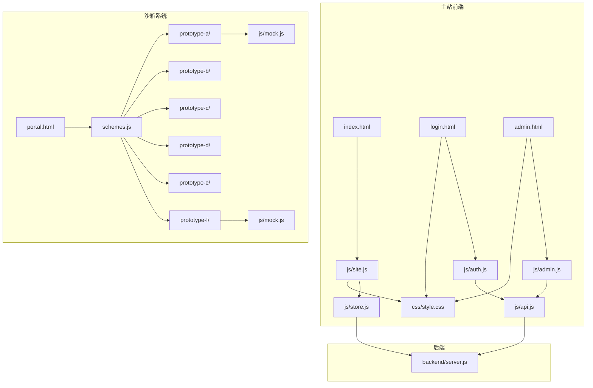
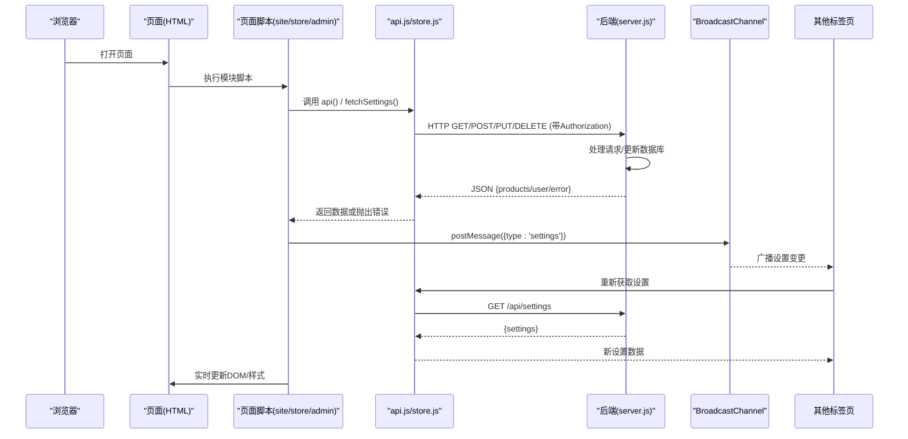
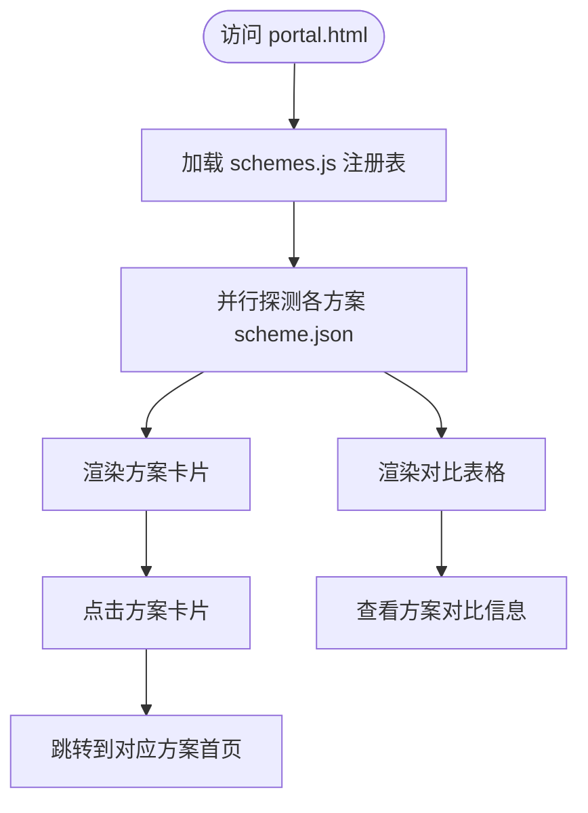
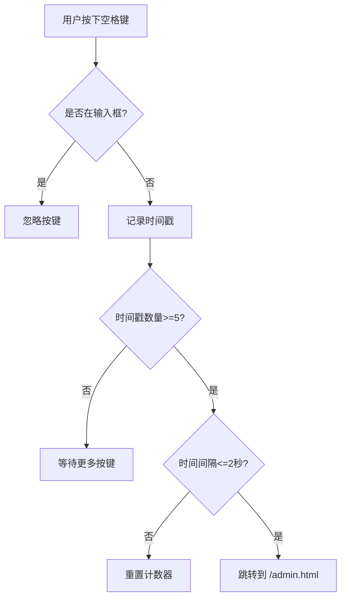
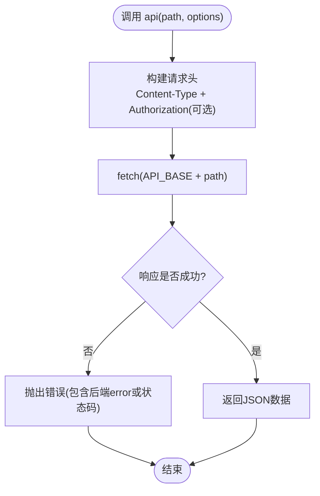
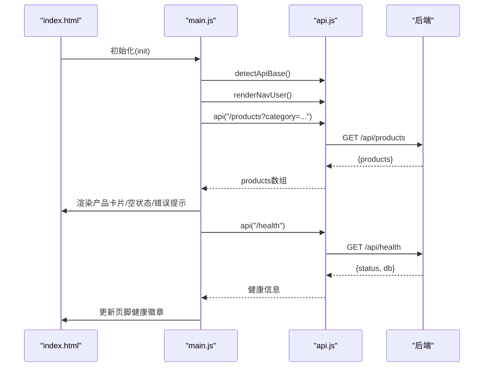
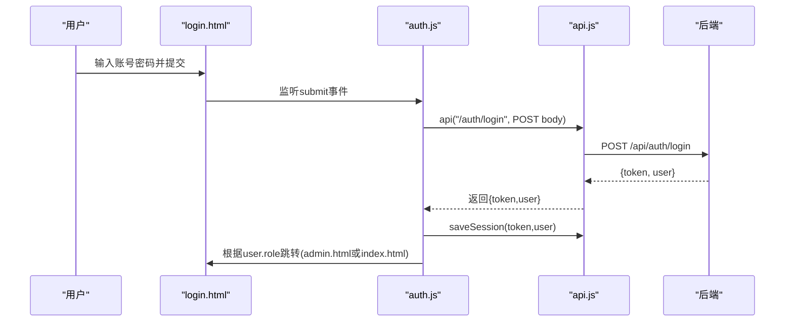
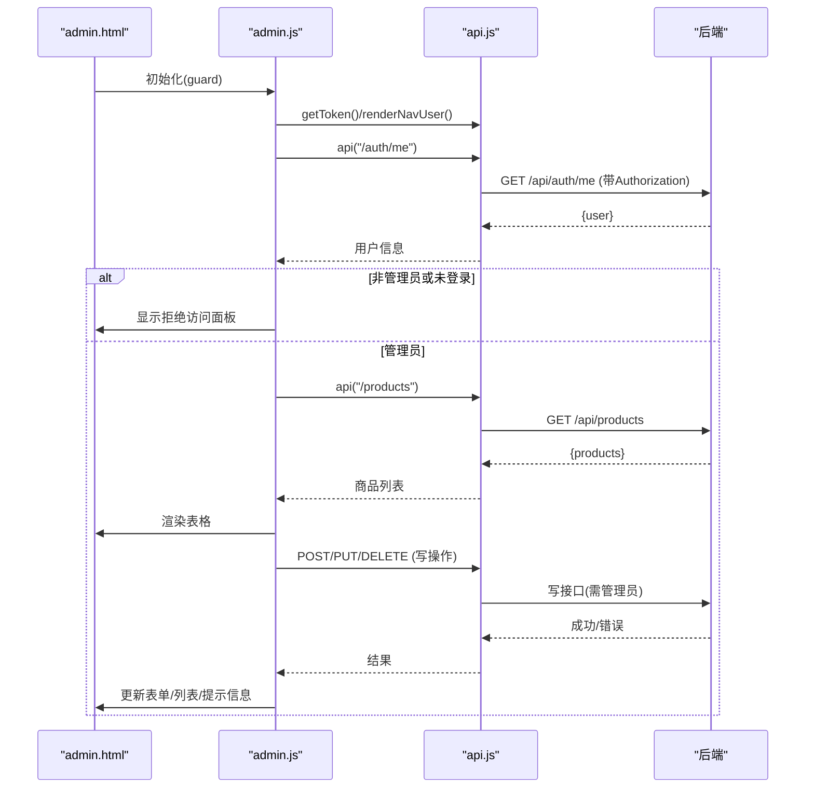
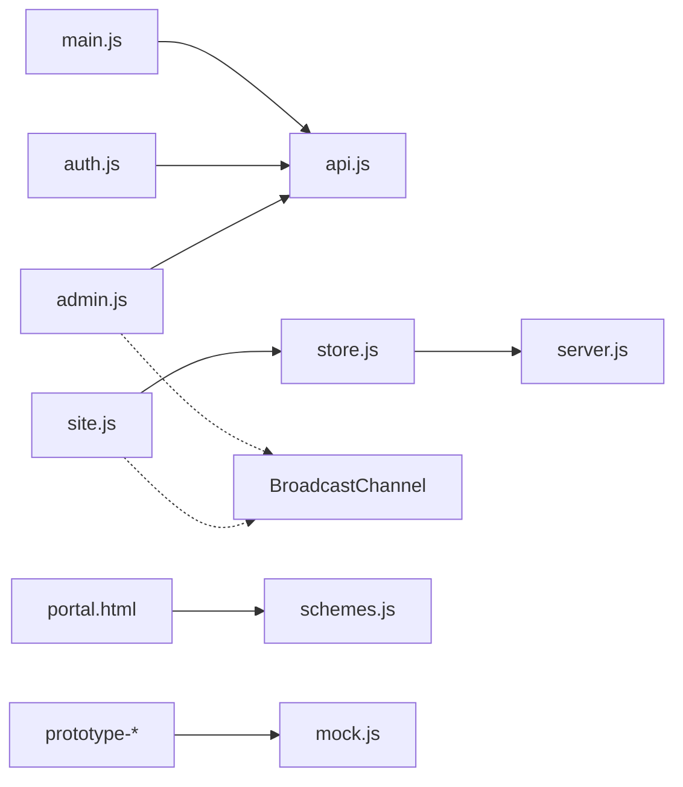

# 前端开发指南

<cite>
**本文引用的文件**
- [frontend/index.html](file://frontend/index.html)
- [frontend/login.html](file://frontend/login.html)
- [frontend/admin.html](file://frontend/admin.html)
- [frontend/js/site.js](file://frontend/js/site.js)
- [frontend/js/store.js](file://frontend/js/store.js)
- [frontend/js/api.js](file://frontend/js/api.js)
- [frontend/js/auth.js](file://frontend/js/auth.js)
- [frontend/js/admin.js](file://frontend/js/admin.js)
- [frontend/css/style.css](file://frontend/css/style.css)
- [backend/server.js](file://backend/server.js)
- [frontend/sandbox/portal.html](file://frontend/sandbox/portal.html)
- [frontend/sandbox/schemes.js](file://frontend/sandbox/schemes.js)
- [frontend/sandbox/prototype-a/index.html](file://frontend/sandbox/prototype-a/index.html)
- [frontend/sandbox/prototype-a/scheme.json](file://frontend/sandbox/prototype-a/scheme.json)
- [frontend/sandbox/prototype-a/js/mock.js](file://frontend/sandbox/prototype-a/js/mock.js)
- [frontend/sandbox/prototype-f/index.html](file://frontend/sandbox/prototype-f/index.html)
- [frontend/sandbox/prototype-f/scheme.json](file://frontend/sandbox/prototype-f/scheme.json)
- [frontend/sandbox/prototype-f/js/mock.js](file://frontend/sandbox/prototype-f/js/mock.js)
- [README.md](file://README.md)
</cite>

## 更新摘要
**变更内容**
- 新增 BroadcastChannel 跨标签页实时同步机制，支持设置变更的即时传播
- 实现隐藏管理员访问机制，通过空格键序列（2秒内5次）快速进入后台
- 增强购物车导出功能，导出后自动清空购物车并关闭抽屉
- 添加全局设置管理界面，支持实时预览和广播通知
- 完善前后端设置同步架构，提升用户体验

## 目录
1. [简介](#简介)
2. [项目结构](#项目结构)
3. [核心组件](#核心组件)
4. [架构总览](#架构总览)
5. [沙箱系统设计验证框架](#沙箱系统设计验证框架)
6. [详细组件分析](#详细组件分析)
7. [依赖关系分析](#依赖关系分析)
8. [性能与体验优化](#性能与体验优化)
9. [故障排查指南](#故障排查指南)
10. [结论](#结论)
11. [附录：集成与部署要点](#附录集成与部署要点)

## 简介
本指南面向LeapShop前端开发者，系统化说明基于原生HTML/CSS/JS（ES Modules）的模块化架构、API客户端封装、页面实现逻辑、响应式设计与主题样式、以及用户体验与性能优化策略。文档同时覆盖首页商品动态加载与分类过滤、登录认证流程、管理后台权限控制与CRUD操作，并提供可追溯的代码片段路径与流程图示，帮助快速上手与二次开发。

**重要更新**：项目现已包含完整的沙箱系统设计验证框架，支持多方案并行开发和独立测试环境，并新增了跨标签页实时同步机制和隐藏管理员访问功能。

## 项目结构
前端位于 frontend 目录，采用"页面 + 模块脚本 + 共享样式"的组织方式，并新增了独立的沙箱设计验证系统：

### 主站结构
- 页面：index.html（官网首页）、login.html（登录页）、admin.html（管理后台）
- 脚本：js/site.js（全站共享层）、js/store.js（数据层）、js/main.js（首页逻辑）、js/auth.js（登录逻辑）、js/admin.js（后台逻辑）、js/api.js（共享API客户端）
- 样式：css/style.css（国际象棋主题样式与响应式布局）

### 沙箱系统结构
- 门户入口：sandbox/portal.html（设计方案统一入口）
- 注册系统：sandbox/schemes.js（方案注册表）
- 设计原型：sandbox/prototype-{a-f}/（6个独立的设计方案）
- 参考资源：sandbox/.design-ref/（设计参考素材）
- 类型数据：sandbox/type-f-data/（品牌设计文档）



**图表来源**
- [frontend/index.html:1-169](file://frontend/index.html#L1-L169)
- [frontend/sandbox/portal.html:1-204](file://frontend/sandbox/portal.html#L1-L204)
- [frontend/sandbox/schemes.js:1-17](file://frontend/sandbox/schemes.js#L1-L17)

**章节来源**
- [README.md:106-127](file://README.md#L106-L127)

## 核心组件
- API客户端（js/api.js）：统一请求封装、JWT令牌存取、自动探测后端地址、导航用户状态渲染与XSS防护工具。
- 全站共享层（js/site.js）：注入导航/购物车/页脚、维护跨页购物车、隐蔽后台入口、全站设置实时同步。
- 数据层（js/store.js）：后端自动探测、统一fetch封装、商品和设置缓存管理。
- 首页逻辑（js/main.js）：商品列表动态加载、分类过滤、健康检查、滚动显现动画、移动端导航交互。
- 登录逻辑（js/auth.js）：表单提交、调用认证接口、保存会话、按角色跳转。
- 管理后台（js/admin.js）：权限守卫、商品CRUD、图片base64上传预览、表格行内编辑与删除、全局设置管理。
- 样式主题（css/style.css）：国际象棋深色主题、按钮/卡片/网格/时间线等UI、响应式断点与滚动动画。
- **沙箱门户（sandbox/portal.html）**：设计方案统一入口，动态加载所有注册的方案并展示对比信息。
- **注册系统（sandbox/schemes.js）**：集中管理所有设计方案的元数据和访问路径。
- **Mock数据系统**：每个原型包含独立的mock.js文件，提供纯静态演示数据，零API调用。

**章节来源**
- [frontend/js/api.js:1-76](file://frontend/js/api.js#L1-L76)
- [frontend/js/site.js:1-252](file://frontend/js/site.js#L1-L252)
- [frontend/js/store.js:1-69](file://frontend/js/store.js#L1-L69)
- [frontend/js/main.js:1-90](file://frontend/js/main.js#L1-L90)
- [frontend/js/auth.js:1-30](file://frontend/js/auth.js#L1-L30)
- [frontend/js/admin.js:1-617](file://frontend/js/admin.js#L1-L617)
- [frontend/css/style.css:1-413](file://frontend/css/style.css#L1-L413)
- [frontend/sandbox/portal.html:125-204](file://frontend/sandbox/portal.html#L125-L204)
- [frontend/sandbox/schemes.js:1-17](file://frontend/sandbox/schemes.js#L1-L17)

## 架构总览
前端通过ES Module引入共享API客户端和数据层，所有页面均依赖这些模块完成鉴权与数据获取。后端提供RESTful接口，使用JWT进行身份校验与角色授权，支持单服务托管静态前端或前后端分离部署。

**新增**：跨标签页实时同步机制通过BroadcastChannel实现，当管理员在前台修改设置时，所有打开的前台页面会立即收到通知并重新加载设置，无需刷新页面。

**新增**：隐藏管理员访问机制通过在任意页面连续敲击空格键5次（2秒内）快速跳转到管理后台，提供便捷的调试和访问方式。



**图表来源**
- [frontend/js/site.js:230-236](file://frontend/js/site.js#L230-L236)
- [frontend/js/admin.js:131-136](file://frontend/js/admin.js#L131-L136)
- [backend/server.js:457-490](file://backend/server.js#L457-L490)

## 沙箱系统设计验证框架

### 系统概述
沙箱系统是LeapShop前端开发的重要创新，提供了一个完整的设计验证框架，支持多方案并行开发和独立测试环境。该系统包含三个核心组件：

1. **Portal门户**：统一的设计方案入口页面
2. **Schemes注册系统**：集中管理所有设计方案的元数据
3. **Prototype原型库**：6个独立的设计方案，每个都有完整的目录结构

### Portal门户系统
Portal门户是沙箱系统的统一入口，提供以下功能：

- **动态方案加载**：自动扫描schemes.js注册表中的所有方案
- **方案状态管理**：支持active（实验中）、candidate（待采纳）、adopted（已采纳）、dropped（已废弃）四种状态
- **对比视图**：提供方案对比表格，便于团队评估和决策
- **边界保护**：严格限制沙箱页面的能力，禁止调用API、读写localStorage等



**图表来源**
- [frontend/sandbox/portal.html:144-200](file://frontend/sandbox/portal.html#L144-L200)

### Schemes注册系统
注册系统是沙箱的核心配置中心，采用简洁的JavaScript数组格式：

```javascript
export const SCHEMES = [
  { id: 'prototype-a' },
  { id: 'prototype-b' },
  { id: 'prototype-c' },
  { id: 'prototype-d' },
  { id: 'prototype-e' },
  { id: 'prototype-f' },
];
```

每个方案必须包含scheme.json元数据文件，定义方案的名称、描述、状态、入口页面等信息。

### 设计原型架构
每个设计原型都是完全独立的静态站点，具有以下特点：

#### Prototype A - 重设计豪华风格
- **设计理念**：分层暖黑底 + 香槟金渐变，衬线字体展示
- **页面结构**：单页应用，包含Hero、Why Leap、Shop、Our Journey等区块
- **Mock数据**：内嵌6个产品，支持分类过滤
- **交互特性**：滚动显现动画、移动端导航、产品筛选

#### Prototype B - 野兽派暗夜风格  
- **设计理念**：OLED暗夜基调 + 新野兽派视觉，鲜明色块对比
- **页面结构**：四页多页架构（index、products、about、journey）
- **特色功能**：粘性导航、当前页高亮、全站共享页脚
- **状态**：候选方案（candidate）

#### Prototype F - 白底金黑编辑画廊
- **设计理念**：白色画布 + 金黑撞色，编辑画廊风格
- **页面结构**：多页面架构，包含8个页面（home、products、chess-clock、chess-board、stopwatch、lifestyle、journey、product）
- **高级特性**：轮播图、瀑布流布局、购物车抽屉、计数动画
- **数据丰富**：16个产品，4个分类，详细的品牌故事

### Mock数据系统
每个原型都包含独立的mock.js文件，提供完整的演示数据：

```javascript
// 示例：Prototype F的产品数据结构
export const PRODUCTS = [
  { 
    id: 1, 
    name: 'Tournament Pro Chess Clock', 
    cat: 'chess-clock', 
    price: 89, 
    desc: 'FIDE-grade time control...',
    info: ['Meets FIDE-certified timing standards...']
  },
  // ... 更多产品
];
```

**关键特性**：
- 零API调用，完全静态
- 本地数据过滤和渲染
- XSS防护的escapeHtml工具函数
- 丰富的产品元数据（分类、价格、描述、图片等）

### 开发规范
沙箱系统遵循严格的开发规范：

1. **独立性原则**：每个方案目录完全独立，互不引用
2. **静态限制**：禁止调用/api接口，禁止引用frontend/js/api.js
3. **数据安全**：禁止读写lc_token/lc_user，购物车使用独立键pf_cart
4. **元数据管理**：所有方案信息集中在scheme.json中维护
5. **注册要求**：新增方案必须在schemes.js中登记

**章节来源**
- [frontend/sandbox/portal.html:1-204](file://frontend/sandbox/portal.html#L1-L204)
- [frontend/sandbox/schemes.js:1-17](file://frontend/sandbox/schemes.js#L1-L17)
- [frontend/sandbox/prototype-a/index.html:1-193](file://frontend/sandbox/prototype-a/index.html#L1-L193)
- [frontend/sandbox/prototype-a/scheme.json:1-11](file://frontend/sandbox/prototype-a/scheme.json#L1-L11)
- [frontend/sandbox/prototype-a/js/mock.js:1-134](file://frontend/sandbox/prototype-a/js/mock.js#L1-L134)
- [frontend/sandbox/prototype-f/index.html:1-97](file://frontend/sandbox/prototype-f/index.html#L1-L97)
- [frontend/sandbox/prototype-f/scheme.json:1-11](file://frontend/sandbox/prototype-f/scheme.json#L1-L11)
- [frontend/sandbox/prototype-f/js/mock.js:1-154](file://frontend/sandbox/prototype-f/js/mock.js#L1-L154)

## 详细组件分析

### 全站共享层（js/site.js）
职责
- 注入统一的导航栏、购物车抽屉和页脚到所有页面
- 维护跨页购物车（localStorage独立键pf_cart），支持数量增减和删除
- 实现隐蔽后台入口：2秒内连敲5次空格键跳转到/admin.html
- 全站设置实时同步：通过BroadcastChannel监听设置变更并即时更新
- 安全公告渲染：先全量转义，仅放行白名单标签（<strong>/<b>/<em>/<br>），杜绝XSS

关键特性
- **隐蔽管理员访问**：在任何页面按下空格键5次（2秒内）即可快速进入管理后台
- **跨标签页同步**：使用BroadcastChannel('leap_settings')实现设置变更的即时传播
- **购物车增强**：导出购物清单后自动清空购物车并关闭抽屉



**图表来源**
- [frontend/js/site.js:167-179](file://frontend/js/site.js#L167-L179)

**章节来源**
- [frontend/js/site.js:1-252](file://frontend/js/site.js#L1-L252)

### 数据层（js/store.js）
职责
- 后端自动探测：优先同源/api，失败回退到本地开发端口
- 统一fetch封装：只读公开接口的简化调用
- 模块级缓存：商品和设置数据的内存缓存，避免重复请求
- XSS防护：escapeHtml工具函数防止跨站脚本攻击

关键流程
- discover：尝试访问/api/health，若不通则设置API_BASE为本地开发地址
- fetchProducts：获取全部商品列表，支持强制刷新参数
- fetchSettings：获取全站设置，支持force参数强制从服务器获取最新数据

**章节来源**
- [frontend/js/store.js:1-69](file://frontend/js/store.js#L1-L69)

### API客户端（js/api.js）
职责
- 自动探测后端地址：优先同源/api，失败回退到本地开发端口。
- 令牌与会话管理：从localStorage读写token与user信息。
- 统一请求封装：自动附加Authorization头，统一错误抛出。
- 安全与辅助：escapeHtml防XSS；renderNavUser在导航区渲染登录态与退出入口。

关键流程
- detectApiBase：尝试访问/api/health，若不通则设置API_BASE为本地开发地址。
- api：构造headers并携带Bearer token，发起fetch，解析JSON，非ok状态抛错。
- saveSession/clearSession：持久化登录态。
- renderNavUser：根据用户角色决定是否显示管理面板入口与退出按钮。



**图表来源**
- [frontend/js/api.js:40-49](file://frontend/js/api.js#L40-L49)

**章节来源**
- [frontend/js/api.js:1-76](file://frontend/js/api.js#L1-L76)

### 首页（index.html + js/main.js）
功能
- 动态加载商品：调用/products接口，支持category参数过滤。
- 分类过滤：点击筛选按钮切换active状态并重新加载对应分类商品。
- 健康检查：调用/health并在页脚显示数据库类型与在线状态。
- 滚动显现动画：IntersectionObserver监听.reveal元素，进入视口时添加.show类。
- 移动端导航：点击汉堡菜单展开/收起导航链接。

交互时序


**图表来源**
- [frontend/js/main.js:9-51](file://frontend/js/main.js#L9-L51)
- [frontend/js/main.js:62-78](file://frontend/js/main.js#L62-L78)
- [frontend/js/api.js:10-49](file://frontend/js/api.js#L10-L49)
- [backend/server.js:66-77](file://backend/server.js#L66-L77)
- [backend/server.js:137-140](file://backend/server.js#L137-L140)

**章节来源**
- [frontend/index.html:83-99](file://frontend/index.html#L83-L99)
- [frontend/js/main.js:1-90](file://frontend/js/main.js#L1-L90)

### 登录页（login.html + js/auth.js）
功能
- 表单提交：收集用户名与密码，调用POST /api/auth/login。
- 会话保存：成功后将token与user写入localStorage。
- 角色路由：管理员跳转到admin.html，普通用户返回首页。

认证流程


**图表来源**
- [frontend/js/auth.js:9-25](file://frontend/js/auth.js#L9-L25)
- [frontend/js/api.js:30-49](file://frontend/js/api.js#L30-L49)
- [backend/server.js:43-64](file://backend/server.js#L43-L64)

**章节来源**
- [frontend/login.html:16-36](file://frontend/login.html#L16-L36)
- [frontend/js/auth.js:1-30](file://frontend/js/auth.js#L1-L30)

### 管理后台（admin.html + js/admin.js）
功能
- 权限守卫：未登录或角色非管理员时显示"拒绝访问"，否则进入工作台。
- 商品列表：调用/products渲染表格，支持刷新。
- 创建/编辑：表单提交调用POST/PUT，支持图片base64上传与预览。
- 删除：确认对话框后调用DELETE，成功后刷新列表。
- **全局设置管理**：网站标题、LOGO、公告、联系方式的实时编辑和预览。
- **隐藏快捷入口**：2秒内连敲5次空格键快速返回前台首页。

权限与CRUD时序


**图表来源**
- [frontend/js/admin.js:11-34](file://frontend/js/admin.js#L11-L34)
- [frontend/js/admin.js:36-66](file://frontend/js/admin.js#L36-L66)
- [frontend/js/admin.js:128-152](file://frontend/js/admin.js#L128-L152)
- [frontend/js/admin.js:157-176](file://frontend/js/admin.js#L157-L176)
- [backend/server.js:25-41](file://backend/server.js#L25-L41)
- [backend/server.js:66-135](file://backend/server.js#L66-L135)

**章节来源**
- [frontend/admin.html:24-92](file://frontend/admin.html#L24-L92)
- [frontend/js/admin.js:1-617](file://frontend/js/admin.js#L1-L617)

### 样式与主题（css/style.css）
- 主题色板：黑檀、象牙、棋盘棕、冠军金等变量定义，贯穿全站。
- 组件样式：按钮、导航、Hero区域、商品卡片、时间线、CTA、页脚、登录卡片、管理后台面板与表格。
- 响应式：媒体查询适配移动端导航折叠、双栏变单栏、表单栅格自适应。
- 动画：滚动显现.reveal/.show过渡效果。

**章节来源**
- [frontend/css/style.css:1-413](file://frontend/css/style.css#L1-L413)

## 依赖关系分析
- 页面脚本对api.js和store.js存在强依赖，形成"多页面共用单一客户端"的松耦合模式。
- 后端server.js提供认证中间件与角色权限中间件，保护写接口。
- 前端通过localStorage维护会话，避免每次请求重复鉴权。
- **BroadcastChannel跨标签页通信**：admin.js和site.js通过'leap_settings'频道实现设置变更的实时同步。
- **沙箱系统完全独立**：不依赖主站的任何脚本或样式，每个原型自给自足。



**图表来源**
- [frontend/js/main.js:4](file://frontend/js/main.js#L4)
- [frontend/js/auth.js:4](file://frontend/js/auth.js#L4)
- [frontend/js/admin.js:4](file://frontend/js/admin.js#L4)
- [frontend/js/site.js:8](file://frontend/js/site.js#L8)
- [backend/server.js:25-41](file://backend/server.js#L25-L41)
- [frontend/sandbox/portal.html:130](file://frontend/sandbox/portal.html#L130)
- [frontend/sandbox/prototype-a/index.html:184](file://frontend/sandbox/prototype-a/index.html#L184)

**章节来源**
- [frontend/js/main.js:1-90](file://frontend/js/main.js#L1-L90)
- [frontend/js/auth.js:1-30](file://frontend/js/auth.js#L1-L30)
- [frontend/js/admin.js:1-617](file://frontend/js/admin.js#L1-L617)
- [frontend/js/site.js:1-252](file://frontend/js/site.js#L1-L252)
- [frontend/js/store.js:1-69](file://frontend/js/store.js#L1-L69)
- [frontend/js/api.js:1-76](file://frontend/js/api.js#L1-L76)
- [backend/server.js:1-574](file://backend/server.js#L1-L574)

## 性能与体验优化
- Intersection Observer API：用于滚动显现动画，减少重排重绘开销，提升首屏与滚动流畅度。
- 图片懒加载：商品图片使用loading="lazy"降低初始带宽占用。
- 资源体积控制：图片以base64内嵌存储，限制1.5MB，避免过大图片影响传输与渲染。
- 请求合并与缓存：当前为按需请求，可按需增加内存缓存或Service Worker缓存策略。
- 错误反馈：统一错误抛出与页面提示，避免白屏与静默失败。
- 响应式体验：移动端导航折叠、表格横向滚动、表单栅格自适应，保证小屏可用性。
- **BroadcastChannel实时同步**：设置变更无需刷新页面，提升用户体验和响应速度。
- **隐藏管理员访问**：通过快捷键序列提供便捷的管理后台访问方式。
- **购物车导出优化**：导出后自动清空购物车，避免重复导出和存储空间浪费。
- **沙箱性能优势**：完全静态加载，无网络请求，极速响应，适合快速设计验证。

**章节来源**
- [frontend/js/main.js:62-67](file://frontend/js/main.js#L62-L67)
- [frontend/js/main.js:19-24](file://frontend/js/main.js#L19-L24)
- [frontend/js/admin.js:110-126](file://frontend/js/admin.js#L110-L126)
- [frontend/js/site.js:167-179](file://frontend/js/site.js#L167-L179)
- [frontend/js/site.js:230-236](file://frontend/js/site.js#L230-L236)
- [frontend/css/style.css:385-413](file://frontend/css/style.css#L385-L413)

## 故障排查指南
常见问题与定位方法
- 无法连接后端：检查detectApiBase回退逻辑与CORS配置；确认后端已启动且端口可达。
- 401未登录：确认localStorage中存在有效token；检查Authorization头是否正确附加。
- 403无权限：确认用户角色为admin；写接口受adminOnly中间件保护。
- 商品为空：检查后端/products接口是否返回数据；确认数据库种子数据是否已注入。
- 图片上传失败：确认文件大小不超过1.5MB；检查后端接收大小限制与base64处理。
- **BroadcastChannel同步失败**：检查浏览器兼容性，不支持的环境会静默降级；确认频道名称一致。
- **隐藏管理员访问无效**：检查是否在输入框中按键；确认按键频率和时间间隔符合要求。
- **购物车导出后未清空**：检查导出按钮事件处理器是否正确执行clear操作。
- **设置变更不同步**：确认admin.js中的notifySettingsChanged函数被正确调用；检查BroadcastChannel实例化。

相关代码位置
- 健康检查与错误提示：[frontend/js/main.js:42-51](file://frontend/js/main.js#L42-L51)
- 统一错误抛出：[frontend/js/api.js:40-49](file://frontend/js/api.js#L40-L49)
- 权限守卫与错误文案：[frontend/js/admin.js:11-34](file://frontend/js/admin.js#L11-L34)
- 隐藏管理员访问：[frontend/js/site.js:167-179](file://frontend/js/site.js#L167-L179)
- BroadcastChannel同步：[frontend/js/site.js:230-236](file://frontend/js/site.js#L230-L236)
- 后端权限中间件：[backend/server.js:25-41](file://backend/server.js#L25-L41)
- 沙箱方案探测：[frontend/sandbox/portal.html:144-154](file://frontend/sandbox/portal.html#L144-L154)

**章节来源**
- [frontend/js/main.js:42-51](file://frontend/js/main.js#L42-L51)
- [frontend/js/api.js:40-49](file://frontend/js/api.js#L40-L49)
- [frontend/js/admin.js:11-34](file://frontend/js/admin.js#L11-L34)
- [frontend/js/site.js:167-179](file://frontend/js/site.js#L167-L179)
- [frontend/js/site.js:230-236](file://frontend/js/site.js#L230-L236)
- [backend/server.js:25-41](file://backend/server.js#L25-L41)

## 结论
本前端采用轻量化的原生技术栈与清晰的模块化设计，通过统一的API客户端和数据层实现了跨页面的鉴权与数据交互；结合响应式主题与动画，提供了良好的用户体验。管理后台具备完善的权限控制与CRUD能力，适合快速迭代与扩展。

**重大改进**：新增的跨标签页实时同步机制通过BroadcastChannel实现了设置变更的即时传播，大大提升了用户体验和管理效率。隐藏管理员访问机制提供了便捷的调试和访问方式。增强的购物车导出功能在导出后自动清空购物车，避免了重复操作。全局设置管理界面支持实时预览，使配置过程更加直观和高效。

建议后续引入更完善的状态管理与缓存策略，进一步提升性能与可维护性。

## 附录：集成与部署要点
- 本地运行：启动后端服务后，前端可通过同源/api访问或自动回退至本地开发端口。
- 单服务模式：后端同时托管前端静态文件，便于一键部署。
- 前后端分离：确保后端域名可被浏览器访问，CORS已全开；前端会自动探测同源/api。
- 环境变量：生产环境建议设置JWT_SECRET；Zeabur平台会自动注入数据库与端口变量。
- **BroadcastChannel兼容性**：现代浏览器均支持，旧版浏览器会静默降级，不影响基本功能。
- **隐藏管理员访问安全**：该功能仅供开发调试使用，生产环境建议禁用或加强访问控制。
- **沙箱部署**：沙箱系统完全静态，可直接部署到任何静态网站托管服务，无需后端支持。
- **设计验证流程**：建议在开发前先在沙箱中进行设计探索和原型验证，确定方案后再集成到主站。

**章节来源**
- [README.md:30-68](file://README.md#L30-L68)
- [backend/server.js:523-535](file://backend/server.js#L523-L535)