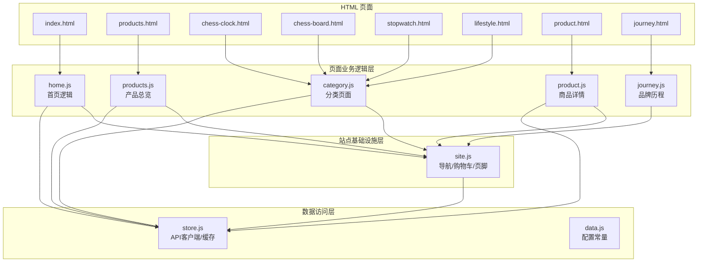
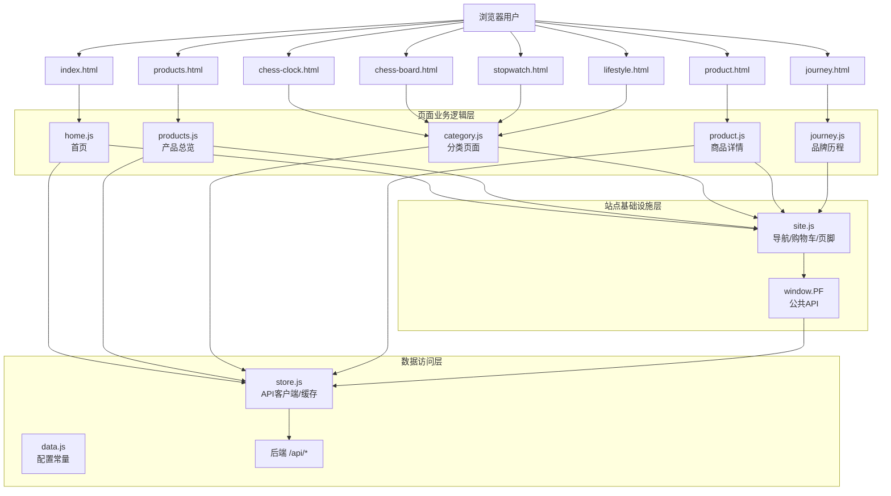
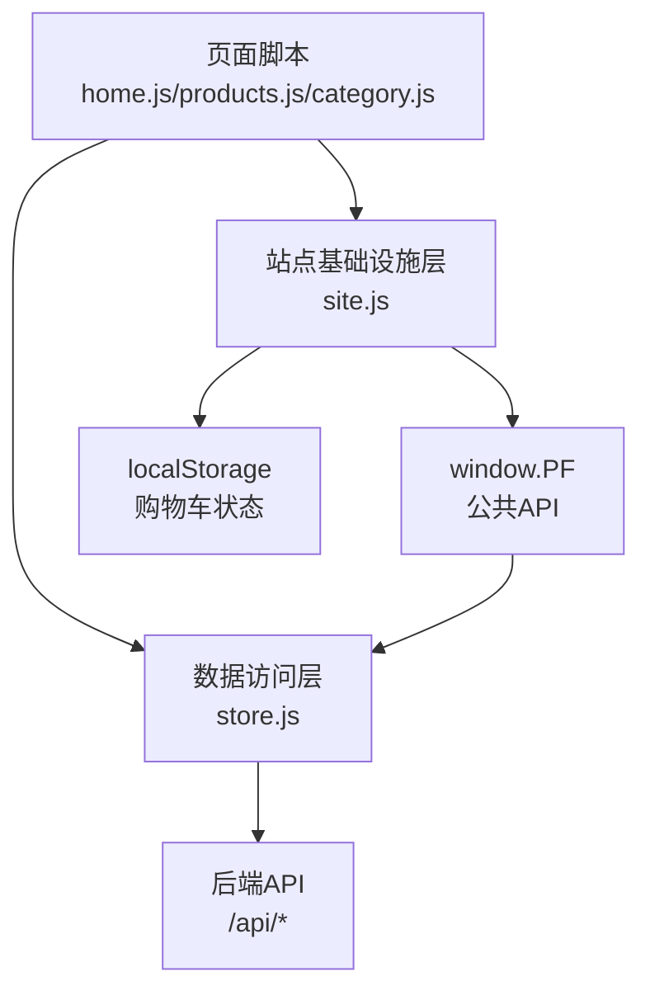
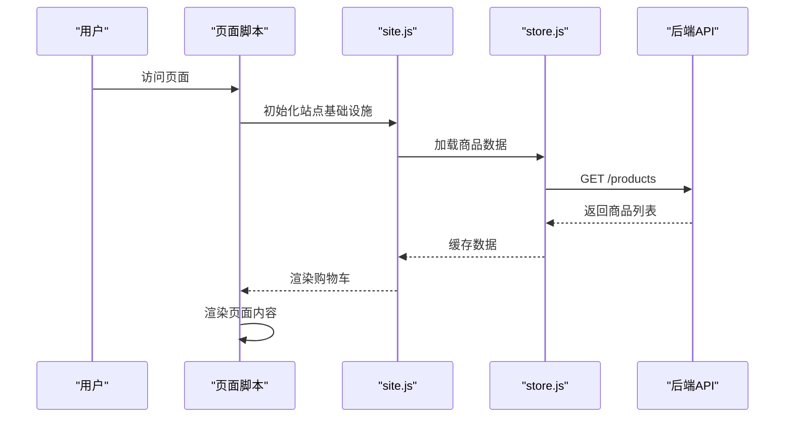
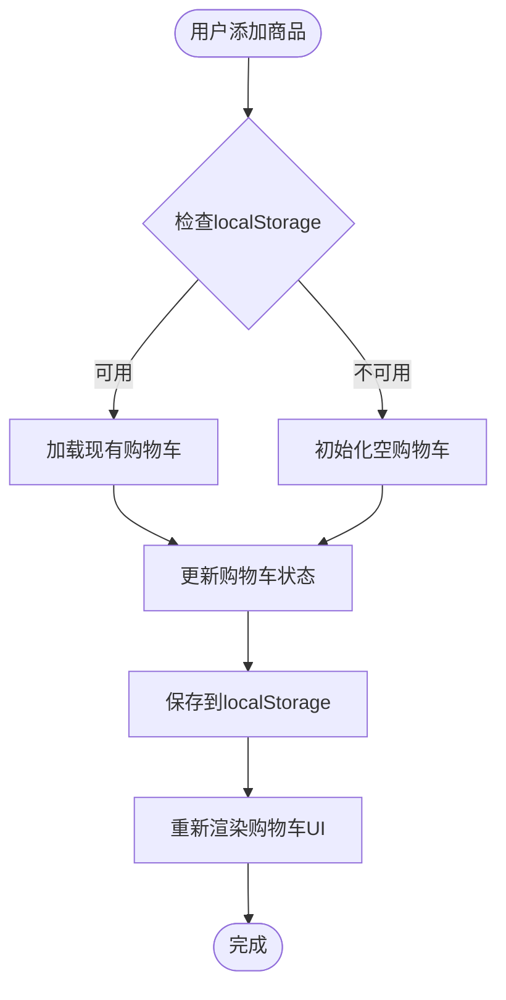
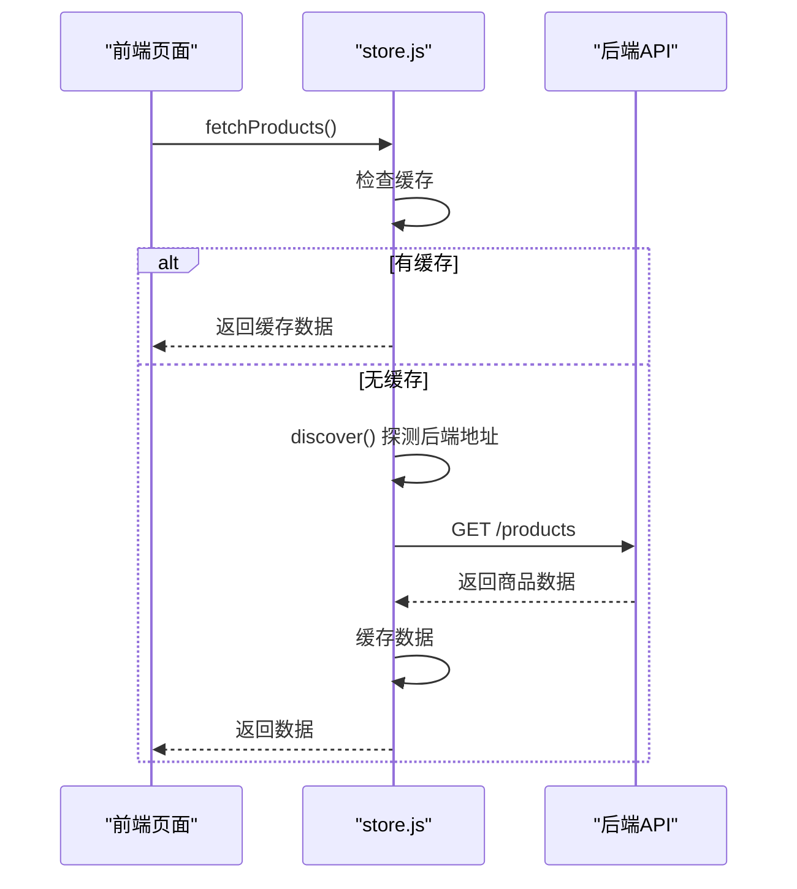
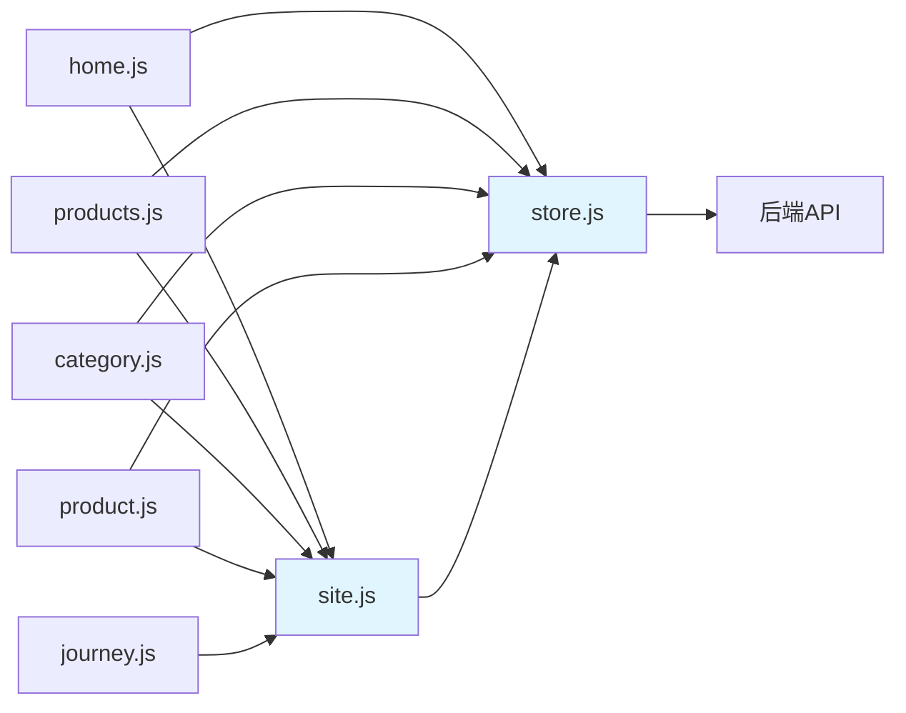

# 前端架构设计

<cite>
**本文引用的文件**
- [frontend/index.html](file://frontend/index.html)
- [frontend/products.html](file://frontend/products.html)
- [frontend/chess-clock.html](file://frontend/chess-clock.html)
- [frontend/lifestyle.html](file://frontend/lifestyle.html)
- [frontend/stopwatch.html](file://frontend/stopwatch.html)
- [frontend/journey.html](file://frontend/journey.html)
- [frontend/product.html](file://frontend/product.html)
- [frontend/js/site.js](file://frontend/js/site.js)
- [frontend/js/store.js](file://frontend/js/store.js)
- [frontend/js/home.js](file://frontend/js/home.js)
- [frontend/js/category.js](file://frontend/js/category.js)
- [frontend/js/products.js](file://frontend/js/products.js)
- [frontend/js/product.js](file://frontend/js/product.js)
- [frontend/js/data.js](file://frontend/js/data.js)
- [frontend/js/admin.js](file://frontend/js/admin.js)
- [frontend/js/api.js](file://frontend/js/api.js)
- [frontend/css/style.css](file://frontend/css/style.css)
</cite>

## 更新摘要
**变更内容**
- 重构前端架构：从单文件 main.js 重构为模块化架构，新增 site.js、store.js、home.js、category.js 等独立模块
- 实现八页面结构：首页、产品总览、四个分类页（棋钟、棋盘、秒表、生活方式）、商品详情页、品牌历程页
- 建立清晰的关注点分离：站点基础设施层、数据访问层、页面业务逻辑层
- 增强购物车功能：跨页购物车、本地存储持久化、导出购物清单
- 优化数据管理：统一 API 客户端、模块级缓存、自动后端地址探测

## 目录
1. [简介](#简介)
2. [项目结构](#项目结构)
3. [核心组件](#核心组件)
4. [架构总览](#架构总览)
5. [详细组件分析](#详细组件分析)
6. [依赖关系分析](#依赖关系分析)
7. [性能与可维护性](#性能与可维护性)
8. [故障排查指南](#故障排查指南)
9. [结论](#结论)
10. [附录：最佳实践清单](#附录最佳实践清单)

## 简介
本设计文档面向 LeapShop 前端，系统性说明基于原生 ES Modules 的模块化架构重构。项目已从单文件 main.js 重构为清晰的三层架构：站点基础设施层（site.js）、数据访问层（store.js）和页面业务逻辑层（home.js、category.js、products.js、product.js）。实现了八页面结构和更清晰的关注点分离，包括统一的导航系统、跨页购物车、自动后端地址探测和模块级数据缓存。

## 项目结构
前端采用"多 HTML 入口 + ES Module 脚本"的组织方式，重构后形成了清晰的三层架构：

### 三层架构设计
- **站点基础设施层（site.js）**：注入全局导航、购物车抽屉、页脚，维护跨页购物车状态
- **数据访问层（store.js）**：统一 API 客户端、后端地址自动探测、模块级数据缓存
- **页面业务逻辑层**：各页面独立的业务逻辑，通过 window.PF 暴露最小 API

### 八页面结构
- **首页（index.html）**：Hero 轮播、精选商品、品牌介绍、旅程摘要
- **产品总览（products.html）**：四系列瀑布流展示
- **分类页面**：chess-clock.html、chess-board.html、stopwatch.html、lifestyle.html
- **商品详情（product.html）**：主图轮播、商品信息、购买操作
- **品牌历程（journey.html）**：品牌故事和统计数据

**图表来源**
- [frontend/js/site.js:1-179](file://frontend/js/site.js#L1-L179)
- [frontend/js/store.js:1-60](file://frontend/js/store.js#L1-L60)
- [frontend/js/home.js:1-81](file://frontend/js/home.js#L1-L81)
- [frontend/js/category.js:1-56](file://frontend/js/category.js#L1-L56)
- [frontend/js/products.js:1-37](file://frontend/js/products.js#L1-L37)
- [frontend/js/product.js:1-100](file://frontend/js/product.js#L1-L100)

**章节来源**
- [frontend/index.html:1-96](file://frontend/index.html#L1-L96)
- [frontend/products.html:1-27](file://frontend/products.html#L1-L27)
- [frontend/chess-clock.html:1-16](file://frontend/chess-clock.html#L1-L16)
- [frontend/lifestyle.html:1-16](file://frontend/lifestyle.html#L1-L16)
- [frontend/stopwatch.html:1-16](file://frontend/stopwatch.html#L1-L16)
- [frontend/journey.html:1-27](file://frontend/journey.html#L1-L27)

## 核心组件
- **站点基础设施层（site.js）**
  - 全局导航：LOGO、页面链接、购物车按钮、汉堡菜单
  - 跨页购物车：localStorage 持久化，支持增减数量、删除商品、导出购物清单
  - 页脚：品牌信息和快速链接
  - 滚动动画：IntersectionObserver 实现的渐显效果
  - 事件委托：统一处理购物车相关交互
- **数据访问层（store.js）**
  - 后端地址自动探测：优先同源 /api/health，失败回退到本地开发端口
  - 统一 fetch 封装：错误处理、JSON 解析
  - 模块级缓存：商品数据缓存，避免重复请求
  - 工具函数：escapeHtml、money、withRatios、PLACEHOLDER
- **首页模块（home.js）**
  - Hero 轮播：服务器 slides 数据，自动播放和手动切换
  - 精选商品：四系列代表商品交错卡片
  - 品牌信息：Why Choose Leap、统计数据、品牌历程摘要
- **分类页面模块（category.js）**
  - 动态渲染：根据 body[data-cat] 属性渲染对应分类
  - 瀑布流布局：CSS columns 实现响应式网格
  - 商品筛选：按分类过滤并应用比例规则
- **产品总览模块（products.js）**
  - 四系列区块：自上而下展示所有分类
  - 瀑布流展示：每个分类下的商品网格
- **商品详情模块（product.js）**
  - 主图轮播：左右滑动切换，支持箭头导航
  - 商品信息：标题、价格、描述、卖点列表
  - 购买操作：数量选择器、加入购物车

**章节来源**
- [frontend/js/site.js:1-179](file://frontend/js/site.js#L1-L179)
- [frontend/js/store.js:1-60](file://frontend/js/store.js#L1-L60)
- [frontend/js/home.js:1-81](file://frontend/js/home.js#L1-L81)
- [frontend/js/category.js:1-56](file://frontend/js/category.js#L1-L56)
- [frontend/js/products.js:1-37](file://frontend/js/products.js#L1-L37)
- [frontend/js/product.js:1-100](file://frontend/js/product.js#L1-L100)

## 架构总览
重构后的前端架构采用清晰的三层设计，通过 ES Modules 实现模块间解耦，所有网络请求统一经由 store.js 发起，实现关注点分离与复用。

**图表来源**
- [frontend/js/site.js:174-175](file://frontend/js/site.js#L174-L175)
- [frontend/js/store.js:43-59](file://frontend/js/store.js#L43-L59)
- [frontend/js/home.js:6-7](file://frontend/js/home.js#L6-L7)
- [frontend/js/category.js:6-7](file://frontend/js/category.js#L6-L7)
- [frontend/js/products.js:6-7](file://frontend/js/products.js#L6-L7)
- [frontend/js/product.js:7-8](file://frontend/js/product.js#L7-L8)

## 详细组件分析

### 模块化架构与导入导出机制
重构后的架构采用清晰的三层设计，每层职责明确：

- **站点基础设施层（site.js）**
  - 提供全局导航、购物车、页脚的注入
  - 维护跨页购物车状态（localStorage 持久化）
  - 暴露 window.PF 公共 API 供页面脚本使用
- **数据访问层（store.js）**
  - 统一管理后端通信，支持自动地址探测
  - 提供模块级缓存，避免重复请求
  - 导出通用工具函数（escapeHtml、money、withRatios）
- **页面业务逻辑层**
  - 各页面脚本只关注自身业务逻辑
  - 通过 import 引入所需功能，避免重复实现
  - 通过 window.PF 调用基础设施层功能

**图表来源**
- [frontend/js/site.js:8-8](file://frontend/js/site.js#L8-L8)
- [frontend/js/site.js:174-175](file://frontend/js/site.js#L174-L175)
- [frontend/js/store.js:43-59](file://frontend/js/store.js#L43-L59)

**章节来源**
- [frontend/js/site.js:1-179](file://frontend/js/site.js#L1-L179)
- [frontend/js/store.js:1-60](file://frontend/js/store.js#L1-L60)
- [frontend/js/home.js:1-81](file://frontend/js/home.js#L1-L81)
- [frontend/js/category.js:1-56](file://frontend/js/category.js#L1-L56)
- [frontend/js/products.js:1-37](file://frontend/js/products.js#L1-L37)
- [frontend/js/product.js:1-100](file://frontend/js/product.js#L1-L100)

### 八页面结构与路由管理
重构后实现了完整的八页面结构，每个页面都有明确的职责：

- **首页（index.html）**：品牌展示、精选商品、旅程摘要
- **产品总览（products.html）**：全量商品瀑布流展示
- **分类页面（4个）**：chess-clock、chess-board、stopwatch、lifestyle
- **商品详情（product.html）**：单个商品的详细信息和购买操作
- **品牌历程（journey.html）**：品牌故事和统计数据

页面间通过传统 <a href> 链接进行导航，无前端路由库，保持简单可靠。

**图表来源**
- [frontend/js/site.js:88-91](file://frontend/js/site.js#L88-L91)
- [frontend/js/store.js:43-47](file://frontend/js/store.js#L43-L47)

**章节来源**
- [frontend/index.html:1-96](file://frontend/index.html#L1-L96)
- [frontend/products.html:1-27](file://frontend/products.html#L1-L27)
- [frontend/chess-clock.html:1-16](file://frontend/chess-clock.html#L1-L16)
- [frontend/lifestyle.html:1-16](file://frontend/lifestyle.html#L1-L16)
- [frontend/stopwatch.html:1-16](file://frontend/stopwatch.html#L1-L16)
- [frontend/journey.html:1-27](file://frontend/journey.html#L1-L27)

### 跨页购物车系统
重构后的购物车系统实现了真正的跨页持久化：

- **数据存储**：使用 localStorage 的 pf_cart 键存储购物车数据
- **数据结构**：Map 对象存储 {productId: quantity} 映射
- **功能特性**：
  - 跨页状态保持：刷新或跳转页面后购物车数据不丢失
  - 数量控制：支持增加、减少、删除商品
  - 实时计算：自动计算总价和商品总数
  - 导出功能：生成购物清单文本文件下载
- **容错处理**：存储不可用时自动降级为内存态

**图表来源**
- [frontend/js/site.js:77-86](file://frontend/js/site.js#L77-L86)
- [frontend/js/site.js:126-129](file://frontend/js/site.js#L126-L129)

**章节来源**
- [frontend/js/site.js:77-143](file://frontend/js/site.js#L77-L143)

### 数据访问层与缓存机制
store.js 提供了统一的数据访问接口和智能缓存：

- **后端地址自动探测**：
  - 优先尝试同源 /api/health
  - 失败时回退到 http(s)://hostname:3000/api
  - 结果缓存，避免重复探测
- **模块级缓存**：
  - 商品数据在模块作用域内缓存
  - 首次请求后直接返回缓存数据
  - 支持强制刷新参数
- **统一错误处理**：
  - 网络异常时返回友好提示
  - JSON 解析失败时抛出明确错误

**图表来源**
- [frontend/js/store.js:8-16](file://frontend/js/store.js#L8-L16)
- [frontend/js/store.js:43-47](file://frontend/js/store.js#L43-L47)

**章节来源**
- [frontend/js/store.js:1-60](file://frontend/js/store.js#L1-L60)

### 页面模块详解

#### 首页模块（home.js）
- **Hero 轮播**：从服务器获取 slides 数据，支持自动播放和手动切换
- **精选商品**：从四个分类中各选一个代表商品展示
- **品牌信息**：Why Choose Leap 板块、统计数据、品牌历程摘要
- **滚动动画**：IntersectionObserver 实现的渐显效果

#### 分类页面模块（category.js）
- **动态渲染**：根据 body[data-cat] 属性识别当前分类
- **瀑布流布局**：使用 CSS columns 实现响应式网格
- **比例规则**：应用 withRatios 函数设置图片宽高比
- **错误处理**：分类不存在或数据加载失败时的友好提示

#### 产品总览模块（products.js）
- **四系列区块**：自上而下展示所有分类的商品
- **瀑布流展示**：每个分类下的商品网格布局
- **商品链接**：点击商品跳转到详情页

#### 商品详情模块（product.js）
- **主图轮播**：支持左右滑动和箭头导航
- **商品信息**：标题、价格、描述、卖点列表
- **购买操作**：数量选择器和加入购物车功能
- **详情图片**：支持多张详情图片展示

**章节来源**
- [frontend/js/home.js:1-81](file://frontend/js/home.js#L1-L81)
- [frontend/js/category.js:1-56](file://frontend/js/category.js#L1-L56)
- [frontend/js/products.js:1-37](file://frontend/js/products.js#L1-L37)
- [frontend/js/product.js:1-100](file://frontend/js/product.js#L1-L100)

## 依赖关系分析
重构后的依赖关系清晰明确，形成单向依赖链：

- **页面脚本** → **站点基础设施层** → **数据访问层** → **后端API**
- **站点基础设施层** → **数据访问层**
- **数据访问层** → **后端API**
- **页面脚本** → **数据访问层**（直接获取数据）

**图表来源**
- [frontend/js/home.js:6-7](file://frontend/js/home.js#L6-L7)
- [frontend/js/category.js:6-7](file://frontend/js/category.js#L6-L7)
- [frontend/js/products.js:6-7](file://frontend/js/products.js#L6-L7)
- [frontend/js/product.js:7-8](file://frontend/js/product.js#L7-L8)
- [frontend/js/site.js:8](file://frontend/js/site.js#L8)

**章节来源**
- [frontend/js/site.js:1-179](file://frontend/js/site.js#L1-L179)
- [frontend/js/store.js:1-60](file://frontend/js/store.js#L1-L60)
- [frontend/js/home.js:1-81](file://frontend/js/home.js#L1-L81)
- [frontend/js/category.js:1-56](file://frontend/js/category.js#L1-L56)
- [frontend/js/products.js:1-37](file://frontend/js/products.js#L1-L37)
- [frontend/js/product.js:1-100](file://frontend/js/product.js#L1-L100)

## 性能与可维护性
重构带来的性能优化和维护性提升：

- **性能优化**
  - 模块级缓存：避免重复的网络请求
  - 懒加载：商品图片使用 loading="lazy"
  - 滚动动画：IntersectionObserver 按需触发，减少重排重绘
  - 资源隔离：各页面脚本独立加载，互不影响
- **可维护性提升**
  - 职责分离：每层职责明确，便于理解和修改
  - 代码复用：公共功能集中在基础设施层和数据访问层
  - 错误处理：统一的错误处理机制，便于调试和维护
  - 扩展性：新增页面只需创建对应的脚本文件
- **最佳实践**
  - 对敏感信息进行脱敏展示（已使用 escapeHtml）
  - 对大图片进行懒加载提升性能
  - 使用 IntersectionObserver 实现滚动动画
  - 统一的 API 封装，避免分散的 fetch 调用

## 故障排查指南
- **无法连接后端**
  - 检查 detectApiBase 是否成功回退到 3000 端口
  - 确认后端服务已启动且 /api/health 可达
- **购物车数据丢失**
  - 检查浏览器 localStorage 是否被禁用
  - 验证 pf_cart 键是否存在且格式正确
- **商品数据加载失败**
  - 查看控制台错误信息
  - 确认后端 /products 接口正常
  - 检查网络连接状态
- **页面渲染异常**
  - 检查对应页面的 data.js 配置是否正确
  - 验证 DOM 元素 ID 是否与脚本匹配
  - 查看 console 中的 JavaScript 错误
- **轮播功能异常**
  - 检查服务器 slides 数据是否存在
  - 验证图片路径是否正确
  - 确认 CSS 样式是否加载

**章节来源**
- [frontend/js/store.js:8-16](file://frontend/js/store.js#L8-L16)
- [frontend/js/site.js:77-86](file://frontend/js/site.js#L77-L86)
- [frontend/js/home.js:12-18](file://frontend/js/home.js#L12-L18)
- [frontend/js/category.js:13-25](file://frontend/js/category.js#L13-L25)

## 结论
LeapShop 前端已成功从单文件 main.js 重构为清晰的三层模块化架构。新的架构通过站点基础设施层、数据访问层和页面业务逻辑层的分离，实现了更好的关注点分离和代码复用。八页面结构的实现提供了完整的电商网站功能，包括商品浏览、分类筛选、详情查看和购物车管理。模块化的设计使得项目更易于维护和扩展，为未来的功能迭代奠定了坚实基础。

## 附录：最佳实践清单
- **模块组织**
  - 将公共能力抽离到 site.js 和 store.js
  - 页面脚本只关注业务逻辑，通过 import 引入所需功能
  - 使用命名导出明确接口契约
- **状态管理**
  - 使用 localStorage 持久化购物车数据
  - 通过 window.PF 暴露最小公共 API
  - 实现模块级缓存避免重复请求
- **网络请求**
  - 统一使用 store.js 的 API 客户端
  - 实现后端地址自动探测和容错机制
  - 对错误进行统一捕获与提示
- **用户体验**
  - 使用 IntersectionObserver 实现滚动动画
  - 图片懒加载与尺寸限制提升性能
  - 提供友好的错误提示和加载状态
- **部署与环境**
  - 生产环境使用同源 /api，开发环境回退到 3000 端口
  - 遵循模块化架构，便于团队协作开发
  - 保持页面间的独立性，便于测试和维护