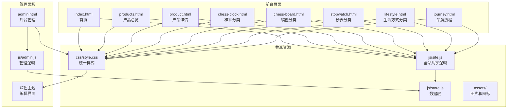
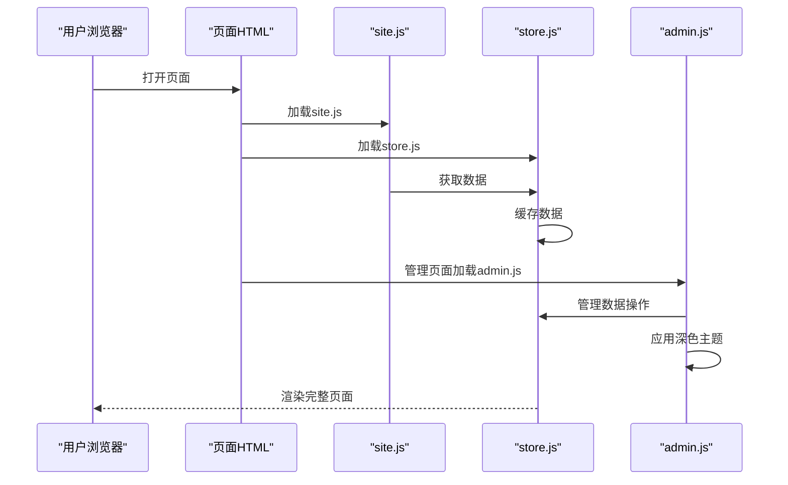
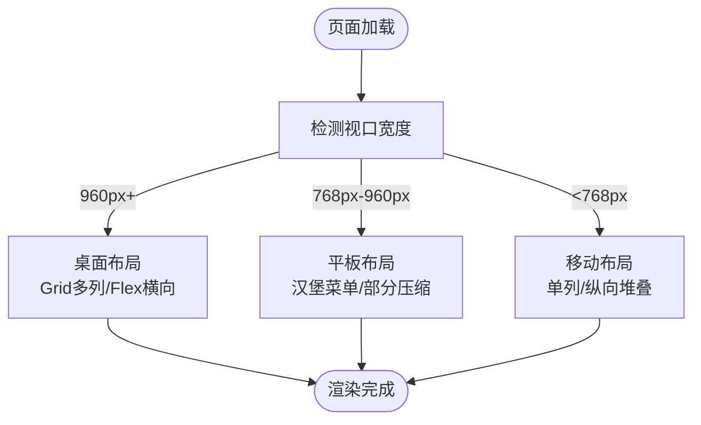
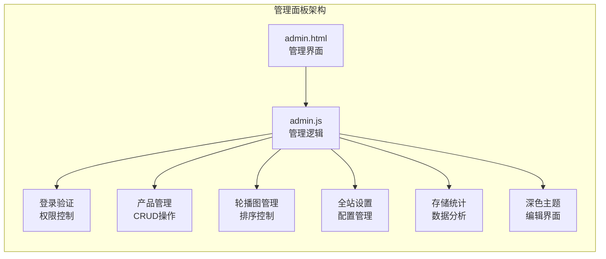
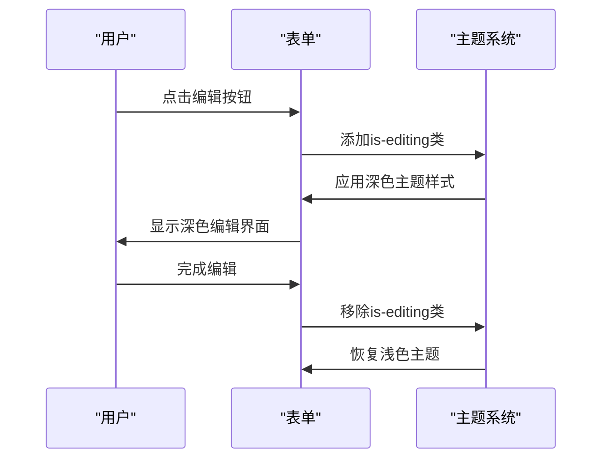
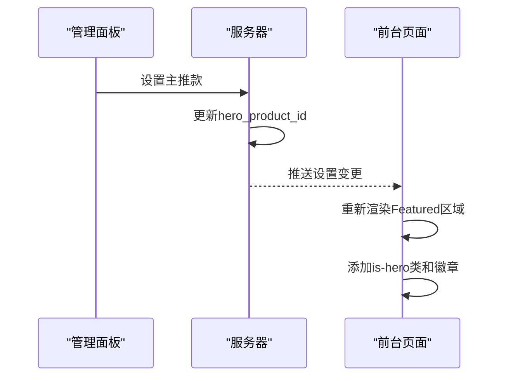
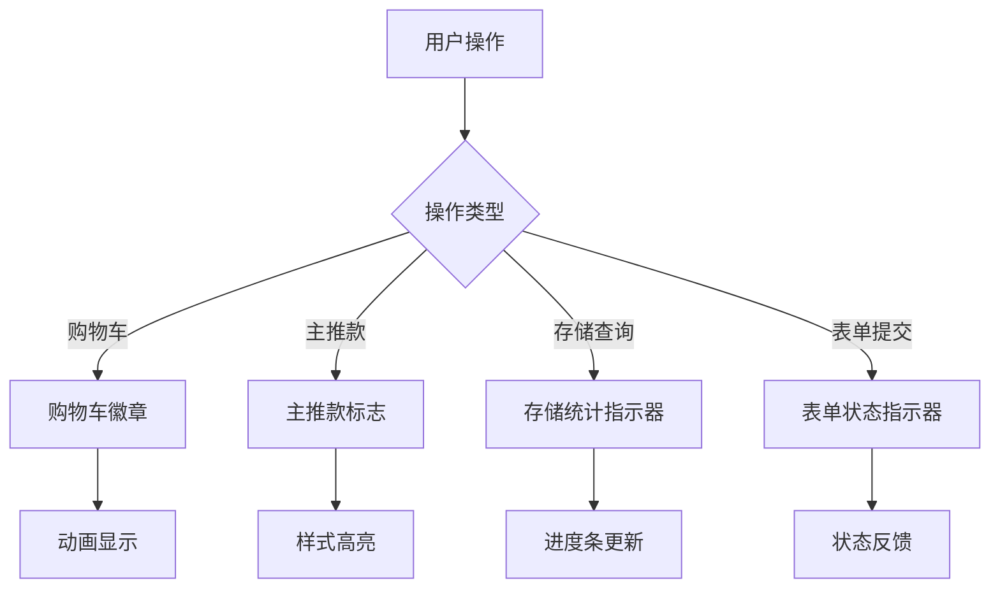
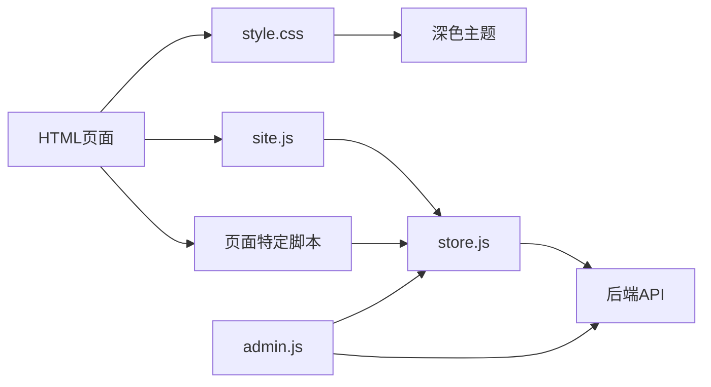

# 用户界面设计

<cite>
**本文引用的文件**
- [frontend/css/style.css](file://frontend/css/style.css)
- [frontend/admin.html](file://frontend/admin.html)
- [frontend/js/admin.js](file://frontend/js/admin.js)
- [frontend/index.html](file://frontend/index.html)
- [frontend/js/site.js](file://frontend/js/site.js)
- [frontend/js/store.js](file://frontend/js/store.js)
</cite>

## 更新摘要
**所做更改**
- **新增深色主题支持**：为产品编辑界面添加了全面的深色主题，提供更好的编辑体验
- **改进响应式布局**：优化了管理面板的响应式设计，确保在不同屏幕尺寸下的良好显示效果
- **增强视觉层次**：通过垂直堆叠排列的表单和表格，提升了管理界面的信息架构
- **完善移动端适配**：改进了小屏幕设备上的布局和交互体验

## 目录
1. [简介](#简介)
2. [项目结构](#项目结构)
3. [核心组件](#核心组件)
4. [架构总览](#架构总览)
5. [详细组件分析](#详细组件分析)
6. [管理面板系统](#管理面板系统)
7. [英雄产品徽章系统](#英雄产品徽章系统)
8. [视觉指示器样式](#视觉指示器样式)
9. [依赖关系分析](#依赖关系分析)
10. [性能与可访问性](#性能与可访问性)
11. [故障排查指南](#故障排查指南)
12. [结论](#结论)
13. [附录：样式定制与主题扩展](#附录样式定制与主题扩展)

## 简介
本设计文档面向 LeapShop 前端用户界面的全新重构版本，重点介绍'Prototype F'美学风格的实现。该风格采用白底(#FFFFFF) × 金(#D4AF37) × 黑(#12100E)的三色对比方案，营造高端但亲和的品牌形象。**最新更新**为产品编辑界面添加了全面的深色主题支持，改进了响应式布局模式，并通过垂直堆叠排列增强了视觉层次，为用户提供更优秀的管理体验。

## 项目结构
LeapShop采用多页面架构，每个页面都有独立的HTML文件，通过site.js注入统一的导航、购物车和页脚。所有页面共享同一套CSS样式文件和JavaScript模块，确保设计一致性。**新增管理面板**提供完整的后台管理功能，包含产品CRUD操作、轮播图管理和全站设置配置，并支持深色编辑主题。

**图表来源**
- [frontend/index.html:1-96](file://frontend/index.html#L1-L96)
- [frontend/admin.html:1-257](file://frontend/admin.html#L1-L257)
- [frontend/css/style.css:1-812](file://frontend/css/style.css#L1-L812)
- [frontend/js/admin.js:1-709](file://frontend/js/admin.js#L1-L709)
- [frontend/js/store.js:1-69](file://frontend/js/store.js#L1-L69)

章节来源
- [frontend/index.html:1-96](file://frontend/index.html#L1-L96)
- [frontend/admin.html:1-257](file://frontend/admin.html#L1-L257)
- [frontend/js/admin.js:1-709](file://frontend/js/admin.js#L1-L709)
- [frontend/js/store.js:1-69](file://frontend/js/store.js#L1-L69)

## 核心组件
- **统一导航栏**：LOGO左侧、七页跳转居中、购物车右侧，支持移动端汉堡菜单
- **Hero区域**：full-bleed轮播，高度min(80vh,700px)，8秒自动切换+手动控制
- **产品展示网格**：交错四卡布局，棋盘格装饰带分隔区块
- **瀑布流布局**：CSS columns实现masonry效果，不同比例图片自然排列
- **产品详情页**：1:1主图滚动吸附+详情图片，右侧产品信息和购买操作
- **购物车抽屉**：跨页面状态管理，支持数量调整、删除和导出购物清单
- **品牌历程**：黑面撞色设计，计数动画展示品牌成就
- **管理面板**：完整的后台管理系统，包含登录验证、产品管理、轮播图管理和全站设置
- **深色编辑主题**：产品编辑界面的深色主题，提供更好的编辑体验
- **英雄产品徽章**：前台产品展示中的"♕ Hero"徽章标识主推商品
- **视觉指示器**：购物车徽章、主推款标志、存储统计指示器等视觉反馈元素

章节来源
- [frontend/css/style.css:114-153](file://frontend/css/style.css#L114-L153)
- [frontend/css/style.css:154-175](file://frontend/css/style.css#L154-L175)
- [frontend/css/style.css:183-215](file://frontend/css/style.css#L183-L215)
- [frontend/css/style.css:317-353](file://frontend/css/style.css#L317-L353)
- [frontend/css/style.css:362-404](file://frontend/css/style.css#L362-L404)
- [frontend/css/style.css:480-541](file://frontend/css/style.css#L480-L541)
- [frontend/css/style.css:575-586](file://frontend/css/style.css#L575-L586)
- [frontend/css/style.css:190-194](file://frontend/css/style.css#L190-L194)
- [frontend/css/style.css:144-150](file://frontend/css/style.css#L144-L150)

## 架构总览
LeapShop采用前后端分离架构，前台页面通过store.js进行数据获取，管理面板提供完整的后台管理功能。site.js负责全站共享功能，包括导航注入、购物车管理和滚动动画。各页面脚本专注于特定页面的业务逻辑。**新增深色主题支持**为编辑界面提供了更好的视觉体验。

**图表来源**
- [frontend/js/site.js:1-252](file://frontend/js/site.js#L1-L252)
- [frontend/js/store.js:1-69](file://frontend/js/store.js#L1-L69)
- [frontend/js/admin.js:1-709](file://frontend/js/admin.js#L1-L709)

章节来源
- [frontend/js/site.js:1-252](file://frontend/js/site.js#L1-L252)
- [frontend/js/store.js:1-69](file://frontend/js/store.js#L1-L69)
- [frontend/js/admin.js:1-709](file://frontend/js/admin.js#L1-L709)

## 详细组件分析

### 响应式设计实现原理
- **布局策略**
  - CSS Grid：用于Featured产品网格、Why选择网格和统计数字网格
  - Flexbox：用于导航、Hero动作区、页脚等线性排列
  - CSS Columns：实现瀑布流(masonry)布局，支持不同高度的卡片自然排列
- **断点设置**
  - 960px：导航变为汉堡菜单，Why网格单列，统计网格双列
  - 768px：产品详情页箭头默认隐藏，悬停时显示
  - 720px：容器宽度调整，网格单列，Hero底部内容垂直堆叠
  - 1080px：管理面板从横向布局切换为纵向堆叠布局
- **移动端适配策略**
  - 导航折叠：点击汉堡按钮切换菜单显示/隐藏
  - 字体与间距：使用clamp()函数控制标题字号，保证可读性
  - 触摸友好：按钮和链接具备足够点击区域
  - **新增**：管理面板在小屏幕下自动切换为纵向布局，提升可用性

**图表来源**
- [frontend/css/style.css:410-448](file://frontend/css/style.css#L410-L448)
- [frontend/js/site.js:167-179](file://frontend/js/site.js#L167-L179)

章节来源
- [frontend/css/style.css:183-230](file://frontend/css/style.css#L183-L230)
- [frontend/css/style.css:410-448](file://frontend/css/style.css#L410-L448)
- [frontend/js/site.js:167-179](file://frontend/js/site.js#L167-L179)

### Prototype F美学风格详解

#### 色彩体系
- **主色调**：白色背景(#FFFFFF)提供纯净画布
- **强调色**：金色(#D4AF37)用于品牌标识和重要元素
- **文字色**：深黑色(#12100E)确保最佳可读性
- **辅助色**：多种灰色层次用于次要信息和边框
- **新增深色主题**：编辑界面使用深棕色背景(#1b1712)和浅色文字(#f5f1e8)，提供更好的编辑体验

#### 排版系统
- **字体选择**：Georgia衬线字体用于标题，无衬线字体用于正文
- **字距调整**：微标签使用宽字距(letter-spacing: .32em)营造精致感
- **层级设计**：通过字号、字重和颜色建立清晰的视觉层次

#### 设计元素
- **棋盘格装饰带**：使用repeating-conic-gradient创建品牌纹样
- **直角矩形按钮**：0圆角设计体现现代感和力量感
- **发丝线分割**：细边框和半透明线条营造精致质感

章节来源
- [frontend/css/style.css:14-30](file://frontend/css/style.css#L14-L30)
- [frontend/css/style.css:47-63](file://frontend/css/style.css#L47-L63)
- [frontend/css/style.css:66-71](file://frontend/css/style.css#L66-L71)
- [frontend/css/style.css:74-90](file://frontend/css/style.css#L74-L90)

### Hero轮播系统
- **Full-bleed设计**：轮播铺满整个视口，创造沉浸式体验
- **自动播放**：8秒间隔自动切换，支持暂停和手动控制
- **指示器导航**：底部圆点指示当前幻灯片位置
- **懒加载优化**：非首张幻灯片使用loading="lazy"提升性能

章节来源
- [frontend/index.html:13-24](file://frontend/index.html#L13-L24)
- [frontend/js/home.js:11-39](file://frontend/js/home.js#L11-L39)
- [frontend/css/style.css:154-175](file://frontend/css/style.css#L154-L175)

### 产品展示系统
- **交错网格布局**：偶数卡片上移56px，创造动态节奏感
- **悬停效果**：图片缩放1.05倍，金色边框偏移出现
- **瀑布流布局**：CSS columns实现masonry效果，适应不同尺寸图片
- **分类筛选**：按产品类别组织展示，支持快速浏览

章节来源
- [frontend/css/style.css:183-215](file://frontend/css/style.css#L183-L215)
- [frontend/css/style.css:217-230](file://frontend/css/style.css#L217-L230)

### 产品详情页组件
- **主图轮播**：1:1比例图片，scroll-snap实现平滑滑动
- **详情图片**：下方展示更多产品细节图片
- **购买操作**：数量选择器和加入购物车按钮
- **产品信息**：详细的规格说明和品牌故事

章节来源
- [frontend/css/style.css:317-353](file://frontend/css/style.css#L317-L353)
- [frontend/js/product.js:20-89](file://frontend/js/product.js#L20-L89)

### 购物车系统
- **跨页面状态**：使用localStorage持久化购物车数据
- **抽屉式界面**：从右侧滑出，不干扰主页面浏览
- **数量管理**：支持增加、减少和删除商品
- **导出功能**：一键生成购物清单文本文件

章节来源
- [frontend/js/site.js:79-142](file://frontend/js/site.js#L79-L142)
- [frontend/css/style.css:362-404](file://frontend/css/style.css#L362-L404)

### 品牌历程展示
- **深色背景**：与主站形成对比，突出品牌历史
- **计数动画**：CSS @property实现数字递增动画
- **统计数据**：展示32年经验、46个国家服务、300+产品、50万+俱乐部

章节来源
- [frontend/index.html:62-76](file://frontend/index.html#L62-L76)
- [frontend/css/style.css:258-284](file://frontend/css/style.css#L258-L284)

## 管理面板系统

### 管理面板架构
管理面板提供完整的后台管理功能，包含登录验证、产品管理、轮播图管理和全站设置配置。采用模块化设计，每个功能区域独立管理。**新增深色编辑主题**为产品编辑界面提供更好的视觉体验。

**图表来源**
- [frontend/admin.html:1-257](file://frontend/admin.html#L1-L257)
- [frontend/js/admin.js:1-709](file://frontend/js/admin.js#L1-L709)

### 登录验证系统
- **内置登录**：管理面板专属登录界面，支持用户名密码验证
- **权限控制**：仅管理员账户可访问管理功能
- **会话管理**：使用token机制维护登录状态
- **错误处理**：友好的错误提示和状态反馈

### 产品管理系统
- **产品CRUD**：完整的创建、读取、更新、删除功能
- **图片管理**：支持主图和详情图上传，最多10张主图
- **分类管理**：支持预设分类和自定义分类
- **权重排序**：支持系列内排序权重设置
- **主推款设置**：可将任意产品设为主推款
- **深色编辑主题**：编辑模式下自动切换深色主题，提升编辑体验

### 轮播图管理系统
- **轮播图管理**：支持添加、删除、排序轮播图
- **预览功能**：实时预览上传的图片
- **Alt文本**：支持为每张图片设置描述文本
- **启用禁用**：可控制轮播图的显示状态

### 全站设置管理
- **站点设置**：网站标题、Logo、公告等全局配置
- **Logo上传**：支持在线上传和预览Logo图片
- **联系方式**：邮箱和社交媒体链接管理
- **实时更新**：设置修改后即时生效

### 深色编辑主题实现
**新增**深色编辑主题为产品编辑界面提供了更好的用户体验：

- **主题切换**：当进入编辑模式时，表单自动应用深色主题类`is-editing`
- **配色方案**：深棕色背景(#1b1712)配浅米色文字(#f5f1e8)，减少长时间编辑的视觉疲劳
- **输入框优化**：深色背景配半透明白色边框，聚焦时显示金色边框
- **按钮适配**：编辑模式下的按钮采用金色边框和浅色文字，保持品牌一致性
- **过渡动画**：主题切换时使用平滑的过渡效果，提升用户体验

**图表来源**
- [frontend/js/admin.js:493-532](file://frontend/js/admin.js#L493-L532)
- [frontend/css/style.css:690-716](file://frontend/css/style.css#L690-L716)

章节来源
- [frontend/admin.html:25-257](file://frontend/admin.html#L25-L257)
- [frontend/js/admin.js:34-97](file://frontend/js/admin.js#L34-L97)
- [frontend/js/admin.js:143-235](file://frontend/js/admin.js#L143-L235)
- [frontend/js/admin.js:237-273](file://frontend/js/admin.js#L237-L273)
- [frontend/js/admin.js:289-414](file://frontend/js/admin.js#L289-L414)
- [frontend/js/admin.js:416-691](file://frontend/js/admin.js#L416-L691)

## 英雄产品徽章系统

### 徽章设计原理
英雄产品徽章是LeapShop的核心视觉元素之一，用于标识当前主推商品。徽章采用"♕ Hero"标识，配合金色主题色，在产品展示中提供明确的视觉引导。

### 前台展示实现
- **徽章显示**：在主推商品卡片左上角显示"♕ Hero"徽章
- **样式高亮**：主推商品卡片具有金色边框和特殊样式
- **智能排序**：主推商品在Featured区域置顶显示
- **响应式设计**：在不同屏幕尺寸下保持良好显示效果

### 管理功能
- **主推款设置**：管理面板中可选择任意产品设为主推款
- **唯一性保证**：系统确保同时只有一个主推商品
- **自动替换**：设置新的主推款会自动替换旧的
- **实时同步**：管理端修改立即反映到前台展示

**图表来源**
- [frontend/js/admin.js:237-273](file://frontend/js/admin.js#L237-L273)
- [frontend/js/home.js:41-68](file://frontend/js/home.js#L41-L68)
- [frontend/css/style.css:185-194](file://frontend/css/style.css#L185-L194)

章节来源
- [frontend/js/home.js:41-68](file://frontend/js/home.js#L41-L68)
- [frontend/js/admin.js:237-273](file://frontend/js/admin.js#L237-L273)
- [frontend/css/style.css:185-194](file://frontend/css/style.css#L185-L194)

## 视觉指示器样式

### 购物车徽章
- **动态显示**：购物车数量变化时显示徽章
- **动画效果**：使用scale变换实现弹跳动画
- **位置定位**：绝对定位在购物车图标右上角
- **样式设计**：金色背景配深色文字，符合品牌主题

### 主推款标志
- **表格指示**：在产品管理表格中显示"♕"标志
- **样式高亮**：使用金色深色调标识当前主推款
- **操作按钮**：提供清除主推款的快捷操作

### 存储统计指示器
- **进度条**：可视化展示存储空间使用情况
- **双维度统计**：应用数据占比和磁盘容量使用率
- **渐变效果**：使用金色渐变增强视觉效果
- **工具提示**：鼠标悬停显示详细存储信息

### 表单状态指示器
- **成功提示**：绿色文字表示操作成功
- **错误提示**：红色文字表示操作失败
- **加载状态**：操作过程中的状态反馈
- **输入焦点**：聚焦时显示金色边框

**图表来源**
- [frontend/css/style.css:144-150](file://frontend/css/style.css#L144-L150)
- [frontend/css/style.css:589-590](file://frontend/css/style.css#L589-L590)
- [frontend/css/style.css:554-573](file://frontend/css/style.css#L554-L573)
- [frontend/css/style.css:550-552](file://frontend/css/style.css#L550-L552)

章节来源
- [frontend/css/style.css:144-150](file://frontend/css/style.css#L144-L150)
- [frontend/css/style.css:589-590](file://frontend/css/style.css#L589-L590)
- [frontend/css/style.css:554-573](file://frontend/css/style.css#L554-L573)
- [frontend/css/style.css:550-552](file://frontend/css/style.css#L550-L552)

## 依赖关系分析
- **页面与样式**：所有页面引入统一的style.css，确保视觉一致性
- **页面与脚本**：每个页面加载对应的JavaScript模块处理特定逻辑
- **脚本依赖**：site.js作为基础层，其他页面脚本依赖其提供的API
- **数据层**：store.js提供统一的数据获取接口，支持前后端分离
- **管理依赖**：admin.js依赖store.js进行数据操作，提供完整的管理功能
- **主题依赖**：深色主题通过CSS类名动态切换，无需额外依赖

**图表来源**
- [frontend/index.html:92-94](file://frontend/index.html#L92-L94)
- [frontend/admin.html:254-255](file://frontend/admin.html#L254-L255)
- [frontend/js/store.js:1-69](file://frontend/js/store.js#L1-L69)
- [frontend/js/admin.js:1-709](file://frontend/js/admin.js#L1-L709)

章节来源
- [frontend/js/site.js:1-252](file://frontend/js/site.js#L1-L252)
- [frontend/js/store.js:1-69](file://frontend/js/store.js#L1-L69)
- [frontend/js/admin.js:1-709](file://frontend/js/admin.js#L1-L709)

## 性能与可访问性
- **性能优化**
  - 图片懒加载：非首张图片使用loading="lazy"属性
  - 数据缓存：store.js实现模块级数据缓存
  - CSS动画优先：使用transform和opacity实现GPU加速动画
  - 内存优化：合理的数据结构和事件监听管理
  - **主题优化**：深色主题通过CSS类切换，避免重复计算
- **可访问性**
  - 语义化HTML：使用适当的ARIA标签和角色定义
  - 键盘导航：所有交互元素支持键盘操作
  - 屏幕阅读器：为图片添加描述性alt文本
  - 焦点管理：模态框和抽屉支持ESC键关闭
  - **对比度优化**：深色主题确保足够的颜色对比度

章节来源
- [frontend/js/home.js:12-13](file://frontend/js/home.js#L12-L13)
- [frontend/js/store.js:41-48](file://frontend/js/store.js#L41-L48)
- [frontend/js/site.js:81-87](file://frontend/js/site.js#L81-L87)
- [frontend/js/site.js:167-179](file://frontend/js/site.js#L167-L179)

## 故障排查指南
- **页面无法加载**
  - 检查HTML文件是否正确引用CSS和JS文件
  - 确认文件路径是否正确，特别是相对路径
  - 查看浏览器控制台是否有语法错误
- **轮播不工作**
  - 检查home.js是否正确加载
  - 确认SLIDES数据是否存在
  - 验证carousel容器的ID是否正确
- **购物车异常**
  - 检查localStorage是否可用
  - 确认pf_cart键值格式正确
  - 验证PRODUCTS数据中的ID匹配
- **管理面板问题**
  - 检查登录状态和权限验证
  - 确认API连接是否正常
  - 验证数据存储和读取逻辑
- **英雄徽章不显示**
  - 检查hero_product_id设置是否正确
  - 确认Featured区域渲染逻辑
  - 验证CSS类名是否正确应用
- **样式显示问题**
  - 检查CSS文件是否正确加载
  - 确认类名拼写无误
  - 验证媒体查询断点设置
- **深色主题问题**
  - 检查is-editing类是否正确添加
  - 确认CSS规则优先级正确
  - 验证主题切换逻辑
- **移动端适配问题**
  - 检查响应式CSS是否正确应用
  - 验证汉堡菜单切换逻辑
  - 确认触摸事件绑定

章节来源
- [frontend/js/site.js:81-87](file://frontend/js/site.js#L81-L87)
- [frontend/js/home.js:11-39](file://frontend/js/home.js#L11-L39)
- [frontend/js/admin.js:34-97](file://frontend/js/admin.js#L34-L97)
- [frontend/css/style.css:410-448](file://frontend/css/style.css#L410-L448)

## 结论
LeapShop成功实现了可负担奢华的美学理念，通过白底金黑三色对比营造出高端而亲和的品牌形象。完整的响应式设计确保了在各种设备上的良好体验，现代CSS技术如scroll-snap、CSS columns和@property动画提供了流畅的交互效果。纯静态架构保证了零API调用的轻量级部署，同时通过localStorage实现了跨页面的购物车状态管理。

**最新更新**为产品编辑界面添加了全面的深色主题支持，显著改善了管理体验。深色主题通过精心设计的配色方案和优化的输入体验，让用户在进行长时间编辑工作时更加舒适。同时，改进了响应式布局模式，确保管理面板在不同屏幕尺寸下都能提供良好的使用体验。通过垂直堆叠排列的表单和表格，增强了视觉层次和信息架构，使复杂的编辑任务变得更加直观和高效。

该设计方案为LeapShop提供了现代化的用户界面解决方案，既保持了专业品质感，又确保了良好的用户体验。编辑画廊风格的产品展示方式能够有效吸引用户注意力，而完整的管理系统和深色编辑主题则为未来的功能扩展奠定了坚实基础。

## 附录：样式定制与主题扩展
- **主题变量**
  - 在:root中定义的颜色变量便于全局替换
  - 字体变量支持自定义字体族
  - 间距变量控制整体布局节奏
  - **新增**：深色主题变量定义了编辑界面的专用配色
- **组件样式**
  - 按钮样式支持多种变体（主要、幽灵、危险）
  - 卡片组件支持悬停效果和阴影变化
  - 表单控件提供统一的输入体验
  - **新增**：深色编辑主题提供专门的表单样式
- **响应式断点**
  - 960px：平板设备适配
  - 768px：小屏设备优化
  - 720px：手机设备专用样式
  - **新增**：1080px：管理面板布局切换断点
- **动画效果**
  - 滚动显现动画使用IntersectionObserver
  - 计数动画通过CSS @property实现
  - 过渡动画使用transform和opacity优化性能
  - **新增**：主题切换动画提供平滑的视觉过渡
- **扩展方法**
  - 新增页面：复制现有页面模板并修改内容
  - 添加产品：通过管理面板或API添加产品数据
  - 自定义样式：覆盖现有CSS类或添加新类
  - 集成新功能：通过store.js暴露的API扩展功能
  - **新增**：主题扩展：通过CSS类名切换不同的编辑主题
- **管理面板扩展**
  - 新增管理功能：在admin.js中添加相应的处理逻辑
  - 自定义表单：扩展现有表单字段或添加新字段
  - 权限控制：基于用户角色限制功能访问
  - 数据验证：添加前端数据验证规则
  - **新增**：主题定制：通过CSS变量和类名自定义编辑界面外观

章节来源
- [frontend/css/style.css:14-30](file://frontend/css/style.css#L14-L30)
- [frontend/css/style.css:74-90](file://frontend/css/style.css#L74-L90)
- [frontend/css/style.css:410-448](file://frontend/css/style.css#L410-L448)
- [frontend/js/site.js:167-179](file://frontend/js/site.js#L167-L179)
- [frontend/js/store.js:1-69](file://frontend/js/store.js#L1-L69)
- [frontend/js/admin.js:1-709](file://frontend/js/admin.js#L1-L709)
- [frontend/css/style.css:690-716](file://frontend/css/style.css#L690-L716)