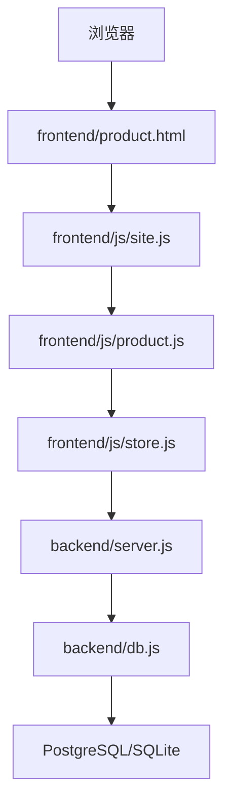
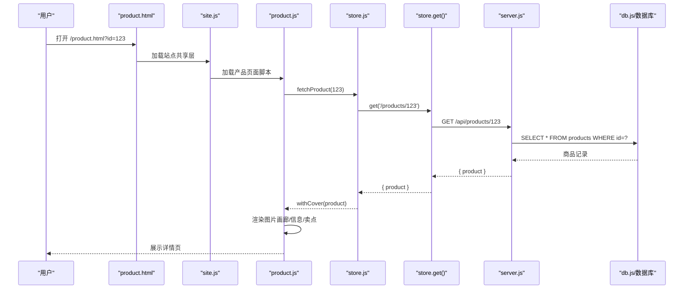
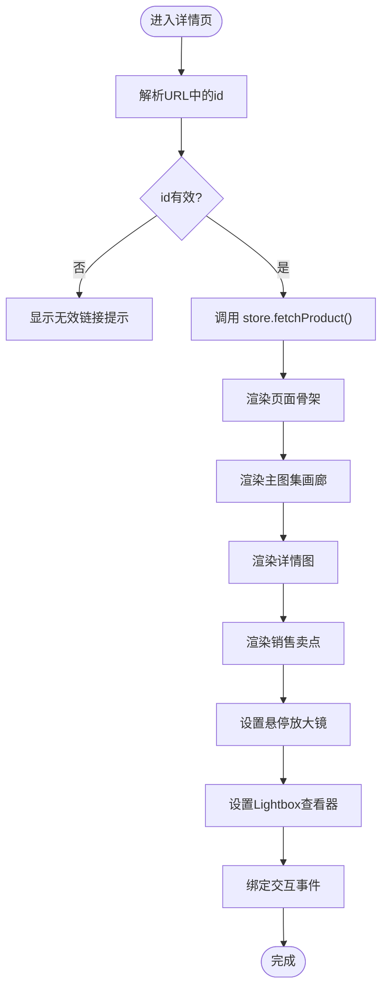
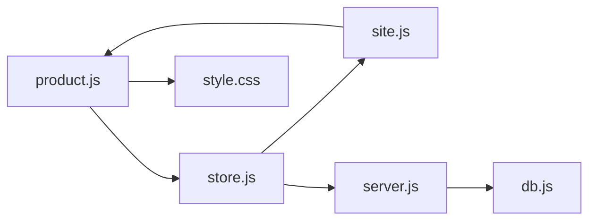

# 产品详情页组件

<cite>
**本文引用的文件**
- [frontend/product.html](file://frontend/product.html)
- [frontend/js/product.js](file://frontend/js/product.js)
- [frontend/js/store.js](file://frontend/js/store.js)
- [frontend/js/site.js](file://frontend/js/site.js)
- [backend/server.js](file://backend/server.js)
- [backend/db.js](file://backend/db.js)
- [backend/seed.js](file://backend/seed.js)
- [frontend/css/style.css](file://frontend/css/style.css)
- [README.md](file://README.md)
</cite>

## 更新摘要
**所做更改**
- 重构了产品详情页的架构，将内联JavaScript完全迁移到独立模块
- 新增store.js统一数据层，提供API客户端、缓存管理和工具函数
- 增强了产品详情页功能，支持多图片画廊（主图集+详情图）和销售卖点展示
- **新增完整的图片查看系统**：包括悬停放大镜、全屏lightbox查看器、键盘导航、无障碍支持和移动端响应式设计
- 优化了页面结构和样式，提升用户体验和可维护性

## 目录
1. [简介](#简介)
2. [项目结构](#项目结构)
3. [核心组件](#核心组件)
4. [架构总览](#架构总览)
5. [详细组件分析](#详细组件分析)
6. [依赖关系分析](#依赖关系分析)
7. [性能与可用性](#性能与可用性)
8. [故障排查指南](#故障排查指南)
9. [结论](#结论)
10. [附录：API 与数据模型](#附录api-与数据模型)

## 简介
本组件为"产品详情页"，负责展示单个商品的图片轮播、名称、价格、描述以及销售卖点。用户通过 URL 参数 id 访问具体商品，页面从后端获取商品详情并渲染左侧图片画廊与右侧信息面板，支持主图集滑动浏览、详情图展示和销售卖点列表。

**更新** 重构后的架构采用模块化设计，将业务逻辑从HTML中完全分离，通过store.js统一管理数据层，提供更清晰的代码结构和更好的可维护性。**新增了完整的图片查看系统，包括悬停放大镜、全屏lightbox查看器、键盘导航、无障碍支持和移动端响应式设计。**

## 项目结构
- 前端静态资源位于 frontend，包含极简化的 product.html 骨架和独立的 JS 模块；product.js 实现详情页交互逻辑，store.js 提供统一的数据层服务。
- 全站共享层 site.js 负责导航、购物车抽屉和页脚的注入，确保多页面一致性。
- 后端 Express 服务在 backend/server.js，暴露 /api/products/:id 等接口，并通过 db.js 抽象数据库（PostgreSQL/SQLite）。
- 样式集中在 frontend/css/style.css，包含详情页的响应式布局与主题风格。

**图表来源**
- [frontend/product.html:1-16](file://frontend/product.html#L1-L16)
- [frontend/js/site.js:1-179](file://frontend/js/site.js#L1-L179)
- [frontend/js/product.js:1-248](file://frontend/js/product.js#L1-L248)
- [frontend/js/store.js:1-69](file://frontend/js/store.js#L1-L69)
- [backend/server.js:1-524](file://backend/server.js#L1-L524)
- [backend/db.js:1-265](file://backend/db.js#L1-L265)

**章节来源**
- [frontend/product.html:1-16](file://frontend/product.html#L1-L16)
- [frontend/js/product.js:1-248](file://frontend/js/product.js#L1-L248)
- [frontend/js/store.js:1-69](file://frontend/js/store.js#L1-L69)
- [frontend/js/site.js:1-179](file://frontend/js/site.js#L1-L179)
- [backend/server.js:1-524](file://backend/server.js#L1-L524)
- [backend/db.js:1-265](file://backend/db.js#L1-L265)
- [frontend/css/style.css:318-444](file://frontend/css/style.css#L318-L444)
- [README.md:109-131](file://README.md#L109-L131)

## 核心组件
- **页面骨架**：product.html 提供极简的HTML结构，仅包含必要的meta标签和脚本引用。
- **详情页逻辑**：product.js 解析路由参数、调用 store.js 获取商品、渲染图片画廊与信息面板、处理数量选择和购物车添加。
- **数据层**：store.js 封装API请求、自动探测后端地址、提供缓存机制和通用工具函数。
- **全站共享层**：site.js 注入导航、购物车抽屉和页脚，管理跨页面购物车状态。
- **后端接口**：server.js 提供 /api/products/:id 返回商品详情，支持 images、details、info 等多字段数据结构。
- **样式**：style.css 定义详情页左右布局、图片画廊、选项按钮与响应式适配。

**更新** 新增了完整的图片查看系统，包括悬停放大镜、全屏lightbox查看器、键盘导航、无障碍支持和移动端响应式设计。

**章节来源**
- [frontend/product.html:10-14](file://frontend/product.html#L10-L14)
- [frontend/js/product.js:23-247](file://frontend/js/product.js#L23-L247)
- [frontend/js/store.js:6-69](file://frontend/js/store.js#L6-L69)
- [frontend/js/site.js:14-75](file://frontend/js/site.js#L14-L75)
- [backend/server.js:282-287](file://backend/server.js#L282-L287)
- [frontend/css/style.css:318-444](file://frontend/css/style.css#L318-L444)

## 架构总览
重构后的产品详情页采用清晰的分层架构：HTML仅负责结构，product.js处理业务逻辑，store.js统一管理数据层，site.js提供全局功能。前端通过ES Module组织逻辑，使用store.js统一请求；后端以Express提供RESTful接口，读取数据库并返回标准化JSON。

**图表来源**
- [frontend/js/product.js:23-247](file://frontend/js/product.js#L23-L247)
- [frontend/js/store.js:50-53](file://frontend/js/store.js#L50-L53)
- [backend/server.js:282-287](file://backend/server.js#L282-L287)
- [backend/db.js:174-189](file://backend/db.js#L174-L189)

## 详细组件分析

### 产品详情页（product.html + style.css）
- **页面结构**：极简HTML骨架，仅包含必要的meta标签、viewport设置和脚本引用；主内容区由 #pdRoot 容器承载，由JS动态填充。
- **样式要点**：深色国际象棋主题，左右两栏网格布局，主图区域支持1:1比例滑动浏览，详情图区域展示产品细节，右侧信息区包含标题、价格、描述、数量选择器和销售卖点列表。

**更新** 页面结构大幅简化，移除了所有内联JavaScript，提升了页面的可维护性和加载性能。新增了完整的图片查看系统样式支持。

**章节来源**
- [frontend/product.html:1-16](file://frontend/product.html#L1-L16)
- [frontend/css/style.css:318-444](file://frontend/css/style.css#L318-L444)

### 详情页逻辑（product.js）
- **路由解析**：从 URL 查询参数中读取 id，校验有效性。
- **数据获取**：调用 store.js 的 fetchProduct(id) 获取商品对象。
- **渲染流程**：
  - 构建左右布局 DOM（左侧图片画廊、右侧信息面板）
  - 渲染主图集（images），支持左右箭头切换和滑动浏览
  - 渲染详情图（details），懒加载优化性能
  - 渲染销售卖点（info），展示产品特性列表
  - 绑定事件：图片切换、数量增减、加入购物车
- **安全**：所有用户可控文本通过 escapeHtml 转义，避免 XSS。

**更新** 重构后的逻辑更加清晰，职责单一，通过store.js统一管理数据获取和工具函数。**新增了完整的图片查看系统：**

#### 悬停放大镜功能
- **圆形透镜跟随鼠标**：200px直径的圆形放大镜，2.5倍放大倍率
- **性能优化**：使用requestAnimationFrame避免mousemove高频重绘
- **设备检测**：仅在支持hover的设备上启用，触屏设备自动禁用
- **智能隐藏**：页面滚动或窗口缩放时自动隐藏，避免透镜滞留错位

#### 全屏Lightbox查看器
- **完整键盘导航**：支持Esc关闭、方向键切换图片、Tab焦点循环
- **无障碍支持**：role="dialog"、aria-modal="true"、aria-label等语义化属性
- **预加载优化**：自动预加载相邻两张图片，确保切换流畅
- **焦点管理**：打开时锁定焦点在查看器内，关闭时恢复原焦点
- **触摸支持**：区分点击和滑动操作，避免误触发

#### 统一的图片浏览序列
- **主图与详情图整合**：主图集和详情图组成统一的浏览序列
- **智能事件绑定**：自动识别图片类型，绑定相应的事件处理器
- **滑动检测**：通过pointerdown事件检测滑动操作，避免与点击冲突

**图表来源**
- [frontend/js/product.js:23-247](file://frontend/js/product.js#L23-L247)

**章节来源**
- [frontend/js/product.js:1-248](file://frontend/js/product.js#L1-L248)

### 数据层（store.js）
- **自动探测后端地址**：先尝试同源 /api/health，失败则回退到本地开发端口。
- **统一请求封装**：get() 方法封装fetch，自动处理错误和JSON解析。
- **缓存机制**：fetchProducts() 提供模块级缓存，避免重复请求。
- **工具函数**：escapeHtml 用于防XSS；money 格式化货币；withCover 为主图提供默认占位符。
- **商品数据获取**：fetchProduct() 和 fetchProducts() 提供标准化的商品数据接口。

**更新** store.js作为统一数据层，提供了更清晰的数据流管理和更好的错误处理能力。

**章节来源**
- [frontend/js/store.js:1-69](file://frontend/js/store.js#L1-L69)

### 全站共享层（site.js）
- **导航注入**：动态生成导航菜单，根据当前页面高亮对应项。
- **购物车管理**：跨页面购物车状态维护，支持localStorage持久化。
- **页脚注入**：统一的页脚内容和版权信息。
- **全局事件委托**：集中处理购物车操作、导航交互等全局事件。
- **滚动显现动画**：IntersectionObserver实现的滚动触发动画效果。

**更新** site.js现在承担更多全局职责，确保多页面的一致性和用户体验。

**章节来源**
- [frontend/js/site.js:1-179](file://frontend/js/site.js#L1-L179)

### 后端接口（server.js）
- **健康检查**：GET /api/health 返回数据库类型与时间戳。
- **商品详情**：GET /api/products/:id 查询数据库并返回标准化商品对象（images/details/info已归一化）。
- **权限控制**：写操作需携带有效 JWT 且角色为 admin，否则返回 401/403。
- **静态托管**：若存在 frontend 目录，直接托管静态页面。

**更新** 后端支持新的数据结构，包括details（详情图）和info（销售卖点）字段。

**章节来源**
- [backend/server.js:282-287](file://backend/server.js#L282-L287)
- [backend/server.js:246-267](file://backend/server.js#L246-L267)

### 数据库层（db.js）
- **双驱动**：检测到环境变量时使用 PostgreSQL，否则使用 SQLite（sql.js），统一 query/run 接口。
- **建表与迁移**：initSchema 创建 users、products、slides 表，ensureColumn 平滑补列。
- **存储统计**：storageStats 返回数据库总占用与商品数据占用，便于后台监控。

**更新** 数据库schema增加了details和info字段，支持更丰富的产品展示需求。

**章节来源**
- [backend/db.js:129-206](file://backend/db.js#L129-L206)
- [backend/db.js:228-247](file://backend/db.js#L228-L247)

### 种子数据（seed.js）
- **预设账户**：管理员 P001 与客户 C001，密码哈希存储。
- **占位商品**：若干计时器、棋具与服饰类商品，便于首次运行体验。

**更新** 种子数据现在包含details和info字段，展示完整的产品信息结构。

**章节来源**
- [backend/seed.js:1-129](file://backend/seed.js#L1-L129)

## 依赖关系分析
- product.js 依赖 store.js 提供的数据获取和工具函数。
- store.js 依赖后端 /api 路由，尤其是 /api/products/:id。
- site.js 依赖 store.js 获取商品信息，为购物车功能提供数据支持。
- server.js 依赖 db.js 进行数据存取，并可选托管 frontend 静态资源。
- 样式依赖 style.css 定义的详情页布局与交互样式。

**图表来源**
- [frontend/js/product.js:7-8](file://frontend/js/product.js#L7-L8)
- [frontend/js/store.js:1-69](file://frontend/js/store.js#L1-L69)
- [frontend/js/site.js:8](file://frontend/js/site.js#L8)
- [backend/server.js:1-524](file://backend/server.js#L1-L524)
- [backend/db.js:1-265](file://backend/db.js#L1-L265)
- [frontend/css/style.css:318-444](file://frontend/css/style.css#L318-L444)

**章节来源**
- [frontend/js/product.js:1-248](file://frontend/js/product.js#L1-L248)
- [frontend/js/store.js:1-69](file://frontend/js/store.js#L1-L69)
- [frontend/js/site.js:1-179](file://frontend/js/site.js#L1-L179)
- [backend/server.js:1-524](file://backend/server.js#L1-L524)
- [backend/db.js:1-265](file://backend/db.js#L1-L265)
- [frontend/css/style.css:318-444](file://frontend/css/style.css#L318-L444)

## 性能与可用性
- **图片加载优化**：主图集支持滑动浏览，详情图使用lazy loading优化首屏性能。
- **缓存机制**：store.js提供模块级缓存，避免重复API请求。
- **渲染效率**：DOM更新集中在renderProduct/renderCarousel，减少重排次数。
- **网络优化**：store.js自动探测后端地址，避免跨域配置问题。
- **可访问性**：轮播按钮具备aria-label，缩略图按钮具备语义化alt；移动端布局自适应。
- **安全性**：所有动态文本通过escapeHtml转义，防止XSS；写操作受JWT与角色中间件保护。

**更新** 新的架构通过store.js的统一数据层和缓存机制，显著提升了性能和用户体验。**新增的图片查看系统具有以下性能特点：**

### 悬停放大镜性能优化
- **requestAnimationFrame优化**：使用rAF批量更新位置，避免频繁重绘
- **条件启用**：仅在支持hover的设备上启用，触屏设备自动禁用
- **智能隐藏**：页面滚动或窗口缩放时立即隐藏，避免内存泄漏

### Lightbox查看器性能优化
- **图片预加载**：自动预加载相邻两张图片，确保切换流畅
- **淡入淡出过渡**：使用CSS transition实现平滑的图片切换效果
- **内存管理**：合理管理图片对象生命周期，避免内存泄漏

### 无障碍支持
- **键盘导航**：完整的键盘操作支持，包括Esc关闭、方向键切换、Tab焦点循环
- **屏幕阅读器**：适当的ARIA属性和语义化HTML结构
- **焦点管理**：打开/关闭时正确管理焦点，确保可访问性

### 移动端响应式设计
- **触摸优化**：触屏设备上禁用悬停放大镜，保留Lightbox功能
- **自适应布局**：Lightbox查看器在不同屏幕尺寸下保持良好显示效果
- **手势支持**：区分点击和滑动操作，避免误触发

## 故障排查指南
- **无法加载商品详情**：
  - 检查 URL 是否包含有效的 id 参数。
  - 确认后端 /api/products/:id 可访问（健康检查 /api/health）。
  - 查看控制台是否有 CORS 或网络错误。
- **图片画廊无图片**：
  - 确认数据库中该商品的 images 字段有值。
  - 检查 details 字段是否正确配置详情图。
- **销售卖点不显示**：
  - 检查 info 字段是否为数组格式。
  - 确认后端parseProduct函数正确解析info字段。
- **购物车功能异常**：
  - 确认 localStorage 可用且 pf_cart 键存在。
  - 检查 site.js 是否正确注入导航和购物车组件。
- **后端启动异常**：
  - 检查数据库连接（PostgreSQL/SQLite）与环境变量。
  - 查看启动日志输出。

**更新** 新增了针对新功能的故障排查指导。

### 图片查看系统故障排查
- **悬停放大镜不工作**：
  - 检查设备是否支持hover（触屏设备会自动禁用）
  - 确认图片元素具有正确的class和事件监听器
  - 查看控制台是否有JavaScript错误
- **Lightbox查看器无法打开**：
  - 检查图片元素是否正确绑定了点击事件
  - 确认lbSeq数组包含有效的图片URL
  - 验证键盘事件监听器是否正确注册
- **键盘导航失效**：
  - 检查focus管理逻辑是否正确执行
  - 确认keydown事件监听器正常工作
  - 验证Tab焦点循环逻辑

**章节来源**
- [frontend/js/product.js:23-247](file://frontend/js/product.js#L23-L247)
- [frontend/js/store.js:8-23](file://frontend/js/store.js#L8-L23)
- [backend/server.js:282-287](file://backend/server.js#L282-L287)
- [backend/db.js:228-247](file://backend/db.js#L228-L247)

## 结论
重构后的产品详情页组件以清晰的职责划分实现了商品信息的可视化与交互：product.html 提供极简骨架，product.js 负责数据获取与渲染，store.js 统一管理数据层，site.js 提供全局功能，后端 server.js 提供稳定接口与权限控制。整体方案兼顾了用户体验（多图片画廊、销售卖点展示）、安全性（XSS 防护、JWT 鉴权）与可维护性（模块化、响应式样式）。在生产环境中建议启用 PostgreSQL 并合理配置环境变量以确保稳定性与扩展性。

**更新** 新的架构设计显著提升了代码的可维护性和扩展性，为后续功能迭代奠定了坚实基础。**新增的完整图片查看系统为用户提供了专业的图片浏览体验，包括悬停放大镜、全屏查看器、键盘导航、无障碍支持和移动端优化，大幅提升了产品的专业性和用户体验。**

## 附录：API 与数据模型

### 关键 API
- GET /api/products/:id：返回商品详情（公开）
- GET /api/health：健康检查（公开）
- POST /api/auth/login：登录获取 JWT（公开）
- GET /api/auth/me：校验 Token 并返回用户信息（需登录）

**章节来源**
- [backend/server.js:282-287](file://backend/server.js#L282-L287)
- [backend/server.js:246-267](file://backend/server.js#L246-L267)
- [README.md:55-71](file://README.md#L55-L71)

### 数据模型（products 表关键字段）
- name：商品名称
- category：分类（如 chess-timer/chess-set/apparel）
- price：价格
- description：描述
- image：主图（兼容旧字段）
- images：主图集数组（JSON 字符串，后端归一化为数组）
- variants：变体数组（JSON 字符串，每个变体含 color/style/images）
- details：详情图数组（JSON 字符串，用于展示产品细节）
- info：销售卖点数组（JSON 字符串，用于展示产品特性）
- stock：库存

**更新** 新增了details和info字段，支持更丰富的产品展示需求。

**章节来源**
- [backend/db.js:174-189](file://backend/db.js#L174-L189)
- [backend/server.js:70-79](file://backend/server.js#L70-L79)
- [backend/server.js:297-344](file://backend/server.js#L297-L344)