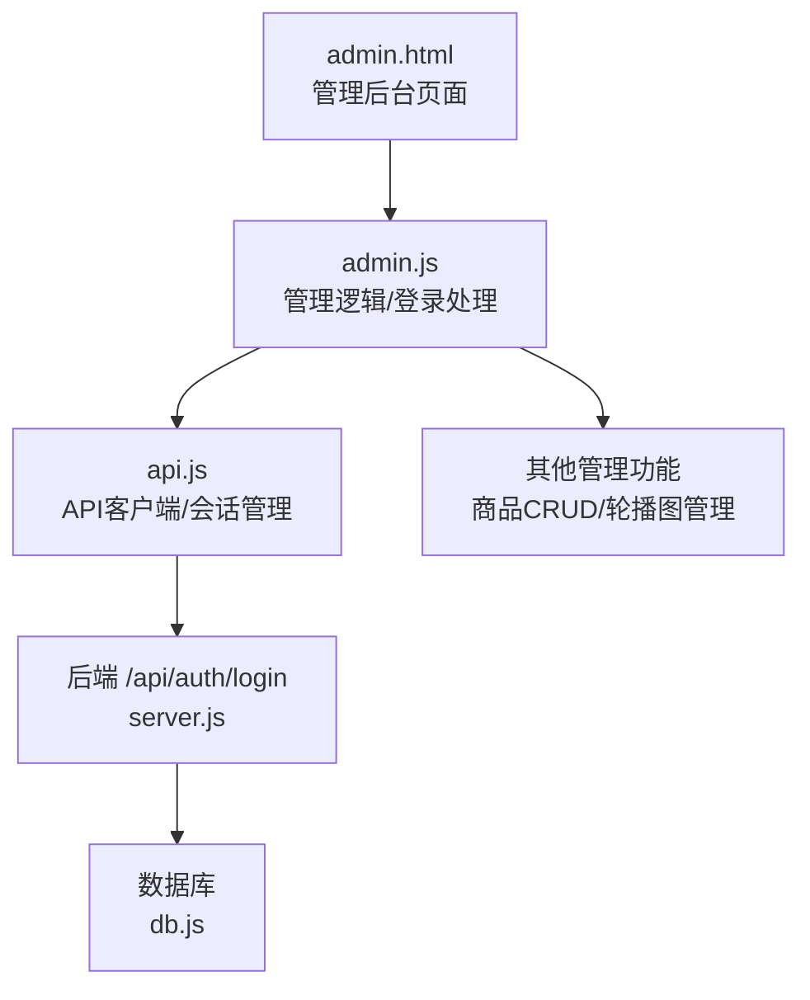
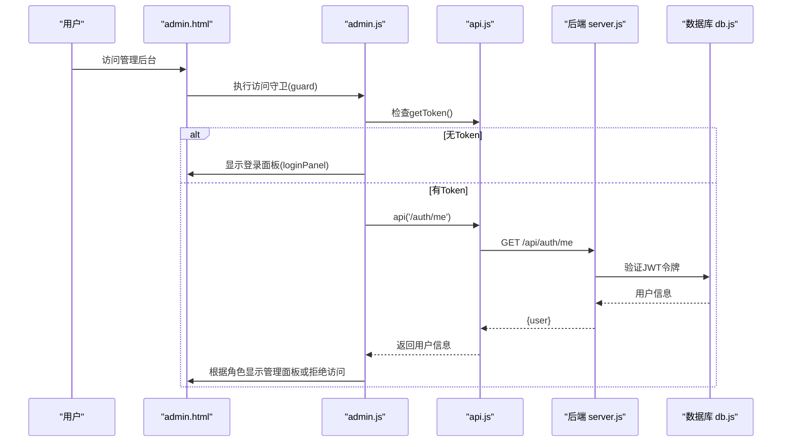
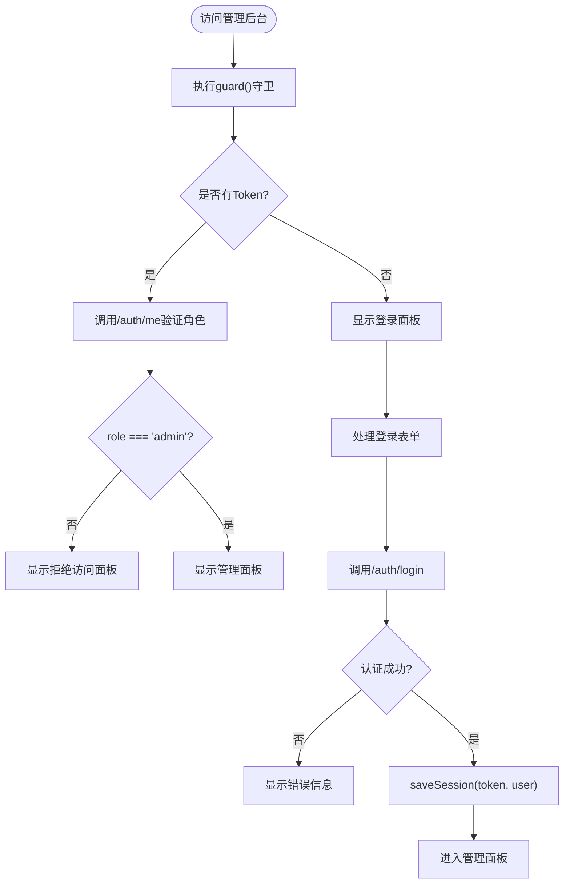
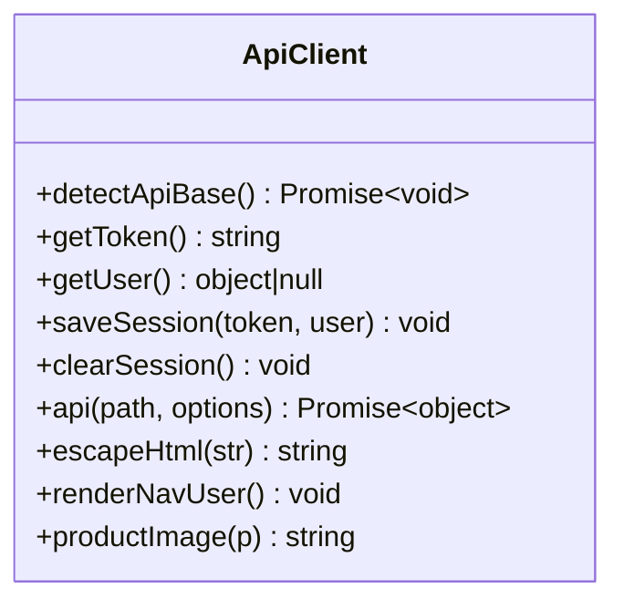
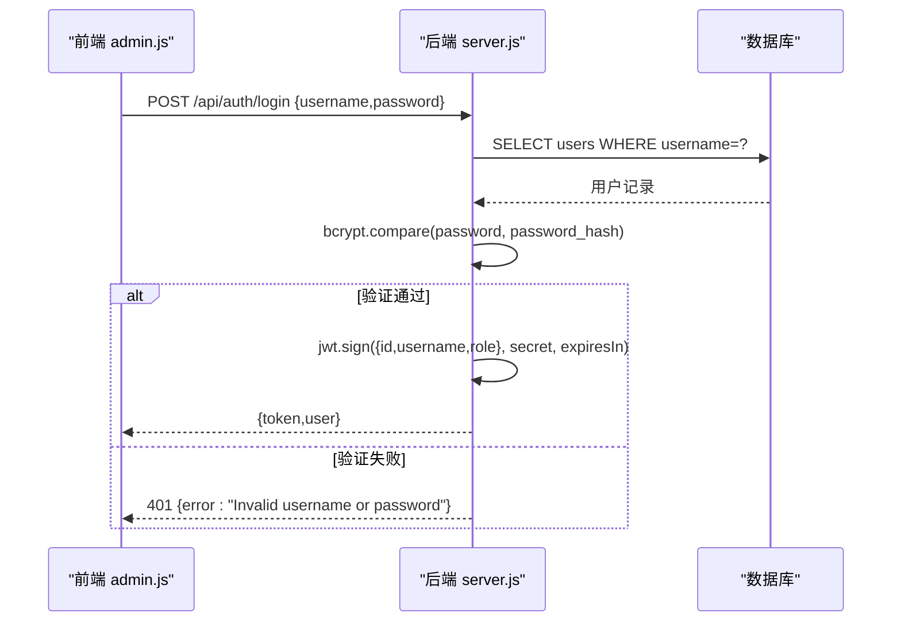
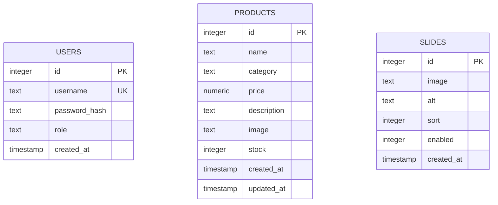
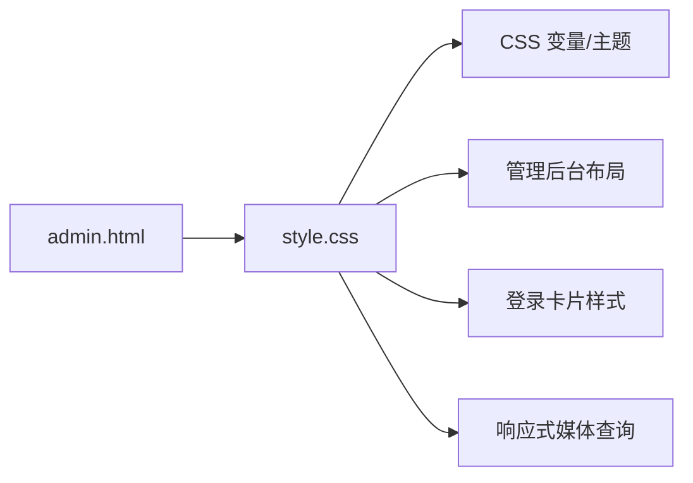
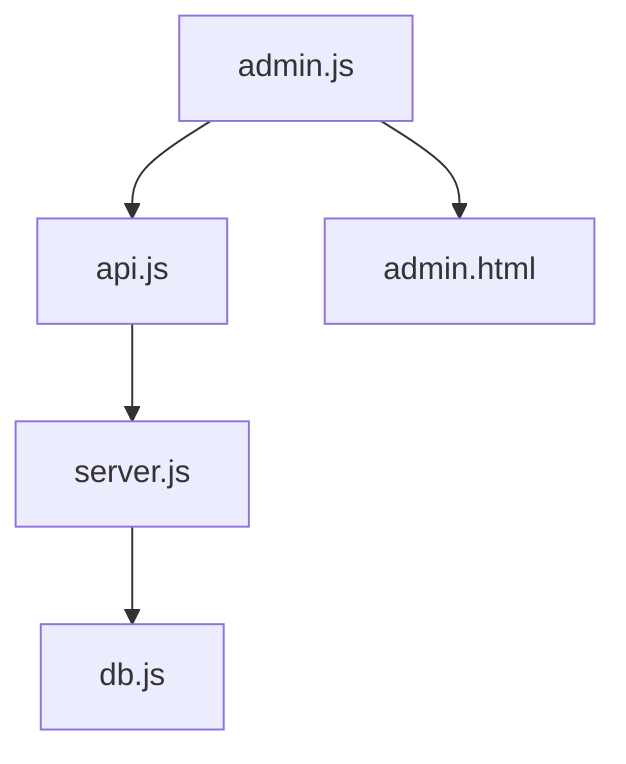

# 登录页面组件

<cite>
**本文引用的文件**
- [frontend/admin.html](file://frontend/admin.html)
- [frontend/js/admin.js](file://frontend/js/admin.js)
- [frontend/js/api.js](file://frontend/js/api.js)
- [backend/server.js](file://backend/server.js)
- [backend/db.js](file://backend/db.js)
- [frontend/css/style.css](file://frontend/css/style.css)
- [README.md](file://README.md)
</cite>

## 更新摘要
**所做更改**
- 移除了独立登录页面组件的引用（auth.js和login.html）
- 更新了认证流程以反映内嵌登录架构
- 修改了架构图表以显示新的管理后台集成登录
- 更新了代码示例和实现细节
- 调整了依赖关系分析

## 目录
1. [简介](#简介)
2. [项目结构](#项目结构)
3. [核心组件](#核心组件)
4. [架构总览](#架构总览)
5. [详细组件分析](#详细组件分析)
6. [依赖关系分析](#依赖关系分析)
7. [性能与体验优化](#性能与体验优化)
8. [故障排查指南](#故障排查指南)
9. [结论](#结论)
10. [附录：实现示例与最佳实践](#附录：实现示例与最佳实践)

## 简介
本文件为 LeapShop 管理后台内嵌登录组件的实现文档。认证功能已从独立的登录页面迁移至管理后台，实现了更简洁的架构设计。文档聚焦于内嵌登录流程、JWT 令牌获取与存储、会话状态管理、登录 API 调用链路、错误处理与重定向逻辑，以及 HTML/CSS 的结构设计与响应式体验。同时提供"记住登录状态""自动登出""多设备会话管理"的落地方案与安全建议。

## 项目结构
认证功能现已集成到管理后台中，由以下关键文件协作完成：
- 管理后台页面：包含内置登录表单和管理界面
- 管理逻辑 JS：处理登录验证、权限检查和后台功能
- 共享 API 客户端：统一请求封装、Token/用户信息存取、导航渲染
- 后端服务：认证路由、JWT 签发、权限中间件、健康检查
- 样式表：管理后台主题、登录卡片布局、交互反馈

图表来源
- [frontend/admin.html:25-40](file://frontend/admin.html#L25-L40)
- [frontend/js/admin.js:28-78](file://frontend/js/admin.js#L28-L78)
- [frontend/js/api.js:40-49](file://frontend/js/api.js#L40-L49)
- [backend/server.js:247-263](file://backend/server.js#L247-L263)
- [backend/db.js:112-158](file://backend/db.js#L112-L158)

章节来源
- [frontend/admin.html:1-189](file://frontend/admin.html#L1-L189)
- [frontend/js/admin.js:1-488](file://frontend/js/admin.js#L1-L488)
- [frontend/js/api.js:1-81](file://frontend/js/api.js#L1-L81)
- [backend/server.js:1-524](file://backend/server.js#L1-L524)
- [backend/db.js:1-176](file://backend/db.js#L1-L176)

## 核心组件
- 管理后台登录逻辑（admin.js）
  - 内置访问守卫函数，检查用户身份和权限
  - 监听登录表单提交，读取用户名与密码
  - 调用统一 API 客户端发起 POST /api/auth/login
  - 成功后保存会话并进入管理面板，否则显示拒绝访问页面
  - 失败时显示错误信息并提供切换账户选项
- 共享 API 客户端（api.js）
  - 自动探测后端地址（同源 /api 不通则回退到本地开发端口）
  - 管理 Token 与用户信息（localStorage）
  - 统一请求封装：自动携带 Authorization 头、统一错误抛出
  - 渲染导航栏用户状态与退出逻辑
- 后端认证（server.js）
  - 校验用户名密码（bcrypt 比对）
  - 签发 JWT（含 id、username、role），设置过期时间
  - 提供 /api/auth/me 用于校验身份
  - 提供 /api/health 健康检查
- 数据库抽象（db.js）
  - 支持 PostgreSQL（生产）与 SQLite（开发）
  - 初始化表结构与种子数据

章节来源
- [frontend/js/admin.js:28-78](file://frontend/js/admin.js#L28-L78)
- [frontend/js/api.js:10-81](file://frontend/js/api.js#L10-L81)
- [backend/server.js:247-267](file://backend/server.js#L247-L267)
- [backend/db.js:112-158](file://backend/db.js#L112-L158)

## 架构总览
登录流程从管理后台触发，经前端模块与后端服务交互，最终返回 JWT 并在前端持久化与会话控制。

图表来源
- [frontend/js/admin.js:28-51](file://frontend/js/admin.js#L28-L51)
- [frontend/js/api.js:40-49](file://frontend/js/api.js#L40-L49)
- [backend/server.js:265-267](file://backend/server.js#L265-L267)
- [backend/db.js:112-158](file://backend/db.js#L112-L158)

## 详细组件分析

### 管理后台登录逻辑（admin.js）
- 访问守卫机制
  - guard() 函数检查用户是否已登录且拥有管理员权限
  - 根据检查结果显示相应的面板：登录面板、拒绝访问面板或管理面板
  - 使用 showOnly() 函数控制不同面板的显示状态
- 表单处理与认证
  - 监听登录表单提交事件，阻止默认行为
  - 读取用户名与密码（trim 处理）
  - 调用 api('/auth/login') 进行认证
  - 验证用户角色是否为 admin，非管理员显示拒绝消息
- 会话管理与状态更新
  - 成功登录后调用 saveSession(token, user) 保存会话
  - 调用 renderNavUser() 更新导航栏用户状态
  - 切换到管理面板并启动后台功能

图表来源
- [frontend/js/admin.js:28-78](file://frontend/js/admin.js#L28-L78)

章节来源
- [frontend/js/admin.js:28-78](file://frontend/js/admin.js#L28-L78)

### 共享 API 客户端（api.js）
- 后端地址探测
  - detectApiBase() 尝试访问 /api/health，若失败则切换至本地开发端口（如 :3000）
- 会话管理
  - getToken/getUser/saveSession/clearSession：基于 localStorage 的键 lc_token/lc_user
- 统一请求封装
  - 自动附加 Content-Type 与 Authorization（Bearer token）
  - 非 2xx 响应统一抛错，错误消息来自后端 data.error 或 HTTP 状态
- 导航渲染与退出
  - renderNavUser：在 #navUserSlot 中渲染用户信息与退出按钮
  - 退出时清除会话并刷新页面

图表来源
- [frontend/js/api.js:10-81](file://frontend/js/api.js#L10-L81)

章节来源
- [frontend/js/api.js:1-81](file://frontend/js/api.js#L1-L81)

### 后端认证（server.js）
- 登录接口 /api/auth/login
  - 校验请求体 username/password
  - 查询用户并 bcrypt 比对密码
  - 签发 JWT（包含 id、username、role），设置过期时间
  - 返回 { token, user }
- 身份校验 /api/auth/me
  - 需要有效 Token，返回当前用户信息
- 权限中间件
  - authRequired：解析 Authorization 头，校验 JWT
  - adminOnly：仅允许 role === 'admin' 的请求通过

图表来源
- [backend/server.js:247-263](file://backend/server.js#L247-L263)
- [backend/server.js:216-231](file://backend/server.js#L216-L231)

章节来源
- [backend/server.js:216-267](file://backend/server.js#L216-L267)

### 数据库与表结构（db.js）
- 双驱动适配：PostgreSQL（生产）与 SQLite（开发）
- 初始化表结构：users、products、slides
- 种子数据：首次启动写入演示账户与占位商品（幂等）

图表来源
- [backend/db.js:112-158](file://backend/db.js#L112-L158)

章节来源
- [backend/db.js:1-176](file://backend/db.js#L1-L176)

### HTML 结构与 CSS 样式
- 管理后台结构（admin.html）
  - 导航栏包含管理标签和用户状态插槽
  - 内置登录面板（admin-auth）：品牌标识、标题、用户名密码输入框
  - 拒绝访问面板（admin-denied）：显示访问限制信息和切换账户按钮
  - 管理主面板（admin-main）：统计信息、轮播图管理、商品CRUD
- 样式设计（style.css）
  - 管理后台专用样式：浅色背景、专业配色
  - 登录卡片居中布局、圆角边框、阴影与悬停效果
  - 输入框焦点高亮、错误信息颜色
  - 响应式断点适配移动端（网格布局调整、元素重排）

图表来源
- [frontend/admin.html:12-53](file://frontend/admin.html#L12-L53)
- [frontend/css/style.css:470-510](file://frontend/css/style.css#L470-L510)
- [frontend/css/style.css:643-653](file://frontend/css/style.css#L643-L653)

章节来源
- [frontend/admin.html:1-189](file://frontend/admin.html#L1-L189)
- [frontend/css/style.css:470-653](file://frontend/css/style.css#L470-L653)

## 依赖关系分析
- 前端模块耦合
  - admin.js 依赖 api.js（网络与会话）
  - api.js 被管理后台复用以渲染用户状态
- 前后端契约
  - 登录接口 POST /api/auth/login 返回 { token, user }
  - 写操作需 Authorization: Bearer <token>
- 外部依赖
  - Express、cors、bcryptjs、jsonwebtoken
  - 数据库：PostgreSQL（生产）或 SQLite（开发）

图表来源
- [frontend/js/admin.js:1-5](file://frontend/js/admin.js#L1-L5)
- [frontend/js/api.js:1-81](file://frontend/js/api.js#L1-L81)
- [backend/server.js:1-524](file://backend/server.js#L1-L524)
- [backend/db.js:1-176](file://backend/db.js#L1-L176)

章节来源
- [frontend/js/admin.js:1-488](file://frontend/js/admin.js#L1-L488)
- [frontend/js/api.js:1-81](file://frontend/js/api.js#L1-L81)
- [backend/server.js:1-524](file://backend/server.js#L1-L524)
- [backend/db.js:1-176](file://backend/db.js#L1-L176)

## 性能与体验优化
- 网络层
  - 自动探测后端地址，避免跨域/端口配置问题导致的失败
  - 统一错误抛出，减少重复错误处理代码
- 用户体验
  - 访问守卫机制确保未授权用户无法访问管理功能
  - 清晰的错误提示和状态反馈
  - 导航栏动态渲染用户状态与退出入口，增强可发现性
- 样式与响应式
  - 管理后台专业配色与布局
  - 移动端友好：网格自适应、元素重排、触控友好尺寸

[本节为通用指导，不直接分析具体文件]

## 故障排查指南
- 登录失败（401）
  - 可能原因：用户名/密码错误、后端未运行、CORS 限制
  - 排查步骤：
    - 确认后端 /api/health 可达
    - 检查浏览器控制台网络面板，查看响应体 error 字段
    - 确认 CORS 已开启（后端已启用 cors）
- 会话无效（401 后续请求）
  - 可能原因：Token 过期、localStorage 被清理、跨标签页不同步
  - 处理建议：
    - 捕获 401 后引导重新登录
    - 使用 sessionStorage 替代 localStorage 可实现"关闭标签即失效"
    - 多设备/多标签同步：监听 storage 事件或在服务端维护会话黑名单
- 后端鉴权失败（403）
  - 可能原因：非管理员访问管理功能
  - 处理建议：前端根据角色隐藏/禁用敏感操作

章节来源
- [backend/server.js:216-231](file://backend/server.js#L216-L231)
- [frontend/js/api.js:40-49](file://frontend/js/api.js#L40-L49)

## 结论
管理后台内嵌登录组件通过简洁的前端逻辑与健壮的后端认证，实现了完整的用户认证与权限控制。将登录功能集成到管理后台简化了前端架构，减少了页面跳转复杂度。借助统一的 API 客户端，前端实现了 Token 管理与会话控制，并通过响应式样式提供良好的用户体验。建议在安全与可用性方面引入更多机制（如刷新令牌、CSRF/XSS 防护、多设备会话管理等）以进一步提升系统安全性与可维护性。

[本节为总结，不直接分析具体文件]

## 附录：实现示例与最佳实践

### 记住登录状态
- 当前实现：使用 localStorage 持久化 token 与 user，刷新页面后可保持登录态
- 参考路径
  - 会话存储：[frontend/js/api.js:30-33](file://frontend/js/api.js#L30-L33)
  - 读取会话：[frontend/js/api.js:18-28](file://frontend/js/api.js#L18-L28)
- 建议
  - 对敏感信息增加加密存储（如 Web Crypto API）
  - 结合 HttpOnly Cookie 与 SameSite 策略降低 XSS 风险

### 自动登出功能
- 当前实现：Token 过期后，受保护接口返回 401；可在前端拦截并重定向登录
- 建议
  - 在 api() 中统一捕获 401，弹出提示并跳转登录页
  - 使用 sessionStorage 实现"关闭标签即失效"的短期会话
  - 服务端维护 Token 黑名单或缩短 TTL，配合刷新令牌机制

### 多设备会话管理
- 当前实现：Token 存储在浏览器本地，无服务端会话跟踪
- 建议
  - 服务端维护活跃会话列表（设备指纹、IP、UA）
  - 支持"强制下线"：服务端撤销 Token 或加入黑名单
  - 前端监听 storage 事件实现多标签页状态同步

### 安全最佳实践
- 传输安全
  - 全站 HTTPS，防止中间人攻击
- 认证安全
  - 使用强随机 JWT_SECRET（环境变量注入）
  - 合理设置 Token 过期时间（当前 12h）
  - 密码使用 bcrypt 哈希存储（已实现）
- 前端安全
  - 对用户输入进行转义（api.js 提供 escapeHtml）
  - 避免将敏感信息写入日志
- 后端安全
  - 严格校验请求体字段类型与长度
  - 对写接口实施角色校验（已实现 adminOnly）

### 常见问题解决方案
- 无法连接后端
  - 检查 /api/health 可达性与端口配置
  - 确认 CORS 已开启（后端已启用）
- 登录后仍显示"Sign In"
  - 检查 localStorage 是否写入成功
  - 确保页面正确调用 renderNavUser
- 管理后台无法访问
  - 确认角色为 admin，且 Token 有效
  - 检查后端 adminOnly 中间件返回码

章节来源
- [backend/server.js:216-231](file://backend/server.js#L216-L231)
- [frontend/js/api.js:62-81](file://frontend/js/api.js#L62-L81)
- [frontend/js/admin.js:53-84](file://frontend/js/admin.js#L53-L84)