# 管理后台组件

<cite>
**本文引用的文件**
- [admin.js](file://frontend/js/admin.js)
- [api.js](file://frontend/js/api.js)
- [admin.html](file://frontend/admin.html)
- [server.js](file://backend/server.js)
- [db.js](file://backend/db.js)
- [seed.js](file://backend/seed.js)
- [style.css](file://frontend/css/style.css)
</cite>

## 更新摘要
**所做更改**
- **新增**：增强的管理面板布局，包含水平溢出修复和响应式设计改进
- **新增**：垂直堆叠表单布局，优化小屏幕设备的用户体验
- **新增**：深色主题模式用于商品编辑，提供更好的视觉对比度
- **新增**：平滑滚动行为，改善创建和编辑模式之间的切换体验
- **增强**：左侧导航栏系统，支持响应式设计和粘性定位
- **增强**：英雄产品管理面板，支持全局唯一主推款的设置和管理
- **增强**：产品排序功能，支持 sort_weight 字段实现系列内自定义排序
- **增强**：全站设置管理，支持站点配置的全局管理
- **增强**：存储统计面板升级为双进度条设计，同时显示产品数据占比和磁盘容量利用率
- **增强**：图片上传系统升级至80MB JSON限制，单商品图片总量限制50MB

## 目录
1. [简介](#简介)
2. [项目结构](#项目结构)
3. [核心组件](#核心组件)
4. [架构总览](#架构总览)
5. [详细组件分析](#详细组件分析)
6. [依赖关系分析](#依赖关系分析)
7. [性能与扩展性](#性能与扩展性)
8. [故障排查指南](#故障排查指南)
9. [结论](#结论)
10. [附录：API 参考与安全清单](#附录api-参考与安全清单)

## 简介
本文件面向 LeapShop 管理后台组件，聚焦以下目标：
- 详细说明 admin.js 中的权限控制实现（管理员身份验证、接口级访问控制、UI 权限显示）
- 文档化商品 CRUD 的完整流程（数据验证、API 调用、错误处理、状态同步）
- 说明 HTML 管理界面的结构设计（商品列表展示、编辑表单、删除确认对话框）
- 提供具体代码示例路径，演示批量操作、实时数据刷新与文件上传的实现方式
- 总结管理员权限设计模式与前端安全防护措施
- **新增**：内置登录验证系统，提供安全的身份认证机制
- **新增**：轮播图管理功能，支持首页图片轮播的全面管理
- **新增**：双图片画廊编辑系统，支持主图和详情图的独立管理
- **新增**：销售卖点管理功能，支持产品信息的多行文本编辑
- **新增**：英雄产品管理面板，支持全局唯一主推款的设置和管理
- **新增**：左侧导航栏，提供便捷的页面导航体验
- **新增**：产品排序功能，支持系列内自定义排序权重
- **新增**：全站设置管理，支持站点配置的全局管理
- **增强**：存储统计显示面板，提供实时的数据库使用情况监控，现已升级为双进度条设计
- **特别优化**：图片上传系统已升级至80MB JSON限制，单商品图片总量限制50MB，配备实时大小验证功能
- **最新优化**：增强的管理面板布局，包含水平溢出修复、响应式设计改进、垂直堆叠表单布局和深色主题模式

## 项目结构
管理后台由"前端页面 + 前端逻辑 + 后端服务"三部分构成：
- 前端页面：admin.html 提供管理界面布局与交互元素，包含内置登录、轮播图管理和增强的存储统计面板
- 前端逻辑：admin.js 负责权限守卫、商品列表渲染、表单提交、双图片画廊管理和轮播图操作；api.js 提供统一的 API 客户端、Token 管理与用户信息渲染
- 后端服务：server.js 提供认证、权限中间件与商品 CRUD 接口；db.js 抽象数据库连接与建表/种子初始化；seed.js 提供预设数据和初始配置

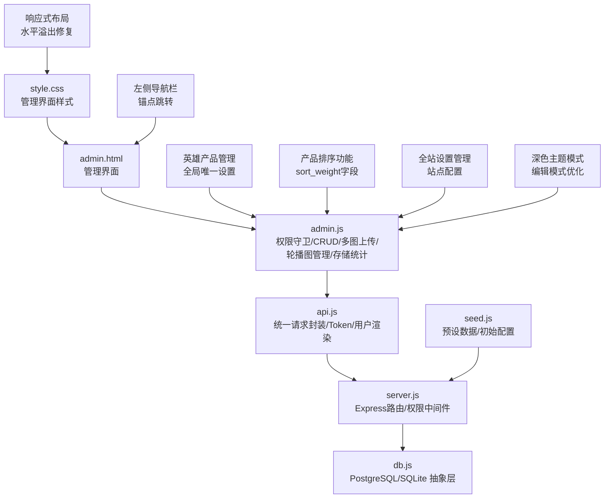

**图表来源**
- [admin.html:1-257](file://frontend/admin.html#L1-L257)
- [admin.js:1-709](file://frontend/js/admin.js#L1-L709)
- [api.js:1-81](file://frontend/js/api.js#L1-L81)
- [server.js:1-583](file://backend/server.js#L1-L583)
- [db.js:1-272](file://backend/db.js#L1-L272)
- [seed.js:1-164](file://backend/seed.js#L1-L164)
- [style.css:511-812](file://frontend/css/style.css#L511-L812)

## 核心组件
- **内置登录系统**：在 admin.js 中通过 guard() 函数检测后端可用性，读取本地 Token，调用 /api/auth/me 校验角色，仅当 role === 'admin' 时显示管理面板，否则显示拒绝访问提示或登录界面
- **左侧导航栏**：提供锚点跳转的侧边栏导航，包含服务器监控、英雄产品、商品管理、轮播图、站点设置等功能入口，支持响应式设计和粘性定位
- **英雄产品管理面板**：支持全局唯一主推款的设置和管理，选中新的主推款会自动替换旧的，影响前台首页和商品概览的展示
- **产品排序功能**：支持 sort_weight 字段的设置，实现系列内的自定义排序，数字越小越靠前，留空则按上传时间倒序
- **全站设置管理**：支持站点标题、LOGO、公告、联系方式等全局配置，实时更新到前台显示
- **轮播图管理**：支持首页图片轮播的增删改查操作，包括图片上传、排序调整、启用/禁用切换等功能
- **双图片画廊编辑**：支持主图和详情图分别管理，每个图集最多10张图片，第一张作为封面显示
- **销售卖点管理**：支持多行文本输入，每行作为一个卖点条目，自动过滤空行和空白字符
- **增强的存储统计面板**：提供数据库类型、总存储、产品数据、产品数量、图片文件统计、数据库开销比例和磁盘容量等详细信息，现已升级为双进度条设计
- **深色主题模式**：为商品编辑模式提供专门的深色主题，提升编辑体验的视觉对比度和专注度
- **响应式布局系统**：包含水平溢出修复、垂直堆叠表单布局和移动端优化
- **平滑滚动行为**：在创建和编辑模式之间切换时提供流畅的滚动体验
- **统一 API 客户端**：api.js 自动附加 Authorization: Bearer <token>，统一错误抛出，并提供 escapeHtml 防 XSS 与 renderNavUser 渲染导航栏用户状态
- **后端权限中间件**：server.js 定义 authRequired 与 adminOnly，对写接口进行鉴权与角色校验
- **数据库抽象**：db.js 根据环境变量选择 PostgreSQL 或 SQLite，提供 query/run 统一接口，并在启动时建表与写入种子数据
- **增强的图片上传系统**：支持80MB JSON限制，单商品图片总量50MB限制，实时大小验证和全面客户端验证

**章节来源**
- [admin.js:41-64](file://frontend/js/admin.js#L41-L64)
- [admin.html:55-62](file://frontend/admin.html#L55-L62)
- [admin.js:237-273](file://frontend/js/admin.js#L237-L273)
- [admin.js:677-691](file://frontend/js/admin.js#L677-L691)
- [admin.js:143-235](file://frontend/js/admin.js#L143-L235)
- [admin.js:242-364](file://frontend/js/admin.js#L242-L364)
- [admin.js:470-532](file://frontend/js/admin.js#L470-L532)
- [admin.js:535-577](file://frontend/js/admin.js#L535-L577)
- [admin.js:113-129](file://frontend/js/admin.js#L113-L129)
- [api.js:41-49](file://frontend/js/api.js#L41-L49)
- [server.js:215-231](file://backend/server.js#L215-L231)
- [server.js:28-28](file://backend/server.js#L28-L28)
- [style.css:690-716](file://frontend/css/style.css#L690-L716)
- [style.css:569-587](file://frontend/css/style.css#L569-L587)

## 架构总览
管理后台采用前后端分离但可单服务托管的模式。前端通过 api.js 发起 REST 请求，后端使用 Express 路由与 JWT 中间件进行认证与授权，读写操作经由 db.js 抽象层持久化到数据库。

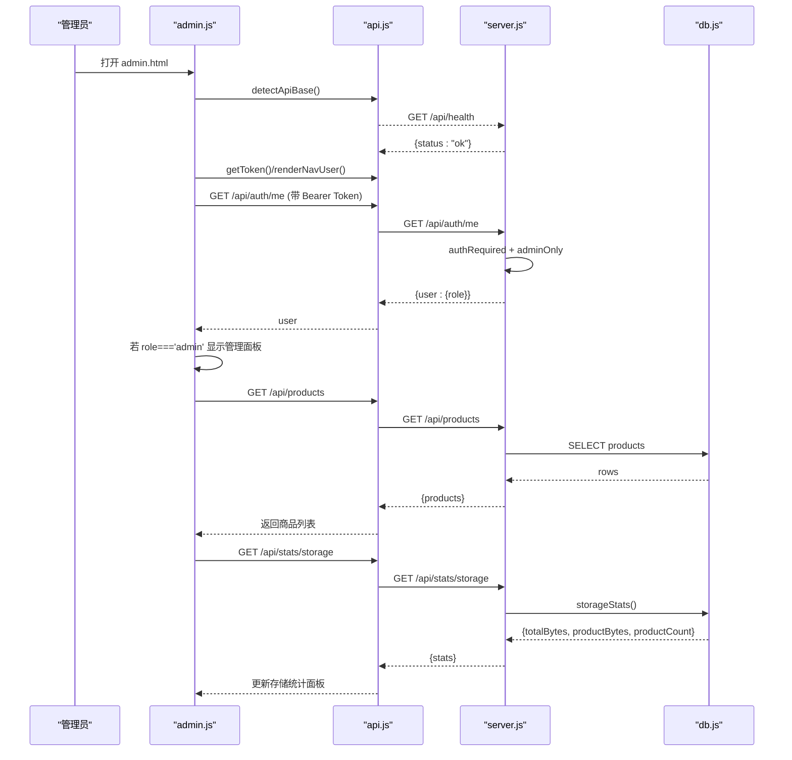

**图表来源**
- [admin.js:41-64](file://frontend/js/admin.js#L41-L64)
- [api.js:10-49](file://frontend/js/api.js#L10-L49)
- [server.js:246-267](file://backend/server.js#L246-L267)
- [db.js:235-254](file://backend/db.js#L235-L254)
- [server.js:492-522](file://backend/server.js#L492-L522)

## 详细组件分析

### 增强的管理面板布局系统（重要更新）
**更新**：管理面板布局经过全面优化，包含水平溢出修复、响应式设计改进和垂直堆叠表单布局

- **水平溢出修复**：使用 `overflow-x: clip` 替代 `hidden`，既吸收 full-bleed 100vw 在滚动条存在时的横向溢出，又不破坏 sticky 导航
- **响应式设计**：在大屏幕上显示为固定侧边栏，在小屏幕上降级为顶部横向导航，确保最佳的用户体验
- **垂直堆叠表单布局**：使用 CSS Grid 实现上下分栏布局，表单在上、表格在下，各占满容器宽度
- **粘性定位**：使用 `position: sticky` 确保导航在滚动时保持可见，提升长页面的导航效率
- **视觉反馈**：悬停时显示边框和背景变化，提升用户体验
- **滚动优化**：添加 `scroll-margin-top: 84px` 避免 sticky 导航遮挡内容

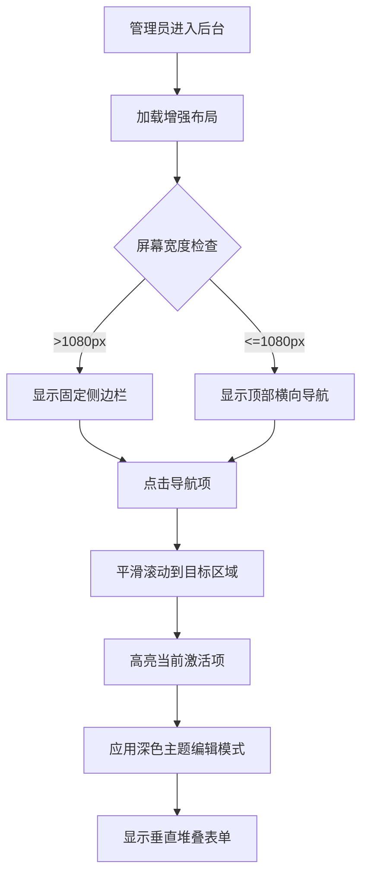

**图表来源**
- [admin.html:55-62](file://frontend/admin.html#L55-L62)
- [style.css:34-35](file://frontend/css/style.css#L34-L35)
- [style.css:569-587](file://frontend/css/style.css#L569-L587)
- [style.css:674](file://frontend/css/style.css#L674)

**章节来源**
- [admin.html:55-62](file://frontend/admin.html#L55-L62)
- [style.css:34-35](file://frontend/css/style.css#L34-L35)
- [style.css:569-587](file://frontend/css/style.css#L569-L587)
- [style.css:674](file://frontend/css/style.css#L674)

### 深色主题编辑模式（重要更新）
**更新**：新增了专门的深色主题模式用于商品编辑，提供更好的视觉对比度和专注度

- **主题切换**：通过 `is-editing` 类名动态切换浅色新建模式和深色编辑模式
- **颜色方案**：深色背景 (#1b1712)、金色强调色 (#D4AF37)、浅灰色文字 (#f5f1e8)
- **按钮反转**：深色模式下按钮反转为金/浅描边，保证对比度
- **输入框优化**：深色背景 (#262019)、半透明边框、浅灰色文字
- **焦点状态**：金色边框和高亮背景，提升可访问性
- **平滑过渡**：所有颜色变化都带有 0.35s 的过渡动画

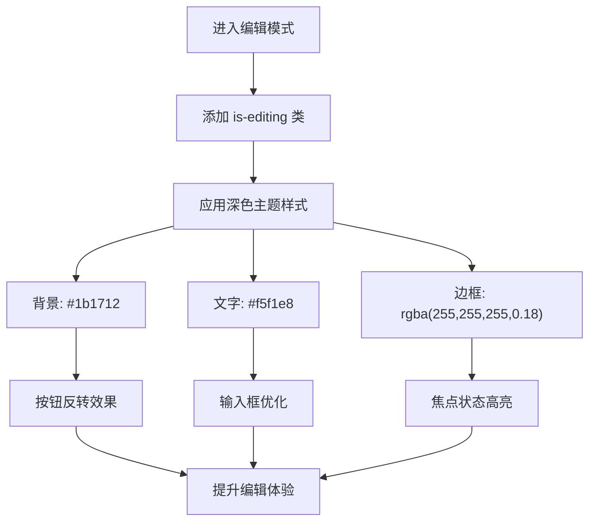

**图表来源**
- [admin.js:493-532](file://frontend/js/admin.js#L493-L532)
- [style.css:690-716](file://frontend/css/style.css#L690-L716)

**章节来源**
- [admin.js:493-532](file://frontend/js/admin.js#L493-L532)
- [style.css:690-716](file://frontend/css/style.css#L690-L716)

### 平滑滚动行为优化（重要更新）
**更新**：在创建和编辑模式之间切换时添加了平滑滚动行为，改善用户体验

- **智能滚动**：编辑商品时自动滚动到表单可视位置，避免页面跳跃
- **粘性导航避让**：使用 `scrollIntoView({ behavior: 'smooth', block: 'start' })` 确保内容不被 sticky 导航遮挡
- **滚动偏移**：添加 `scroll-margin-top: 84px` 为 sticky 导航预留空间
- **用户体验**：提供流畅的视觉反馈，减少用户的认知负担

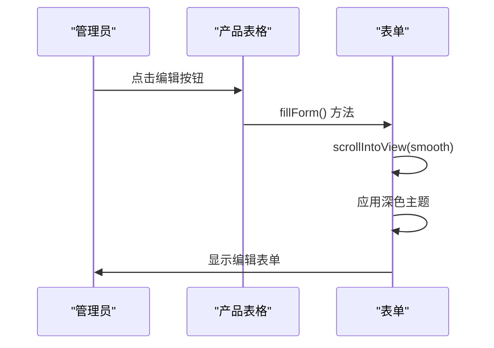

**图表来源**
- [admin.js:530-532](file://frontend/js/admin.js#L530-L532)
- [style.css:691](file://frontend/css/style.css#L691)

**章节来源**
- [admin.js:530-532](file://frontend/js/admin.js#L530-L532)
- [style.css:691](file://frontend/css/style.css#L691)

### 左侧导航栏系统（重要更新）
**更新**：新增了完整的左侧导航栏系统，提供便捷的页面导航体验

- **锚点导航**：使用HTML锚点实现平滑滚动到各个管理区域
- **响应式设计**：在大屏幕上显示为固定侧边栏，在小屏幕上降级为顶部横向导航
- **粘性定位**：使用 `position: sticky` 确保导航在滚动时保持可见
- **视觉反馈**：悬停时显示边框和背景变化，提升用户体验
- **功能入口**：包含服务器监控、英雄产品、商品管理、轮播图、站点设置等核心功能

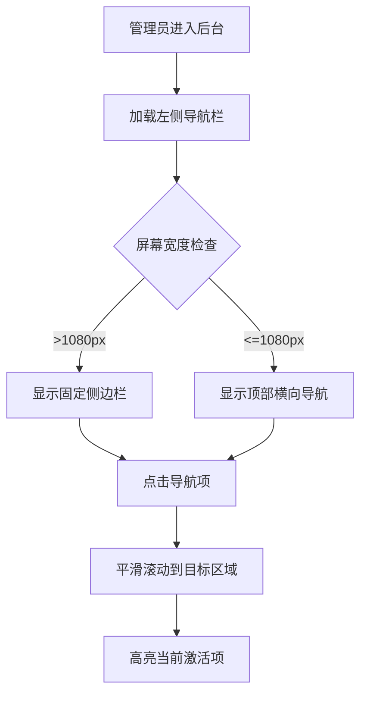

**图表来源**
- [admin.html:55-62](file://frontend/admin.html#L55-L62)
- [style.css:573-587](file://frontend/css/style.css#L573-L587)

**章节来源**
- [admin.html:55-62](file://frontend/admin.html#L55-L62)
- [style.css:573-587](file://frontend/css/style.css#L573-L587)

### 英雄产品管理面板（重要更新）
**更新**：新增了完整的英雄产品管理功能，支持全局唯一主推款的设置和管理

- **全局唯一性**：通过后端单键 upsert 天然保证只有一个主推款存在
- **自动替换**：选择新的主推款会自动替换之前的主推款
- **前台联动**：设置的主推款会显示在前台首页 Featured 区块和产品概览的第一位置
- **表格标识**：在产品列表中显示 ♕ 标志和 Clear 按钮
- **表单集成**：支持在创建/编辑商品时直接设置为英雄产品
- **状态同步**：修改后自动刷新产品列表和统计信息

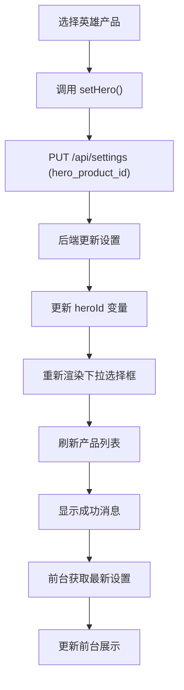

**图表来源**
- [admin.js:237-273](file://frontend/js/admin.js#L237-L273)
- [admin.html:104-118](file://frontend/admin.html#L104-L118)

**章节来源**
- [admin.js:237-273](file://frontend/js/admin.js#L237-L273)
- [admin.html:104-118](file://frontend/admin.html#L104-L118)
- [style.css:621-632](file://frontend/css/style.css#L621-L632)

### 产品排序功能（重要更新）
**更新**：新增了产品排序功能，支持 sort_weight 字段实现系列内自定义排序

- **权重字段**：每个商品都有 sort_weight 字段，数字越小排序越靠前
- **实时编辑**：直接在产品表格中编辑权重值，失焦或回车即保存
- **默认行为**：留空权重时按上传时间倒序排列
- **批量操作**：支持快速调整多个产品的排序顺序
- **前端验证**：确保权重值为有效数字

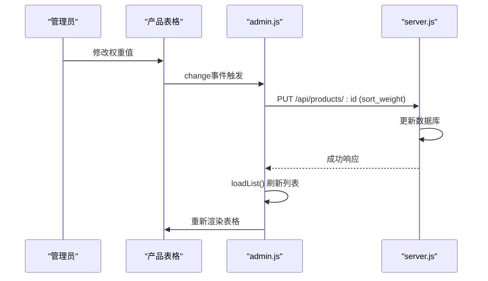

**图表来源**
- [admin.js:677-691](file://frontend/js/admin.js#L677-L691)
- [admin.html:201-204](file://frontend/admin.html#L201-L204)

**章节来源**
- [admin.js:677-691](file://frontend/js/admin.js#L677-L691)
- [admin.html:201-204](file://frontend/admin.html#L201-L204)
- [style.css:637-641](file://frontend/css/style.css#L637-L641)

### 全站设置管理（重要更新）
**更新**：新增了完整的全站设置管理功能，支持站点配置的全局管理

- **站点标题**：设置网站标题，影响浏览器标签页和SEO
- **LOGO管理**：支持上传和更换网站LOGO，实时更新到导航栏和页脚
- **公告管理**：支持富文本公告，可在首页显示重要通知
- **联系方式**：管理邮箱和社交媒体链接
- **实时生效**：设置修改后立即在前台生效
- **跨标签页同步**：使用 BroadcastChannel 实现多标签页设置同步

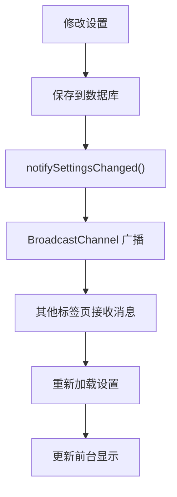

**图表来源**
- [admin.js:143-235](file://frontend/js/admin.js#L143-L235)
- [admin.html:120-149](file://frontend/admin.html#L120-L149)

**章节来源**
- [admin.js:143-235](file://frontend/js/admin.js#L143-L235)
- [admin.html:120-149](file://frontend/admin.html#L120-L149)
- [style.css:782-800](file://frontend/css/style.css#L782-L800)

### 增强的图片上传验证系统（重要更新）
**更新**：图片上传系统已进行全面升级，支持更大的图片容量和更严格的验证机制

- **JSON限制提升**：后端express.json限制从原来的24MB提升至80MB，支持更大规模的base64图片数据传输
- **单商品总量限制**：每商品图片总量限制为50MB（二进制口径），考虑base64膨胀约1/3后约67MB，预留JSON开销余量
- **实时大小验证**：使用dataUrlBytes()函数精确计算dataURL对应的二进制字节数，避免估算误差
- **双重验证机制**：
  - 单张图片大小限制：8MB（防止异常大文件）
  - 每商品图片总量限制：50MB（二进制口径）
- **全面客户端验证**：在文件选择时立即进行大小检查，阻止超大文件上传，提升用户体验

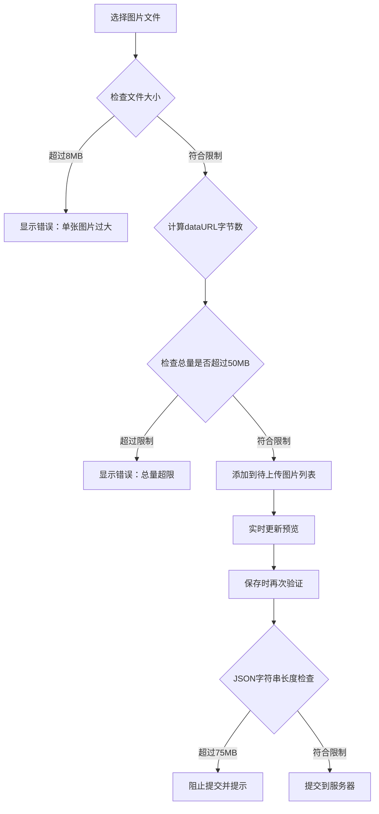

**图表来源**
- [admin.js:23-32](file://frontend/js/admin.js#L23-L32)
- [admin.js:503-529](file://frontend/js/admin.js#L503-L529)
- [admin.js:558-563](file://frontend/js/admin.js#L558-L563)
- [server.js:28-28](file://backend/server.js#L28-L28)

**章节来源**
- [admin.js:15-17](file://frontend/js/admin.js#L15-L17)
- [admin.js:23-32](file://frontend/js/admin.js#L23-L32)
- [admin.js:503-529](file://frontend/js/admin.js#L503-L529)
- [admin.js:558-563](file://frontend/js/admin.js#L558-L563)
- [server.js:28-28](file://backend/server.js#L28-L28)

### 内置登录验证系统
- **登录流程**：guard() 函数检测后端健康、渲染导航用户信息、读取本地 Token、调用 /api/auth/me 校验角色；非管理员显示拒绝面板，管理员显示管理面板
- **会话管理**：支持登录/登出操作，Token 和用户信息存储在 localStorage，登出时清除所有会话数据
- **权限控制**：只有 role === 'admin' 的用户才能访问管理功能，普通用户显示拒绝访问提示
- **错误处理**：会话过期时自动跳转到登录界面，并显示相应的提示信息

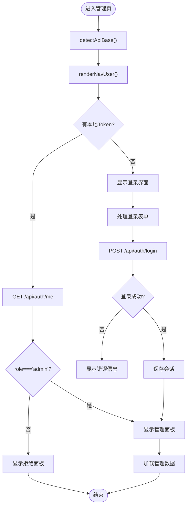

**图表来源**
- [admin.js:41-64](file://frontend/js/admin.js#L41-L64)
- [admin.html:25-50](file://frontend/admin.html#L25-L50)
- [server.js:246-267](file://backend/server.js#L246-L267)

**章节来源**
- [admin.js:41-64](file://frontend/js/admin.js#L41-L64)
- [admin.html:25-50](file://frontend/admin.html#L25-L50)
- [api.js:30-38](file://frontend/js/api.js#L30-L38)
- [server.js:246-267](file://backend/server.js#L246-L267)

### 轮播图管理功能
- **轮播图列表**：支持获取所有轮播图（管理员）或仅启用的轮播图（公开），按 sort 字段排序
- **图片上传**：支持 base64 图片上传，自动保存到服务器文件系统，数据库只存储 URL 引用
- **排序管理**：支持上下移动轮播图顺序，通过交换 sort 值实现
- **状态控制**：支持启用/禁用轮播图，影响公开接口的显示
- **内容编辑**：支持修改轮播图的 alt 文本，失焦即保存
- **删除功能**：支持删除轮播图，同时清理不再被引用的磁盘文件

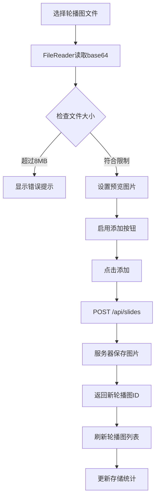

**图表来源**
- [admin.js:242-364](file://frontend/js/admin.js#L242-L364)
- [server.js:374-440](file://backend/server.js#L374-L440)

**章节来源**
- [admin.js:242-364](file://frontend/js/admin.js#L242-L364)
- [server.js:374-440](file://backend/server.js#L374-L440)
- [style.css:649-671](file://frontend/css/style.css#L649-L671)

### 双图片画廊编辑系统
- **主图库**：支持最多10张图片，第一张作为商品封面显示
- **详情图库**：支持最多10张图片，用于展示商品的详细信息
- **图片预览**：实时显示上传的图片，支持删除操作
- **文件验证**：检查文件大小（8MB限制和图片格式）
- **数据绑定**：将图片数组绑定到商品数据的 images 和 details 字段
- **总量控制**：确保两个图集的总大小不超过50MB限制

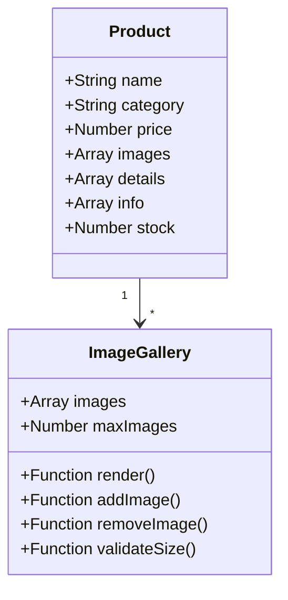

**图表来源**
- [admin.js:470-532](file://frontend/js/admin.js#L470-L532)
- [admin.js:535-577](file://frontend/js/admin.js#L535-L577)

**章节来源**
- [admin.js:470-532](file://frontend/js/admin.js#L470-L532)
- [admin.js:535-577](file://frontend/js/admin.js#L535-L577)
- [style.css:717-739](file://frontend/css/style.css#L717-L739)

### 销售卖点管理功能
- **多行文本编辑**：支持每行一个卖点的文本输入
- **数据处理**：自动分割换行符，过滤空行和空白字符
- **数据验证**：确保至少有一个有效的卖点条目
- **数据格式**：以 JSON 数组形式存储，便于前端直接渲染

**章节来源**
- [admin.js:535-577](file://frontend/js/admin.js#L535-L577)
- [server.js:59-67](file://backend/server.js#L59-L67)
- [server.js:297-362](file://backend/server.js#L297-L362)

### 增强的存储统计面板（重要更新）
**更新**：存储统计面板现已升级为双进度条设计，提供更直观的存储使用情况可视化

- **数据库信息**：显示数据库类型（PostgreSQL/SQLite）、总存储大小
- **产品数据**：显示产品数据占用空间和产品数量
- **图片文件统计**：显示图片文件数量和总大小
- **数据库开销**：计算数据库系统开销占总体积的比例
- **磁盘容量**：显示所在文件系统的总容量和剩余空间
- **双进度条可视化**：
  - 第一条进度条：显示产品数据占总应用数据（数据库+图片）的比例
  - 第二条进度条：显示磁盘容量使用率（Volume 文件系统整体）
- **改进的UI术语**：
  - 'App Data (DB + Images)'：清晰表示应用数据包含数据库和图片文件
  - 'Product Share of App Data'：明确产品数据在应用数据中的占比

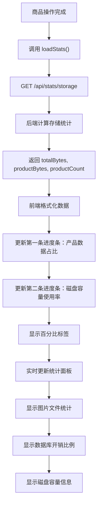

**图表来源**
- [admin.js:113-141](file://frontend/js/admin.js#L113-L141)
- [server.js:492-522](file://backend/server.js#L492-L522)
- [db.js:235-254](file://backend/db.js#L235-L254)

**章节来源**
- [admin.js:113-141](file://frontend/js/admin.js#L113-L141)
- [server.js:492-522](file://backend/server.js#L492-L522)
- [db.js:235-254](file://backend/db.js#L235-L254)
- [style.css:600-619](file://frontend/css/style.css#L600-L619)
- [admin.html:66-102](file://frontend/admin.html#L66-L102)

### 商品 CRUD 流程
- **列表加载**：GET /api/products，按分类过滤可选；失败时显示错误行
- **新增**：POST /api/products，需管理员；服务端校验 name 必填，其他字段有默认值；成功返回新商品
- **更新**：PUT /api/products/:id，仅管理员；支持部分字段更新；不存在返回 404
- **删除**：DELETE /api/products/:id，仅管理员；存在则删除并返回 ok

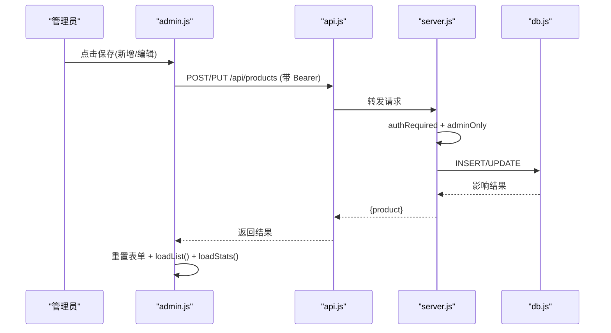

**图表来源**
- [admin.js:535-577](file://frontend/js/admin.js#L535-L577)
- [server.js:297-362](file://backend/server.js#L297-L362)

**章节来源**
- [admin.js:367-402](file://frontend/js/admin.js#L367-L402)
- [admin.js:535-577](file://frontend/js/admin.js#L535-L577)
- [server.js:269-372](file://backend/server.js#L269-L372)

### 数据验证与错误处理
- **前端验证**：图片大小限制（8MB单张，50MB总量），表单字段类型与默认值处理；提交后统一捕获异常并显示消息
- **后端验证**：name 必填校验；数值字段默认 0；不存在的资源返回 404；未登录返回 401；非管理员返回 403
- **统一错误**：api.js 将非 2xx 响应转换为 Error，便于上层 catch 处理
- **图片验证**：支持多种图片格式，自动转换 JPEG 为 JPG，SVG 保持原格式
- **JSON大小验证**：提交前检查JSON字符串长度，确保不超过75MB限制

**章节来源**
- [admin.js:503-529](file://frontend/js/admin.js#L503-L529)
- [admin.js:558-563](file://frontend/js/admin.js#L558-L563)
- [admin.js:535-577](file://frontend/js/admin.js#L535-L577)
- [server.js:215-231](file://backend/server.js#L215-L231)
- [server.js:297-362](file://backend/server.js#L297-L362)
- [api.js:41-49](file://frontend/js/api.js#L41-L49)

### 状态同步机制
- **列表缓存**：产品列表以 JSON 字符串存储在 tbody.dataset.products，用于快速定位当前编辑/删除的目标项
- **实时刷新**：每次新增/更新/删除后调用 loadList() 重新拉取最新数据，保证视图与数据一致
- **表单状态**：pendingImages 和 pendingDetails 保存当前图片 base64；resetForm 清空表单与预览；fillForm 填充编辑态
- **轮播图状态**：slides 数组保存当前轮播图数据，支持实时更新和状态同步
- **存储统计**：每次商品操作后自动刷新统计信息，确保数据一致性
- **英雄产品状态**：heroId 变量跟踪当前主推款，与前端下拉框和表格显示同步

**章节来源**
- [admin.js:397-398](file://frontend/js/admin.js#L397-L398)
- [admin.js:434-468](file://frontend/js/admin.js#L434-L468)
- [admin.js:571-573](file://frontend/js/admin.js#L571-L573)
- [admin.js:605-611](file://frontend/js/admin.js#L605-L611)
- [admin.js:237-273](file://frontend/js/admin.js#L237-L273)

### HTML 管理界面结构设计
- **导航区**：品牌标识、返回站点链接、用户信息插槽 navUserSlot
- **内置登录面板**：loginPanel，包含用户名和密码输入框，以及登录状态消息
- **拒绝访问面板**：deniedPanel，包含提示信息与账户切换按钮
- **左侧导航栏**：admin-side，提供锚点跳转的功能入口
- **管理主区域**：adminPanel，包含服务器监控、英雄产品、商品管理、轮播图、站点设置等模块
- **服务器监控面板**：admin-stats，显示数据库信息、存储使用情况、图片文件统计等，现已包含双进度条可视化
- **英雄产品面板**：admin-hero-panel，支持主推款的设置和管理
- **站点设置面板**：admin-settings，支持站点配置的全局管理
- **轮播图管理区**：admin-slides，支持图片上传、预览、排序调整和状态控制
- **商品管理区**：admin-grid，左侧为创建/编辑表单，右侧为商品列表表格
- **表单元素**：隐藏 editId、名称、分类下拉、价格、库存、描述、销售卖点、双图片输入、图库预览、消息区、提交/取消按钮
- **列表区**：标题计数、刷新按钮、表格头与 tbody 动态渲染

**章节来源**
- [admin.html:12-257](file://frontend/admin.html#L12-L257)

### 管理员权限设计模式与前端安全防护
- **权限设计模式**
  - 前端守卫：基于 Token 与 /api/auth/me 的角色判断，控制 UI 可见性与行为
  - 后端中间件：authRequired 校验 Token，adminOnly 校验角色，确保写操作不可被越权
  - 会话管理：localStorage 存储 Token 与用户信息，登出时清除
- **前端安全防护**
  - 输出编码：escapeHtml 对所有用户可控内容进行转义，避免 XSS
  - 最小权限：非管理员无法看到管理入口，且即使绕过前端也会在后端被拦截
  - 输入验证：严格的文件格式和大小验证，防止恶意文件上传
  - 安全传输：HTTPS 支持和 CORS 配置，确保数据传输安全

**章节来源**
- [admin.js:41-64](file://frontend/js/admin.js#L41-L64)
- [api.js:51-55](file://frontend/js/api.js#L51-L55)
- [api.js:62-80](file://frontend/js/api.js#L62-L80)
- [server.js:215-231](file://backend/server.js#L215-L231)

## 依赖关系分析
- **模块耦合**
  - admin.js 依赖 api.js 提供的 detectApiBase、api、getToken、renderNavUser、escapeHtml、productImage
  - server.js 依赖 db.js 的 connect、initSchema、usePg、storageStats
  - seed.js 依赖 db.js 的 connect、initSchema，提供预设数据
- **外部依赖**
  - 前端：fetch、FileReader、localStorage、BroadcastChannel
  - 后端：Express、cors、bcryptjs、jsonwebtoken、pg/sql.js

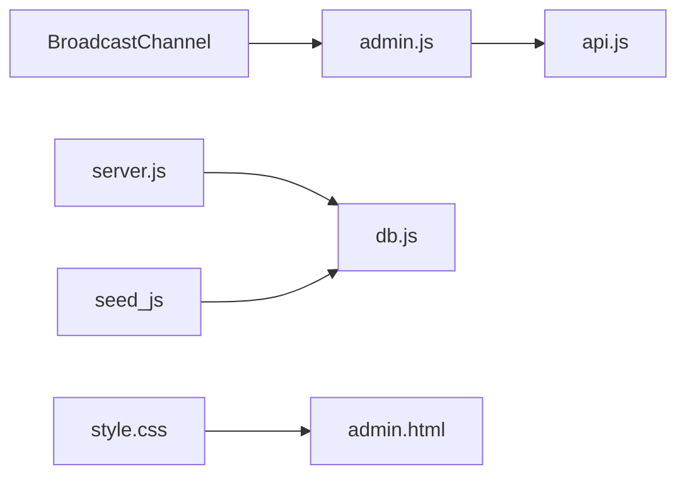

**图表来源**
- [admin.js:1-5](file://frontend/js/admin.js#L1-L5)
- [server.js:1-16](file://backend/server.js#L1-L16)
- [db.js:1-9](file://backend/db.js#L1-L9)
- [seed.js:1-12](file://backend/seed.js#L1-L12)

**章节来源**
- [admin.js:1-5](file://frontend/js/admin.js#L1-L5)
- [server.js:1-16](file://backend/server.js#L1-L16)
- [db.js:1-9](file://backend/db.js#L1-L9)
- [seed.js:1-12](file://backend/seed.js#L1-L12)

## 性能与扩展性
- **图片存储**：采用 base64 内嵌数据库，适合小规模演示；生产环境建议迁移至对象存储（如 OSS/S3），数据库仅存 URL 引用
- **列表渲染**：当前全量拉取并内存渲染，适合中小规模；大数据量时可引入分页与虚拟滚动
- **并发与限流**：后端可加入速率限制与请求体大小限制策略，保护数据库与带宽
- **缓存策略**：对只读接口（如 /api/products）可考虑 Redis 缓存以提升性能
- **图片去重**：基于内容哈希的文件命名，天然去重，避免重复文件占用空间
- **异步处理**：轮播图和商品操作的异步处理，提升用户体验
- **存储优化**：智能的文件清理机制，自动删除不再被引用的图片文件
- **数据库优化**：支持 PostgreSQL 和 SQLite 两种数据库，根据环境自动选择最优方案
- **扩展性设计**：模块化架构，便于添加新的管理功能和业务逻辑
- **大容量支持**：80MB JSON限制和50MB单商品图片总量限制，支持大规模商品图片管理
- **双进度条优化**：增强的存储统计面板提供双进度条设计，改善用户体验和数据可视化效果
- **响应式导航**：左侧导航栏支持响应式设计，在不同屏幕尺寸下提供最佳用户体验
- **实时同步**：全站设置支持跨标签页实时同步，提升多任务工作效率
- **英雄产品优化**：全局唯一的主推款设置，简化前台展示逻辑
- **深色主题优化**：编辑模式的深色主题提升视觉对比度和专注度
- **平滑滚动优化**：改善创建和编辑模式之间的切换体验
- **水平溢出修复**：解决full-bleed布局在滚动条存在时的横向溢出问题

## 故障排查指南
- **无法加载商品列表**
  - 检查后端是否运行与健康检查 /api/health 是否可达
  - 检查 CORS 配置与端口映射
  - 查看控制台错误信息，确认 api.js 抛出的错误原因
- **登录失败**
  - 检查用户名和密码是否正确
  - 确认用户是否具有管理员权限
  - 检查 Token 是否过期或丢失
- **轮播图上传失败**
  - 检查文件大小是否超过 8MB 限制
  - 确认图片格式是否受支持
  - 检查服务器存储空间是否充足
- **图片显示异常**
  - 确认图片文件是否存在于 uploads 目录
  - 检查图片 URL 是否正确
  - 验证浏览器缓存是否导致显示问题
- **权限相关问题**
  - 确认当前用户是否为管理员
  - 检查 JWT Token 是否有效
  - 验证后端权限中间件是否正常工作
- **存储统计不显示**
  - 检查 /api/stats/storage 接口是否可访问
  - 确认当前用户具有管理员权限
  - 检查数据库连接是否正常
  - 验证双进度条CSS样式是否正确加载
- **数据同步问题**
  - 确认网络连接是否正常
  - 检查 API 响应数据格式是否正确
  - 验证前端状态管理逻辑
- **图片上传验证失败**
  - 检查单张图片是否超过8MB限制
  - 确认商品图片总量是否超过50MB限制
  - 验证dataUrlBytes()函数计算是否正确
  - 检查JSON字符串长度是否超过75MB限制
- **双进度条显示异常**
  - 检查.stat-bars CSS样式是否正确应用
  - 验证进度条宽度计算逻辑
  - 确认后端返回的磁盘容量数据格式正确
- **左侧导航栏问题**
  - 检查导航栏CSS样式是否正确加载
  - 验证锚点链接是否指向正确的元素ID
  - 确认响应式设计媒体查询是否正常工作
- **英雄产品设置失败**
  - 检查 /api/settings 接口是否可访问
  - 确认当前用户具有管理员权限
  - 验证数据库连接是否正常
  - 检查前端状态同步逻辑
- **产品排序无效**
  - 检查 sort_weight 字段是否正确更新
  - 确认前端事件监听器是否正常工作
  - 验证后端排序逻辑是否正确实现
- **全站设置不同步**
  - 检查 BroadcastChannel 是否受支持
  - 确认设置保存接口是否正常工作
  - 验证前台设置获取逻辑是否正确
- **深色主题显示异常**
  - 检查 is-editing 类是否正确添加
  - 验证深色主题CSS样式是否加载
  - 确认按钮反转效果是否正常
- **平滑滚动问题**
  - 检查 scrollIntoView 方法是否被调用
  - 验证 scroll-margin-top 是否正确设置
  - 确认 sticky 导航的高度计算
- **水平溢出问题**
  - 检查 overflow-x: clip 是否正确应用
  - 验证 full-bleed 布局的兼容性
  - 确认滚动条存在时的布局表现

**章节来源**
- [admin.js:41-64](file://frontend/js/admin.js#L41-L64)
- [admin.js:242-364](file://frontend/js/admin.js#L242-L364)
- [admin.js:367-402](file://frontend/js/admin.js#L367-L402)
- [admin.js:503-529](file://frontend/js/admin.js#L503-L529)
- [admin.js:558-563](file://frontend/js/admin.js#L558-L563)
- [admin.js:113-141](file://frontend/js/admin.js#L113-L141)
- [admin.js:237-273](file://frontend/js/admin.js#L237-L273)
- [admin.js:677-691](file://frontend/js/admin.js#L677-L691)
- [admin.js:143-235](file://frontend/js/admin.js#L143-L235)
- [admin.js:530-532](file://frontend/js/admin.js#L530-L532)
- [server.js:215-231](file://backend/server.js#L215-L231)
- [server.js:297-362](file://backend/server.js#L297-L362)
- [server.js:374-440](file://backend/server.js#L374-L440)
- [server.js:492-522](file://backend/server.js#L492-L522)
- [style.css:34-35](file://frontend/css/style.css#L34-L35)
- [style.css:569-587](file://frontend/css/style.css#L569-L587)
- [style.css:600-619](file://frontend/css/style.css#L600-L619)
- [style.css:690-716](file://frontend/css/style.css#L690-L716)

## 结论
LeapShop 管理后台通过清晰的前后端职责划分与严格的权限控制，实现了全面的管理能力。**最新的更新**包括：**增强的管理面板布局**提供了水平溢出修复、响应式设计改进和垂直堆叠表单布局，显著提升了用户体验；**深色主题模式**为商品编辑提供了专门的视觉主题，增强了编辑体验的对比度和专注度；**平滑滚动行为**改善了创建和编辑模式之间的切换体验；**左侧导航栏系统**提供了便捷的页面导航体验，支持响应式设计和粘性定位；**英雄产品管理面板**实现了全局唯一主推款的设置和管理，影响前台首页和商品概览的展示；**产品排序功能**支持 sort_weight 字段实现系列内自定义排序；**全站设置管理**支持站点配置的全局管理，具备跨标签页实时同步能力；**增强的存储统计面板**采用了双进度条设计，同时显示产品数据占比和磁盘容量利用率，提供了更直观的数据可视化体验。**图片上传系统升级**将JSON限制提升至80MB，单商品图片总量限制达到50MB，配备了real-time大小验证和全面的客户端验证机制。**内置登录验证系统**提供了安全的身份认证机制，**轮播图管理功能**支持首页图片轮播的全面管理，**双图片画廊编辑系统**允许主图和详情图的独立管理，**销售卖点管理功能**支持产品信息的多行文本编辑。这些功能提供了更全面的商品管理能力，帮助管理员更好地维护和管理电商平台的内容。建议在后续迭代中引入对象存储、分页与更完善的批量操作能力，以提升性能与用户体验。

## 附录：API 参考与安全清单
- **API 一览**
  - POST /api/auth/login：公开，登录返回 JWT
  - GET /api/auth/me：登录，获取当前用户信息
  - GET /api/products：公开，商品列表（支持 ?category=）
  - GET /api/products/:id：公开，商品详情
  - GET /api/products/:id/storage：管理员，获取单个商品的存储详情
  - POST /api/products：管理员，新增商品（支持 images[]、details[]、info[]）
  - PUT /api/products/:id：管理员，更新商品
  - DELETE /api/products/:id：管理员，删除商品
  - GET /api/slides：公开/管理员，轮播图列表（?all=1 获取全部）
  - POST /api/slides：管理员，新增轮播图
  - PUT /api/slides/:id：管理员，更新轮播图
  - DELETE /api/slides/:id：管理员，删除轮播图
  - GET /api/stats/storage：管理员，获取存储统计信息（包含双进度条所需数据）
  - GET /api/settings：公开，获取站点设置
  - PUT /api/settings：管理员，更新站点设置
  - POST /api/settings/logo：管理员，上传站点LOGO
  - GET /api/health：公开，健康检查
- **安全清单**
  - 前端：escapeHtml 输出编码；Token 存储于 localStorage；登出时清除
  - 后端：JWT 校验；adminOnly 角色校验；输入校验与默认值；401/403/404 明确错误
  - 图片上传：8MB单张限制；50MB总量限制；80MB JSON限制；文件格式验证；内容哈希去重存储
  - 数据存储：数据库字段长度限制；SQL 注入防护；文件路径验证
  - 网络通信：CORS 配置；HTTPS 支持；请求频率限制
  - 存储统计：双进度条数据完整性验证；磁盘容量信息准确性保障
  - 设置管理：跨标签页同步安全性；设置项白名单验证
  - 导航安全：锚点跳转XSS防护；响应式布局兼容性测试
  - 主题安全：深色主题样式隔离；CSS类名冲突防护
  - 滚动安全：平滑滚动兼容性检查；sticky导航高度计算

**章节来源**
- [server.js:246-522](file://backend/server.js#L246-L522)
- [api.js:51-55](file://frontend/js/api.js#L51-L55)
- [api.js:62-80](file://frontend/js/api.js#L62-L80)
- [admin.js:113-141](file://frontend/js/admin.js#L113-L141)
- [admin.js:237-273](file://frontend/js/admin.js#L237-L273)
- [admin.js:677-691](file://frontend/js/admin.js#L677-L691)
- [admin.js:143-235](file://frontend/js/admin.js#L143-L235)
- [admin.js:530-532](file://frontend/js/admin.js#L530-L532)
- [style.css:34-35](file://frontend/css/style.css#L34-L35)
- [style.css:569-587](file://frontend/css/style.css#L569-L587)
- [style.css:600-619](file://frontend/css/style.css#L600-L619)
- [style.css:690-716](file://frontend/css/style.css#L690-L716)