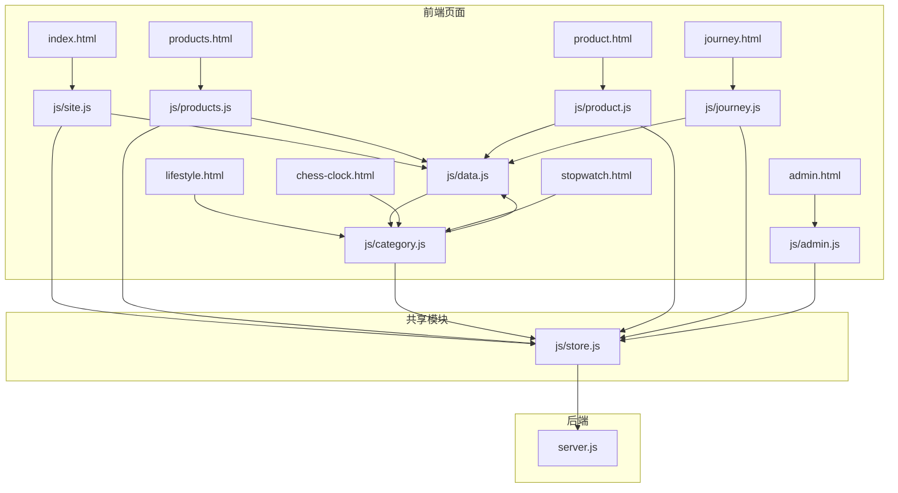
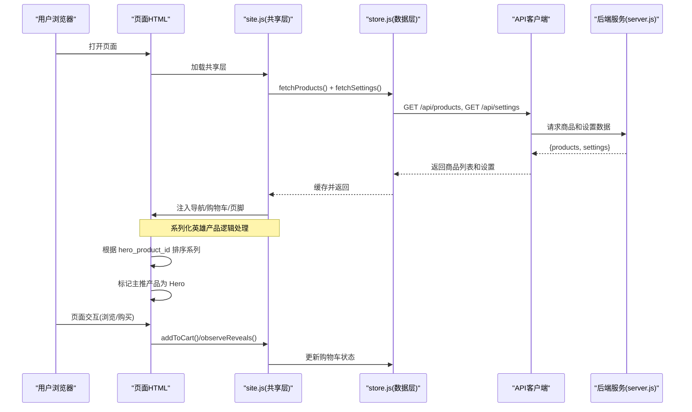
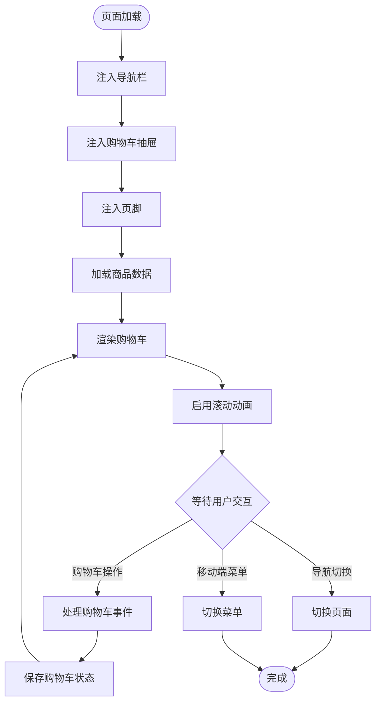
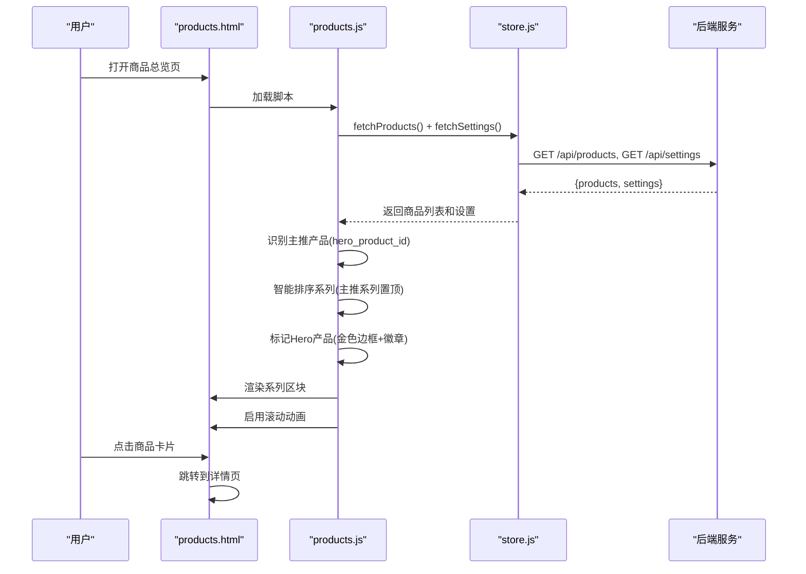
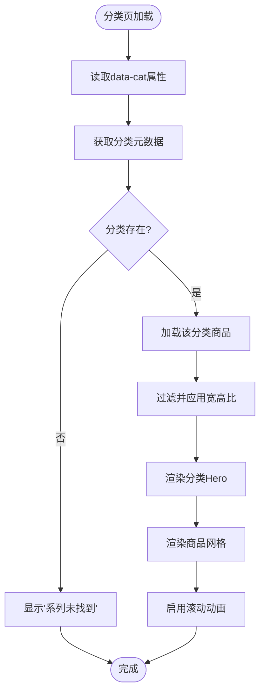
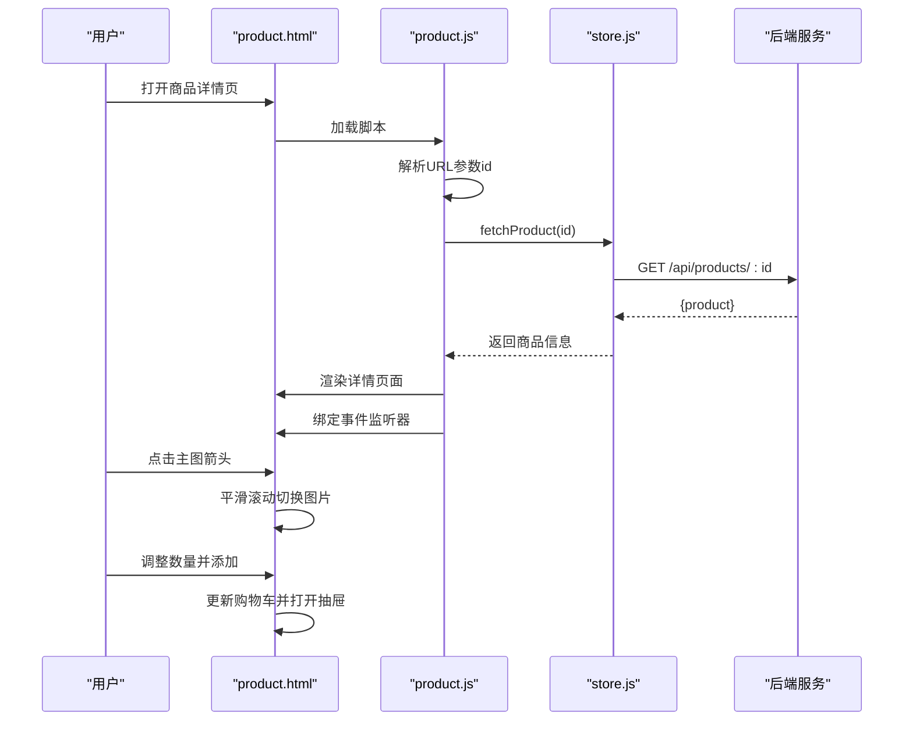
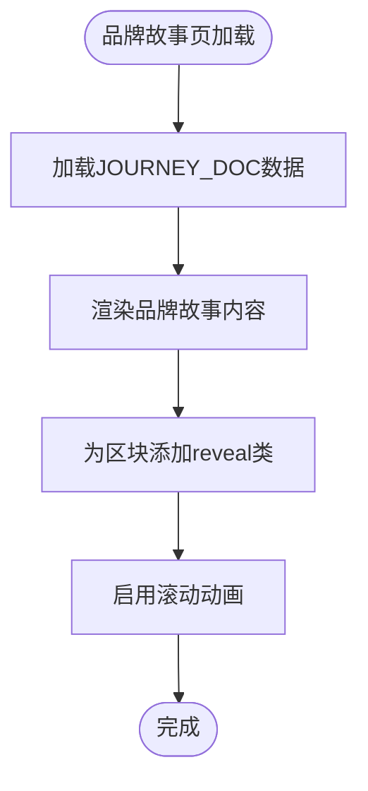
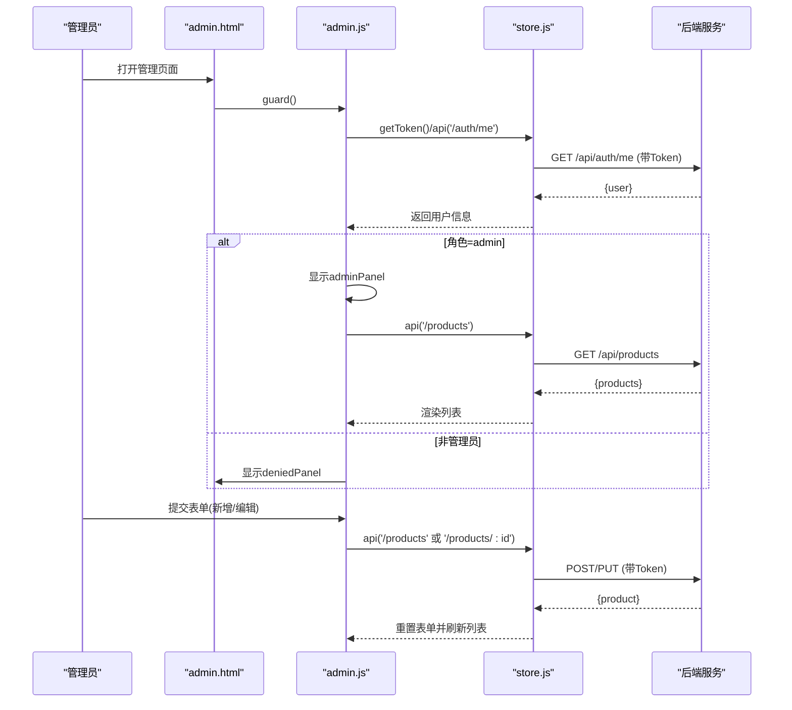
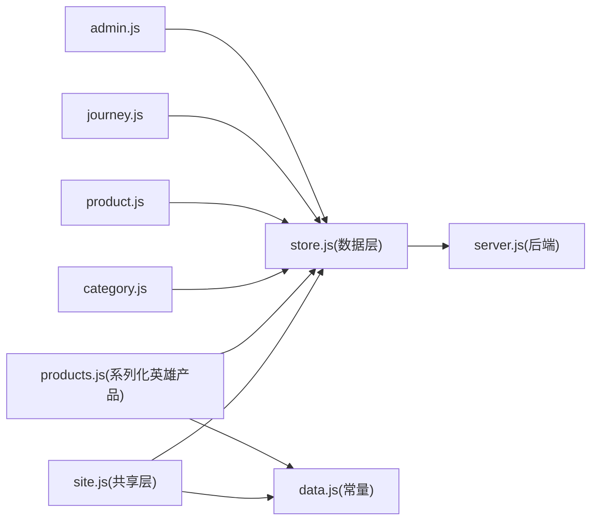

# 页面组件实现

<cite>
**本文引用的文件**
- [frontend/index.html](file://frontend/index.html)
- [frontend/products.html](file://frontend/products.html)
- [frontend/lifestyle.html](file://frontend/lifestyle.html)
- [frontend/chess-board.html](file://frontend/chess-board.html)
- [frontend/chess-clock.html](file://frontend/chess-clock.html)
- [frontend/stopwatch.html](file://frontend/stopwatch.html)
- [frontend/journey.html](file://frontend/journey.html)
- [frontend/product.html](file://frontend/product.html)
- [frontend/admin.html](file://frontend/admin.html)
- [frontend/js/site.js](file://frontend/js/site.js)
- [frontend/js/store.js](file://frontend/js/store.js)
- [frontend/js/data.js](file://frontend/js/data.js)
- [frontend/js/products.js](file://frontend/js/products.js)
- [frontend/js/category.js](file://frontend/js/category.js)
- [frontend/js/product.js](file://frontend/js/product.js)
- [frontend/js/journey.js](file://frontend/js/journey.js)
- [frontend/js/admin.js](file://frontend/js/admin.js)
- [backend/server.js](file://backend/server.js)
- [frontend/css/style.css](file://frontend/css/style.css)
</cite>

## 更新摘要
**变更内容**
- 重构为八页面结构，新增 products.html、lifestyle.html、chess-board.html、chess-clock.html、stopwatch.html、journey.html、product.html 等专门页面
- 新增 site.js 全站共享层，统一导航、购物车抽屉和页脚注入
- 新增 category.js 分类页脚本，支持 chess-clock、chess-board、stopwatch、lifestyle 四个系列
- **新增系列化英雄产品放置逻辑**：products.js 实现主推产品的智能排序和视觉突出显示
- 新增 product.js 商品详情页脚本，支持主图轮播和购买交互
- 新增 journey.js 品牌故事页脚本，展示品牌历程
- 更新 store.js 数据层，提供统一的商品 API 封装
- 更新 data.js 常量配置，包含分类元数据和品牌故事内容

## 目录
1. [简介](#简介)
2. [项目结构](#项目结构)
3. [核心组件](#核心组件)
4. [架构总览](#架构总览)
5. [详细组件分析](#详细组件分析)
6. [依赖关系分析](#依赖关系分析)
7. [性能考虑](#性能考虑)
8. [故障排查指南](#故障排查指南)
9. [结论](#结论)
10. [附录：集成与使用指南](#附录集成与使用指南)

## 简介
本文件为 LeapShop 前端各页面组件的实现文档，覆盖首页商品动态加载、登录认证流程与管理后台权限控制及商品 CRUD。经过重构后，项目采用八页面结构，通过模块化 JS（ES Module）组织逻辑，HTML 作为页面骨架，CSS 提供主题样式；后端基于 Express 提供 RESTful API 与静态资源托管。**特别新增了系列化英雄产品放置逻辑**，实现了按类别组织的智能产品展示机制，包括主推产品的自动排序和视觉突出显示。

## 项目结构
前端采用模块化 JS（ES Module）组织逻辑，HTML 作为页面骨架，CSS 提供主题样式；后端基于 Express 提供 RESTful API 与静态资源托管。

图示来源
- [frontend/index.html:1-169](file://frontend/index.html#L1-L169)
- [frontend/products.html:1-27](file://frontend/products.html#L1-L27)
- [frontend/lifestyle.html:1-16](file://frontend/lifestyle.html#L1-L16)
- [frontend/chess-board.html:1-16](file://frontend/chess-board.html#L1-L16)
- [frontend/chess-clock.html:1-16](file://frontend/chess-clock.html#L1-L16)
- [frontend/stopwatch.html:1-16](file://frontend/stopwatch.html#L1-L16)
- [frontend/journey.html:1-27](file://frontend/journey.html#L1-L27)
- [frontend/product.html:1-16](file://frontend/product.html#L1-L16)
- [frontend/admin.html:1-97](file://frontend/admin.html#L1-L97)
- [frontend/js/site.js:1-179](file://frontend/js/site.js#L1-L179)
- [frontend/js/store.js:1-60](file://frontend/js/store.js#L1-L60)
- [frontend/js/data.js:1-81](file://frontend/js/data.js#L1-L81)
- [frontend/js/products.js:1-54](file://frontend/js/products.js#L1-L54)
- [frontend/js/category.js:1-56](file://frontend/js/category.js#L1-L56)
- [frontend/js/product.js:1-100](file://frontend/js/product.js#L1-L100)
- [frontend/js/journey.js:1-16](file://frontend/js/journey.js#L1-L16)
- [frontend/js/admin.js:1-182](file://frontend/js/admin.js#L1-L182)
- [backend/server.js:1-169](file://backend/server.js#L1-L169)
- [frontend/css/style.css:1-200](file://frontend/css/style.css#L1-L200)

章节来源
- [frontend/index.html:1-169](file://frontend/index.html#L1-L169)
- [frontend/js/store.js:1-60](file://frontend/js/store.js#L1-L60)
- [backend/server.js:1-169](file://backend/server.js#L1-L169)

## 核心组件
- 全站共享层（site.js）：统一注入导航栏、购物车抽屉、页脚，维护跨页购物车状态，提供滚动动画和事件委托。
- 数据层（store.js）：自动探测后端地址，提供商品获取、单页详情、轮播图等 API 封装，包含 XSS 防护和价格格式化。
- **系列化英雄产品系统**：products.js 实现主推产品的智能排序和视觉突出显示，category.js 支持四个系列的瀑布流展示。
- 商品总览页（products.js）：按系列分组展示所有商品，支持主推产品置顶和 Hero 标记，点击跳转到详情页。
- 商品详情页（product.js）：主图轮播、数量选择、加入购物车等功能。
- 品牌故事页（journey.js）：展示品牌发展历程和价值主张。
- 管理后台模块：访问守卫（鉴权）、商品列表渲染、表单创建/编辑、图片预览与上传、删除确认与刷新。

章节来源
- [frontend/js/site.js:1-179](file://frontend/js/site.js#L1-L179)
- [frontend/js/store.js:1-60](file://frontend/js/store.js#L1-L60)
- [frontend/js/category.js:1-56](file://frontend/js/category.js#L1-L56)
- [frontend/js/products.js:1-54](file://frontend/js/products.js#L1-L54)
- [frontend/js/product.js:1-100](file://frontend/js/product.js#L1-L100)
- [frontend/js/journey.js:1-16](file://frontend/js/journey.js#L1-L16)
- [frontend/js/admin.js:1-182](file://frontend/js/admin.js#L1-L182)

## 架构总览
前端通过 store.js 的封装函数发起 HTTP 请求，自动探测后端地址；后端 server.js 提供 /api 路由，包含认证、商品 CRUD、健康检查等。各页面通过 site.js 获得统一的导航、购物车和页脚功能。**新增的系列化英雄产品系统通过 settings.hero_product_id 配置实现主推产品的智能展示**。

图示来源
- [frontend/js/site.js:77-179](file://frontend/js/site.js#L77-L179)
- [frontend/js/store.js:8-60](file://frontend/js/store.js#L8-L60)
- [frontend/js/products.js:24-53](file://frontend/js/products.js#L24-L53)
- [backend/server.js:44-140](file://backend/server.js#L44-L140)

## 详细组件分析

### 全站共享层（site.js + 多页面）
- HTML 结构要点
  - 每个页面通过 `data-page` 属性标识当前页面类型
  - 导航栏：品牌LOGO、七页导航链接、购物车按钮、移动端菜单按钮
  - 购物车抽屉：侧边滑出式购物车，支持商品数量调整和导出清单
  - 页脚：品牌信息、导航链接、版权信息
- JavaScript 逻辑要点
  - 动态注入：在页面初始化时插入导航、购物车抽屉和页脚HTML
  - 购物车管理：localStorage 持久化，支持增删改查和总额计算
  - 事件委托：统一处理购物车操作、导航切换、移动端菜单
  - 滚动动画：IntersectionObserver 实现元素进入视口时的显示效果
  - 全局API：暴露 addToCart、observeReveals、money、escapeHtml、findProduct 等方法
- 用户交互流程
  - 页面加载 → 注入共享组件 → 加载商品数据 → 渲染购物车 → 启用滚动动画
  - 点击购物车 → 打开抽屉 → 显示商品列表 → 调整数量 → 导出清单
  - 点击导航 → 切换页面 → 保持购物车状态
- 关键代码路径参考
  - 导航注入：[frontend/js/site.js:14-46](file://frontend/js/site.js#L14-L46)
  - 购物车管理：[frontend/js/site.js:77-143](file://frontend/js/site.js#L77-L143)
  - 事件委托：[frontend/js/site.js:145-163](file://frontend/js/site.js#L145-L163)
  - 滚动动画：[frontend/js/site.js:165-172](file://frontend/js/site.js#L165-L172)
  - 全局API：[frontend/js/site.js:174-175](file://frontend/js/site.js#L174-L175)

图示来源
- [frontend/js/site.js:14-75](file://frontend/js/site.js#L14-L75)
- [frontend/js/site.js:77-179](file://frontend/js/site.js#L77-L179)

章节来源
- [frontend/js/site.js:14-179](file://frontend/js/site.js#L14-L179)

### 系列化英雄产品系统（products.js + products.html）
- HTML 结构要点
  - 页面标题：The Catalog 微标签 + Product Overview 大标题 + 描述文本
  - 内容区域：checker-band 装饰条 + ovSecs 容器用于动态渲染系列区块
- **系列化英雄产品逻辑要点**
  - **主推产品识别**：从 settings.hero_product_id 获取主推产品ID
  - **智能系列排序**：主推产品所属系列自动置顶，其他系列按原顺序排列
  - **Hero 标记系统**：主推产品在系列内排首位，并添加金色边框和 Hero 徽章
  - **瀑布流布局**：使用 CSS columns 实现 masonry 布局，自动分配不同宽高比
  - **商品卡片增强**：包含图片、名称、描述片段、价格和 Hero 标记
- **用户交互流程**
  - 页面加载 → 获取所有商品和设置 → 识别主推产品 → 按系列分组 → 智能排序 → 渲染瀑布流 → 启用滚动动画
  - 点击商品 → 跳转到 product.html?id=N 详情页
- **关键代码路径参考**
  - 主推产品获取：[frontend/js/products.js:24-26](file://frontend/js/products.js#L24-L26)
  - 系列智能排序：[frontend/js/products.js:29-33](file://frontend/js/products.js#L29-L33)
  - Hero 产品标记：[frontend/js/products.js:11-22](file://frontend/js/products.js#L11-L22)
  - 系列渲染逻辑：[frontend/js/products.js:34-50](file://frontend/js/products.js#L34-L50)
  - 错误处理：[frontend/js/products.js:51-53](file://frontend/js/products.js#L51-L53)
  - 页面入口：[frontend/products.html:10-25](file://frontend/products.html#L10-L25)

图示来源
- [frontend/js/products.js:24-53](file://frontend/js/products.js#L24-L53)
- [frontend/js/store.js:43-53](file://frontend/js/store.js#L43-L53)
- [backend/server.js:282-298](file://backend/server.js#L282-L298)

章节来源
- [frontend/products.html:10-25](file://frontend/products.html#L10-L25)
- [frontend/js/products.js:11-54](file://frontend/js/products.js#L11-L54)
- [frontend/js/store.js:43-53](file://frontend/js/store.js#L43-L53)

### 分类页（category.js + 多个分类页面）
- HTML 结构要点
  - 每个分类页面通过 `data-cat` 属性指定具体分类（chess-clock、chess-board、stopwatch、lifestyle）
  - 统一容器：catRoot 用于渲染分类 Hero 和商品网格
- JavaScript 逻辑要点
  - 分类识别：读取 body.dataset.cat 确定当前分类
  - 元数据获取：从 CAT_META 获取分类标题、标语、微标签等信息
  - 商品过滤：根据分类ID筛选对应商品，应用宽高比节奏
  - 错误处理：分类不存在或网络异常时显示友好提示
- 用户交互流程
  - 页面加载 → 识别分类 → 获取分类元数据 → 加载对应商品 → 渲染 Hero 和网格 → 启用滚动动画
  - 点击商品 → 跳转到详情页
- 关键代码路径参考
  - 分类识别：[frontend/js/category.js:10-17](file://frontend/js/category.js#L10-L17)
  - 商品加载：[frontend/js/category.js:18-25](file://frontend/js/category.js#L18-L25)
  - 页面渲染：[frontend/js/category.js:27-52](file://frontend/js/category.js#L27-L52)
  - 页面入口：[frontend/lifestyle.html:10-14](file://frontend/lifestyle.html#L10-L14)

图示来源
- [frontend/js/category.js:10-56](file://frontend/js/category.js#L10-L56)
- [frontend/js/data.js:22-31](file://frontend/js/data.js#L22-L31)

章节来源
- [frontend/lifestyle.html:10-14](file://frontend/lifestyle.html#L10-L14)
- [frontend/chess-board.html:10-14](file://frontend/chess-board.html#L10-L14)
- [frontend/chess-clock.html:10-14](file://frontend/chess-clock.html#L10-L14)
- [frontend/stopwatch.html:10-14](file://frontend/stopwatch.html#L10-L14)
- [frontend/js/category.js:10-56](file://frontend/js/category.js#L10-L56)

### 商品详情页（product.js + product.html）
- HTML 结构要点
  - 页面容器：pdRoot 用于动态渲染商品详情
  - 响应式布局：左侧主图区 + 右侧信息区的网格布局
- JavaScript 逻辑要点
  - 参数解析：从 URL 查询参数获取商品ID
  - 商品获取：调用 fetchProduct(id) 获取详细信息
  - 主图轮播：支持左右箭头切换和滑动浏览，自动禁用边界状态
  - 购买交互：数量增减器、添加到购物车功能
  - 错误处理：商品不存在时显示回退链接
- 用户交互流程
  - 页面加载 → 解析商品ID → 获取商品信息 → 渲染详情页面 → 绑定交互事件
  - 点击主图箭头 → 平滑滚动切换图片 → 更新按钮状态
  - 调整数量 → 点击添加 → 更新购物车并打开抽屉
- 关键代码路径参考
  - 参数解析：[frontend/js/product.js:11-12](file://frontend/js/product.js#L11-L12)
  - 商品获取：[frontend/js/product.js:23-26](file://frontend/js/product.js#L23-L26)
  - 主图轮播：[frontend/js/product.js:77-96](file://frontend/js/product.js#L77-L96)
  - 购买交互：[frontend/js/product.js:73-75](file://frontend/js/product.js#L73-L75)
  - 页面入口：[frontend/product.html:10-14](file://frontend/product.html#L10-L14)

图示来源
- [frontend/js/product.js:23-96](file://frontend/js/product.js#L23-L96)
- [frontend/js/store.js:50-53](file://frontend/js/store.js#L50-L53)
- [backend/server.js:294-298](file://backend/server.js#L294-L298)

章节来源
- [frontend/product.html:10-14](file://frontend/product.html#L10-L14)
- [frontend/js/product.js:11-100](file://frontend/js/product.js#L11-L100)

### 品牌故事页（journey.js + journey.html）
- HTML 结构要点
  - 页面标题：Our Journey 微标签 + About Us 大标题 + 品牌标语
  - 内容区域：journeyDoc 容器用于渲染品牌故事内容
- JavaScript 逻辑要点
  - 内容渲染：从 JOURNEY_DOC 常量获取品牌故事数据
  - 结构化展示：支持标题、段落、列表等多种内容格式
  - 滚动动画：为每个故事区块添加 reveal 类实现渐显效果
- 用户交互流程
  - 页面加载 → 获取品牌故事数据 → 渲染结构化内容 → 启用滚动动画
- 关键代码路径参考
  - 内容渲染：[frontend/js/journey.js:8-13](file://frontend/js/journey.js#L8-L13)
  - 页面入口：[frontend/journey.html:10-25](file://frontend/journey.html#L10-L25)

图示来源
- [frontend/js/journey.js:8-16](file://frontend/js/journey.js#L8-L16)
- [frontend/js/data.js:58-80](file://frontend/js/data.js#L58-L80)

章节来源
- [frontend/journey.html:10-25](file://frontend/journey.html#L10-L25)
- [frontend/js/journey.js:8-16](file://frontend/js/journey.js#L8-L16)

### 管理后台（admin.js + admin.html）
- HTML 结构要点
  - 导航栏：返回站点链接、用户状态插槽
  - 访问拒绝面板：未登录或非管理员时显示提示信息
  - 管理面板：左侧表单（创建/编辑），右侧商品列表（含操作按钮）
- JavaScript 逻辑要点
  - 访问守卫：检测登录状态与角色，非管理员显示拒绝面板
  - 商品列表：调用 /api/products 渲染表格，支持编辑/删除
  - 表单处理：创建或更新商品，支持图片 base64 预览与上传（限制大小）
  - 行操作：编辑填充表单，删除前二次确认并调用 DELETE
- 用户交互流程
  - 进入页面 → 守卫校验 → 允许则加载商品列表 → 表单提交创建/更新 → 刷新列表
  - 点击删除 → 确认 → 调用删除接口 → 刷新列表
- 关键代码路径参考
  - 访问守卫：[frontend/js/admin.js:12-34](file://frontend/js/admin.js#L12-L34)
  - 商品列表加载：[frontend/js/admin.js:37-66](file://frontend/js/admin.js#L37-L66)
  - 表单提交（创建/更新）：[frontend/js/admin.js:128-152](file://frontend/js/admin.js#L128-L152)
  - 图片预览与上传：[frontend/js/admin.js:110-126](file://frontend/js/admin.js#L110-L126)
  - 行操作（编辑/删除）：[frontend/js/admin.js:157-176](file://frontend/js/admin.js#L157-L176)
  - 页面入口：[frontend/admin.html:24-91](file://frontend/admin.html#L24-L91)

图示来源
- [frontend/js/admin.js:12-34](file://frontend/js/admin.js#L12-L34)
- [frontend/js/admin.js:37-66](file://frontend/js/admin.js#L37-L66)
- [frontend/js/admin.js:128-152](file://frontend/js/admin.js#L128-L152)
- [backend/server.js:282-389](file://backend/server.js#L282-L389)

章节来源
- [frontend/admin.html:24-91](file://frontend/admin.html#L24-L91)
- [frontend/js/admin.js:12-182](file://frontend/js/admin.js#L12-L182)
- [backend/server.js:282-389](file://backend/server.js#L282-L389)

### 数据层（store.js）
- 功能要点
  - 自动探测后端地址：优先同源 /api，否则回退到本地 3000 端口
  - 统一请求封装：get() 方法处理所有GET请求，自动错误处理
  - 商品数据管理：fetchProducts() 模块级缓存，fetchProduct() 单页详情
  - **系列化支持**：withRatios() 函数为瀑布流布局提供宽高比节奏
  - 工具函数：escapeHtml XSS防护、money 价格格式化、PLACEHOLDER 占位符
- 关键代码路径参考
  - 后端探测：[frontend/js/store.js:8-16](file://frontend/js/store.js#L8-L16)
  - 请求封装：[frontend/js/store.js:18-23](file://frontend/js/store.js#L18-L23)
  - 商品获取：[frontend/js/store.js:43-53](file://frontend/js/store.js#L43-L53)
  - 瀑布流支持：[frontend/js/store.js:34-36](file://frontend/js/store.js#L34-L36)
  - 工具函数：[frontend/js/store.js:25-36](file://frontend/js/store.js#L25-L36)

章节来源
- [frontend/js/store.js:8-60](file://frontend/js/store.js#L8-L60)

### 常量配置（data.js）
- 功能要点
  - 品牌信息：BRAND 对象包含LOGO、微标签和品牌名
  - 分类定义：CATS 数组定义四个产品系列
  - 分类元数据：CAT_META 对象包含每个系列的页面映射、标题、标语等
  - 价值主张：WHY 数组展示三个核心价值点
  - 统计数据：STATS 数组包含品牌历史数字
  - 品牌历程：HERITAGE 和 JOURNEY_DOC 提供品牌故事内容
- 关键代码路径参考
  - 品牌信息：[frontend/js/data.js:8-12](file://frontend/js/data.js#L8-L12)
  - 分类定义：[frontend/js/data.js:14-31](file://frontend/js/data.js#L14-L31)
  - 价值主张：[frontend/js/data.js:33-41](file://frontend/js/data.js#L33-L41)
  - 品牌故事：[frontend/js/data.js:57-80](file://frontend/js/data.js#L57-L80)

章节来源
- [frontend/js/data.js:8-80](file://frontend/js/data.js#L8-L80)

## 依赖关系分析
- 模块耦合
  - 所有页面都依赖 site.js 提供的共享功能
  - 业务页面（products.js、category.js、product.js、journey.js）依赖 store.js 的数据层
  - **系列化英雄产品系统**：products.js 同时依赖 store.js 和 data.js，实现智能排序和视觉突出
  - 所有业务页面都依赖 data.js 的常量配置
  - 管理后台独立于前台模块，直接依赖 store.js
- 外部依赖
  - 后端 Express/CORS/JWT/Bcrypt/Pg/SQLite 等，提供认证与数据持久化
- 潜在循环依赖
  - 当前无循环导入；所有页面单向依赖共享模块
- 接口契约
  - 商品：GET /api/products?category=...；GET /api/products/:id
  - 设置：GET /api/settings（包含 hero_product_id）
  - 健康：GET /api/health 返回 {status, db}

图示来源
- [frontend/js/site.js:1-179](file://frontend/js/site.js#L1-L179)
- [frontend/js/store.js:1-60](file://frontend/js/store.js#L1-L60)
- [frontend/js/data.js:1-81](file://frontend/js/data.js#L1-L81)
- [frontend/js/products.js:1-54](file://frontend/js/products.js#L1-L54)
- [frontend/js/category.js:1-56](file://frontend/js/category.js#L1-L56)
- [frontend/js/product.js:1-100](file://frontend/js/product.js#L1-L100)
- [frontend/js/journey.js:1-16](file://frontend/js/journey.js#L1-L16)
- [frontend/js/admin.js:1-182](file://frontend/js/admin.js#L1-L182)
- [backend/server.js:1-169](file://backend/server.js#L1-L169)

章节来源
- [frontend/js/site.js:1-179](file://frontend/js/site.js#L1-L179)
- [frontend/js/store.js:1-60](file://frontend/js/store.js#L1-L60)
- [frontend/js/data.js:1-81](file://frontend/js/data.js#L1-L81)
- [backend/server.js:1-169](file://backend/server.js#L1-L169)

## 性能考虑
- 图片懒加载：所有商品图片使用 loading="lazy"，减少首屏带宽压力
- 滚动动画：IntersectionObserver 阈值设为 0.15，避免频繁重排
- 数据缓存：store.js 模块级缓存商品列表，避免重复请求
- **系列化优化**：主推产品智能排序减少用户查找时间，Hero 标记提升视觉焦点
- 瀑布流布局：CSS columns 实现 masonry 布局，提升视觉体验
- 购物车优化：localStorage 持久化，支持离线状态
- 建议优化
  - 对商品列表增加分页或虚拟滚动以应对大数据集
  - 对图片进行服务端压缩与 CDN 缓存
  - 对高频请求增加短期缓存策略（如内存缓存或 Service Worker）

## 故障排查指南
- 无法连接后端
  - 现象：页面显示"Products are temporarily unavailable"
  - 排查：确认后端服务运行于 3000 端口或部署环境可访问 /api/health；检查 CORS 配置
  - 相关位置：[frontend/js/store.js:8-16](file://frontend/js/store.js#L8-L16)、[backend/server.js:137-140](file://backend/server.js#L137-L140)
- **系列化英雄产品不显示**
  - 现象：products.html 没有 Hero 标记或主推产品未置顶
  - 排查：检查 settings.hero_product_id 是否正确设置；确认对应商品存在且属于有效分类
  - 相关位置：[frontend/js/products.js:24-26](file://frontend/js/products.js#L24-L26)、[backend/server.js:460-479](file://backend/server.js#L460-L479)
- 商品页面空白
  - 现象：products.html 或分类页面显示空白
  - 排查：检查 console 是否有 JavaScript 错误；确认后端 /api/products 接口正常
  - 相关位置：[frontend/js/products.js:51-53](file://frontend/js/products.js#L51-L53)、[frontend/js/category.js:22-25](file://frontend/js/category.js#L22-L25)
- 商品详情页404
  - 现象：product.html?id=N 显示"Product not found"
  - 排查：确认商品ID是否存在；检查 /api/products/:N 接口返回
  - 相关位置：[frontend/js/product.js:14-21](file://frontend/js/product.js#L14-L21)、[backend/server.js:294-298](file://backend/server.js#L294-L298)
- 购物车不工作
  - 现象：添加商品后购物车数量为0
  - 排查：检查 localStorage 是否可用；确认商品数据是否正确加载
  - 相关位置：[frontend/js/site.js:77-85](file://frontend/js/site.js#L77-L85)、[frontend/js/site.js:88-91](file://frontend/js/site.js#L88-L91)

章节来源
- [frontend/js/store.js:8-16](file://frontend/js/store.js#L8-L16)
- [frontend/js/products.js:51-53](file://frontend/js/products.js#L51-L53)
- [frontend/js/category.js:22-25](file://frontend/js/category.js#L22-L25)
- [frontend/js/product.js:14-21](file://frontend/js/product.js#L14-L21)
- [frontend/js/site.js:77-91](file://frontend/js/site.js#L77-L91)
- [backend/server.js:294-298](file://backend/server.js#L294-L298)
- [backend/server.js:137-140](file://backend/server.js#L137-L140)

## 结论
LeapShop 前端通过重构为八页面结构，实现了更加清晰的功能分离和更好的用户体验。**新增的系列化英雄产品系统**通过智能排序和视觉突出显示，显著提升了产品展示效果和用户购物体验。新的架构通过 site.js 共享层提供统一的导航、购物车和页脚功能，store.js 数据层提供统一的后端通信，各业务页面专注于特定功能的实现。结合 Intersection Observer 与 CSS Grid，提供了良好的滚动动画和响应式布局。后端提供健壮的认证与商品 CRUD 接口，配合前端错误处理与状态管理，形成稳定可靠的全栈方案。**系列化英雄产品放置逻辑**的成功实现为未来的产品推广和营销活动提供了强大的技术支持。

## 附录：集成与使用指南
- 启动后端
  - 安装依赖并运行后端服务，确保 /api/health 可访问
  - 参考：[backend/server.js:151-169](file://backend/server.js#L151-L169)
- 部署前端
  - 将 frontend 目录作为静态资源托管，或通过后端单服务模式直接提供
  - 参考：[backend/server.js:142-149](file://backend/server.js#L142-L149)
- **配置系列化英雄产品**
  - 通过管理后台设置 hero_product_id 为主推产品ID
  - 系统将自动将该产品所属系列置顶，并在系列内排首位显示
  - 参考：[backend/server.js:460-479](file://backend/server.js#L460-L479)
- 测试账号
  - 管理员：P001 / 123456
  - 客户：C001 / 123456
  - 参考：[frontend/login.html:29-33](file://frontend/login.html#L29-L33)
- 常见问题
  - 跨域问题：确保后端启用 CORS
  - 图片过大：遵循 1.5MB 限制，必要时在服务端压缩
  - 权限不足：确认登录后角色为 admin
  - 新页面开发：参考现有页面结构，确保正确引入 site.js 和相关业务脚本

章节来源
- [backend/server.js:142-169](file://backend/server.js#L142-L169)
- [frontend/login.html:29-33](file://frontend/login.html#L29-L33)
- [backend/server.js:460-479](file://backend/server.js#L460-L479)