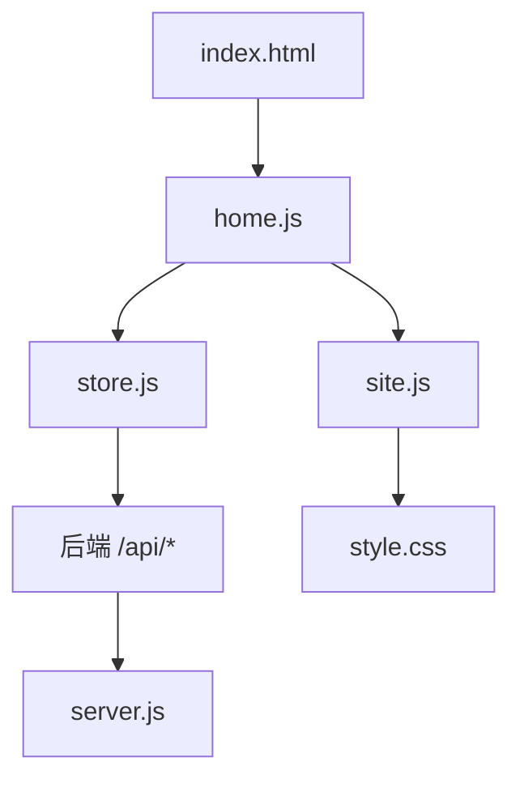
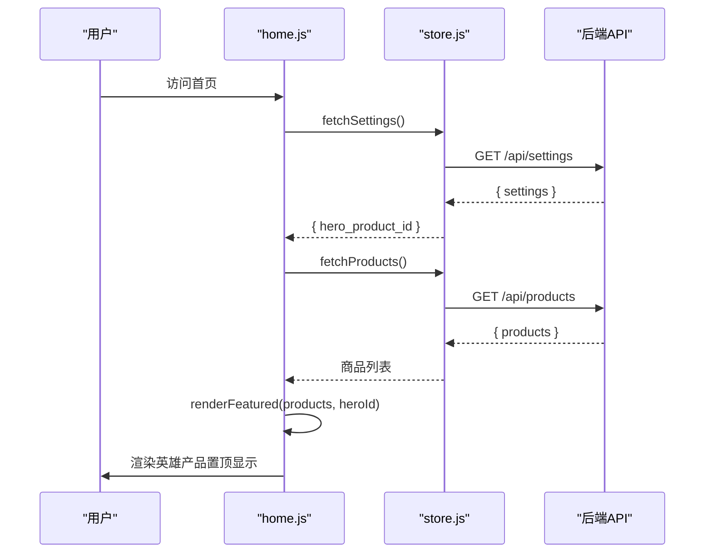
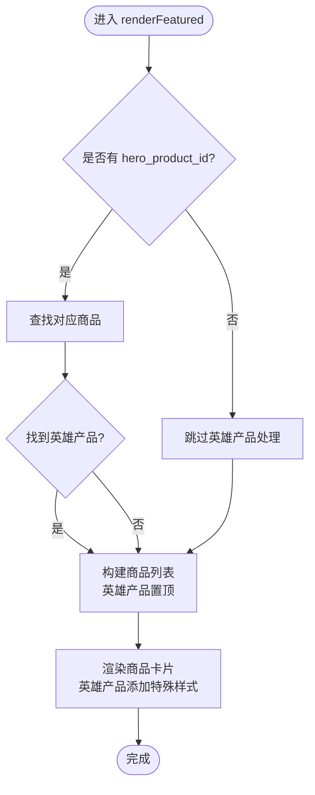
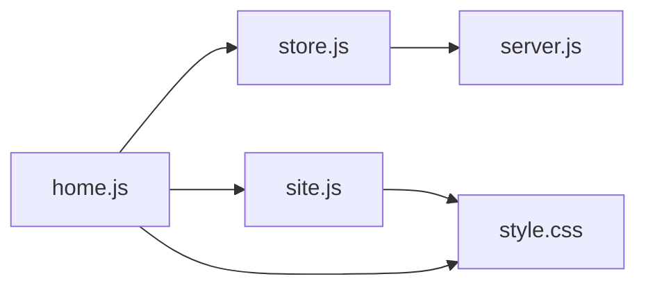

# 首页组件实现

<cite>
**本文引用的文件**
- [frontend/js/home.js](file://frontend/js/home.js)
- [frontend/index.html](file://frontend/index.html)
- [frontend/css/style.css](file://frontend/css/style.css)
- [frontend/js/store.js](file://frontend/js/store.js)
- [frontend/js/site.js](file://frontend/js/site.js)
- [backend/server.js](file://backend/server.js)
</cite>

## 更新摘要
**所做更改**
- 增强了英雄产品的展示逻辑，将指定商品置顶显示并添加特殊样式
- 实现了配置驱动的 hero_product_id 机制，支持动态设置主推商品
- 添加了 Hero 徽章标识和金色边框的特殊视觉效果
- 优化了商品网格布局，确保英雄产品始终位于首位
- 完善了错误处理机制，当无英雄产品时正常显示其他商品

## 目录
1. [简介](#简介)
2. [项目结构](#项目结构)
3. [核心组件](#核心组件)
4. [架构总览](#架构总览)
5. [详细组件分析](#详细组件分析)
6. [依赖关系分析](#依赖关系分析)
7. [性能考量](#性能考量)
8. [故障排查指南](#故障排查指南)
9. [结论](#结论)
10. [附录](#附录)

## 简介
本文件为 LeapShop 首页组件的实现文档，聚焦于前端 home.js 中的英雄产品展示机制、Intersection Observer 滚动动画、分类过滤逻辑与响应式网格布局。文档同时说明商品加载的 API 调用流程、错误处理与 DOM 渲染逻辑，以及 IntersectionObserver 的配置与使用方式。**最新更新**：首页组件现已支持配置驱动的英雄产品展示，可将指定商品置顶显示并添加特殊样式，提升重点商品的曝光度。

## 项目结构
- 前端入口 index.html 引入样式与脚本，包含导航、英雄轮播区、主推商品区（含交错四卡布局）、品牌历程、CTA 与页脚等模块。
- 主逻辑 frontend/js/home.js 负责：
  - 初始化 Hero 轮播（服务器 slides）
  - 渲染主推商品区域，支持英雄产品置顶
  - 处理 Why Choose Leap、统计数据、品牌历程内容
  - 管理滚动显现动画
- 共享数据层 frontend/js/store.js 提供商品、设置、轮播图的获取接口
- 全站共享 frontend/js/site.js 注入导航、购物车、页脚，并提供滚动观察器
- 样式 frontend/css/style.css 定义主题色、按钮、导航、商品网格、Hero 特殊样式与响应式规则
- 后端 backend/server.js 暴露 /api/products、/api/settings 等接口，支持 hero_product_id 配置



**图表来源**
- [frontend/index.html:1-96](file://frontend/index.html#L1-L96)
- [frontend/js/home.js:1-91](file://frontend/js/home.js#L1-L91)
- [frontend/js/store.js:1-69](file://frontend/js/store.js#L1-L69)
- [frontend/js/site.js:1-252](file://frontend/js/site.js#L1-L252)
- [backend/server.js:1-610](file://backend/server.js#L1-L610)

章节来源
- [frontend/index.html:27-40](file://frontend/index.html#L27-L40)
- [frontend/js/home.js:1-91](file://frontend/js/home.js#L1-L91)
- [frontend/js/store.js:1-69](file://frontend/js/store.js#L1-L69)
- [frontend/css/style.css:182-225](file://frontend/css/style.css#L182-L225)
- [backend/server.js:459-506](file://backend/server.js#L459-L506)

## 核心组件
- **英雄产品展示**：renderFeatured(products, heroId) 通过 hero_product_id 配置识别主推商品，将其置顶显示并添加特殊样式
- **Hero 轮播**：initCarousel() 从服务器获取 slides 数据，实现自动播放和手动切换功能
- **滚动动画**：site.js 中的 IntersectionObserver 监听 .reveal 元素，进入视口时添加 in-view 类触发 CSS 过渡
- **数据获取**：store.js 提供 fetchProducts()、fetchSettings()、fetchSlides() 等统一的数据接口
- **错误处理**：当后端不可达或数据为空时，提供友好的降级显示
- **响应式布局**：CSS Grid 实现的交错卡片布局，移动端自适应调整

**更新**：新增了英雄产品展示功能，支持配置驱动的主推商品置顶显示和特殊样式效果。

章节来源
- [frontend/js/home.js:41-68](file://frontend/js/home.js#L41-L68)
- [frontend/js/home.js:11-39](file://frontend/js/home.js#L11-L39)
- [frontend/js/site.js:238-245](file://frontend/js/site.js#L238-L245)
- [frontend/js/store.js:41-68](file://frontend/js/store.js#L41-L68)

## 架构总览
前端采用模块化设计：home.js 作为首页控制器，协调 UI 行为与数据流；store.js 提供统一的数据访问层；site.js 提供全站共享功能；CSS 提供主题与响应式布局；后端 server.js 提供 RESTful 接口，支持 hero_product_id 配置管理。



**图表来源**
- [frontend/js/home.js:84-90](file://frontend/js/home.js#L84-L90)
- [frontend/js/store.js:61-68](file://frontend/js/store.js#L61-L68)
- [backend/server.js:474-480](file://backend/server.js#L474-L480)

## 详细组件分析

### 英雄产品展示：renderFeatured
- **功能要点**
  - 根据 hero_product_id 配置查找对应的英雄产品
  - 将英雄产品置于商品列表首位，其他产品按分类顺序排列
  - 为英雄产品添加 is-hero 类和 Hero 徽章标识
  - 英雄产品链接到详情页，其他产品根据分类映射跳转
- **英雄产品识别逻辑**
  - 通过 settings.hero_product_id 获取英雄产品 ID
  - 在商品列表中查找匹配的产品
  - 如果找到英雄产品，将其从原位置移除并插入到首位
- **特殊样式应用**
  - 添加 is-hero 类名以应用金色边框样式
  - 插入 Hero 徽章（♕ Hero）标识
  - 保持与其他商品一致的交互体验
- **容错处理**
  - 如果没有找到英雄产品，正常显示所有商品
  - 英雄产品不存在时不影响其他商品的显示

**更新**：新增的英雄产品展示功能提供了灵活的配置机制，管理员可通过后台设置任意商品为主推款。



**图表来源**
- [frontend/js/home.js:41-68](file://frontend/js/home.js#L41-L68)

章节来源
- [frontend/js/home.js:41-68](file://frontend/js/home.js#L41-L68)
- [frontend/js/store.js:61-68](file://frontend/js/store.js#L61-L68)
- [backend/server.js:459-506](file://backend/server.js#L459-L506)

### Hero 轮播：initCarousel
- **功能特性**
  - 从服务器 slides 表获取轮播图数据
  - 支持自动播放（8秒间隔）和手动切换
  - 响应式图片加载，首图优先加载
  - 页面不可见时暂停自动播放，节省资源
- **技术实现**
  - 使用 fetchSlides() 获取服务器配置的轮播图
  - 动态生成轮播图和导航点
  - 事件委托处理点击切换
  - visibilitychange 事件监听页面可见性
- **降级处理**
  - 后端不可达时隐藏整个 Hero 区域
  - 无轮播图数据时不显示轮播区

章节来源
- [frontend/js/home.js:11-39](file://frontend/js/home.js#L11-L39)
- [frontend/js/store.js:55-59](file://frontend/js/store.js#L55-L59)

### 滚动动画：IntersectionObserver
- **配置**
  - 创建 IntersectionObserver，threshold: 0.15，当元素进入视口比例达到 15% 时触发
  - 回调中对每个 entry，若 isIntersecting 则为目标元素添加 'in-view' 类
- **使用方式**
  - 选择所有 .reveal 和 .stats 元素并逐一 observe
  - CSS 中 .reveal 初始隐藏并下移，.reveal.in-view 恢复可见并上移，配合 transition 形成淡入上滑效果
- **适用场景**
  - 用于 sec-head、why-card、timeline-item、cta-inner 等需要入场动画的元素

章节来源
- [frontend/js/site.js:238-245](file://frontend/js/site.js#L238-L245)
- [frontend/css/style.css:416-418](file://frontend/css/style.css#L416-L418)

### 数据获取与缓存：store.js
- **功能特性**
  - 统一的 API 基础路径发现机制
  - 模块级缓存避免重复请求
  - 错误处理和降级策略
- **主要接口**
  - fetchProducts(): 获取商品列表，带主图处理
  - fetchSettings(): 获取全站设置，包括 hero_product_id
  - fetchSlides(): 获取轮播图数据
  - escapeHtml(): XSS 防护工具函数
  - money(): 价格格式化函数
- **缓存策略**
  - 商品数据和设置数据采用模块级缓存
  - 支持强制刷新参数 force = true

章节来源
- [frontend/js/store.js:1-69](file://frontend/js/store.js#L1-L69)

### 英雄产品样式：CSS 特殊效果
- **金色边框效果**
  - .p-card.is-hero .p-media 应用金色边框
  - 悬停时显示内嵌金色边框偏移效果
- **Hero 徽章**
  - 绝对定位在卡片左上角
  - 深金色背景配白色文字
  - 禁用鼠标事件避免干扰交互
- **悬停增强**
  - 英雄产品悬停时图片放大效果
  - 金色边框高亮显示

章节来源
- [frontend/css/style.css:185-194](file://frontend/css/style.css#L185-L194)
- [frontend/css/style.css:195-209](file://frontend/css/style.css#L195-L209)

### 后端配置管理：hero_product_id
- **配置存储**
  - 使用 settings 表存储 hero_product_id
  - 支持空值表示无主推商品
- **验证机制**
  - 必须为数字格式
  - 必须指向真实存在的商品
  - 单键 upsert 保证唯一性
- **API 接口**
  - GET /api/settings: 获取所有设置
  - PUT /api/settings: 更新设置项
  - 删除商品时自动清理关联的主推设置

章节来源
- [backend/server.js:459-506](file://backend/server.js#L459-L506)
- [backend/server.js:377-389](file://backend/server.js#L377-L389)

## 依赖关系分析
- home.js 依赖 store.js 提供的数据获取接口
- site.js 提供全局的滚动观察器和购物车功能
- style.css 提供视觉样式和交互动画
- server.js 提供后端 API 和数据持久化
- 各组件通过模块化方式解耦，便于维护和扩展



**图表来源**
- [frontend/js/home.js:1-91](file://frontend/js/home.js#L1-L91)
- [frontend/js/store.js:1-69](file://frontend/js/store.js#L1-L69)
- [frontend/js/site.js:1-252](file://frontend/js/site.js#L1-L252)
- [backend/server.js:1-610](file://backend/server.js#L1-L610)

章节来源
- [frontend/js/home.js:1-91](file://frontend/js/home.js#L1-L91)
- [frontend/js/store.js:1-69](file://frontend/js/store.js#L1-L69)
- [frontend/js/site.js:1-252](file://frontend/js/site.js#L1-L252)
- [backend/server.js:1-610](file://backend/server.js#L1-L610)

## 性能考量
- **图片懒加载**：非首屏图片使用 loading="lazy" 延迟加载
- **模块级缓存**：商品数据和设置数据缓存避免重复请求
- **条件渲染**：Hero 轮播在无数据时完全隐藏，减少不必要的 DOM 操作
- **事件优化**：使用事件委托减少内存占用
- **响应式设计**：移动端优化图片和布局，提升加载性能
- **错误降级**：网络异常时提供友好的降级显示

## 故障排查指南
- **英雄产品不显示**
  - 检查后端 settings 表中 hero_product_id 是否正确设置
  - 确认指定的商品 ID 是否存在
  - 查看浏览器控制台是否有 API 请求错误
- **轮播图不工作**
  - 检查后端 /api/slides 接口是否正常返回数据
  - 确认 slides 表中 enabled 字段是否为 1
  - 验证图片路径是否有效
- **滚动动画失效**
  - 确认目标元素是否具有 .reveal 类
  - 检查 CSS 中 .reveal 和 .reveal.in-view 的样式定义
  - 验证 IntersectionObserver 是否正确初始化
- **商品加载失败**
  - 检查后端 /api/products 接口是否可达
  - 确认数据库连接正常
  - 查看网络请求状态码和响应内容

## 结论
本实现通过 home.js 将英雄产品展示、Hero 轮播、滚动动画等功能有机整合，结合 store.js 的统一数据封装与 style.css 的精美样式，提供了良好的用户体验与可维护性。**最新更新**：英雄产品展示功能的加入显著提升了重点商品的曝光度，通过配置驱动的机制，管理员可以灵活设置主推商品，并获得专业的视觉效果。后端 server.js 的 settings 表支持完整的配置管理，确保了系统的可扩展性和灵活性。

## 附录

### 如何设置英雄产品
- 通过后端 API 设置 hero_product_id：
  ```javascript
  // 设置某个商品为英雄产品
  await fetch('/api/settings', {
    method: 'PUT',
    headers: {'Authorization': 'Bearer YOUR_TOKEN'},
    body: JSON.stringify({key: 'hero_product_id', value: '1'})
  });
  ```
- 或通过管理后台界面进行设置
- 清空英雄产品：将 hero_product_id 设置为空字符串

章节来源
- [backend/server.js:482-506](file://backend/server.js#L482-L506)

### 自定义英雄产品样式
- 修改 .p-card.is-hero 的边框颜色和宽度
- 调整 .hero-badge 的位置和样式
- 自定义悬停效果的动画时长和缓动函数
- 添加额外的视觉标识或徽章

章节来源
- [frontend/css/style.css:185-194](file://frontend/css/style.css#L185-L194)

### 扩展商品展示功能
- 在 renderFeatured 中添加新的商品类型判断逻辑
- 为不同类型的商品添加特定的样式类
- 扩展商品卡片的信息展示
- 添加更多交互功能如收藏、分享等

章节来源
- [frontend/js/home.js:41-68](file://frontend/js/home.js#L41-L68)

### 性能优化建议
- 对大量商品数据进行分页加载
- 实现虚拟滚动以提升长列表性能
- 使用 CDN 加速静态资源加载
- 实施更智能的图片压缩和格式转换
- 添加服务工作者实现离线缓存

[本节为通用指导，不直接分析具体文件]