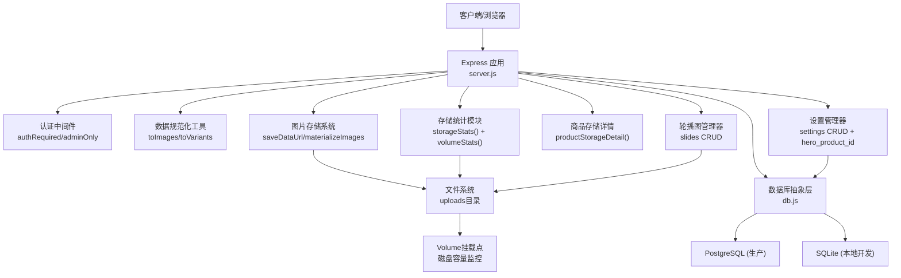
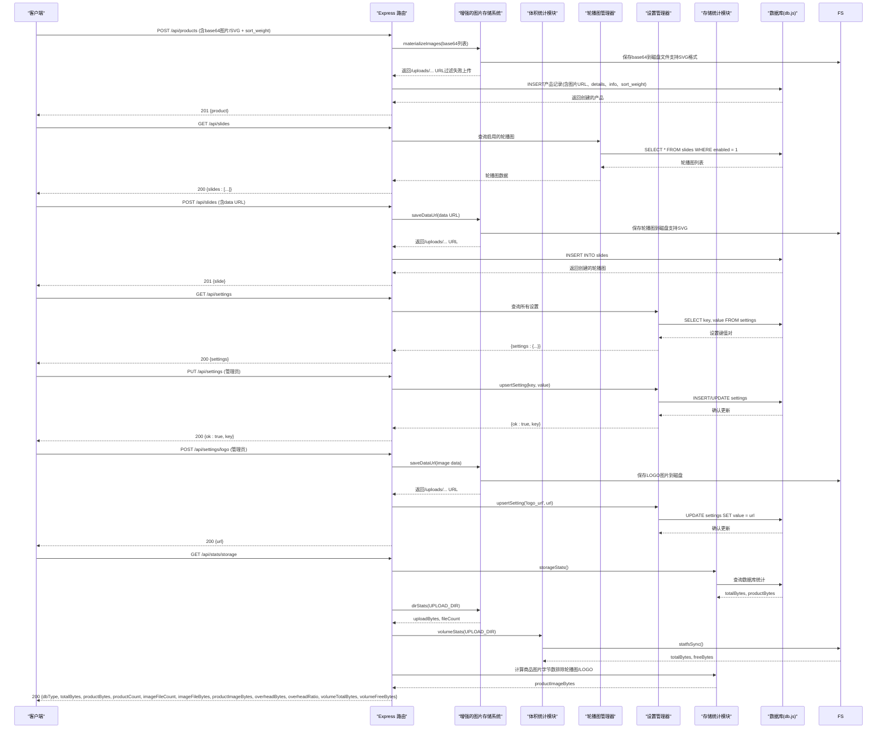
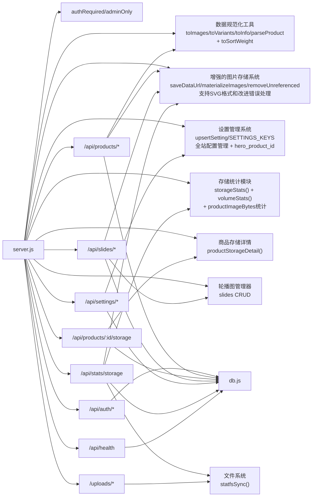

# API端点参考

<cite>
**本文引用的文件**
- [backend/server.js](file://backend/server.js)
- [backend/db.js](file://backend/db.js)
- [backend/test-api.ps1](file://backend/test-api.ps1)
- [backend/test-crud.js](file://backend/test-crud.js)
- [frontend/admin.html](file://frontend/admin.html)
- [frontend/js/admin.js](file://frontend/js/admin.js)
- [README.md](file://README.md)
</cite>

## 更新摘要
**所做更改**
- **新增英雄产品功能**：添加了 `settings.hero_product_id` 全局唯一主推款机制，支持首页Featured置顶和商品总览第一行第一位展示
- **新增排序权重字段**：为商品表添加 `sort_weight` 字段，支持系列内自定义排序（升序优先，未设置按上传时间倒序）
- **增强商品删除逻辑**：删除商品时自动清理关联的英雄产品设置，确保数据一致性
- **完善设置管理接口**：在 `SETTINGS_KEYS` 中新增 `hero_product_id` 键，并添加相应的验证逻辑
- **前端界面增强**：提供完整的英雄产品选择界面和排序权重编辑功能

## 目录
1. [简介](#简介)
2. [项目结构](#项目结构)
3. [核心组件](#核心组件)
4. [架构总览](#架构总览)
5. [详细端点规范](#详细端点规范)
6. [依赖关系分析](#依赖关系分析)
7. [性能与扩展性](#性能与扩展性)
8. [故障排查指南](#故障排查指南)
9. [结论](#结论)
10. [附录：错误码与响应格式](#附录错误码与响应格式)

## 简介
本参考文档面向LeapShop后端API，覆盖认证接口、商品管理RESTful接口、轮播图管理接口以及全站设置管理接口。内容包括请求方法、路径、权限要求、参数校验规则、业务逻辑、HTTP状态码与错误响应格式，并给出版本控制策略与未来扩展建议。所有端点均基于Express实现，使用JWT进行身份鉴权，支持PostgreSQL或SQLite两种数据库后端。**已全面增强图片文件存储系统，支持base64图片自动转换为磁盘文件存储，提供智能去重、清理机制和增强的存储统计功能，包括完整的磁盘容量监控能力**。

**最新更新**：新增了英雄产品功能和排序权重机制，通过 `settings.hero_product_id` 实现全局唯一的主推款管理，支持首页Featured区域置顶展示和商品总览的第一行第一位展示。同时为商品表添加了 `sort_weight` 字段，支持系列内的自定义排序功能。

## 项目结构
后端采用单服务模式：Express应用同时提供API与静态前端托管。数据库抽象层自动选择PostgreSQL（生产）或SQLite（开发）。认证通过JWT中间件保护写操作，读操作公开。**已实现完整的图片文件存储系统和全站设置管理系统，支持base64图片自动落盘、内容哈希去重、智能清理机制，以及增强的存储统计监控功能和磁盘容量监控**。

**图表来源**
- [backend/server.js:21-24](file://backend/server.js#L21-L24)
- [backend/server.js:69-145](file://backend/server.js#L69-L145)
- [backend/server.js:155-162](file://backend/server.js#L155-L162)
- [backend/server.js:442-490](file://backend/server.js#L442-L490)
- [backend/db.js:12-109](file://backend/db.js#L12-L109)
- [backend/db.js:201-206](file://backend/db.js#L201-L206)

**章节来源**
- [backend/server.js:1-583](file://backend/server.js#L1-L583)
- [backend/db.js:1-272](file://backend/db.js#L1-L272)
- [README.md:6-19](file://README.md#L6-L19)

## 核心组件
- **认证中间件**
  - authRequired：校验Authorization头中的Bearer Token，失败返回401。
  - adminOnly：校验用户角色为admin，否则返回403。
- **数据规范化工具**
  - toImages：归一化图片集合，兼容旧单图字段/JSON字符串/数组，最多MAX_IMAGES张
  - toVariants：归一化变体数据，支持颜色、款式和独立图集
  - toInfo：归一化卖点文案，将JSON字符串/数组转换为字符串数组
  - parseProduct：出库前解析JSON文本列为数组，便于前端直接使用
  - **toSortWeight**：排序权重归一化，undefined = 不改动；null/空串 = 清除权重；其余截断为整数
- **增强的图片存储系统**
  - saveDataUrl：将base64图片转换为磁盘文件，使用内容哈希命名实现天然去重，**新增SVG格式支持**
  - materializeImages：批量处理图片列表，自动转换data URL为文件URL，**现在过滤掉失败的上传以保持数据完整性**
  - productUploadUrls：收集商品引用的所有图片URL
  - removeUnreferenced：智能清理不再被任何商品或轮播图引用的图片文件
  - dirStats：递归统计图片目录占用空间
  - uploadFileBytes：计算单个上传文件的字节数
  - productStorageDetail：计算单个商品的详细存储信息
- **设置管理系统**
  - upsertSetting：跨数据库方言的upsert操作，支持PostgreSQL和SQLite
  - SETTINGS_KEYS：白名单验证，限制可设置的键名，**新增 hero_product_id 支持**
  - 支持网站标题、LOGO、公告、联系方式等全局配置
  - **英雄产品管理**：全局唯一的主推款设置，删除商品时自动清理关联设置
  - 提供完整的管理员界面进行可视化配置
- **增强的存储统计模块**
  - storageStats：计算数据库总占用字节数和商品数据占用字节数
  - **volumeStats**：获取文件系统容量统计，包括总容量和剩余空间
  - 支持PostgreSQL和SQLite两种数据库的存储统计
  - 集成图片文件存储空间统计
  - 计算系统开销和占比分析
  - **完整的磁盘容量监控**，支持Volume挂载点检测
  - **新增 productImageBytes 统计**：精确计算商品图片文件的字节数，排除轮播图和LOGO等非商品图片
- **轮播图管理器**
  - 支持完整的CRUD操作（创建、读取、更新、删除）
  - 支持排序（sort字段）和启用/禁用（enabled字段）功能
  - 支持data URL自动转换为磁盘文件存储
  - 管理员可通过?all=1参数查看所有轮播图（包括禁用的）
- **数据库抽象层**
  - connect/initSchema：初始化连接与建表；自动适配PostgreSQL或SQLite。
  - query/run：统一SQL执行接口，INSERT自动追加RETURNING id以便获取新记录主键。
  - **排序权重字段**：products表新增 sort_weight INTEGER 字段，NULL表示未设置
- **路由与控制器**
  - /api/auth/*：登录与当前用户信息。
  - /api/products/*：商品CRUD，读公开，写需管理员，支持多图、变体、详情图和卖点信息，**新增排序权重支持**。
  - /api/products/:id/storage：单商品存储详情（管理员专用），包含图片文件和JSON存储信息。
  - /api/slides/*：轮播图CRUD，读公开（仅启用项），写需管理员。
  - /api/settings/*：全站设置CRUD，读公开，写需管理员，**新增 hero_product_id 管理**。
  - /api/stats/storage：存储统计监控（管理员专用），包含图片文件统计、系统开销分析和**磁盘容量监控**，**新增商品图片字节统计**。
  - /api/health：健康检查。
  - /uploads/*：静态图片文件服务。

**章节来源**
- [backend/server.js:26-63](file://backend/server.js#L26-L63)
- [backend/server.js:69-180](file://backend/server.js#L69-L180)
- [backend/server.js:155-162](file://backend/server.js#L155-L162)
- [backend/server.js:209-249](file://backend/server.js#L209-L249)
- [backend/server.js:320-338](file://backend/server.js#L320-L338)
- [backend/server.js:442-490](file://backend/server.js#L442-L490)
- [backend/db.js:44-109](file://backend/db.js:44-L109)
- [backend/db.js:190-208](file://backend/db.js:190-L208)
- [backend/db.js:201-206](file://backend/db.js#L201-L206)

## 架构总览

**图表来源**
- [backend/server.js:209-233](file://backend/server.js#L209-L233)
- [backend/server.js:244-249](file://backend/server.js#L244-L249)
- [backend/server.js:321-338](file://backend/server.js#L321-L338)
- [backend/server.js:442-490](file://backend/server.js#L442-L490)
- [backend/server.js:155-162](file://backend/server.js#L155-L162)
- [backend/server.js:69-180](file://backend/server.js#L69-L180)
- [backend/db.js:190-208](file://backend/db.js:190-L208)
- [backend/db.js:201-206](file://backend/db.js#L201-L206)

## 详细端点规范

### 认证接口

#### POST /api/auth/login
- 权限：公开
- 请求体
  - username: string，必填
  - password: string，必填
- 成功响应 200
  - token: string（JWT）
  - user: object
    - id: number/string
    - username: string
    - role: string（customer 或 admin）
- 错误
  - 400：缺少用户名或密码
  - 401：用户名或密码无效
- 说明
  - 使用bcrypt校验密码哈希
  - JWT有效期由TOKEN_TTL控制（默认12小时）
  - 测试脚本验证了正确登录、错误密码拒绝等流程

**章节来源**
- [backend/server.js:247-263](file://backend/server.js#L247-L263)
- [backend/test-api.ps1:40-52](file://backend/test-api.ps1#L40-L52)
- [backend/test-crud.js:23-24](file://backend/test-crud.js#L23-L24)

#### GET /api/auth/me
- 权限：已登录（需要有效的Bearer Token）
- 请求头
  - Authorization: Bearer <token>
- 成功响应 200
  - user: object（包含id、username、role）
- 错误
  - 401：未携带Token或Token过期/无效
- 说明
  - 用于校验Token有效性并返回当前用户身份

**章节来源**
- [backend/server.js:265-267](file://backend/server.js#L265-L267)
- [backend/test-api.ps1:54-56](file://backend/test-api.ps1#L54-L56)

### 商品管理接口（RESTful）

#### GET /api/products
- 权限：公开
- 查询参数
  - category: string，可选，按分类过滤
- 成功响应 200
  - products: array，按id升序排列，每个商品包含规范化后的images[]、variants[]、details[]和info[]，**新增 sort_weight 字段**
- 说明
  - 无category时返回全部商品；有category时仅返回匹配项
  - 返回数据已通过parseProduct处理，images、variants、details和info字段为数组格式
  - 图片URL已从base64转换为/uploads/...路径
  - **排序规则**：已设权重者优先（权重升序，同权重按上传时间倒序），未设权重者按上传时间倒序

**章节来源**
- [backend/server.js:271-280](file://backend/server.js#L271-L280)
- [backend/server.js:40](file://backend/server.js#L40)
- [backend/test-api.ps1:36-38](file://backend/test-api.ps1#L36-L38)

#### GET /api/products/:id
- 权限：公开
- 路径参数
  - id: number/string，必填
- 成功响应 200
  - product: object，包含规范化后的images[]、variants[]、details[]和info[]，**新增 sort_weight 字段**
- 错误
  - 404：商品不存在
- 说明
  - 返回的商品数据已通过parseProduct处理，确保images、variants、details和info字段格式一致
  - 图片URL已转换为可访问的文件路径

**章节来源**
- [backend/server.js:283-287](file://backend/server.js#L283-L287)
- [backend/test-api.ps1:75-77](file://backend/test-api.ps1#L75-L77)

#### GET /api/products/:id/storage
- 权限：管理员（需登录且role=admin）
- 路径参数
  - id: number/string，必填
- 成功响应 200
  - id: number/string（商品ID）
  - name: string（商品名称）
  - imageFileCount: number（该商品引用的图片文件数量，去重后）
  - imageFileBytes: number（图片文件在磁盘上的总字节数）
  - jsonBytes: number（商品JSON记录的字节数）
  - totalBytes: number（图片文件字节数 + JSON记录字节数的总和）
- 错误
  - 401：未登录
  - 403：非管理员
  - 404：商品不存在
- 说明
  - 提供单个商品的详细存储信息，包括图片文件和JSON数据的存储占用
  - 图片文件计数会去除重复的URL引用
  - 用于前端展示每行商品的存储使用情况
  - 支持实时监控商品存储占用情况

**章节来源**
- [backend/server.js:290-295](file://backend/server.js#L290-L295)
- [frontend/js/admin.js:111-128](file://frontend/js/admin.js#L111-L128)

#### POST /api/products
- 权限：管理员（需登录且role=admin）
- 请求体
  - name: string，必填，会被trim处理
  - category: string，可选，默认"chess-timer"
  - price: number，可选，默认0
  - description: string，可选，默认空串
  - image: string，可选，默认空串（支持base64图片，向后兼容）
  - images: string[]|string|JSON字符串，可选，支持多张图片（base64格式，**现支持SVG格式**）
  - variants: array|JSON字符串，可选，支持颜色/款式变体及其独立图集
  - details: string[]|string|JSON字符串，可选，支持商品详情图片（base64格式，**现支持SVG格式**）
  - info: string[]|string|JSON字符串，可选，支持商品卖点信息（文本数组）
  - stock: number，可选，默认0
  - **sort_weight: number|null，可选，系列内排序权重，null表示清除权重回到自动排序**
- 成功响应 201
  - product: object（包含新增后的完整字段，含id、规范化后的images[]、variants[]、details[]和info[]，**新增 sort_weight 字段**）
- 错误
  - 400：name为空或空白，或未提供至少1张主图
  - 401：未登录
  - 403：非管理员
- 说明
  - 写入后查询该记录返回完整对象
  - 支持多种图片格式输入：单个base64字符串、base64字符串数组、JSON字符串
  - **增强功能**：base64图片自动转换为磁盘文件存储，使用内容哈希命名实现天然去重，**新增SVG格式支持**
  - **改进的错误处理**：materializeImages函数现在过滤掉失败的上传以保持数据完整性
  - 变体数据支持颜色(color)、款式(style)和独立图片集(images[])
  - **新增功能**：支持商品详情图片（details字段）和卖点信息（info字段）
  - **新增功能**：支持系列内排序权重（sort_weight），数字越小越靠前，留空按上传时间倒序
  - JSON负载大小限制已提升至24MB以支持多图上传
  - 图片文件存储在uploads目录，数据库仅保存URL引用
  - 测试脚本覆盖了中文内容与base64图片的创建与读取一致性

**章节来源**
- [backend/server.js:298-325](file://backend/server.js#L298-L325)
- [backend/server.js:332](file://backend/server.js#L332)
- [backend/test-api.ps1:66-69](file://backend/test-api.ps1#L66-L69)
- [backend/test-crud.js:26-36](file://backend/test-crud.js:26-L36)

#### PUT /api/products/:id
- 权限：管理员（需登录且role=admin）
- 路径参数
  - id: number/string，必填
- 请求体（部分更新）
  - name: string，可选，若提供则trim
  - category: string，可选
  - price: number，可选
  - description: string，可选
  - image: string，可选，向后兼容的单图字段
  - images: string[]|string|JSON字符串，可选，多图更新（**现支持SVG格式**）
  - variants: array|JSON字符串，可选，变体更新
  - details: string[]|string|JSON字符串，可选，详情图片更新（**现支持SVG格式**）
  - info: string[]|string|JSON字符串，可选，卖点信息更新
  - stock: number，可选
  - **sort_weight: number|null，可选，系列内排序权重更新，null表示清除权重**
- 成功响应 200
  - product: object（更新后的完整记录，包含规范化后的images[]、variants[]、details[]和info[]，**新增 sort_weight 字段**）
- 错误
  - 401：未登录
  - 403：非管理员
  - 404：商品不存在
  - 400：未提供至少1张主图
- 说明
  - 未提供的字段保持原值不变
  - updated_at在更新时刷新
  - 支持增量更新图片和变体数据
  - **增强功能**：自动清理不再被引用的旧图片文件，释放存储空间
  - **改进的错误处理**：单个图片上传失败不会阻止整个更新操作
  - **新增功能**：支持排序权重的增量更新，可实现系列内自定义排序

**章节来源**
- [backend/server.js:328-362](file://backend/server.js#L328-L362)
- [backend/server.js:368](file://backend/server.js#L368)
- [backend/test-api.ps1:71-73](file://backend/test-api.ps1#L71-L73)
- [backend/test-crud.js:43-45](file://backend/test-crud.js#L43-L45)

#### DELETE /api/products/:id
- 权限：管理员（需登录且role=admin）
- 路径参数
  - id: number/string，必填
- 成功响应 200
  - ok: boolean（true）
- 错误
  - 401：未登录
  - 403：非管理员
  - 404：商品不存在
- 说明
  - 删除成功后再次查询将返回404
  - **增强功能**：自动清理商品关联的所有图片文件，释放存储空间
  - **新增功能**：删除商品时自动清理关联的英雄产品设置，确保数据一致性

**章节来源**
- [backend/server.js:365-372](file://backend/server.js#L365-L372)
- [backend/server.js:383-386](file://backend/server.js#L383-L386)
- [backend/test-api.ps1:79-85](file://backend/test-api.ps1#L79-L85)

### 轮播图管理接口（RESTful）

#### GET /api/slides
- 权限：公开（仅返回启用的轮播图）
- 查询参数
  - all: string，可选，当值为"1"且请求者具有管理员权限时返回所有轮播图（包括禁用的）
- 成功响应 200
  - slides: array，按sort升序排列，每个轮播图包含id、image、alt、sort、enabled字段
- 说明
  - 默认只返回enabled=1的轮播图，按sort字段升序排列
  - 管理员可通过添加?all=1参数查看和管理所有轮播图
  - 轮播图图片URL已从base64转换为/uploads/...路径

**章节来源**
- [backend/server.js:376-382](file://backend/server.js#L376-L382)

#### POST /api/slides
- 权限：管理员（需登录且role=admin）
- 请求体
  - image: string，必填，支持base64 data URL或现有图片URL（**现支持SVG格式**）
  - alt: string，可选，轮播图替代文本
  - sort: number，可选，排序值，不指定时自动追加到末尾
  - enabled: boolean/number，可选，是否启用，默认为1（启用）
- 成功响应 201
  - slide: object（包含新增后的完整字段，含id、image、alt、sort、enabled）
- 错误
  - 400：image为空或格式无效
  - 401：未登录
  - 403：非管理员
- 说明
  - 支持base64 data URL自动转换为磁盘文件存储（**新增SVG格式支持**）
  - 支持现有图片URL直接引用
  - 排序值不指定时自动计算为最大值+1
  - 图片文件存储在uploads目录，数据库仅保存URL引用
  - **改进的错误处理**：单个图片处理失败不会阻止整个操作

**章节来源**
- [backend/server.js:385-407](file://backend/server.js#L385-L407)

#### PUT /api/slides/:id
- 权限：管理员（需登录且role=admin）
- 路径参数
  - id: number/string，必填
- 请求体（部分更新）
  - image: string，可选，支持base64 data URL或现有图片URL（**现支持SVG格式**）
  - alt: string，可选，轮播图替代文本
  - sort: number，可选，排序值
  - enabled: boolean/number，可选，启用状态切换
- 成功响应 200
  - slide: object（更新后的完整记录）
- 错误
  - 401：未登录
  - 403：非管理员
  - 404：轮播图不存在
  - 400：image格式无效
- 说明
  - 支持增量更新轮播图的各项属性
  - 图片更新时自动清理不再被引用的旧图片文件
  - 支持启用/禁用状态的动态切换
  - **改进的错误处理**：图片处理失败不会阻止其他属性的更新

**章节来源**
- [backend/server.js:410-431](file://backend/server.js#L410-L431)

#### DELETE /api/slides/:id
- 权限：管理员（需登录且role=admin）
- 路径参数
  - id: number/string，必填
- 成功响应 200
  - ok: boolean（true）
- 错误
  - 401：未登录
  - 403：非管理员
  - 404：轮播图不存在
- 说明
  - 删除成功后再次查询将返回404
  - **增强功能**：自动清理轮播图关联的图片文件，释放存储空间

**章节来源**
- [backend/server.js:434-440](file://backend/server.js#L434-L440)

### 全站设置管理接口

#### GET /api/settings
- 权限：公开
- 成功响应 200
  - settings: object，包含所有站点配置键值对
    - site_title: string，网站标题
    - logo_url: string，LOGO图片URL
    - announcement_html: string，首页公告HTML内容
    - contact_email: string，联系邮箱
    - contact_social: string，社交媒体链接
    - **hero_product_id: string，当前英雄产品ID（全局唯一）**
- 说明
  - 返回全站所有设置配置，供前台渲染使用
  - 支持动态更新网站标题、LOGO、公告和联系方式
  - 前台页面加载时自动获取并应用这些设置
  - 管理员修改设置后，前台通过BroadcastChannel即时同步更新
  - **新增功能**：包含当前英雄产品信息，用于前端展示主推款

**章节来源**
- [backend/server.js:457-463](file://backend/server.js#L457-L463)
- [backend/server.js:475-479](file://backend/server.js#L475-L479)
- [frontend/js/admin.js:149-163](file://frontend/js/admin.js#L149-L163)

#### PUT /api/settings
- 权限：管理员（需登录且role=admin）
- 请求体
  - key: string，必填，必须是SETTINGS_KEYS白名单中的键名
  - value: string，必填，设置值，最大64KB
- 支持的key值：
  - site_title: 网站标题
  - logo_url: LOGO图片URL（通常通过POST /api/settings/logo设置）
  - announcement_html: 首页公告HTML内容
  - contact_email: 联系邮箱地址
  - contact_social: 社交媒体链接信息
  - **hero_product_id: 英雄产品ID（全局唯一，支持清空）**
- 成功响应 200
  - ok: boolean（true）
  - key: string（更新的设置键名）
- 错误
  - 400：Unknown setting key（未知键名）
  - 400：Value must be a string（值类型错误）
  - 400：Setting value too large（值超过64KB限制）
  - 400：**hero_product_id must be a product id or empty**（英雄产品ID必须是有效商品ID或空字符串）
  - 400：**Product not found for hero setting**（指定的商品不存在）
  - 401：未登录
  - 403：非管理员
- 说明
  - 使用upsert操作，如果键不存在则创建，存在则更新
  - 支持跨数据库方言的upsert操作（PostgreSQL和SQLite）
  - 值长度限制为64KB，防止过大配置影响性能
  - 修改后前台页面会自动同步显示新配置
  - **新增功能**：英雄产品设置支持全局唯一性保证，设置新的英雄产品会自动替换旧的

**章节来源**
- [backend/server.js:465-479](file://backend/server.js#L465-L479)
- [backend/server.js:483-506](file://backend/server.js#L483-L506)
- [backend/db.js:445-455](file://backend/db.js:445-L455)

#### POST /api/settings/logo
- 权限：管理员（需登录且role=admin）
- 请求体
  - image: string，必填，base64 data URL格式的LOGO图片
- 成功响应 200
  - url: string，新生成的LOGO图片URL
- 错误
  - 400：Unsupported or invalid image data（不支持或无效的图像数据）
  - 401：未登录
  - 403：非管理员
- 说明
  - 接收base64 data URL格式的LOGO图片
  - 自动转换为磁盘文件存储，使用内容哈希命名实现去重
  - 更新settings表中logo_url字段为新图片URL
  - 自动清理旧的LOGO图片（如果没有其他引用）
  - 支持SVG格式图片上传和处理
  - 前端提供可视化界面进行LOGO选择和预览

**章节来源**
- [backend/server.js:481-490](file://backend/server.js#L481-L490)
- [frontend/admin.html:97-103](file://frontend/admin.html#L97-L103)
- [frontend/js/admin.js:183-200](file://frontend/js/admin.js#L183-L200)

### 健康检查
#### GET /api/health
- 权限：公开
- 成功响应 200
  - status: "ok"
  - db: string（postgresql 或 sqlite）
  - time: ISO时间戳
- 用途：部署与健康探针

**章节来源**
- [backend/server.js:525-527](file://backend/server.js#L525-L527)
- [backend/test-api.ps1:32-34](file://backend/test-api.ps1#L32-L34)

### 存储统计（管理员专用）
#### GET /api/stats/storage
- 权限：管理员（需登录且role=admin）
- 成功响应 200
  - dbType: string（postgresql 或 sqlite）
  - totalBytes: number（数据库总占用字节数 + 图片文件占用）
  - productBytes: number（商品数据占用字节数 + **商品图片文件占用**）
  - productCount: number（商品总数）
  - imageFileCount: number（图片文件总数）
  - imageFileBytes: number（图片文件总字节数）
  - **productImageBytes: number（商品图片文件字节数，排除轮播图和LOGO）**
  - overheadBytes: number（数据库系统开销字节数，即非商品数据部分）
  - overheadRatio: number（系统开销占比百分比，保留一位小数）
  - volumeTotalBytes: number（磁盘总容量字节数）
  - volumeFreeBytes: number（磁盘剩余容量字节数）
- 用途：监控数据库和图片文件存储使用情况，提供系统开销分析和磁盘容量监控
- **更新**：新增 `productImageBytes` 字段，提供精确的商品图片统计，排除非商品图片（如轮播图和LOGO）
- 实现细节
  - PostgreSQL：使用pg_database_size()和pg_total_relation_size()函数
  - SQLite：计算数据文件大小和商品数据列长度总和
  - **增强功能**：集成图片文件目录空间统计，提供完整的存储使用视图
  - **新增功能**：计算数据库系统开销和占比，帮助管理员了解存储分布
  - **新增功能**：通过fs.statfsSync()获取文件系统容量信息，支持Volume挂载点检测
  - **精确商品图片统计**：通过遍历所有商品并收集其引用的图片URL，计算仅属于商品的图片文件字节数
  - **排除非商品图片**：轮播图和LOGO图片不计入商品图片统计，确保统计准确性
  - 前端展示：显示存储使用百分比、格式化后的字节数、图片文件统计、系统开销占比和磁盘容量信息

**章节来源**
- [backend/server.js:493-522](file://backend/server.js#L493-L522)
- [backend/server.js:155-162](file://backend/server.js#L155-L162)
- [backend/db.js:236-254](file://backend/db.js#L236-L254)
- [frontend/js/admin.js:113-141](file://frontend/js/admin.js#L113-L141)
- [frontend/admin.html:60-90](file://frontend/admin.html#L60-L90)

### 图片文件服务
#### GET /uploads/*
- 权限：公开
- 路径参数
  - *：图片文件路径（如 /uploads/ab/cdef1234.jpg）
- 成功响应 200
  - 图片文件内容
- 说明
  - 静态图片文件服务，支持长缓存（30天）
  - 文件以内容哈希命名，天然去重
  - 支持子目录结构（按哈希前两位分目录）
  - **新增**：现在支持SVG格式文件的正确处理和提供服务

**章节来源**
- [backend/server.js:530](file://backend/server.js#L530)

## 依赖关系分析
- Express应用负责路由与中间件编排
- 认证中间件依赖jsonwebtoken解析与校验
- **增强的图片存储系统**：saveDataUrl、materializeImages、removeUnreferenced处理图片文件的自动存储和清理，**新增SVG格式支持和改进的错误处理**
- **设置管理系统**：upsertSetting提供跨数据库方言的设置更新，SETTINGS_KEYS白名单验证确保安全性，**新增 hero_product_id 支持**
- **数据规范化模块**：toImages、toVariants、toInfo、parseProduct处理商品数据的标准化，**新增 toSortWeight 排序权重处理**
- **增强的存储统计模块**：storageStats提供数据库和图片文件存储使用情况监控，**volumeStats提供磁盘容量监控**，**新增productImageBytes精确统计**
- **商品存储详情模块**：productStorageDetail提供单个商品的详细存储信息
- **轮播图管理模块**：完整的CRUD操作，支持排序、启用/禁用和数据URL上传
- **数据库抽象层**：统一管理数据库操作，**新增 sort_weight 字段支持**
- 种子数据与建表在启动时幂等执行

**图表来源**
- [backend/server.js:26-63](file://backend/server.js#L26-L63)
- [backend/server.js:69-180](file://backend/server.js#L69-L180)
- [backend/server.js:155-162](file://backend/server.js#L155-L162)
- [backend/server.js:244-346](file://backend/server.js#L244-L346)
- [backend/server.js:442-490](file://backend/server.js#L442-L490)
- [backend/db.js:44-109](file://backend/db.js:44-L109)
- [backend/db.js:236-254](file://backend/db.js#L236-L254)
- [backend/db.js:445-455](file://backend/db.js:445-L455)

**章节来源**
- [backend/server.js:1-583](file://backend/server.js#L1-L583)
- [backend/db.js:1-272](file://backend/db.js#L1-L272)

## 性能与扩展性
- **数据库连接池**：PostgreSQL使用pg Pool，提升并发能力；SQLite适合本地开发。
- **增强的图片存储系统**：
  - base64图片自动转换为磁盘文件存储，减少数据库负担
  - 内容哈希命名实现天然去重，避免重复存储
  - 智能清理机制自动删除不再引用的图片文件
  - 支持子目录结构优化文件组织
  - JSON负载大小限制已提升至24MB以支持多图上传
  - **新增SVG格式支持**：正确处理'svg+xml' MIME类型，转换为标准'.svg'扩展名
  - **改进的错误处理**：materializeImages函数现在过滤掉失败的上传，确保单个图片处理失败不会影响整体操作
- **设置管理系统优化**：
  - 白名单验证确保设置键的安全性
  - 值大小限制（64KB）防止配置过大影响性能
  - 跨数据库方言的upsert操作保证兼容性
  - 前端实时同步机制提升用户体验
  - 可视化界面简化配置管理
  - **新增英雄产品管理**：全局唯一性保证，删除商品时自动清理关联设置
- **数据规范化优化**：通过toImages、toVariants、toInfo和parseProduct函数确保数据一致性，减少前端处理复杂度，**新增排序权重处理**
- **增强的存储统计监控**：
  - 提供数据库和图片文件存储使用情况的实时监控
  - 新增系统开销分析和占比计算
  - **磁盘容量监控**：通过fs.statfsSync()获取Volume挂载点的总容量和剩余空间
  - **精确商品图片统计**：通过productImageBytes字段提供仅商品相关图片的字节数统计
  - **排除非商品图片**：轮播图和LOGO图片不计入商品统计，提高统计准确性
  - 每商品存储详情支持细粒度存储监控
  - 帮助管理员了解完整存储分布和优化机会
- **轮播图管理优化**：
  - 支持高效的排序和启用/禁用操作
  - 自动图片文件清理，避免存储浪费
  - 管理员友好的管理界面，支持可视化操作
- **排序权重机制**：
  - 支持系列内自定义排序，数字越小越靠前
  - 未设置权重的商品按上传时间倒序排列
  - 前端提供直观的权重编辑界面
  - 实时更新排序结果，无需重新加载页面
- **缓存策略**：图片文件服务启用30天长缓存，提升加载性能
- **分页与排序**：当前列表按id倒序，可扩展page/page_size与自定义排序字段
- **限流与防抖**：对登录与写操作增加速率限制，防止暴力破解与滥用
- **版本控制策略**：
  - URL前缀版本化：如/api/v1/products，便于向后兼容与灰度发布
  - 头部协商：Accept: application/vnd.leapshop.v1+json，逐步废弃旧版本
- **扩展点**：
  - 多租户：在users/products加入tenant_id与索引
  - 审计日志：记录关键写操作的user_id、时间戳与变更摘要
  - 搜索与筛选：为products.name/category建立全文检索或搜索引擎集成
  - 图片CDN：可将uploads目录迁移至对象存储服务
  - **存储告警**：基于volumeFreeBytes实现磁盘空间不足告警
  - **设置扩展**：支持更多类型的设置值和验证规则
  - **国际化支持**：为设置项添加多语言支持
  - **统计增强**：基于productImageBytes字段实现更精细的存储分析报告
  - **英雄产品扩展**：支持多个英雄产品或按分类设置不同的英雄产品
  - **排序权重扩展**：支持多级排序权重或按类别分别排序

## 故障排查指南
- **401 未登录或Token无效**
  - 确认请求头包含Authorization: Bearer <token>
  - 检查JWT是否过期或密钥不一致
  - 参考：/api/auth/me 与写接口的鉴权流程
- **403 权限不足**
  - 确认当前用户role为admin
  - 客户角色调用写接口将被拒绝
- **404 资源不存在**
  - 商品ID错误或已被删除
  - 轮播图ID错误或已被删除
- **400 参数校验失败**
  - 创建商品时name不能为空或空白
  - 必须提供至少1张主图（image或images字段）
  - 变体数据格式不正确
  - 轮播图image字段为空或格式无效
  - **设置相关**：unknown setting key（未知设置键）、value类型错误、值过大
  - **新增**：hero_product_id必须是有效商品ID或空字符串
  - **新增**：排序权重必须是有效数字或null
- **图片存储问题**
  - 检查uploads目录是否存在且可写
  - 确认base64图片格式正确（data:image/xxx;base64,...）
  - 查看服务器日志中的图片保存错误
  - 验证磁盘空间是否充足
  - **新增**：检查SVG格式是否正确处理（MIME类型应为'image/svg+xml'）
- **JSON负载过大**
  - 当前限制为24MB，如需更大请调整express.json配置
  - 考虑使用外部存储服务替代base64内嵌
- **数据库连接问题**
  - 生产环境确保注入DATABASE_URL或PGHOST等变量
  - 未检测到PG时将回退SQLite并输出警告
- **存储统计不可用**
  - 确认数据库已连接
  - 检查storageStats()函数是否正常执行
  - 验证管理员权限是否正确设置
  - 检查uploads目录存在且可读
  - **新增**：检查Node.js版本是否支持fs.statfsSync()（需要≥18.15）
  - **新增**：验证productImageBytes统计逻辑是否正确执行
- **商品存储详情不可用**
  - 确认商品存在且管理员权限正确
  - 检查图片文件路径是否有效
  - 验证磁盘文件是否可访问
- **轮播图管理问题**
  - 确认轮播图ID存在且管理员权限正确
  - 检查图片文件路径是否有效
  - 验证排序值是否为有效数字
  - 确认启用/禁用状态切换正常
- **设置管理问题**
  - 确认设置键在白名单中（site_title、logo_url、announcement_html、contact_email、contact_social、**hero_product_id**）
  - 检查设置值类型和大小限制
  - 验证管理员权限是否正确
  - 确认数据库连接正常
  - 检查前端界面是否正确加载设置
  - **新增**：英雄产品ID验证失败时检查商品是否存在
- **磁盘容量监控不可用**
  - 确认fs.statfsSync()函数可用
  - 检查Volume挂载点是否正确配置
  - 验证文件系统权限
  - 查看volumeStats()函数的错误日志
- **图片上传失败但操作继续**
  - **新增**：这是预期行为，materializeImages函数会过滤掉失败的上传
  - 检查具体哪些图片上传失败，查看服务器日志
  - 确认文件格式和base64编码是否正确
- **英雄产品功能问题**
  - **新增**：确认英雄产品ID是有效商品ID或空字符串
  - **新增**：删除商品时自动清理关联的英雄产品设置
  - **新增**：设置新的英雄产品会自动替换旧的设置
  - **新增**：检查前端界面是否正确显示当前英雄产品
- **排序权重功能问题**
  - **新增**：确认排序权重是有效数字或null
  - **新增**：检查商品列表是否正确按照权重排序
  - **新增**：验证前端权重编辑功能是否正常工作
  - **新增**：确认未设置权重的商品按上传时间倒序排列
- **健康检查**
  - 使用/api/health确认服务与数据库类型
- **存储统计数据不准确**
  - **新增**：检查productImageBytes字段是否正确排除轮播图和LOGO图片
  - 验证商品图片统计逻辑是否正常工作
  - 确认商品图片URL格式正确（/uploads/...）
  - 检查是否有损坏或缺失的图片文件

**章节来源**
- [backend/server.js:26-81](file://backend/server.js#L26-L81)
- [backend/server.js:247-527](file://backend/server.js#L247-L527)
- [backend/server.js:155-162](file://backend/server.js#L155-L162)
- [backend/server.js:442-490](file://backend/server.js#L442-L490)
- [backend/db.js:12-109](file://backend/db.js:12-L109)
- [backend/db.js:236-254](file://backend/db.js#L236-L254)
- [backend/db.js:445-455](file://backend/db.js:445-L455)
- [backend/test-api.ps1:50-90](file://backend/test-api.ps1#L50-L90)

## 结论
本API提供完整的认证、商品管理、轮播图管理和全站设置管理能力，遵循REST风格与最小权限原则。读操作公开、写操作受管理员保护，错误响应统一简洁。**已全面增强图片文件存储系统，支持base64图片自动转换为磁盘文件存储，提供智能去重、清理机制和增强的存储统计功能，包括完整的磁盘容量监控能力**。

**最新更新**：新增了英雄产品功能和排序权重机制，通过 `settings.hero_product_id` 实现全局唯一的主推款管理，支持首页Featured区域置顶展示和商品总览的第一行第一位展示。同时为商品表添加了 `sort_weight` 字段，支持系列内的自定义排序功能。这些增强功能使得管理员能够更好地控制商品展示顺序，提升用户体验，并为未来的电商功能扩展奠定了坚实基础。

通过数据库抽象层兼容开发与生产环境，便于快速迭代与部署。增强的图片存储系统显著提升了性能和可维护性，**新增的全站设置管理端点和产品详情字段为管理员提供了更丰富的内容管理能力，特别是支持排序、启用/禁用和数据URL上传功能**，有助于构建更加灵活和强大的电商网站。建议在生产中启用PostgreSQL、引入缓存与限流，并通过URL或头部方式实施API版本控制，保障长期演进的可维护性与兼容性。

## 附录：错误码与响应格式

- **HTTP状态码**
  - 200：成功（GET/PUT/DELETE）
  - 201：创建成功（POST）
  - 400：请求参数错误（如缺失必填字段、图片格式错误、设置键无效）
  - 401：未认证或Token无效
  - 403：权限不足（非管理员尝试写操作）
  - 404：资源不存在
- **错误响应体**
  - { error: "描述信息" }
- **成功响应体示例**
  - 登录：{ token, user }
  - 当前用户：{ user }
  - 商品列表：{ products: [...] }
  - 商品详情：{ product }
  - 商品存储详情：{ id, name, imageFileCount, imageFileBytes, jsonBytes, totalBytes }
  - 新增商品：{ product }
  - 更新商品：{ product }
  - 删除商品：{ ok: true }
  - 轮播图列表：{ slides: [...] }
  - 新增轮播图：{ slide }
  - 更新轮播图：{ slide }
  - 删除轮播图：{ ok: true }
  - **设置列表：{ settings: {...} }**
  - **设置更新：{ ok: true, key }**
  - **LOGO上传：{ url }**
  - 存储统计：{ dbType, totalBytes, productBytes, productCount, imageFileCount, imageFileBytes, **productImageBytes**, overheadBytes, overheadRatio, volumeTotalBytes, volumeFreeBytes }
  - 图片文件：直接返回图片二进制内容
- **请求头**
  - Content-Type: application/json
  - Authorization: Bearer <token>（受保护接口）
- **版本控制建议**
  - 路径版本：/api/v1/*
  - 媒体类型协商：Accept: application/vnd.leapshop.v1+json
- **未来扩展**
  - 分页、排序、搜索
  - 图片上传至对象存储，数据库仅存引用
  - 审计日志、限流、缓存
  - 更多数据类型支持和验证规则
  - 图片压缩和优化
  - CDN集成以提升图片加载性能
  - **存储告警系统**：基于volumeFreeBytes实现磁盘空间不足自动告警
  - **容量趋势分析**：记录历史存储使用情况，预测容量需求
  - **轮播图定时任务**：支持定时切换轮播图内容
  - **A/B测试支持**：为轮播图添加实验分组和效果追踪
  - **SVG格式优化**：针对SVG文件进行专门的压缩和优化处理
  - **图片格式检测**：自动检测和支持更多图片格式
  - **设置模板系统**：预定义常用设置模板，简化配置流程
  - **设置版本控制**：记录设置变更历史，支持回滚操作
  - **国际化设置**：支持多语言站点配置
  - **统计报告增强**：基于productImageBytes字段生成更详细的存储分析报告
  - **英雄产品扩展**：支持多个英雄产品或按分类设置不同的英雄产品
  - **排序权重扩展**：支持多级排序权重或按类别分别排序
  - **前端交互优化**：提供更直观的权重编辑和英雄产品选择界面

**章节来源**
- [backend/server.js:247-527](file://backend/server.js#L247-L527)
- [backend/server.js:155-162](file://backend/server.js#L155-L162)
- [backend/server.js:442-490](file://backend/server.js#L442-L490)
- [backend/test-api.ps1:32-97](file://backend/test-api.ps1#L32-L97)
- [backend/test-crud.js:23-49](file://backend/test-crud.js#L23-L49)
- [frontend/js/admin.js:113-141](file://frontend/js/admin.js#L113-L141)
- [frontend/admin.html:60-90](file://frontend/admin.html#L60-L90)
- [README.md:54-68](file://README.md#L54-L68)