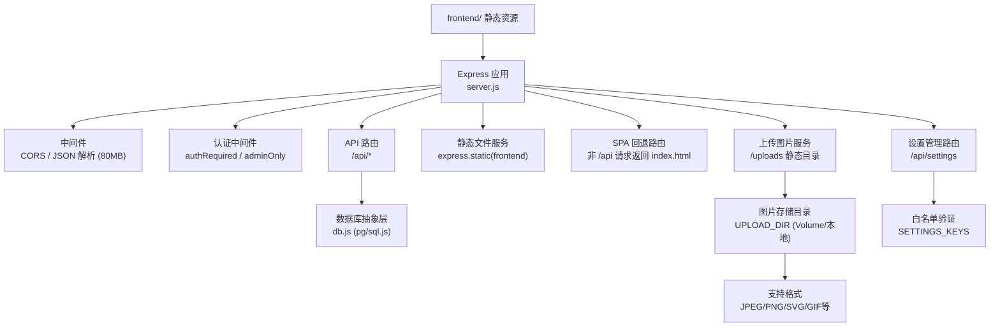
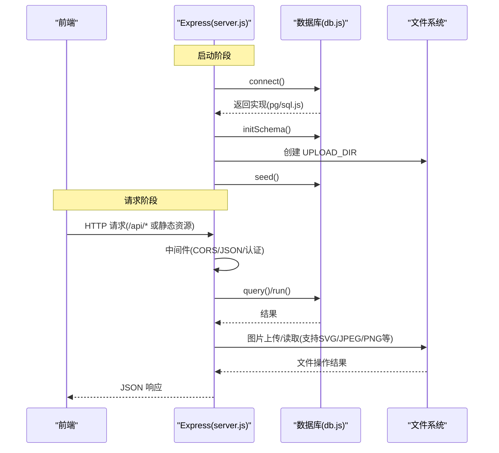
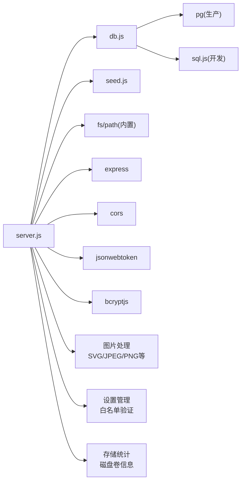

</think>

基于我对代码的分析，我现在了解了具体的变更内容。让我更新文档以反映这些变更：

# Express服务器配置

<cite>
**本文引用的文件**
- [backend/server.js](file://backend/server.js)
- [backend/db.js](file://backend/db.js)
- [backend/seed.js](file://backend/seed.js)
- [backend/package.json](file://backend/package.json)
- [README.md](file://README.md)
- [frontend/js/admin.js](file://frontend/js/admin.js)
</cite>

## 更新摘要
**所做更改**
- 更新了JSON解析限制从24MB增加到80MB，以支持更大的图片负载
- 新增了设置管理路由和白名单验证功能
- 增强了存储统计仪表板，包含磁盘卷信息和格式化的字节计数
- 改进了图片上传服务和错误处理机制
- 优化了生产环境部署指导

## 目录
1. [简介](#简介)
2. [项目结构](#项目结构)
3. [核心组件](#核心组件)
4. [架构总览](#架构总览)
5. [详细组件分析](#详细组件分析)
6. [依赖关系分析](#依赖关系分析)
7. [性能与扩展建议](#性能与扩展建议)
8. [故障排查指南](#故障排查指南)
9. [结论](#结论)
10. [附录：环境变量与启动命令](#附录：环境变量与启动命令)

## 简介
本文件为 LeapShop 后端 Express 服务器的配置与运行文档，覆盖以下内容：
- 应用初始化流程（Express 创建、中间件、路由、静态资源）
- 端口与环境变量管理
- 数据库连接与模式初始化（PostgreSQL / SQLite 自动切换）
- **增强** 图片上传服务和静态文件托管，支持SVG格式和灵活MIME类型处理
- **新增** 设置管理API和白名单验证
- **增强** 存储统计功能，包含磁盘卷信息和格式化字节计数
- 错误处理机制与启动流程
- 如何扩展新的中间件与路由
- 开发环境与生产环境的差异说明

## 项目结构
后端位于 backend 目录，入口为 server.js；数据库抽象在 db.js；种子数据在 seed.js。前端静态资源托管于 frontend 目录，由后端在单服务模式中提供。**增强** 的图片上传系统通过 UPLOAD_DIR 环境变量配置，支持本地开发和生产环境的不同存储策略，并新增了对SVG格式的完整支持。

**图表来源**
- [backend/server.js:27-28](file://backend/server.js#L27-L28)
- [backend/server.js:442-490](file://backend/server.js#L442-L490)
- [backend/server.js:295-310](file://backend/server.js#L295-L310)
- [backend/server.js:22-24](file://backend/server.js#L22-L24)
- [backend/server.js:82-102](file://backend/server.js#L82-L102)

**章节来源**
- [backend/server.js:1-574](file://backend/server.js#L1-L574)
- [backend/db.js:1-272](file://backend/db.js#L1-L272)
- [backend/seed.js:1-129](file://backend/seed.js#L1-L129)
- [backend/package.json:1-23](file://backend/package.json#L1-L23)
- [README.md:1-132](file://README.md#L1-L132)

## 核心组件
- Express 应用与中间件：创建 app，启用 CORS 与 JSON 解析（80MB限制），挂载认证中间件与 API 路由，最后提供静态资源与 SPA 回退。
- 数据库抽象层：根据环境变量自动选择 PostgreSQL 或 SQLite，统一 query/run 接口，并提供 initSchema 建表。
- **增强** 图片上传服务：支持 base64 图片上传、内容哈希命名、自动去重和清理功能，新增对SVG格式的完整支持。
- **新增** 设置管理API：提供全站设置的读取和更新功能，包含白名单验证防止恶意键名。
- **增强** 存储统计：提供数据库和图片文件的存储使用量统计，包含详细的图片文件计数、大小信息和磁盘卷容量信息。
- 种子数据：幂等写入默认管理员与客户账户及占位商品。
- 启动流程：连接数据库 → 初始化模式 → 注入种子数据 → 监听端口并输出日志。

**章节来源**
- [backend/server.js:27-28](file://backend/server.js#L27-L28)
- [backend/server.js:442-490](file://backend/server.js#L442-L490)
- [backend/server.js:492-513](file://backend/server.js#L492-L513)
- [backend/server.js:313-330](file://backend/server.js#L313-L330)
- [backend/db.js:59-126](file://backend/db.js#L59-L126)
- [backend/seed.js:87-114](file://backend/seed.js#L87-L114)

## 架构总览
后端以 Express 为中心，通过中间件链处理请求，API 路由访问数据库抽象层，同时提供静态资源、图片上传、设置管理和 SPA 路由支持。**增强** 的图片处理系统现在支持多种格式包括SVG，并通过灵活的内容哈希命名实现天然去重。

**图表来源**
- [backend/server.js:313-330](file://backend/server.js#L313-L330)
- [backend/db.js:59-126](file://backend/db.js#L59-L126)
- [backend/server.js:72-89](file://backend/server.js#L72-L89)

## 详细组件分析

### 应用初始化与中间件
- 应用创建：使用 express 创建 app。
- 中间件：
  - CORS：允许跨域请求。
  - **更新** JSON 解析：**将请求体大小限制从24MB增加到80MB**，以支持多图 base64 内嵌提交，单商品图片总量上限50MB（二进制口径），base64 膨胀约 1/3 后约 67MB，预留 JSON 开销余量。
- 自定义认证中间件：
  - authRequired：从 Authorization 头提取 Bearer Token，校验后挂载到 req.user。
  - adminOnly：仅当用户角色为 admin 时放行。

**更新** 增加了JSON解析限制以提高图片上传能力

**章节来源**
- [backend/server.js:27-28](file://backend/server.js#L27-L28)
- [backend/server.js:148-163](file://backend/server.js#L148-L163)

### 端口与环境变量管理
- 端口：优先使用 PORT 环境变量，否则默认 3000。
- JWT 密钥：JWT_SECRET 环境变量，未设置时使用开发默认值。
- 令牌有效期：TOKEN_TTL 控制过期时间。
- **增强** 上传目录：UPLOAD_DIR 环境变量，生产环境指向 Volume 挂载点，本地开发回退到 backend/data/uploads。

**章节来源**
- [backend/server.js:18-24](file://backend/server.js#L18-L24)

### 增强的图片上传服务与存储管理
- **新增** SVG格式支持：通过灵活的MIME类型处理，现在支持 `image/svg+xml` 格式，自动转换为 `.svg` 扩展名。
- **增强** MIME类型处理：支持多种图像格式，包括 JPEG、PNG、GIF、SVG等，通过正则表达式匹配 `data:image\/([\w.+-]+);base64,` 格式。
- **改进** 错误处理机制：
  - 无效的 data URL 格式：返回 null 并跳过该图片，防止数据库膨胀。
  - 空缓冲区检查：确保 base64 解码后的缓冲区不为空。
  - 文件写入异常捕获：记录警告日志但不中断请求处理。
- **优化** 存储策略：
  - 内容哈希命名：使用 SHA1 哈希作为文件名，实现天然去重和迁移幂等。
  - 子目录组织：按哈希前两位分目录存储，避免单目录文件过多。
  - 自动清理：删除不再被任何商品引用的图片文件。
- **增强** 静态文件服务：通过 `/uploads` 路由提供图片文件的静态访问，支持长缓存策略（30天不可变缓存）。
- **增强** 存储统计：计算数据库和图片文件的总存储使用量，包含图片文件数量和大小统计。

**更新** 增强了图片处理系统，新增SVG格式支持和改进的错误处理机制

**章节来源**
- [backend/server.js:22-24](file://backend/server.js#L22-L24)
- [backend/server.js:82-102](file://backend/server.js#L82-L102)
- [backend/server.js:104-112](file://backend/server.js#L104-L112)
- [backend/server.js:295-296](file://backend/server.js#L295-L296)
- [backend/server.js:277-288](file://backend/server.js#L277-L288)

### 设置管理API与白名单验证
- **新增** 设置表：创建 settings 表用于存储全站配置项。
- **新增** 公开设置读取：`GET /api/settings` 返回所有设置项供前台渲染。
- **新增** 管理员设置更新：`PUT /api/settings` 支持更新单个设置项，包含严格的白名单验证。
- **新增** LOGO上传：`POST /api/settings/logo` 支持通过dataURL上传LOGO图片。
- **安全验证**：
  - 白名单验证：只允许预定义的设置键名（site_title, logo_url, announcement_html, contact_email, contact_social）。
  - 数据类型验证：确保值为字符串类型。
  - 大小限制：单个设置值最大64KB。
- **数据库兼容**：支持PostgreSQL的ON CONFLICT语法和SQLite的INSERT OR REPLACE语法。

**新增** 设置管理功能，提供全站配置的动态管理能力

**章节来源**
- [backend/server.js:442-490](file://backend/server.js#L442-L490)
- [backend/db.js:201-206](file://backend/db.js#L201-L206)

### 增强存储统计仪表板
- **新增** 磁盘卷信息：通过 `fs.statfsSync()` 获取文件系统容量和剩余空间。
- **增强** 统计维度：
  - 数据库类型识别（PostgreSQL/SQLite）
  - 总存储使用量（数据库 + 图片文件）
  - 商品数据存储量（数据库商品数据 + 图片文件）
  - 产品数量统计
  - 图片文件数量和大小
  - 系统开销占比计算
  - **新增** 磁盘卷总容量和剩余空间
- **格式化输出**：提供完整的存储统计信息，便于前端展示和管理员监控。

**新增** 磁盘卷容量统计，提供更全面的存储监控信息

**章节来源**
- [backend/server.js:492-513](file://backend/server.js#L492-L513)
- [backend/server.js:179-186](file://backend/server.js#L179-L186)

### 静态文件服务与单页应用路由
- 静态托管：若存在 frontend 目录，则通过 express.static 提供静态资源。
- SPA 回退：对非 /api 开头的路径，返回 index.html，使前端路由由浏览器侧处理。
- **增强** 上传文件服务：通过 `/uploads` 路由提供图片文件的静态访问，支持长缓存和不可变缓存策略。

**更新** 增强了静态文件服务，新增了上传文件的静态访问支持

**章节来源**
- [backend/server.js:295-310](file://backend/server.js#L295-L310)

### 数据库连接与模式初始化
- 驱动选择：
  - 检测到 DATABASE_URL 或 PGHOST 环境变量时，使用 PostgreSQL（pg）。
  - 否则使用 SQLite（sql.js），数据文件位于 backend/data/leapchess.db。
- 连接与接口：
  - connect() 返回统一的 db 对象，暴露 query(sql, params) 与 run(sql, params)。
  - PostgreSQL 路径下 INSERT 自动追加 RETURNING id。
- 模式初始化：
  - initSchema() 根据当前驱动创建 users 与 products 表（兼容语法）。
  - **新增** settings 表创建。
- 代理保护：
  - 未调用 connect() 直接访问 db 会抛出错误提示。

**章节来源**
- [backend/db.js:13-15](file://backend/db.js#L13-L15)
- [backend/db.js:59-126](file://backend/db.js#L59-L126)
- [backend/db.js:129-182](file://backend/db.js#L129-L182)
- [backend/db.js:224-237](file://backend/db.js#L224-L237)

### 启动流程
- 顺序：connect() → initSchema() → seed() → app.listen(PORT)。
- 日志：
  - 未使用 PostgreSQL 时输出警告，提醒生产环境应使用 PostgreSQL。
  - 当检测到 DATA_DIR 环境变量时，显示已启用 Volume 持久化的确认信息。
  - **增强** 显示图片目录位置和是否使用 Volume 的信息。
  - **新增** Volume 检测：检查 UPLOAD_DIR 是否位于独立挂载点上，如果不是则发出警告。
  - 启动成功输出监听地址与数据库类型。
- 异常：启动失败打印错误并退出进程。

**更新** 增强了启动日志，包含图片目录和 Volume 状态信息

**章节来源**
- [backend/server.js:313-330](file://backend/server.js#L313-L330)

### 错误处理机制
- 认证失败：
  - 未携带 Token 或未登录：返回 401。
  - Token 无效或过期：返回 401。
- 权限不足：
  - 非管理员尝试写操作：返回 403。
- 资源不存在：
  - 查询不到商品：返回 404。
- 参数校验：
  - 必填字段缺失：返回 400。
  - **新增** 设置键名不在白名单：返回 400。
  - **新增** 设置值类型不正确：返回 400。
  - **新增** 设置值过大：返回 400。
- **增强** 图片上传错误：
  - 无效的 data URL 格式：返回 null 并跳过该图片，防止数据库膨胀。
  - 空缓冲区检查：确保 base64 解码后的缓冲区不为空。
  - 文件写入失败：捕获异常并记录警告日志。
  - 不支持的图片格式：返回错误消息。
- 全局错误：
  - 启动阶段异常捕获并退出进程。

**更新** 新增了设置管理和图片上传相关的错误处理机制

**章节来源**
- [backend/server.js:148-163](file://backend/server.js#L148-L163)
- [backend/server.js:166-182](file://backend/server.js#L166-L182)
- [backend/server.js:209-275](file://backend/server.js#L209-L275)
- [backend/server.js:72-89](file://backend/server.js#L72-L89)
- [backend/server.js:117-131](file://backend/server.js#L117-L131)
- [backend/server.js:466-479](file://backend/server.js#L466-L479)

### 扩展新中间件示例
- 新增一个记录请求耗时与来源的中间件，插入到 JSON 解析之后、路由之前：
  - 在 app.use(express.json(...)) 之后添加你的中间件。
  - 在中间件中读取 req.headers['x-forwarded-for'] 或 req.ip 获取来源。
  - 使用 Date.now() 计算耗时并在响应结束后记录日志。
- 参考位置：
  - 中间件注册位置：[backend/server.js:27-28](file://backend/server.js#L27-L28)

**章节来源**
- [backend/server.js:27-28](file://backend/server.js#L27-L28)

### 扩展新路由示例
- 新增一个受保护的只读接口：
  - 使用 authRequired 中间件保护。
  - 在路由处理器中调用 db.query 读取数据并返回 JSON。
- 参考位置：
  - 受保护路由示例：[backend/server.js:184-186](file://backend/server.js#L184-L186)
  - 数据库查询示例：[backend/server.js:190-199](file://backend/server.js#L190-L199)

**章节来源**
- [backend/server.js:184-199](file://backend/server.js#L184-L199)

### 开发环境与生产环境差异
- 数据库：
  - 开发：无 DATABASE_URL/PGHOST 时自动使用 SQLite，便于本地零配置运行。
  - 生产：推荐注入 DATABASE_URL 或使用 Zeabur 自动注入的 PG* 环境变量，走 PostgreSQL。
- 端口：
  - 开发：默认 3000。
  - 生产：优先使用平台注入的 PORT（例如 Zeabur 默认 8080）。
- 安全：
  - 生产务必设置强随机 JWT_SECRET，避免使用代码默认值。
- 静态资源：
  - 单服务模式：后端同时托管 frontend，适合简单部署。
  - 分离模式：前端独立托管，后端仅暴露 /api。
- 健康检查：
  - 提供 /api/health 用于平台健康探测。
- **数据存储**：
  - 开发：SQLite 数据文件存储在 backend/data/ 目录。
  - 生产：推荐使用 PostgreSQL；如必须使用 SQLite，需设置 DATA_DIR 环境变量指向持久化卷。
- **图片存储**：
  - 开发：图片存储在 backend/data/uploads 目录。
  - 生产：通过 UPLOAD_DIR 环境变量指向 Volume 挂载点，确保图片文件持久化。
  - **新增** Volume 检测：生产环境会自动检测 UPLOAD_DIR 是否在独立挂载点上，如果不是则发出警告。
- **新增** 设置管理：
  - 开发：settings 表存储在 SQLite 数据库中。
  - 生产：settings 表存储在 PostgreSQL 数据库中，支持动态全站配置。

**更新** 新增了设置管理的环境差异说明

**章节来源**
- [backend/db.js:13-15](file://backend/db.js#L13-L15)
- [backend/server.js:18-24](file://backend/server.js#L18-L24)
- [backend/server.js:295-310](file://backend/server.js#L295-L310)
- [backend/server.js:313-330](file://backend/server.js#L313-L330)
- [backend/server.js:442-490](file://backend/server.js#L442-L490)
- [README.md:73-100](file://README.md#L73-L100)

## 依赖关系分析
- 运行时依赖：
  - express：Web 框架。
  - cors：跨域支持。
  - jsonwebtoken：JWT 签发与验证。
  - bcryptjs：密码哈希。
  - pg：PostgreSQL 客户端（生产）。
  - sql.js：SQLite WASM 实现（开发回退）。
- 模块耦合：
  - server.js 依赖 db.js 提供的统一数据库接口。
  - server.js 依赖 seed.js 进行初始数据注入。
  - db.js 根据环境变量动态加载 pg 或 sql.js。
  - **增强** server.js 使用 Node.js 内置的 fs 和 path 模块处理文件操作，支持多种图片格式。

**图表来源**
- [backend/server.js:7-16](file://backend/server.js#L7-L16)
- [backend/db.js:59-126](file://backend/db.js#L59-L126)
- [backend/package.json:14-21](file://backend/package.json#L14-L21)

**章节来源**
- [backend/package.json:14-21](file://backend/package.json#L14-L21)
- [backend/server.js:7-16](file://backend/server.js#L7-L16)
- [backend/db.js:59-126](file://backend/db.js#L59-L126)

## 性能与扩展建议
- 请求体大小：**已将JSON解析限制设置为80MB**，足以容纳多图 base64 内嵌存储；如需更大，可继续调整。
- 数据库连接池：生产环境使用 pg Pool，注意合理设置连接数与超时。
- 缓存策略：对高频只读接口（如商品列表）可引入内存缓存或 CDN 缓存静态资源。
- **增强** 图片缓存：上传文件使用 30 天不可变缓存，提升图片加载性能。
- **新增** 设置缓存：考虑对频繁读取的设置数据进行内存缓存，减少数据库查询。
- 日志与监控：可扩展结构化日志与指标上报，便于定位问题。
- 安全加固：
  - 生产环境强制 HTTPS。
  - 限制 CORS 来源为可信域名。
  - 对输入做更严格的校验与过滤。
  - **新增** 设置值大小限制，防止恶意大值攻击。
- **增强** 存储优化：
  - 定期清理不再引用的图片文件。
  - 考虑使用对象存储服务（如 AWS S3）替代本地文件存储。
  - 实现图片压缩和格式转换以减少存储空间。
  - **新增** 支持多种图片格式，包括SVG矢量图，提供更好的视觉效果。
  - **新增** 磁盘卷容量监控，及时发现存储空间不足问题。

**更新** 新增了设置缓存和磁盘卷容量监控的建议

## 故障排查指南
- 无法连接数据库：
  - 检查是否设置了 DATABASE_URL 或 PG* 环境变量。
  - 若使用外部 PostgreSQL，确认网络连通性与 SSL 配置。
- 启动失败：
  - 查看控制台错误输出，确认依赖安装与端口占用情况。
- 认证失败：
  - 确认请求头包含正确的 Authorization: Bearer <token>。
  - 检查 JWT_SECRET 是否与签发端一致。
- 静态资源 404：
  - 确认 frontend 目录存在且未被误删。
  - 确认路由未被其他中间件拦截。
- 健康检查：
  - 访问 /api/health 确认服务状态与数据库类型。
- **增强** 图片上传问题：
  - 检查 UPLOAD_DIR 目录是否存在且有写入权限。
  - 确认磁盘空间充足，特别是生产环境的 Volume 挂载点。
  - 验证 base64 图片格式是否正确。
  - **新增** 检查图片格式是否受支持（现在支持SVG、JPEG、PNG等）。
  - **新增** 检查 data URL 格式是否符合 `data:image/[format];base64,[data]` 规范。
- **新增** 设置管理问题：
  - 检查设置键名是否在白名单中。
  - 确认设置值类型为字符串且不超过64KB。
  - 验证数据库连接是否正常。
- **增强** 存储统计异常：
  - 检查 /api/stats/storage 接口返回的数据是否合理。
  - 确认数据库和图片目录的权限设置正确。
  - **新增** 检查图片文件数量和大小的统计是否准确。
  - **新增** 验证磁盘卷容量信息是否正确获取。
- **增强** 部署警告处理：
  - 如果看到 SQLite 回退警告，在生产环境中应配置 PostgreSQL 服务。
  - 如果必须使用 SQLite，请确保设置 DATA_DIR 环境变量指向持久化卷。
  - 检查 Zeabur 平台的 Volume 挂载是否正确配置。
  - **新增** 检查 UPLOAD_DIR 环境变量指向正确的 Volume 路径。
  - **新增** 关注 Volume 检测警告，确保图片文件不会因重新部署而丢失。
  - **新增** 监控磁盘卷剩余空间，及时扩容避免服务中断。

**更新** 新增了设置管理和磁盘卷相关的故障排查指导

**章节来源**
- [backend/server.js:313-330](file://backend/server.js#L313-L330)
- [backend/server.js:148-163](file://backend/server.js#L148-L163)
- [backend/server.js:295-310](file://backend/server.js#L295-L310)
- [backend/server.js:277-288](file://backend/server.js#L277-L288)
- [backend/server.js:72-89](file://backend/server.js#L72-L89)
- [backend/server.js:466-479](file://backend/server.js#L466-L479)
- [backend/server.js:492-513](file://backend/server.js#L492-L513)

## 结论
该 Express 服务器通过简洁的中间件与路由组织，结合数据库抽象层实现了开发与生产的平滑切换。启动流程清晰，错误处理完善，静态资源与 SPA 路由支持开箱即用。**增强的图片上传和存储服务**提供了完整的图片处理能力，支持多种格式包括SVG，支持生产环境的 Volume 持久化和性能优化。**新增的设置管理功能**提供了全站配置的动态管理能力，配合白名单验证确保安全。**增强的存储统计仪表板**包含磁盘卷容量信息，为运维监控提供了更全面的数据支持。**更新的JSON解析限制**提高了图片上传的承载能力。增强的部署日志和警告机制提供了更好的生产环境部署指导。按本文档扩展中间件与路由即可快速迭代功能。

## 附录：环境变量与启动命令
- 关键环境变量：
  - PORT：服务监听端口（生产由平台注入）。
  - JWT_SECRET：JWT 签名密钥（生产必须设置）。
  - DATABASE_URL 或 PGHOST/PGPORT/PGUSER/PGPASSWORD/PGDATABASE：数据库连接信息。
  - PGSSL：控制是否启用 SSL 连接（可选）。
  - DATA_DIR：SQLite 数据目录（生产环境用于 Volume 持久化）。
  - **增强** UPLOAD_DIR：图片上传目录（生产环境指向 Volume 挂载点）。
- 常用命令：
  - 安装依赖：npm install
  - 启动服务：npm start
  - 开发热重载：npm run dev
  - 执行种子数据：npm run seed

**更新** 新增了UPLOAD_DIR环境变量的说明

**章节来源**
- [backend/package.json:6-10](file://backend/package.json#L6-L10)
- [backend/server.js:18-24](file://backend/server.js#L18-L24)
- [backend/db.js:13-15](file://backend/db.js#L13-L15)
- [backend/server.js:313-330](file://backend/server.js#L313-L330)
- [README.md:30-52](file://README.md#L30-L52)
</docs>