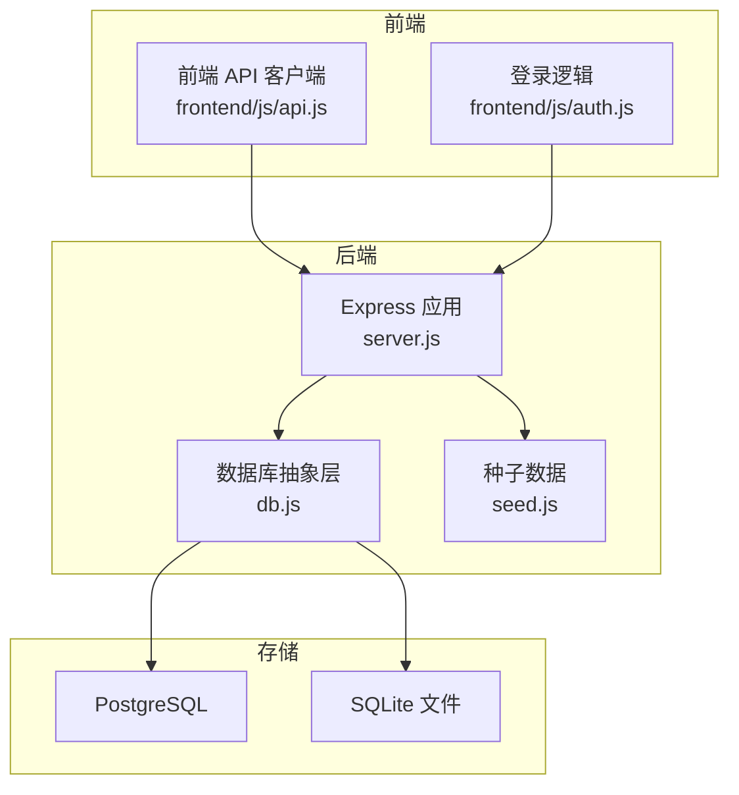
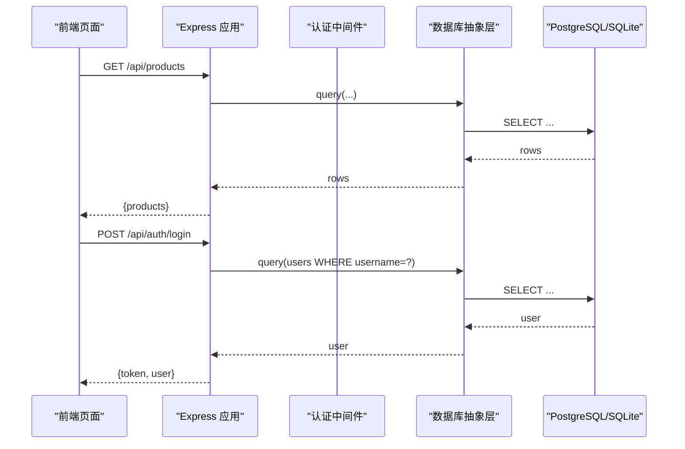
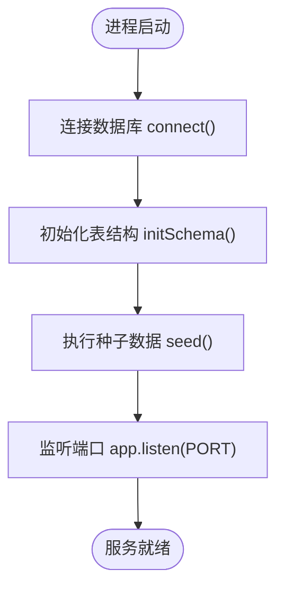
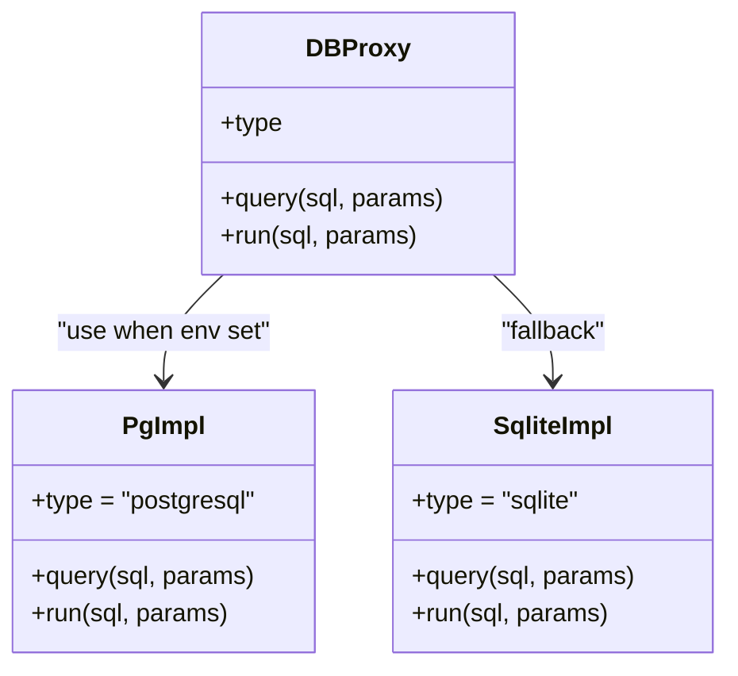
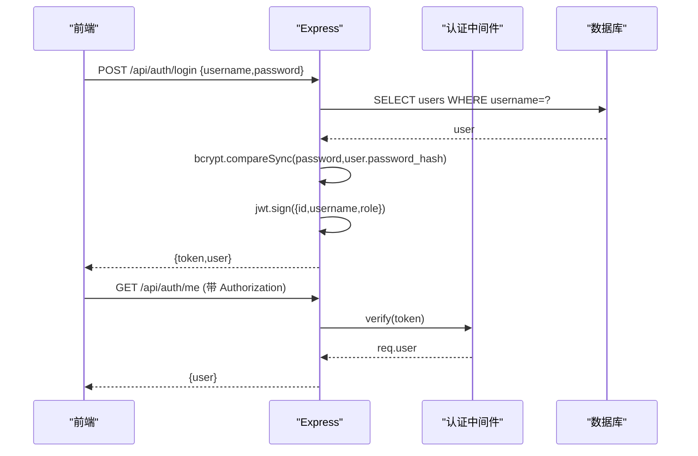
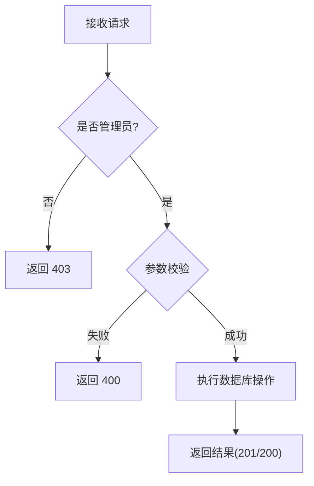
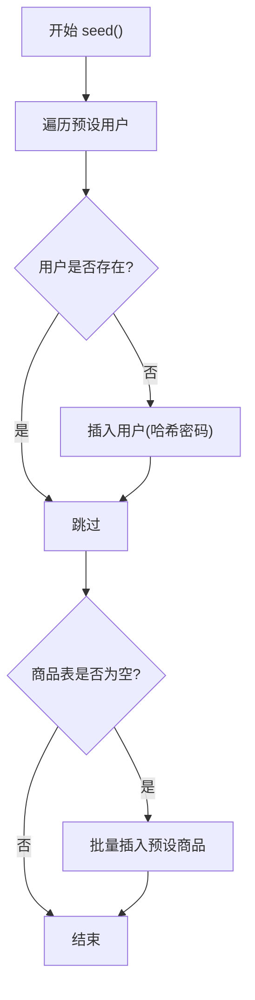
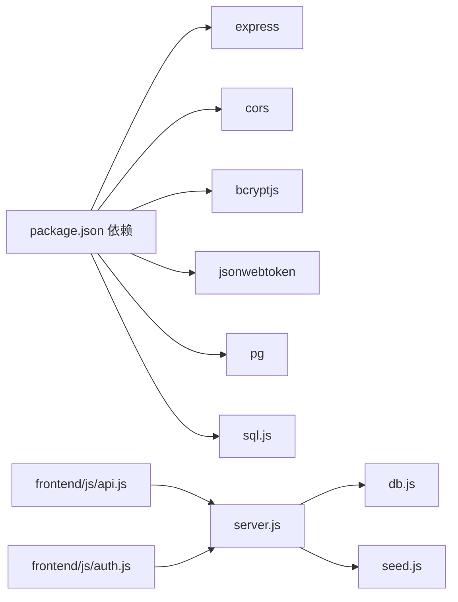

# 后端开发指南

<cite>
**本文引用的文件**
- [server.js](file://backend/server.js)
- [db.js](file://backend/db.js)
- [seed.js](file://backend/seed.js)
- [package.json](file://backend/package.json)
- [README.md](file://README.md)
- [test-api.ps1](file://backend/test-api.ps1)
- [test-crud.js](file://backend/test-crud.js)
- [api.js](file://frontend/js/api.js)
- [auth.js](file://frontend/js/auth.js)
</cite>

## 目录
1. [简介](#简介)
2. [项目结构](#项目结构)
3. [核心组件](#核心组件)
4. [架构总览](#架构总览)
5. [详细组件分析](#详细组件分析)
6. [依赖关系分析](#依赖关系分析)
7. [性能与可观测性](#性能与可观测性)
8. [故障排查指南](#故障排查指南)
9. [结论](#结论)
10. [附录：API 规范与示例](#附录api-规范与示例)

## 简介
本指南面向 LeapShop 后端服务的开发者，覆盖 Express 服务器配置与初始化、中间件与路由、静态文件服务、数据库抽象层（PostgreSQL 与 SQLite 双驱动）、种子数据与幂等性、错误处理策略、日志记录与性能监控实践，并提供具体代码路径与常见问题解决方案。目标是帮助你在本地快速搭建、在生产稳定运行并持续演进。

## 项目结构
后端位于 backend 目录，采用单入口 Express 应用，配合数据库抽象层与种子脚本；前端为原生 HTML/CSS/JS，可在单服务模式中由后端托管静态资源。

图表来源
- [server.js:1-169](file://backend/server.js#L1-L169)
- [db.js:1-176](file://backend/db.js#L1-L176)
- [seed.js:1-129](file://backend/seed.js#L1-L129)
- [api.js:1-76](file://frontend/js/api.js#L1-L76)
- [auth.js:1-30](file://frontend/js/auth.js#L1-L30)

章节来源
- [README.md:6-19](file://README.md#L6-L19)
- [package.json:1-23](file://backend/package.json#L1-L23)

## 核心组件
- Express 应用与中间件：CORS、JSON 解析、认证与管理员权限中间件、健康检查、静态资源托管。
- 数据库抽象层：自动选择 PostgreSQL 或 SQLite，统一 query/run 接口，连接池管理，建表与类型适配。
- 种子数据：幂等写入预设账户与商品，确保首次启动即可用。
- 测试脚本：PowerShell 冒烟测试与 Node 中文 CRUD 验证。

章节来源
- [server.js:21-169](file://backend/server.js#L21-L169)
- [db.js:1-176](file://backend/db.js#L1-L176)
- [seed.js:87-114](file://backend/seed.js#L87-L114)
- [test-api.ps1:1-101](file://backend/test-api.ps1#L1-L101)
- [test-crud.js:1-54](file://backend/test-crud.js#L1-L54)

## 架构总览
系统采用前后端分离但支持单服务模式：前端通过同源 /api 访问后端，若不通则回退到本地 3000 端口；后端根据环境变量自动选择 PostgreSQL（生产）或 SQLite（开发），并在启动时完成建表与种子数据注入。

图表来源
- [server.js:43-84](file://backend/server.js#L43-L84)
- [db.js:44-110](file://backend/db.js#L44-L110)

## 详细组件分析

### Express 服务器配置与初始化
- 中间件
  - CORS：允许跨域请求。
  - JSON：解析请求体，限制大小以支持 base64 图片上传。
  - 认证中间件：从 Authorization 头提取 Bearer Token，校验 JWT 并挂载用户信息。
  - 管理员权限中间件：仅允许 role=admin 的请求继续。
- 路由
  - 认证：POST /api/auth/login、GET /api/auth/me。
  - 商品：GET /api/products、GET /api/products/:id、POST /api/products、PUT /api/products/:id、DELETE /api/products/:id。
  - 健康检查：GET /api/health。
- 静态文件服务
  - 若存在 frontend 目录，则托管静态资源，并将非 /api 路由重定向到 index.html，实现 SPA 友好模式。
- 启动流程
  - 连接数据库、初始化 schema、执行种子数据、监听端口。

图表来源
- [server.js:151-169](file://backend/server.js#L151-L169)

章节来源
- [server.js:21-169](file://backend/server.js#L21-L169)

### 数据库抽象层（PostgreSQL 与 SQLite 双驱动）
- 驱动选择
  - 检测 DATABASE_URL 或 PGHOST 环境变量，使用 PostgreSQL；否则使用 sql.js 的 SQLite（WASM）。
- 连接与查询封装
  - PostgreSQL：使用连接池，query 返回 rows；run 对 INSERT 自动追加 RETURNING id，便于获取新记录主键。
  - SQLite：内存数据库 + 每次写操作后持久化到文件，保证重启不丢数据（开发场景）。
- SQL 兼容
  - 统一使用 ? 占位符，内部将 ? 转换为 $1/$2... 以适配 PostgreSQL。
- Schema 初始化
  - users：id、username（唯一）、password_hash、role、created_at。
  - products：id、name、category、price、description、image、stock、created_at、updated_at。
- 代理对象
  - db.type 暴露当前驱动类型；db.query/db.run 在连接前抛出明确错误提示。

图表来源
- [db.js:12-176](file://backend/db.js#L12-L176)

章节来源
- [db.js:1-176](file://backend/db.js#L1-L176)

### 认证与权限
- 登录
  - 校验用户名与密码，比对 bcrypt 哈希，签发 JWT（含 id、username、role），设置过期时间。
- 鉴权
  - 从 Authorization 头解析 Token，校验失败返回 401。
  - 管理员权限：仅 role=admin 可调用写接口，否则返回 403。
- 会话
  - 前端通过 api.js 管理 localStorage 中的 token 与用户信息，并在请求时自动附加 Authorization 头。

图表来源
- [server.js:25-64](file://backend/server.js#L25-L64)
- [api.js:40-49](file://frontend/js/api.js#L40-L49)

章节来源
- [server.js:25-64](file://backend/server.js#L25-L64)
- [api.js:1-76](file://frontend/js/api.js#L1-L76)
- [auth.js:1-30](file://frontend/js/auth.js#L1-L30)

### 商品管理接口
- 列表与详情：公开读取，支持按 category 过滤。
- 新增/更新/删除：需管理员权限，参数校验与默认值处理。
- 图片字段：支持 base64 内嵌存储，便于无状态部署。

图表来源
- [server.js:86-135](file://backend/server.js#L86-L135)

章节来源
- [server.js:66-135](file://backend/server.js#L66-L135)

### 种子数据与幂等性
- 幂等设计
  - 用户：按 username 查重，不存在才插入。
  - 商品：当 products 表为空时才批量写入预设商品。
- 执行时机
  - 启动流程中先建表再执行种子数据，确保环境可用。
- 演示账户
  - 超级管理员 P001 与客户 C001，密码均为 123456。

图表来源
- [seed.js:87-114](file://backend/seed.js#L87-L114)

章节来源
- [seed.js:1-129](file://backend/seed.js#L1-L129)

### 静态文件服务与单服务模式
- 条件启用：若存在 frontend 目录，则启用 express.static 并拦截非 /api 路由返回 index.html，支持 SPA 刷新。
- 部署优势：单服务简化部署，Zeabur 等平台可直接托管。

章节来源
- [server.js:142-149](file://backend/server.js#L142-L149)

## 依赖关系分析
- 运行时依赖
  - express：Web 框架。
  - cors：跨域支持。
  - bcryptjs：密码哈希。
  - jsonwebtoken：JWT 签发与校验。
  - pg：PostgreSQL 客户端与连接池。
  - sql.js：SQLite 纯 WASM 实现，无需编译。
- 模块耦合
  - server.js 依赖 db.js 与 seed.js。
  - 前端 js/api.js 与 js/auth.js 通过 REST API 与后端交互。

图表来源
- [package.json:14-21](file://backend/package.json#L14-L21)
- [server.js:7-15](file://backend/server.js#L7-L15)

章节来源
- [package.json:1-23](file://backend/package.json#L1-L23)

## 性能与可观测性
- 连接池
  - PostgreSQL 使用连接池，提高并发能力；建议在生产环境合理设置池大小与超时。
- 查询优化
  - 使用预编译语句与参数绑定避免 SQL 注入与重复解析开销。
  - 按需加载：商品列表支持按分类过滤，减少不必要的数据传输。
- 日志与监控
  - 启动日志输出当前数据库类型与监听端口。
  - 健康检查 /api/health 返回状态与数据库类型，可用于平台健康探针。
- 缓存与限流
  - 当前未实现缓存与限流；在高并发场景可引入 Redis 缓存热点数据与速率限制中间件。
- 大文件与图片
  - 支持 base64 图片上传，注意请求体大小限制与存储成本；生产建议迁移至对象存储。

[本节为通用指导，不直接分析具体文件]

## 故障排查指南
- 无法连接数据库
  - 现象：启动时报错或健康检查异常。
  - 排查：确认 DATABASE_URL 或 PGHOST 等环境变量是否正确注入；Zeabur 内网 PG 默认不走 SSL，如需外部库请开启 PGSSL 或在 URL 添加 sslmode。
  - 参考：[db.js:29-42](file://backend/db.js#L29-L42)
- SQLite 数据丢失
  - 现象：重新部署后数据清空。
  - 原因：Zeabur 文件系统无状态，SQLite 文件随容器销毁。
  - 解决：生产使用 PostgreSQL；开发阶段保留 data 目录或使用持久卷。
  - 参考：[server.js:154-159](file://backend/server.js#L154-L159)
- 认证失败
  - 现象：401 未登录或会话过期。
  - 排查：确认 Authorization 头格式为 Bearer <token>；检查 JWT_SECRET 一致性与有效期。
  - 参考：[server.js:25-36](file://backend/server.js#L25-L36)
- 权限不足
  - 现象：403 需要管理员权限。
  - 排查：确认角色为 admin；客户角色无法进行写操作。
  - 参考：[server.js:38-41](file://backend/server.js#L38-L41)
- 静态页面无法访问
  - 现象：/ 或 /login.html 返回 404。
  - 排查：确认 frontend 目录存在且被正确托管；检查路由拦截规则。
  - 参考：[server.js:142-149](file://backend/server.js#L142-L149)
- 中文与 Unicode 问题
  - 现象：中文显示乱码或保存不一致。
  - 排查：确保数据库字符集为 UTF-8；Node 与前端均使用 UTF-8 编码。
  - 参考：[test-crud.js:26-45](file://backend/test-crud.js#L26-L45)

章节来源
- [db.js:29-42](file://backend/db.js#L29-L42)
- [server.js:142-169](file://backend/server.js#L142-L169)
- [test-crud.js:26-45](file://backend/test-crud.js#L26-L45)

## 结论
本指南梳理了 LeapShop 后端的整体架构与关键实现，涵盖 Express 配置、数据库抽象、认证授权、商品管理、种子数据与幂等性、静态托管与部署要点。建议在开发阶段使用 SQLite 快速迭代，生产环境切换至 PostgreSQL 并通过环境变量注入连接信息；结合健康检查与测试脚本保障服务质量。

[本节为总结，不直接分析具体文件]

## 附录：API 规范与示例

### 认证接口
- POST /api/auth/login
  - 请求体：{ username, password }
  - 响应：{ token, user: { id, username, role } }
  - 错误：400（缺少参数）、401（用户名或密码错误）
- GET /api/auth/me
  - 请求头：Authorization: Bearer <token>
  - 响应：{ user: { id, username, role } }
  - 错误：401（未登录或会话过期）

章节来源
- [server.js:43-64](file://backend/server.js#L43-L64)

### 商品接口
- GET /api/products
  - 查询参数：category（可选）
  - 响应：{ products: [...] }
- GET /api/products/:id
  - 响应：{ product: {...} }
  - 错误：404（不存在）
- POST /api/products
  - 权限：管理员
  - 请求体：{ name, category?, price?, description?, image?, stock? }
  - 响应：{ product: {...} }（201）
  - 错误：400（参数校验失败）、401（未登录）、403（非管理员）
- PUT /api/products/:id
  - 权限：管理员
  - 请求体：部分字段更新
  - 响应：{ product: {...} }（200）
  - 错误：404（不存在）、401、403
- DELETE /api/products/:id
  - 权限：管理员
  - 响应：{ ok: true }（200）
  - 错误：404、401、403

章节来源
- [server.js:66-135](file://backend/server.js#L66-L135)

### 健康检查
- GET /api/health
  - 响应：{ status: "ok", db: "postgresql|sqlite", time: "ISO timestamp" }

章节来源
- [server.js:137-140](file://backend/server.js#L137-L140)

### 前端集成要点
- 自动探测后端地址：优先同源 /api，失败回退到 localhost:3000。
- 自动携带 Token：所有请求自动附加 Authorization 头。
- 登录流程：提交表单 -> 调用 /api/auth/login -> 保存 session -> 跳转页面。

章节来源
- [api.js:10-49](file://frontend/js/api.js#L10-L49)
- [auth.js:9-25](file://frontend/js/auth.js#L9-L25)

### 测试与验证
- PowerShell 冒烟测试：覆盖健康检查、登录、权限控制、CRUD、静态托管等 15 项用例。
- Node 中文 CRUD：验证 Unicode 内容与 base64 图片字段读写一致性。

章节来源
- [test-api.ps1:32-97](file://backend/test-api.ps1#L32-L97)
- [test-crud.js:23-49](file://backend/test-crud.js#L23-L49)