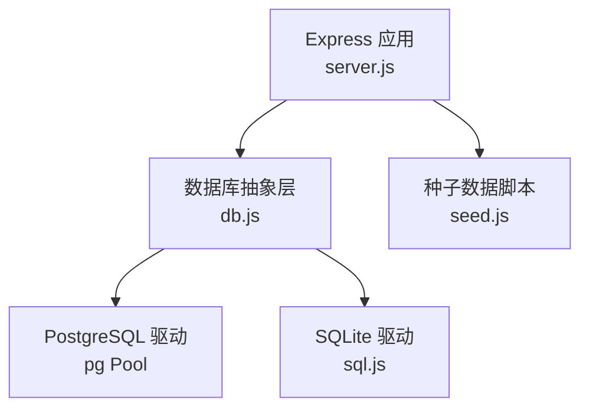
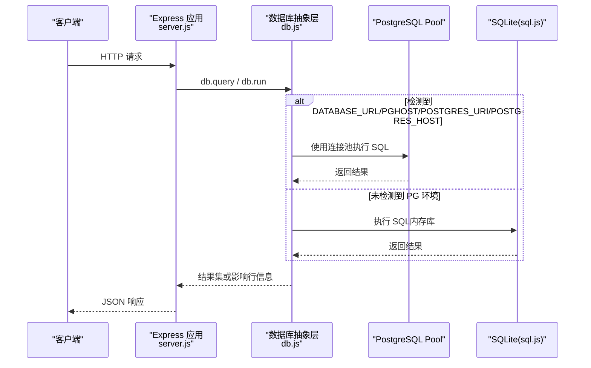
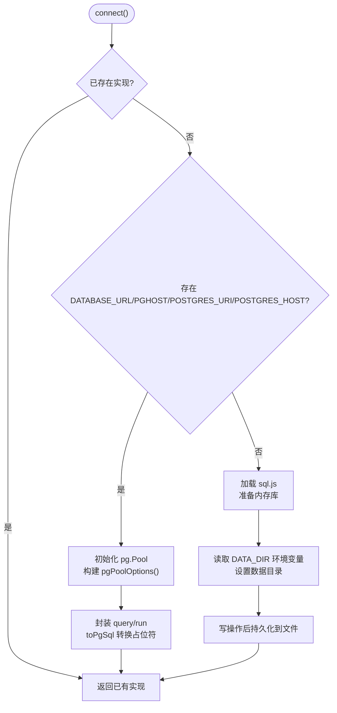
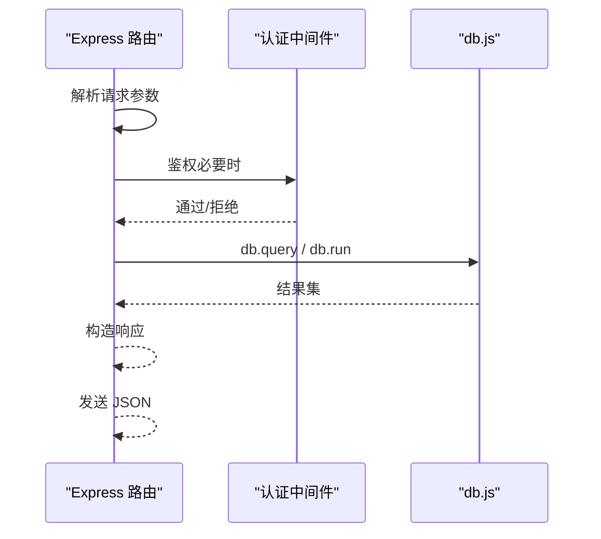
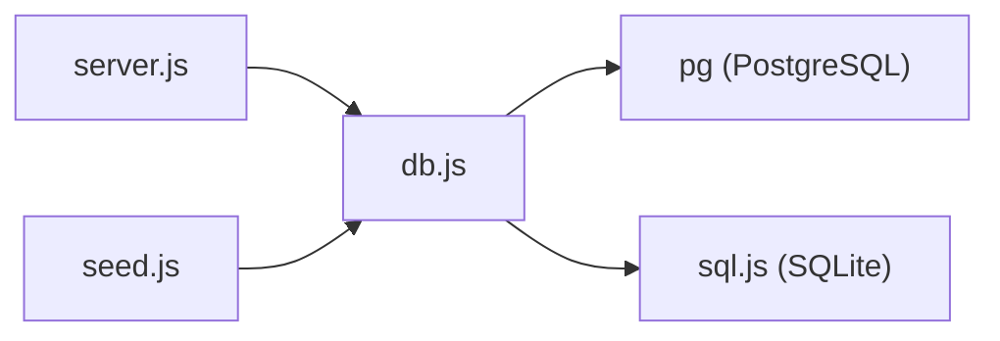
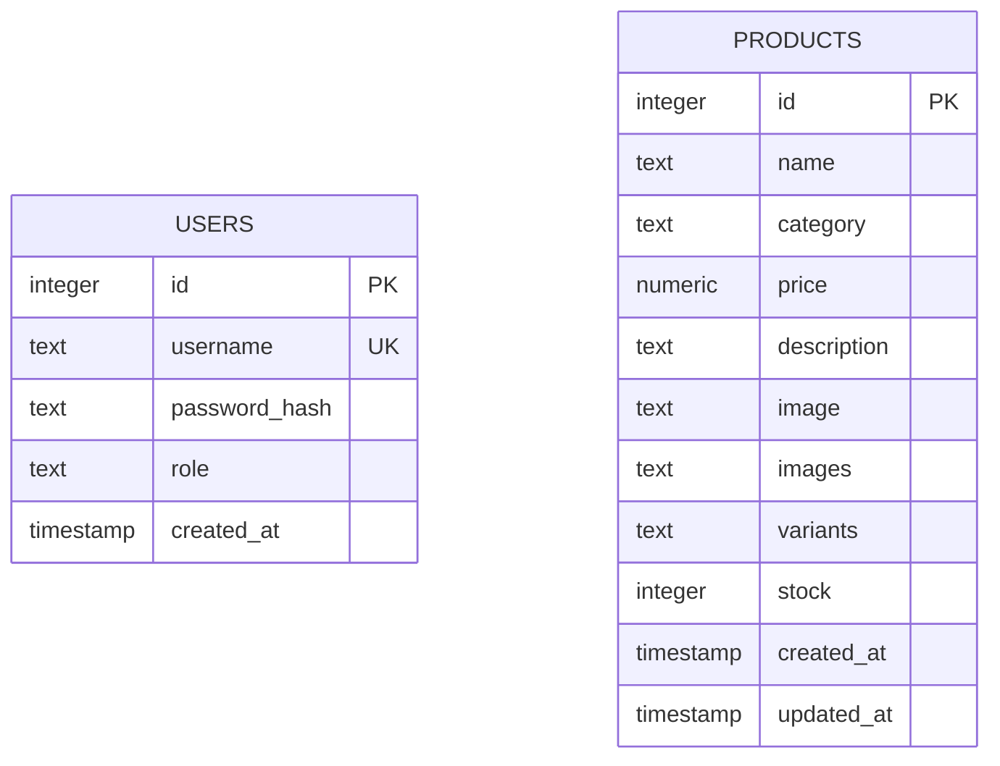

# 数据库抽象层设计

<cite>
**本文引用的文件**
- [backend/db.js](file://backend/db.js)
- [backend/server.js](file://backend/server.js)
- [backend/seed.js](file://backend/seed.js)
- [backend/package.json](file://backend/package.json)
</cite>

## 更新摘要
**变更内容**
- 增强了 PostgreSQL 环境变量兼容性，支持 POSTGRES_URI 和 POSTGRES_* 变量
- 添加了 DATA_DIR 环境变量用于 SQLite 数据目录配置
- 改进了 pgPoolOptions() 函数的连接逻辑
- 更新了环境变量检测机制以支持 Zeabur 平台的新旧命名约定

## 目录
1. [简介](#简介)
2. [项目结构](#项目结构)
3. [核心组件](#核心组件)
4. [架构总览](#架构总览)
5. [详细组件分析](#详细组件分析)
6. [依赖关系分析](#依赖关系分析)
7. [性能考虑](#性能考虑)
8. [故障排查指南](#故障排查指南)
9. [结论](#结论)
10. [附录](#附录)

## 简介
本技术文档聚焦于 LeapShop 后端的数据库抽象层，系统性说明其双驱动（PostgreSQL 与 SQLite）实现、连接池管理、查询封装、错误处理、自动切换机制、环境变量配置策略、SQL 安全实践、表结构设计理念、迁移与版本管理建议以及性能优化要点。该抽象层通过统一接口对外暴露 query/run 能力，屏蔽底层数据库差异，使业务代码无需关心具体数据库类型。

**更新** 增强了环境变量兼容性，现在支持 Zeabur 平台的新旧两种命名约定，并提供更灵活的 SQLite 数据目录配置选项。

## 项目结构
后端采用 Express 提供 API，数据库抽象层位于 backend/db.js；服务启动与路由在 backend/server.js；种子数据初始化在 backend/seed.js；依赖声明在 backend/package.json。

**图表来源**
- [backend/server.js:1-243](file://backend/server.js#L1-L243)
- [backend/db.js:1-240](file://backend/db.js#L1-L240)
- [backend/seed.js:1-129](file://backend/seed.js#L1-L129)

**章节来源**
- [backend/server.js:1-243](file://backend/server.js#L1-L243)
- [backend/db.js:1-240](file://backend/db.js#L1-L240)
- [backend/seed.js:1-129](file://backend/seed.js#L1-L129)
- [backend/package.json:1-23](file://backend/package.json#L1-L23)

## 核心组件
- 数据库抽象层：提供 connect()、initSchema()、db.query()、db.run()，并导出 usePg 标识当前驱动类型。
- PostgreSQL 实现：基于 pg Pool 的连接池，自动将 ? 占位符转换为 $n 占位符，INSERT 自动附加 RETURNING id。
- SQLite 实现：基于 sql.js 的内存数据库，写操作后持久化到本地文件，支持自定义数据目录。
- 服务集成：server.js 在启动时调用 connect() 和 initSchema()，并通过 db 对象执行所有 SQL。
- 种子数据：seed.js 负责幂等地创建初始用户与商品数据。

**更新** 现在支持更多环境变量配置选项，包括 POSTGRES_URI 和 DATA_DIR 环境变量。

**章节来源**
- [backend/db.js:1-240](file://backend/db.js#L1-L240)
- [backend/server.js:1-243](file://backend/server.js#L1-L243)
- [backend/seed.js:1-129](file://backend/seed.js#L1-L129)

## 架构总览
下图展示了请求从 Express 路由到数据库抽象层，再根据环境变量选择 PostgreSQL 或 SQLite 的实现路径。

**图表来源**
- [backend/server.js:222-243](file://backend/server.js#L222-L243)
- [backend/db.js:13-126](file://backend/db.js#L13-L126)

## 详细组件分析

### 数据库抽象层（db.js）
- **自动驱动选择**：通过检测 process.env.DATABASE_URL、process.env.PGHOST、process.env.POSTGRES_URI 或 process.env.POSTGRES_HOST 决定使用 PostgreSQL；否则回退到 SQLite。
- **连接池管理（PostgreSQL）**：使用 pg.Pool，支持通过 DATABASE_URL、POSTGRES_URI 或 Zeabur 注入的 PG* 和 POSTGRES_* 环境变量进行连接；根据 URL 中的 sslmode 或 PGSSL 决定是否启用 SSL。
- **查询封装**：
  - toPgSql：将统一的 ? 占位符转换为 PostgreSQL 的 $n 占位符，确保跨库兼容。
  - query：返回 rows。
  - run：对 INSERT 语句自动追加 RETURNING id，简化新增记录主键获取；SQLite 通过 last_insert_rowid() 获取自增 ID。
- **错误处理**：
  - 未调用 connect() 直接访问 db.query/run 会抛出明确错误，提示先建立连接。
  - 各驱动内部异常由各自库抛出，上层可通过 try/catch 捕获。
- **表结构初始化**：initSchema() 根据 usePg 分支创建 users 与 products 表，字段约束与默认值按数据库方言适配。
- **代理对象**：db.type 暴露当前驱动类型，便于健康检查与日志。

**更新** 增强了环境变量兼容性，现在支持 POSTGRES_URI 和 POSTGRES_* 系列变量，提供更好的 Zeabur 平台兼容性。

**图表来源**
- [backend/db.js:58-126](file://backend/db.js#L58-L126)
- [backend/db.js:128-202](file://backend/db.js#L128-L202)

**章节来源**
- [backend/db.js:1-240](file://backend/db.js#L1-L240)

### 服务集成（server.js）
- **启动流程**：
  - 读取端口与 JWT 密钥（来自环境变量）。
  - 调用 connect() 建立数据库连接。
  - 调用 initSchema() 确保表结构存在。
  - 调用 seed() 幂等写入初始数据。
  - 启动 HTTP 服务。
- **认证与授权**：
  - 登录接口校验用户名密码，生成 JWT。
  - 管理员接口通过中间件 authRequired 与 adminOnly 保护。
- **产品 CRUD**：
  - 列表与详情公开可查，支持分类过滤。
  - 新增、更新、删除需管理员权限。
- **健康检查**：/api/health 返回状态与当前数据库类型。

**更新** 增加了 DATA_DIR 环境变量的检测和日志输出，提供更好的部署指导。

**图表来源**
- [backend/server.js:84-205](file://backend/server.js#L84-L205)
- [backend/db.js:58-126](file://backend/db.js#L58-L126)

**章节来源**
- [backend/server.js:1-243](file://backend/server.js#L1-L243)

### 种子数据（seed.js）
- **功能**：幂等创建管理员与客户账户，并在 products 为空时写入示例商品。
- **安全性**：密码使用 bcrypt 哈希存储；插入使用参数化查询防止注入。
- **执行时机**：服务启动时调用，或在独立脚本中运行。

**章节来源**
- [backend/seed.js:1-129](file://backend/seed.js#L1-L129)

### 表结构与字段约束
- **users 表**
  - id：自增主键（PostgreSQL 为 SERIAL，SQLite 为 INTEGER PRIMARY KEY AUTOINCREMENT）。
  - username：唯一且非空。
  - password_hash：非空，用于存储哈希后的密码。
  - role：非空，默认 customer。
  - created_at：时间戳（PostgreSQL 用 TIMESTAMPTZ，SQLite 用 TEXT 默认 CURRENT_TIMESTAMP）。
- **products 表**
  - id：自增主键。
  - name：非空。
  - category：非空，默认 chess-timer。
  - price：数值型，非空，默认 0。
  - description、image：文本，允许空。
  - images、variants：JSON 数组，默认空数组。
  - stock：整数，非空，默认 0。
  - created_at、updated_at：时间戳（PostgreSQL 用 TIMESTAMPTZ，SQLite 用 TEXT 默认 CURRENT_TIMESTAMP）。

**更新** 新增了 images 和 variants 字段以支持多图片和变体功能。

**章节来源**
- [backend/db.js:128-202](file://backend/db.js#L128-L202)

## 依赖关系分析
- **运行时依赖**：
  - express：Web 框架。
  - cors：跨域支持。
  - bcryptjs：密码哈希。
  - jsonwebtoken：JWT 签发与验证。
  - pg：PostgreSQL 客户端与连接池。
  - sql.js：SQLite 纯 WASM 实现，用于开发/轻量场景。
- **模块耦合**：
  - server.js 依赖 db.js 提供的 db/connect/initSchema/usePg/storageStats。
  - seed.js 依赖 db.js 的 db/connect/initSchema。
  - db.js 根据环境变量动态引入 pg 或 sql.js。

**图表来源**
- [backend/package.json:14-21](file://backend/package.json#L14-L21)
- [backend/server.js:14-15](file://backend/server.js#L14-L15)
- [backend/db.js:62-126](file://backend/db.js#L62-L126)

**章节来源**
- [backend/package.json:1-23](file://backend/package.json#L1-L23)
- [backend/server.js:1-243](file://backend/server.js#L1-L243)
- [backend/db.js:1-240](file://backend/db.js#L1-L240)

## 性能考虑
- **连接复用**
  - PostgreSQL 使用 pg.Pool 复用连接，减少握手开销；在高并发下显著提升吞吐。
  - 建议在部署平台设置合理的连接池大小以匹配数据库资源。
- **查询优化**
  - 统一使用参数化查询（?），避免字符串拼接，降低注入风险与解析成本。
  - 对高频查询字段添加索引（如 products.category、users.username），提升检索效率。
  - 仅选择必要字段，减少网络传输与序列化开销。
- **事务与批处理**
  - 批量写入时使用事务包裹，减少磁盘同步次数。
  - 对于大量更新，考虑分批提交，避免长事务锁竞争。
- **SQLite 特性**
  - 单进程内联数据库，适合低并发与演示场景；写操作后落盘带来一定 I/O 开销。
  - 生产环境建议使用 PostgreSQL 以获得更好的并发与可靠性。
  - 支持自定义数据目录（DATA_DIR），便于在容器化环境中挂载持久化卷。
- **缓存与只读**
  - 对热点只读数据（如商品列表）可结合应用层缓存（内存/Redis）降低数据库压力。
- **监控与诊断**
  - 通过健康端点 /api/health 观察数据库类型与可用性。
  - 记录慢查询与异常堆栈，定位瓶颈。

**更新** 增加了 SQLite 数据目录配置的说明，支持容器化部署场景。

## 故障排查指南
- **常见错误与定位**
  - 未连接即调用 db.query/run：抛出"数据库尚未连接"的错误。需在启动时 await connect()。
  - PostgreSQL 连接失败：检查 DATABASE_URL、POSTGRES_URI 或 PG* 环境变量是否正确；确认网络可达与凭据有效。
  - SSL 连接问题：Zeabur 内网 PG 默认不走 SSL；如需外部托管库，可通过 DATABASE_URL 携带 sslmode=require 或设置 PGSSL=true。
  - SQLite 文件权限：确保 data 目录可写；部署环境若为无状态文件系统，数据可能丢失，应切换到 PostgreSQL。
- **调试步骤**
  - 查看 /api/health 返回的 db 类型，确认实际使用的驱动。
  - 在 server.js 启动阶段打印 usePg 与连接状态，辅助定位环境配置。
  - 对关键 SQL 增加日志输出（注意脱敏），核对参数绑定是否生效。
- **恢复与回滚**
  - 若误删数据，可从备份恢复；SQLite 可直接替换 .db 文件。
  - 对 PostgreSQL，使用平台提供的快照或逻辑备份工具。

**更新** 增加了 POSTGRES_URI 和 DATA_DIR 相关的环境变量故障排查指导。

**章节来源**
- [backend/db.js:224-237](file://backend/db.js#L224-L237)
- [backend/server.js:222-243](file://backend/server.js#L222-L243)

## 结论
该数据库抽象层以最小侵入的方式实现了 PostgreSQL 与 SQLite 的双驱动支持，通过环境变量自动切换、统一查询接口与安全参数化实践，兼顾了开发便捷性与生产可用性。**更新** 增强了环境变量兼容性，现在支持 Zeabur 平台的新旧命名约定，并提供更灵活的 SQLite 数据目录配置选项。配合合理的连接池配置、索引设计与监控手段，可在不同规模场景下稳定运行。建议在生产环境优先使用 PostgreSQL，并结合迁移工具与备份策略保障数据安全与演进可控。

## 附录

### 环境变量与配置策略
- **数据库选择**
  - 存在 DATABASE_URL、PGHOST、POSTGRES_URI 或 POSTGRES_HOST：使用 PostgreSQL。
  - 否则：使用 SQLite（本地文件或指定目录）。
- **PostgreSQL 连接**
  - 支持通过 DATABASE_URL、POSTGRES_URI 或 Zeabur 自动注入的 PG* 和 POSTGRES_* 环境变量。
  - SSL 控制：URL 中包含 sslmode=require|verify-ca|verify-full 或 PGSSL=true 时启用 SSL。
- **SQLite 数据目录**
  - 通过 DATA_DIR 环境变量指定数据文件存储目录。
  - 未设置时默认使用 backend/data 目录。
  - 在容器化环境中建议挂载 Volume 到 DATA_DIR 以实现数据持久化。
- **应用配置**
  - PORT：服务监听端口。
  - JWT_SECRET：JWT 签名密钥，生产环境务必替换为强随机值。

**更新** 新增了 POSTGRES_URI、POSTGRES_* 变量和 DATA_DIR 环境变量的详细说明。

**章节来源**
- [backend/db.js:13-56](file://backend/db.js#L13-L56)
- [backend/db.js:87-91](file://backend/db.js#L87-L91)
- [backend/server.js:17-19](file://backend/server.js#L17-L19)
- [backend/server.js:224-233](file://backend/server.js#L224-L233)

### SQL 安全实践
- **参数化查询**：所有查询均使用 ? 占位符，由抽象层绑定参数，防止 SQL 注入。
- **最小权限**：数据库账号仅授予必要权限。
- **输入校验**：服务端对输入进行类型与长度校验，避免非法数据进入数据库。
- **敏感信息**：不在日志中输出完整 SQL 与参数。

**章节来源**
- [backend/db.js:20-24](file://backend/db.js#L20-L24)
- [backend/server.js:84-205](file://backend/server.js#L84-L205)

### 迁移与版本管理最佳实践
- **现状**：当前通过 initSchema() 在启动时执行建表语句，适用于简单场景。
- **建议**：
  - 引入迁移工具（如 Knex migrations、Prisma Migrate、Alembic 风格脚本），以版本化方式管理变更。
  - 每个变更对应一个有序迁移文件，包含 up/down 方法，支持回滚。
  - 在 CI/CD 流水线中执行迁移，确保环境与数据一致。
  - 对大表变更采用增量策略（如并行创建新列、双写过渡、灰度切换）。
  - 保留历史迁移文件，禁止修改已执行的迁移。

### 数据模型图

**图表来源**
- [backend/db.js:128-202](file://backend/db.js#L128-L202)