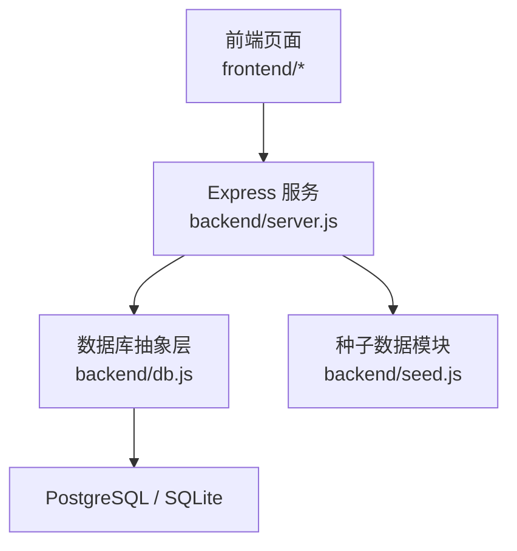
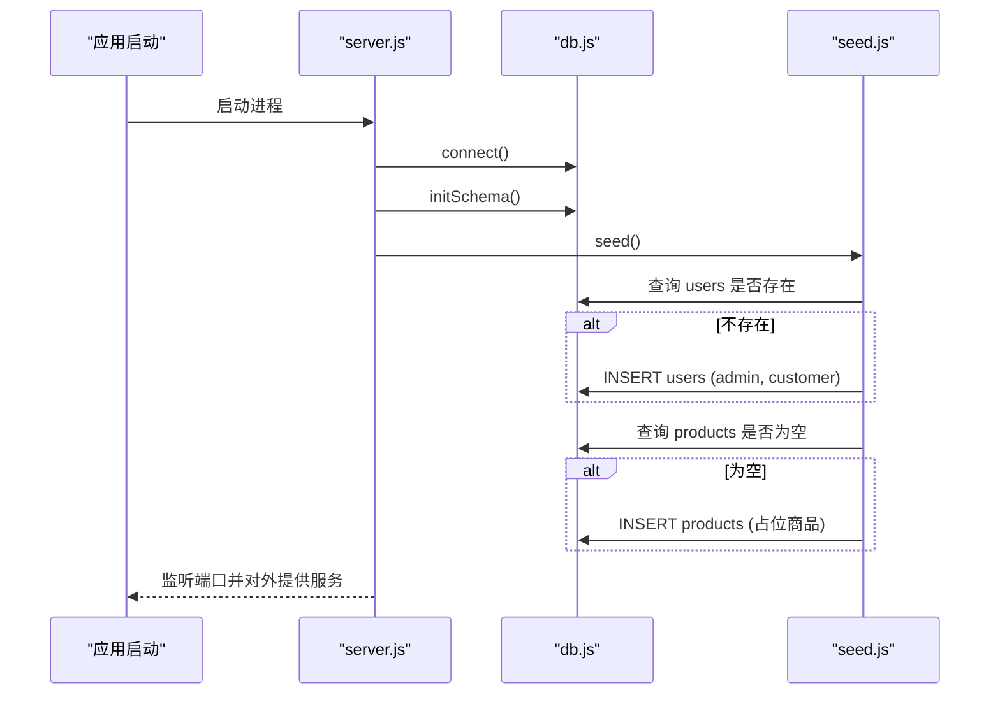
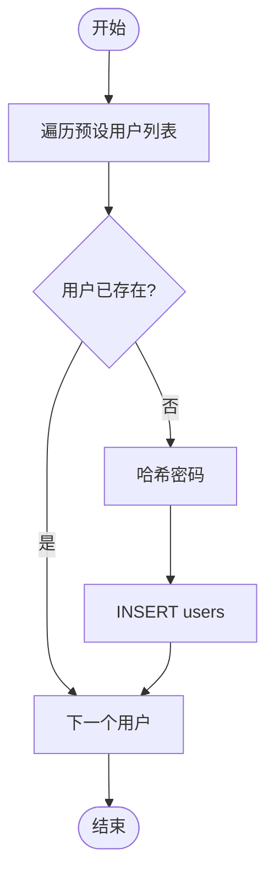
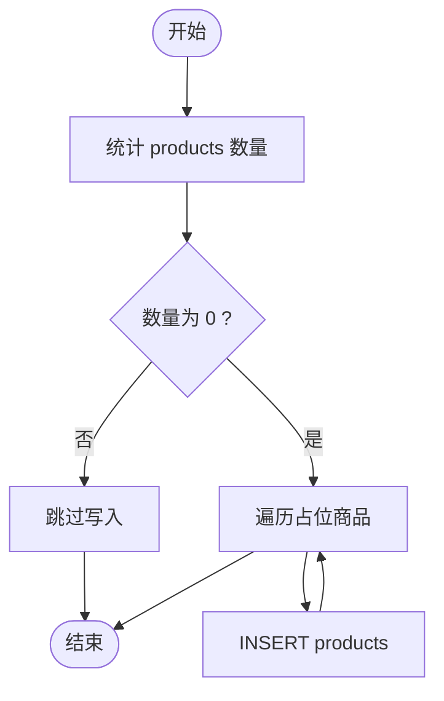
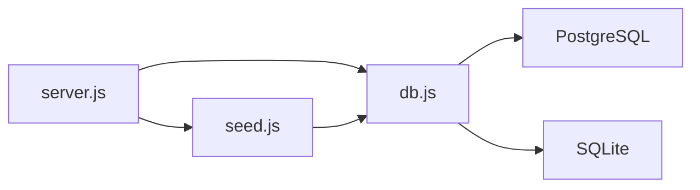

# 种子数据管理

<cite>
**本文引用的文件**
- [backend/seed.js](file://backend/seed.js)
- [backend/db.js](file://backend/db.js)
- [backend/server.js](file://backend/server.js)
- [README.md](file://README.md)
- [backend/test-api.ps1](file://backend/test-api.ps1)
- [backend/test-crud.js](file://backend/test-crud.js)
</cite>

## 目录
1. [简介](#简介)
2. [项目结构](#项目结构)
3. [核心组件](#核心组件)
4. [架构总览](#架构总览)
5. [详细组件分析](#详细组件分析)
6. [依赖关系分析](#依赖关系分析)
7. [性能考量](#性能考量)
8. [故障排查指南](#故障排查指南)
9. [结论](#结论)
10. [附录](#附录)

## 简介
本文件面向 LeapShop 的种子数据系统，系统性说明预设用户与商品占位数据的创建逻辑、幂等性保证、版本管理与更新策略、扩展方法以及数据备份与恢复建议。该系统的目标是：在首次启动或重复执行时，确保数据库中存在必要的管理员与客户账户，以及一组用于演示和测试的商品占位数据；同时保证多次执行不会产生重复数据或冲突。

## 项目结构
后端采用 Node.js + Express，数据库抽象层支持 PostgreSQL（生产）与 SQLite（本地开发）。种子数据模块在应用启动时被调用，负责建表与写入初始数据。

图表来源
- [backend/server.js:1-169](file://backend/server.js#L1-L169)
- [backend/db.js:1-176](file://backend/db.js#L1-L176)
- [backend/seed.js:1-129](file://backend/seed.js#L1-L129)

章节来源
- [backend/server.js:1-169](file://backend/server.js#L1-L169)
- [backend/db.js:1-176](file://backend/db.js#L1-L176)
- [backend/seed.js:1-129](file://backend/seed.js#L1-L129)
- [README.md:1-127](file://README.md#L1-L127)

## 核心组件
- 数据库抽象层：统一 query/run 接口，自动适配 PostgreSQL 与 SQLite，提供连接与建表能力。
- 种子数据模块：定义默认用户与商品占位数据，按幂等规则写入数据库。
- 服务入口：启动时连接数据库、初始化 schema、执行种子数据，并暴露 API。

章节来源
- [backend/db.js:1-176](file://backend/db.js#L1-L176)
- [backend/seed.js:1-129](file://backend/seed.js#L1-L129)
- [backend/server.js:1-169](file://backend/server.js#L1-L169)

## 架构总览
种子数据系统在应用启动流程中运行，先建立数据库连接与表结构，再根据现有数据状态决定是否写入预设数据。

图表来源
- [backend/server.js:152-164](file://backend/server.js#L152-L164)
- [backend/db.js:44-110](file://backend/db.js#L44-L110)
- [backend/seed.js:87-114](file://backend/seed.js#L87-L114)

## 详细组件分析

### 预设用户数据创建逻辑
- 默认管理员账户：用户名 P001，角色 admin，密码经哈希存储。
- 默认客户账户：用户名 C001，角色 customer，密码经哈希存储。
- 幂等策略：对每个预设用户名执行存在性检查，仅当不存在时才插入，避免重复。
- 密码安全：使用 bcrypt 进行哈希存储，不保存明文。

图表来源
- [backend/seed.js:87-102](file://backend/seed.js#L87-L102)

章节来源
- [backend/seed.js:9-12](file://backend/seed.js#L9-L12)
- [backend/seed.js:87-102](file://backend/seed.js#L87-L102)
- [backend/db.js:112-158](file://backend/db.js#L112-L158)

### 商品占位数据生成规则与填充策略
- 占位商品类别：棋钟（chess-timer）、棋盘套装（chess-set）、服饰（apparel）。
- 字段策略：包含名称、分类、价格、库存、描述、图片（可选，默认为空字符串）。
- 填充条件：仅在 products 表为空时批量写入占位商品，避免重复。
- 设计意图：为前端展示、API 冒烟测试提供稳定数据基线。

图表来源
- [backend/seed.js:104-113](file://backend/seed.js#L104-L113)

章节来源
- [backend/seed.js:14-85](file://backend/seed.js#L14-L85)
- [backend/seed.js:104-113](file://backend/seed.js#L104-L113)

### 幂等性保证机制
- 用户幂等：基于 username 的唯一约束与存在性检查，确保重复执行不会新增重复用户。
- 商品幂等：基于“表是否为空”的判断，避免重复写入占位商品。
- 建表幂等：使用 CREATE TABLE IF NOT EXISTS，防止重复建表。
- 结果：多次执行 seed 或重启应用，不会产生重复数据或冲突。

章节来源
- [backend/db.js:112-158](file://backend/db.js#L112-L158)
- [backend/seed.js:91-113](file://backend/seed.js#L91-L113)

### 种子数据的版本管理与更新策略
- 当前实现：以代码内数组形式维护预设数据，未引入显式版本号或迁移脚本。
- 建议策略：
  - 为种子数据增加版本号字段或独立版本文件，便于识别与回滚。
  - 将占位商品与业务数据分离，避免误删或覆盖真实业务数据。
  - 通过环境变量控制是否启用种子数据（例如 SEED_ENABLED），在生产环境谨慎启用。
  - 对敏感信息（如默认密码）使用配置注入而非硬编码。

章节来源
- [backend/seed.js:9-85](file://backend/seed.js#L9-L85)
- [backend/server.js:152-164](file://backend/server.js#L152-L164)

### 自定义种子数据的扩展方法与最佳实践
- 扩展方式：
  - 在种子数据模块中添加新的预设项（用户或商品），遵循现有结构与命名规范。
  - 如需更复杂的初始化逻辑，可封装为独立的迁移脚本，并在启动流程中按需调用。
- 最佳实践：
  - 保持幂等：所有写入前进行存在性或条件判断。
  - 明确边界：区分“演示/测试数据”与“业务数据”，避免污染生产数据。
  - 安全优先：密码必须哈希存储；敏感配置通过环境变量注入。
  - 可观测性：记录关键步骤日志，便于问题定位。

章节来源
- [backend/seed.js:87-114](file://backend/seed.js#L87-L114)
- [backend/db.js:112-158](file://backend/db.js#L112-L158)

### 数据备份与恢复建议方案
- 本地 SQLite：
  - 数据文件位于后端 data 目录下的数据库文件，可直接复制备份。
  - 注意：Zeabur 等平台文件系统无状态，不应依赖本地持久化。
- PostgreSQL（生产）：
  - 使用平台提供的备份工具或 pg_dump 定期导出。
  - 恢复时使用对应导入工具还原至目标库。
- 注意事项：
  - 备份前停止写入或进入只读模式，保证一致性。
  - 恢复后验证关键数据（用户、商品）完整性。

章节来源
- [backend/db.js:70-110](file://backend/db.js#L70-L110)
- [backend/server.js:152-164](file://backend/server.js#L152-L164)

## 依赖关系分析
- server.js 依赖 db.js 与 seed.js，在启动阶段完成连接、建表与种子数据写入。
- seed.js 依赖 db.js 的数据库接口与 bcrypt 进行密码哈希。
- db.js 根据环境变量选择 PostgreSQL 或 SQLite 驱动，并提供统一的 query/run 接口。

图表来源
- [backend/server.js:14-16](file://backend/server.js#L14-L16)
- [backend/seed.js:6-7](file://backend/seed.js#L6-L7)
- [backend/db.js:12-20](file://backend/db.js#L12-L20)

章节来源
- [backend/server.js:14-16](file://backend/server.js#L14-L16)
- [backend/seed.js:6-7](file://backend/seed.js#L6-L7)
- [backend/db.js:12-20](file://backend/db.js#L12-L20)

## 性能考量
- 建表与种子数据仅在启动时执行，影响有限。
- 用户与商品写入前进行存在性检查，减少不必要的 I/O。
- 生产环境建议使用 PostgreSQL，以获得更好的并发与稳定性。
- 图片以 base64 存储在数据库中，适合小图演示；大图建议对象存储并仅存 URL。

[本节为通用指导，无需特定文件引用]

## 故障排查指南
- 常见问题：
  - 未检测到数据库变量导致使用 SQLite：查看启动日志中的警告信息。
  - 登录失败：确认种子数据是否成功写入，检查用户名与密码是否正确。
  - 写操作权限不足：确认 Token 对应的角色为 admin。
- 调试手段：
  - 使用健康检查接口确认服务与数据库类型。
  - 使用冒烟测试脚本验证端到端流程。
  - 查看数据库表结构与数据量，确认种子数据是否生效。

章节来源
- [backend/server.js:152-164](file://backend/server.js#L152-L164)
- [backend/test-api.ps1:32-97](file://backend/test-api.ps1#L32-L97)
- [backend/test-crud.js:16-52](file://backend/test-crud.js#L16-L52)

## 结论
LeapShop 的种子数据系统通过幂等策略确保了预设用户与商品占位数据的可靠初始化，既满足开发与演示需求，又避免了重复执行带来的数据冲突。建议在后续迭代中引入版本化管理、配置注入与更完善的迁移机制，以提升可维护性与安全性。生产环境应使用 PostgreSQL，并配合规范的备份与恢复流程保障数据安全。

[本节为总结性内容，无需特定文件引用]

## 附录
- 演示账户与权限说明见 README。
- 可通过测试脚本快速验证种子数据与 API 功能。

章节来源
- [README.md:21-28](file://README.md#L21-L28)
- [backend/test-api.ps1:32-97](file://backend/test-api.ps1#L32-L97)
- [backend/test-crud.js:16-52](file://backend/test-crud.js#L16-L52)