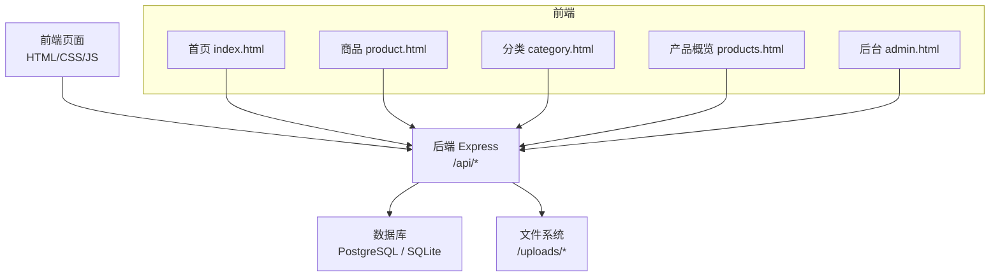
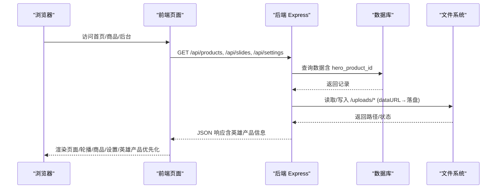
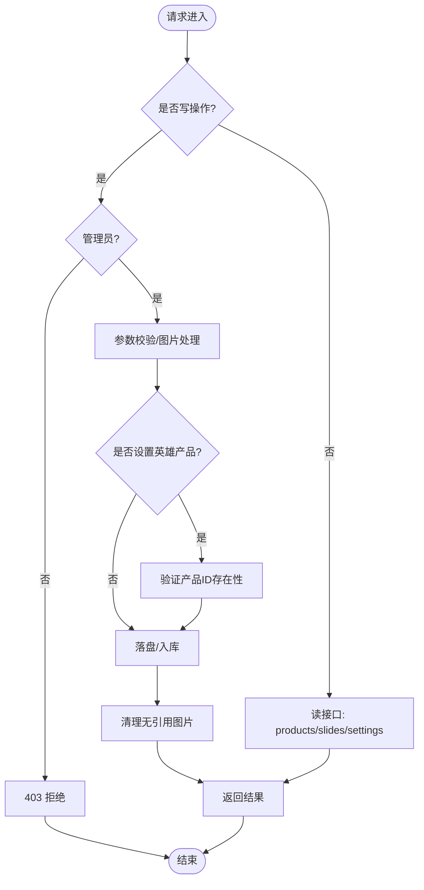
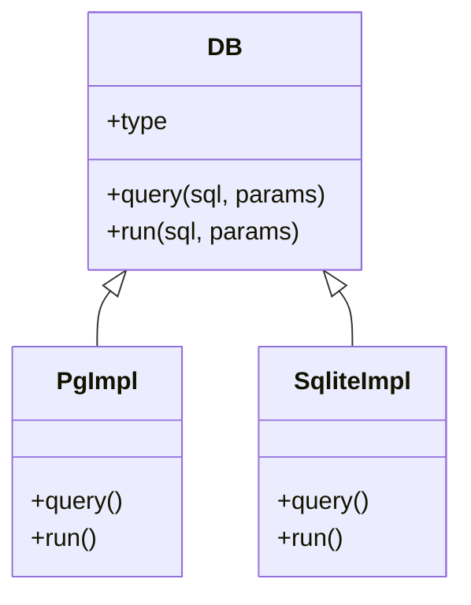
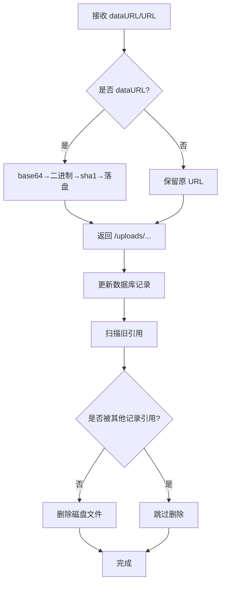
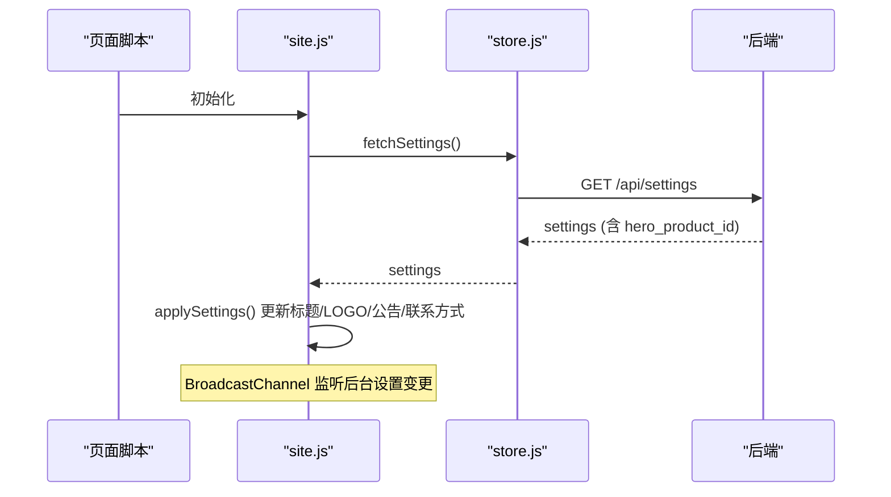
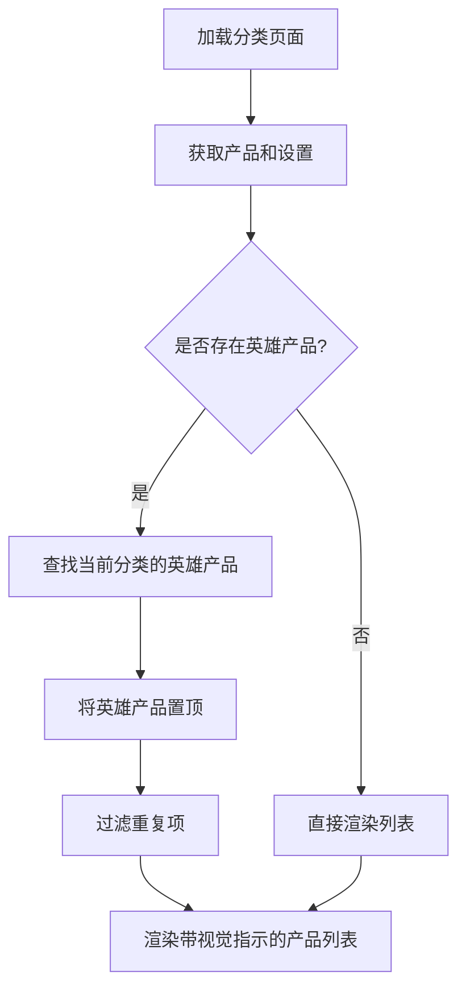
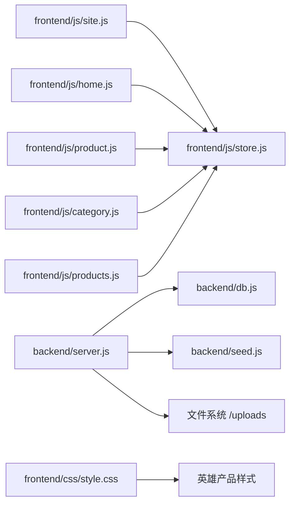

# 英雄产品系统

<cite>
**本文引用的文件**
- [README.md](file://README.md)
- [server.js](file://backend/server.js)
- [db.js](file://backend/db.js)
- [seed.js](file://backend/seed.js)
- [Dockerfile](file://Dockerfile)
- [index.html](file://frontend/index.html)
- [admin.html](file://frontend/admin.html)
- [site.js](file://frontend/js/site.js)
- [store.js](file://frontend/js/store.js)
- [api.js](file://frontend/js/api.js)
- [home.js](file://frontend/js/home.js)
- [product.js](file://frontend/js/product.js)
- [category.js](file://frontend/js/category.js)
- [products.js](file://frontend/js/products.js)
- [style.css](file://frontend/css/style.css)
</cite>

## 更新摘要
**所做更改**
- 新增分类页面英雄产品优先化功能说明
- 更新产品列表动态重排序机制描述
- 添加英雄产品视觉指示器实现细节
- 扩展管理后台英雄产品管理功能
- 完善前后端英雄产品数据流架构

## 目录
1. [简介](#简介)
2. [项目结构](#项目结构)
3. [核心组件](#核心组件)
4. [架构总览](#架构总览)
5. [详细组件分析](#详细组件分析)
6. [依赖关系分析](#依赖关系分析)
7. [性能与容量特性](#性能与容量特性)
8. [故障排查指南](#故障排查指南)
9. [结论](#结论)
10. [附录：API 一览](#附录api-一览)

## 简介
本项目是一个"英雄产品"主题的全栈 Web 应用，采用前后端分离但支持单服务托管的架构。前台为无登录入口的编辑画廊式官网，后台为隐藏入口的管理面板，提供轮播图、商品主图与详情图、全站设置等管理能力，并实现商品的完整 CRUD。数据库在本地开发使用 SQLite（sql.js），生产环境自动切换至 PostgreSQL；图片统一落盘存储，数据库仅保存 URL 引用，具备内容哈希去重与无引用清理能力。

**更新** 系统现已支持英雄产品优先化功能，可在分类页面和产品概览页中动态置顶展示指定英雄产品，并提供完整的视觉指示和管理界面。

## 项目结构
- 前端：原生 HTML/CSS/JS，多页面结构（首页、商品列表、分类页、商品详情、品牌历程、管理后台）
- 后端：Express + JWT 认证，REST API，静态资源托管（单服务模式）
- 数据库：PostgreSQL（生产）或 SQLite（本地），自动建表与幂等种子数据
- 部署：Docker 镜像，适配 Zeabur 平台变量与健康检查



**图表来源**
- [server.js:559-571](file://backend/server.js#L559-L571)
- [db.js:128-216](file://backend/db.js#L128-L216)
- [index.html:1-96](file://frontend/index.html#L1-L96)
- [admin.html:1-257](file://frontend/admin.html#L1-L257)

章节来源
- [README.md:1-155](file://README.md#L1-L155)

## 核心组件
- 后端服务与路由：Express 应用、认证中间件、商品/轮播/设置/统计/健康检查接口
- 数据库抽象层：PostgreSQL/SQLite 双驱动、建表与迁移、存储统计
- 图片存储：dataURL 落盘、内容哈希命名、无引用清理、体积统计
- 前端站点层：导航/购物车/页脚注入、跨页购物车、全站设置同步（BroadcastChannel）
- 前端数据层：同源探测、公开接口封装、模块级缓存
- 管理后台：登录守卫、轮播/商品/设置/主推款/存储监控
- **英雄产品系统**：全局唯一英雄产品设置、分类页面优先化、产品列表动态重排序、视觉指示器

章节来源
- [server.js:1-610](file://backend/server.js#L1-L610)
- [db.js:1-275](file://backend/db.js#L1-L275)
- [site.js:1-252](file://frontend/js/site.js#L1-L252)
- [store.js:1-69](file://frontend/js/store.js#L1-L69)
- [admin.html:1-257](file://frontend/admin.html#L1-L257)

## 架构总览
系统由三层构成：前端静态页面通过 REST API 与后端交互；后端负责业务逻辑、权限控制、数据持久化与图片落盘；数据库根据环境变量选择 PostgreSQL 或 SQLite。启动时自动建表并写入种子数据，图片目录可挂载 Volume 保证持久化。



**图表来源**
- [server.js:280-554](file://backend/server.js#L280-L554)
- [db.js:58-126](file://backend/db.js#L58-L126)
- [store.js:8-23](file://frontend/js/store.js#L8-L23)

## 详细组件分析

### 后端服务与路由（Express）
- 认证：JWT 签发与校验，管理员角色校验中间件
- 商品：列表（按分类过滤、排序权重）、详情、CRUD（管理员）
- 轮播：列表（启用项）、CRUD（管理员）
- 设置：全局 key/value 读写（白名单校验），LOGO 上传，**英雄产品 ID 管理**
- 统计：数据库占用、商品数据占比、图片文件数与字节、磁盘容量与剩余
- 健康检查：返回数据库类型与时间戳
- 静态托管：单服务模式将 frontend 作为静态目录，非 API 路由回退到首页



**图表来源**
- [server.js:226-255](file://backend/server.js#L226-L255)
- [server.js:280-554](file://backend/server.js#L280-L554)

章节来源
- [server.js:1-610](file://backend/server.js#L1-L610)

### 数据库抽象层（PostgreSQL / SQLite）
- 连接策略：优先检测 DATABASE_URL/PGHOST/POSTGRES_* 环境变量，否则回退 SQLite
- SQL 兼容：统一 ? 占位符，PostgreSQL 路径自动转换为 $n
- 建表与迁移：users/products/slides/settings 表，平滑补列
- 存储统计：PostgreSQL 使用内置函数计算库大小与表大小；SQLite 基于文件大小与字段长度估算



**图表来源**
- [db.js:13-24](file://backend/db.js#L13-L24)
- [db.js:58-126](file://backend/db.js#L58-L126)
- [db.js:238-257](file://backend/db.js#L238-L257)

章节来源
- [db.js:1-275](file://backend/db.js#L1-L275)

### 图片存储与清理
- dataURL 落盘：以内容哈希命名，子目录分片，天然去重
- 物化图片：将 dataURL 转为 /uploads/... URL，已有 URL 保留
- 无引用清理：删除商品/轮播/换图时，扫描所有引用，清理不再使用的文件
- 体积统计：递归统计目录字节与文件数，结合文件系统容量统计



**图表来源**
- [server.js:92-166](file://backend/server.js#L92-L166)
- [server.js:168-224](file://backend/server.js#L168-L224)

章节来源
- [server.js:92-224](file://backend/server.js#L92-L224)

### 前端站点层（导航/购物车/页脚/设置）
- 注入布局：每页统一注入导航、购物车抽屉、页脚
- 购物车：跨页 localStorage 持久化，数量收敛与金额计算，导出购物清单
- 全站设置：标题/LOGO/公告/联系方式，安全渲染（白名单标签），BroadcastChannel 即时同步
- 隐蔽后台入口：2 秒内连敲 5 次空格跳转后台



**图表来源**
- [site.js:181-236](file://frontend/js/site.js#L181-L236)
- [store.js:61-68](file://frontend/js/store.js#L61-L68)

章节来源
- [site.js:1-252](file://frontend/js/site.js#L1-L252)
- [store.js:1-69](file://frontend/js/store.js#L1-L69)

### 前端数据层（公开接口封装）
- 同源探测：优先 /api/health，失败回退本地端口
- 模块级缓存：商品列表与全站设置缓存，避免重复请求
- 工具方法：金额格式化、主图获取、占位图常量

章节来源
- [store.js:1-69](file://frontend/js/store.js#L1-L69)

### 管理后台（登录/权限/功能）
- 登录：用户名密码校验，返回 JWT，前端存储会话
- 权限：非管理员写操作返回 403
- 功能：服务器监控、**主推款设置**、商品 CRUD、轮播管理、全站设置、LOGO 上传

**更新** 管理后台现提供完整的英雄产品管理功能，包括下拉选择商品设置为英雄产品、清除当前英雄产品、实时显示当前英雄产品状态。

章节来源
- [admin.html:1-257](file://frontend/admin.html#L1-L257)
- [api.js:1-81](file://frontend/js/api.js#L1-L81)
- [server.js:257-554](file://backend/server.js#L257-L554)

### 首页与商品详情页
- 首页：轮播（slides）、Featured 四卡（主推款置顶）、Why Choose Leap、品牌历程摘要
- 商品详情：主图横滑（scroll-snap）、详情图、卖点文案、加入购物车

**更新** 首页 Featured 区域现在支持英雄产品置顶显示，并在卡片上显示金色边框和"Hero"徽章标识。

章节来源
- [index.html:1-96](file://frontend/index.html#L1-L96)
- [home.js:1-91](file://frontend/js/home.js#L1-L91)
- [product.js:1-100](file://frontend/js/product.js#L1-L100)

### 分类页面英雄产品优先化
**新增功能** 分类页面现在支持英雄产品优先化显示：

- **动态重排序**：当某个商品被设置为英雄产品且属于当前分类时，该商品会自动置顶显示
- **系列优先**：在产品概览页中，包含英雄产品的系列区块会整体置顶显示
- **视觉指示**：英雄产品带有金色边框和"♕ Hero"徽章标识
- **智能过滤**：确保英雄产品不会重复显示，保持列表整洁



**图表来源**
- [category.js:26-31](file://frontend/js/category.js#L26-L31)
- [products.js:27-38](file://frontend/js/products.js#L27-L38)

章节来源
- [category.js:1-66](file://frontend/js/category.js#L1-L66)
- [products.js:1-54](file://frontend/js/products.js#L1-L54)

### 英雄产品视觉指示系统
**新增功能** 完整的视觉指示系统用于标识英雄产品：

- **金色边框**：英雄产品的图片容器带有金色边框高亮
- **徽章标识**：左上角显示"♕ Hero"徽章，使用深金色背景
- **悬停效果**：保持原有的悬停放大效果，同时突出英雄产品
- **管理界面**：管理后台表格中显示皇冠图标标识当前英雄产品

```css
/* 英雄产品样式 */
.p-card.is-hero .p-media { border-color: var(--gold); }
.m-item.is-hero { position: relative; }
.m-item.is-hero .p-media { border-color: var(--gold); }
.hero-badge {
  position: absolute; top: 12px; left: 12px; z-index: 2;
  padding: 5px 12px; font-size: 11px; letter-spacing: .2em; text-transform: uppercase;
  background: var(--gold-deep); color: var(--white); pointer-events: none;
}
```

**图表来源**
- [style.css:187-194](file://frontend/css/style.css#L187-L194)
- [style.css:633](file://frontend/css/style.css#L633)

章节来源
- [style.css:180-379](file://frontend/css/style.css#L180-L379)
- [style.css:630-783](file://frontend/css/style.css#L630-L783)

## 依赖关系分析
- 后端依赖：express、cors、bcryptjs、jsonwebtoken、pg/sql.js、fs/crypto/path
- 前端依赖：原生 DOM API、Fetch、localStorage、BroadcastChannel
- 数据库：PostgreSQL（生产）或 SQLite（本地），通过环境变量切换
- 文件：图片落盘目录由 UPLOAD_DIR 指定，生产建议挂载 Volume



**图表来源**
- [site.js:1-252](file://frontend/js/site.js#L1-L252)
- [store.js:1-69](file://frontend/js/store.js#L1-L69)
- [server.js:1-610](file://backend/server.js#L1-L610)
- [db.js:1-275](file://backend/db.js#L1-L275)
- [seed.js:1-189](file://backend/seed.js#L1-L189)

章节来源
- [server.js:1-610](file://backend/server.js#L1-L610)
- [db.js:1-275](file://backend/db.js#L1-L275)

## 性能与容量特性
- 图片存储：内容哈希去重，减少冗余；单商品图集上限 10 张，单张上限 8MB，总量上限 50MB
- JSON 解析限制：80mb，容纳 base64 膨胀后的提交体
- 排序机制：已设 sort_weight 优先（升序），未设按 created_at 倒序
- 存储统计：数据库总占用、商品数据占比、图片文件数与字节、磁盘容量与剩余
- 部署优化：单服务镜像、健康检查、Volume 挂载保障图片持久化
- **英雄产品优化**：前端客户端重排序，减少后端负载；CSS 动画优化，确保流畅的用户体验

章节来源
- [server.js:21-28](file://backend/server.js#L21-L28)
- [server.js:168-224](file://backend/server.js#L168-L224)
- [server.js:519-549](file://backend/server.js#L519-L549)
- [Dockerfile:1-26](file://Dockerfile#L1-L26)

## 故障排查指南
- 登录失败：检查用户名/密码是否正确，JWT 是否过期
- 写操作 403：确认当前用户是否为管理员
- 图片不显示：检查 /uploads 路径与权限，确认 dataURL 是否有效
- 数据库不可用：检查环境变量（DATABASE_URL/PGHOST/POSTGRES_*），或确认 SQLite 数据目录
- 健康检查失败：确认 /api/health 可达，容器端口与环境变量一致
- **英雄产品问题**：确认 hero_product_id 指向有效的产品ID，检查分类匹配逻辑

章节来源
- [server.js:257-278](file://backend/server.js#L257-L278)
- [server.js:551-554](file://backend/server.js#L551-L554)
- [db.js:13-56](file://backend/db.js#L13-L56)

## 结论
该系统以简洁的前后端分离架构实现了"英雄产品"主题的电商展示与管理能力，具备完善的权限控制、图片落盘与存储统计、全站设置与实时同步、以及生产友好的部署方案。通过内容哈希去重与无引用清理，保障了数据与文件的整洁与一致性；通过环境变量与双数据库支持，兼顾了开发与生产的差异。

**更新** 新增的英雄产品优先化功能进一步增强了产品展示的灵活性和营销能力，允许商家在分类页面和产品概览中突出展示重点商品，提升用户体验和转化率。

## 附录：API 一览
- 认证
  - POST /api/auth/login：登录，返回 JWT
  - GET /api/auth/me：校验 Token / 获取身份
- 商品
  - GET /api/products：商品列表（?category= 过滤，按 id 升序）
  - GET /api/products/:id：商品详情（含 images/details/info）
  - POST /api/products：新增商品（管理员）
  - PUT /api/products/:id：更新商品（管理员）
  - DELETE /api/products/:id：删除商品（管理员）
  - GET /api/products/:id/storage：单商品存储明细（管理员）
- 轮播
  - GET /api/slides：首页轮播图（启用项；管理员 ?all=1 返回全部）
  - POST /api/slides：新增轮播图（管理员）
  - PUT /api/slides/:id：更新轮播图（管理员）
  - DELETE /api/slides/:id：删除轮播图（管理员）
- 设置
  - GET /api/settings：全站设置（公开，含 hero_product_id）
  - PUT /api/settings：更新单项设置（管理员，key 白名单，支持 hero_product_id）
  - POST /api/settings/logo：LOGO 上传（管理员）
- 统计与健康
  - GET /api/stats/storage：存储统计（管理员）
  - GET /api/health：健康检查（公开）

**更新** 设置 API 现已支持 hero_product_id 的设置和验证，确保只有有效的产品ID才能被设置为英雄产品。

章节来源
- [README.md:58-83](file://README.md#L58-L83)
- [server.js:257-554](file://backend/server.js#L257-L554)