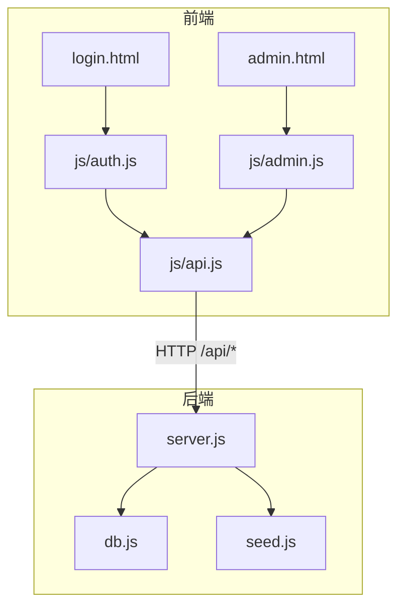
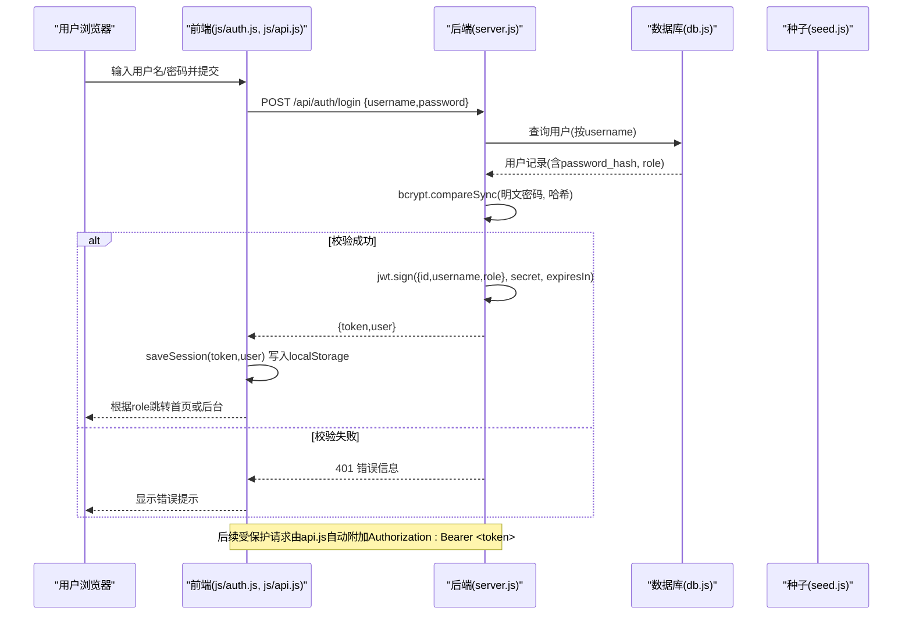
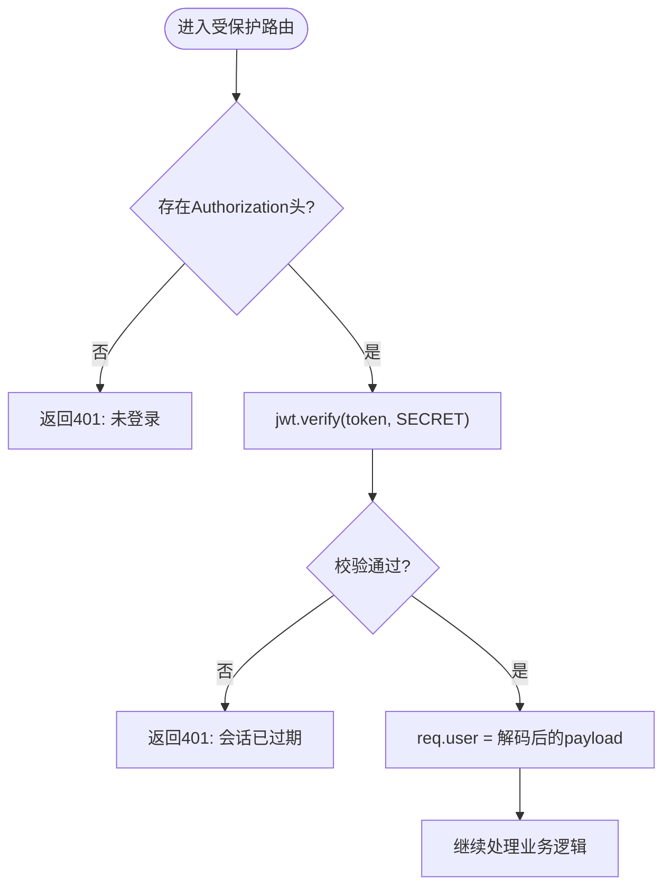
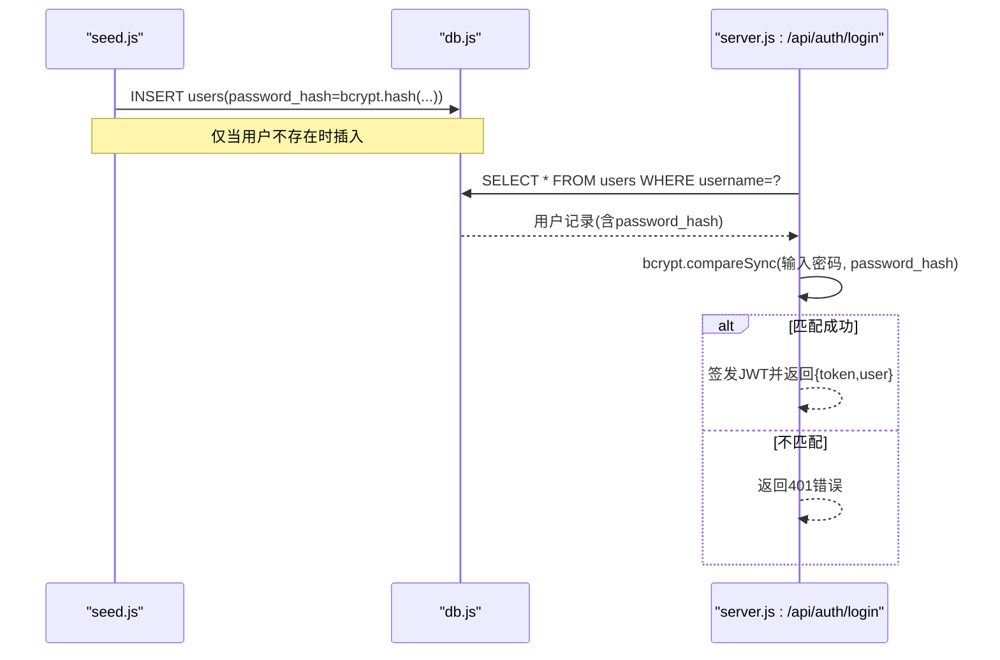
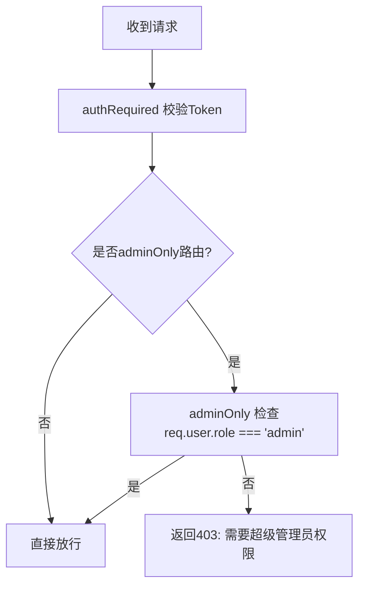
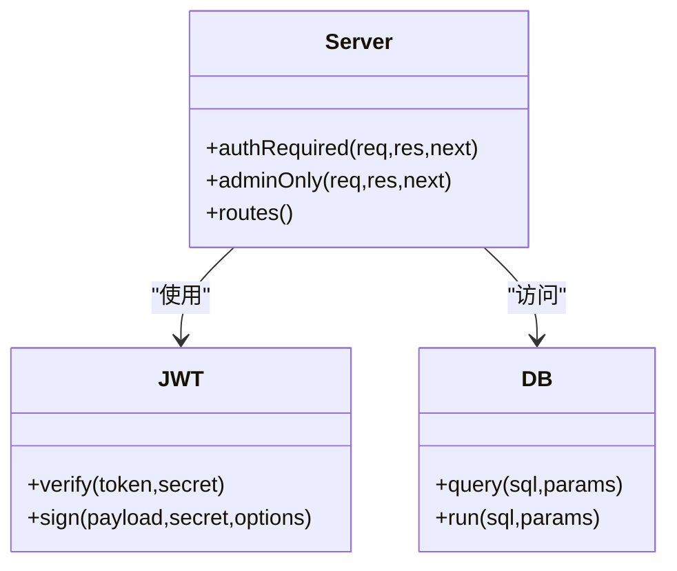
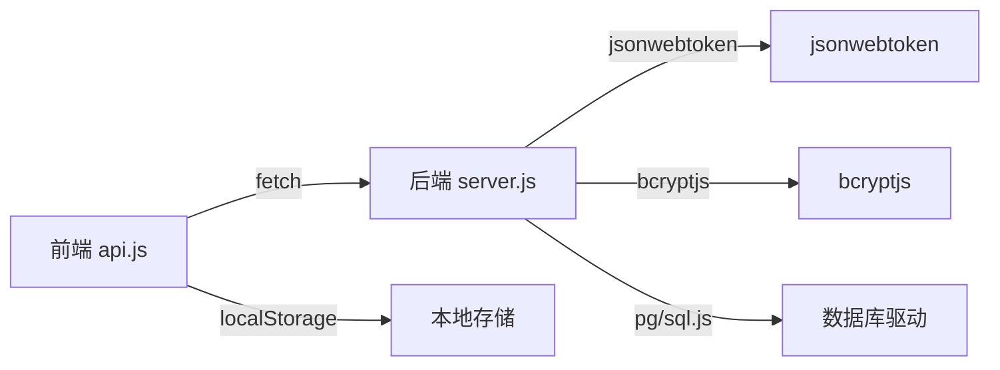

# 认证授权机制

<cite>
**本文引用的文件**
- [server.js](file://backend/server.js)
- [db.js](file://backend/db.js)
- [seed.js](file://backend/seed.js)
- [api.js](file://frontend/js/api.js)
- [auth.js](file://frontend/js/auth.js)
- [admin.js](file://frontend/js/admin.js)
- [login.html](file://frontend/login.html)
- [admin.html](file://frontend/admin.html)
- [package.json](file://backend/package.json)
</cite>

## 目录
1. [简介](#简介)
2. [项目结构](#项目结构)
3. [核心组件](#核心组件)
4. [架构总览](#架构总览)
5. [详细组件分析](#详细组件分析)
6. [依赖关系分析](#依赖关系分析)
7. [性能考虑](#性能考虑)
8. [故障排查指南](#故障排查指南)
9. [结论](#结论)
10. [附录](#附录)

## 简介
本技术文档聚焦于 LeapShop（LeapChess）的认证与授权系统，围绕以下目标展开：
- JWT 令牌的生成、验证与过期处理机制
- 用户密码的 bcrypt 加密存储与登录校验流程
- 基于角色的权限控制（管理员与普通用户）
- 中间件 authRequired 与 adminOnly 的实现与作用
- 会话管理（前端令牌存储、传输安全）与安全最佳实践
- 认证失败的错误处理与用户体验优化建议

## 项目结构
后端采用 Express 提供 REST API，使用 JSON Web Token（JWT）进行无状态认证；数据库层抽象支持 SQLite（开发）与 PostgreSQL（生产）。前端通过共享 API 客户端自动携带 Bearer Token，并在本地存储中维护会话。

图表来源
- [server.js:1-169](file://backend/server.js#L1-L169)
- [db.js:1-176](file://backend/db.js#L1-L176)
- [seed.js:1-129](file://backend/seed.js#L1-L129)
- [api.js:1-76](file://frontend/js/api.js#L1-L76)
- [auth.js:1-30](file://frontend/js/auth.js#L1-L30)
- [admin.js:1-182](file://frontend/js/admin.js#L1-L182)
- [login.html:1-39](file://frontend/login.html#L1-L39)
- [admin.html:1-97](file://frontend/admin.html#L1-L97)

章节来源
- [server.js:1-169](file://backend/server.js#L1-L169)
- [package.json:1-23](file://backend/package.json#L1-L23)

## 核心组件
- 认证接口与中间件
  - POST /api/auth/login：用户名+密码校验，成功后签发 JWT
  - GET /api/auth/me：受保护接口，返回当前用户信息
  - 中间件 authRequired：解析并验证 Authorization 头中的 Bearer Token
  - 中间件 adminOnly：校验角色为 admin 才放行
- 数据与种子
  - db.js：统一数据库访问（SQLite/PostgreSQL），建表与连接
  - seed.js：初始化默认管理员与客户账户，密码使用 bcrypt 哈希存储
- 前端会话与请求封装
  - api.js：自动探测后端地址、读写 localStorage 中的 token/user、统一 fetch 封装并附加 Authorization
  - auth.js：登录表单提交，调用 /api/auth/login，保存会话并跳转
  - admin.js：后台页面守卫，调用 /api/auth/me 校验角色，展示或拒绝管理功能

章节来源
- [server.js:25-64](file://backend/server.js#L25-L64)
- [db.js:112-158](file://backend/db.js#L112-L158)
- [seed.js:87-114](file://backend/seed.js#L87-L114)
- [api.js:10-49](file://frontend/js/api.js#L10-L49)
- [auth.js:9-25](file://frontend/js/auth.js#L9-L25)
- [admin.js:12-34](file://frontend/js/admin.js#L12-L34)

## 架构总览
下图展示了从登录到受保护资源访问的完整链路，包括前后端交互、JWT 签发与校验、以及角色权限控制。

图表来源
- [auth.js:9-25](file://frontend/js/auth.js#L9-L25)
- [api.js:40-49](file://frontend/js/api.js#L40-L49)
- [server.js:44-64](file://backend/server.js#L44-L64)
- [db.js:112-158](file://backend/db.js#L112-L158)
- [seed.js:87-114](file://backend/seed.js#L87-L114)

## 详细组件分析

### JWT 认证流程（生成、验证、过期处理）
- 登录签发
  - 后端在 /api/auth/login 中校验用户名与密码后，使用 jwt.sign 生成包含 id、username、role 的令牌，设置过期时间 TOKEN_TTL（12小时）
  - 返回 {token, user} 给前端
- 前端会话存储
  - 前端通过 saveSession 将 token 与 user 写入 localStorage（键名 lc_token、lc_user）
  - 后续所有受保护请求由 api.js 自动添加 Authorization: Bearer <token>
- 服务端验证
  - 中间件 authRequired 解析 Authorization 头，调用 jwt.verify 校验签名与有效期
  - 校验通过后将 req.user 注入请求上下文，供路由处理器使用
- 过期处理
  - 若令牌无效或已过期，jwt.verify 抛出异常，authRequired 返回 401，提示“会话已过期，请重新登录”
  - 前端在 admin.js 的守卫逻辑中捕获异常并引导用户重新登录

图表来源
- [server.js:25-41](file://backend/server.js#L25-L41)
- [server.js:44-64](file://backend/server.js#L44-L64)
- [api.js:40-49](file://frontend/js/api.js#L40-L49)

章节来源
- [server.js:25-64](file://backend/server.js#L25-L64)
- [api.js:18-49](file://frontend/js/api.js#L18-L49)

### 密码存储与验证（bcrypt）
- 存储阶段
  - 种子脚本 seed.js 在初始化时，对预设用户的明文密码使用 bcrypt.hashSync 生成哈希并存入 users.password_hash
- 登录验证
  - 登录接口使用 bcrypt.compareSync 将用户输入的明文密码与数据库中存储的哈希比对
  - 匹配成功则签发 JWT，否则返回 401

图表来源
- [seed.js:87-114](file://backend/seed.js#L87-L114)
- [server.js:44-60](file://backend/server.js#L44-L60)
- [db.js:112-158](file://backend/db.js#L112-L158)

章节来源
- [seed.js:87-114](file://backend/seed.js#L87-L114)
- [server.js:44-60](file://backend/server.js#L44-L60)

### 角色权限控制（管理员与普通用户）
- 角色模型
  - users.role 字段区分 admin 与 customer
- 权限策略
  - 普通用户可访问公开商品接口（GET /api/products, GET /api/products/:id）
  - 写操作（POST/PUT/DELETE /api/products）需同时满足：
    - 已通过 authRequired 认证
    - 通过 adminOnly 校验角色为 admin
- 前端守卫
  - admin.js 在进入后台前调用 /api/auth/me 获取当前用户角色，非 admin 则显示“访问被拒绝”

图表来源
- [server.js:25-41](file://backend/server.js#L25-L41)
- [server.js:86-135](file://backend/server.js#L86-L135)
- [admin.js:12-34](file://frontend/js/admin.js#L12-L34)

章节来源
- [server.js:25-41](file://backend/server.js#L25-L41)
- [server.js:86-135](file://backend/server.js#L86-L135)
- [admin.js:12-34](file://frontend/js/admin.js#L12-L34)

### 中间件实现机制（authRequired 与 adminOnly）
- authRequired
  - 从 Authorization 头提取 Bearer Token
  - 使用 jwt.verify 校验签名与有效期，失败返回 401
  - 成功则将解码后的 payload 挂载到 req.user
- adminOnly
  - 检查 req.user 是否存在且 role 为 admin
  - 不满足条件返回 403

图表来源
- [server.js:25-41](file://backend/server.js#L25-L41)
- [server.js:44-64](file://backend/server.js#L44-L64)
- [db.js:160-176](file://backend/db.js#L160-L176)

章节来源
- [server.js:25-41](file://backend/server.js#L25-L41)

### 会话管理与安全最佳实践
- 令牌存储
  - 前端使用 localStorage 持久化 token 与 user 信息（lc_token、lc_user）
  - 每次请求通过 api.js 自动附加 Authorization: Bearer <token>
- 传输安全
  - 当前实现未强制 HTTPS，建议在部署环境启用 HTTPS 以保护令牌传输
  - 生产环境建议使用 HttpOnly Cookie 替代 localStorage 以降低 XSS 风险
- 防攻击措施
  - 使用 bcrypt 哈希存储密码，避免明文泄露
  - 使用参数化查询防止 SQL 注入（db.js 统一封装）
  - 限制请求体大小（express.json limit）
  - 建议增加速率限制、CSRF 防护（如使用 Cookie 方案）、CORS 白名单等

章节来源
- [api.js:18-49](file://frontend/js/api.js#L18-L49)
- [server.js:21-24](file://backend/server.js#L21-L24)
- [db.js:160-176](file://backend/db.js#L160-L176)

### 认证失败的错误处理与用户体验优化
- 后端错误响应
  - 未登录：401 Not signed in
  - 会话过期：401 Session expired, please sign in again
  - 凭证错误：401 Invalid username or password
  - 权限不足：403 Super admin access required
- 前端体验优化
  - login.html 中显示错误消息区域（#authError）
  - admin.js 在守卫失败时显示“访问被拒绝”面板并提供重新登录入口
  - 建议在 api.js 中统一错误提示，例如：
    - 401：自动清除本地会话并跳转到登录页
    - 403：提示“权限不足”，并隐藏管理入口
    - 网络错误：友好提示并重试

章节来源
- [server.js:25-41](file://backend/server.js#L25-L41)
- [server.js:44-64](file://backend/server.js#L44-L64)
- [auth.js:9-25](file://frontend/js/auth.js#L9-L25)
- [admin.js:12-34](file://frontend/js/admin.js#L12-L34)
- [login.html:16-33](file://frontend/login.html#L16-L33)
- [admin.html:24-32](file://frontend/admin.html#L24-L32)

## 依赖关系分析
- 后端依赖
  - express：Web 框架
  - jsonwebtoken：JWT 签发与验证
  - bcryptjs：密码哈希与校验
  - cors：跨域支持
  - pg/sql.js：数据库驱动（PostgreSQL/SQLite）
- 前端依赖
  - 原生 fetch：发起 HTTP 请求
  - localStorage：会话持久化

图表来源
- [package.json:14-21](file://backend/package.json#L14-L21)
- [api.js:40-49](file://frontend/js/api.js#L40-L49)
- [server.js:7-15](file://backend/server.js#L7-L15)

章节来源
- [package.json:14-21](file://backend/package.json#L14-L21)
- [server.js:7-15](file://backend/server.js#L7-L15)
- [api.js:40-49](file://frontend/js/api.js#L40-L49)

## 性能考虑
- JWT 无状态认证减少服务器会话存储压力，适合水平扩展
- bcrypt 哈希计算成本较高，建议在生产环境合理配置 salt rounds（当前种子使用固定强度）
- 数据库层统一封装 query/run，避免重复连接与资源泄漏
- 图片以 base64 存储在数据库中，注意体积限制（前端限制 1.5MB），生产环境建议迁移至对象存储

[本节为通用指导，不直接分析具体文件]

## 故障排查指南
- 无法登录
  - 检查 /api/auth/login 是否返回 401，确认用户名与密码是否正确
  - 检查数据库是否有对应用户记录（seed 是否执行成功）
- 登录后访问受限资源失败
  - 确认前端是否在请求头中携带 Authorization: Bearer <token>
  - 检查后端 authRequired 是否成功解析并验证令牌
- 权限不足（403）
  - 确认当前用户 role 是否为 admin
  - 检查 adminOnly 中间件是否生效
- 会话过期
  - 前端检测到 401 时应清理本地会话并跳转登录页
  - 后端 jwt.verify 失败会返回“会话已过期”提示

章节来源
- [server.js:25-41](file://backend/server.js#L25-L41)
- [server.js:44-64](file://backend/server.js#L44-L64)
- [api.js:40-49](file://frontend/js/api.js#L40-L49)
- [admin.js:12-34](file://frontend/js/admin.js#L12-L34)

## 结论
本系统通过 JWT 实现了无状态认证，结合 bcrypt 保障密码安全，并通过中间件与前端守卫实现了细粒度的角色权限控制。整体架构简洁清晰，便于扩展与维护。生产环境中建议引入 HTTPS、HttpOnly Cookie、速率限制与更严格的 CORS 策略，以提升安全性与健壮性。

[本节为总结性内容，不直接分析具体文件]

## 附录
- 环境变量
  - PORT：服务端口（默认 3000）
  - JWT_SECRET：JWT 签名密钥（生产环境务必替换为强随机值）
  - DATABASE_URL/PGHOST：数据库连接（生产推荐 PostgreSQL）
- 默认测试账号
  - 管理员：P001 / 123456
  - 客户：C001 / 123456

章节来源
- [server.js:17-19](file://backend/server.js#L17-L19)
- [seed.js:9-12](file://backend/seed.js#L9-L12)