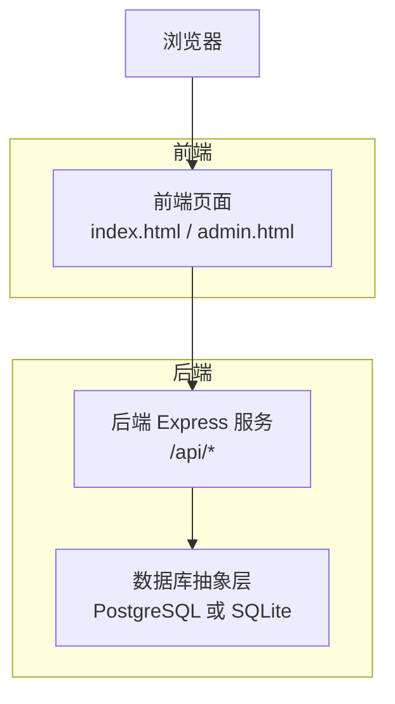
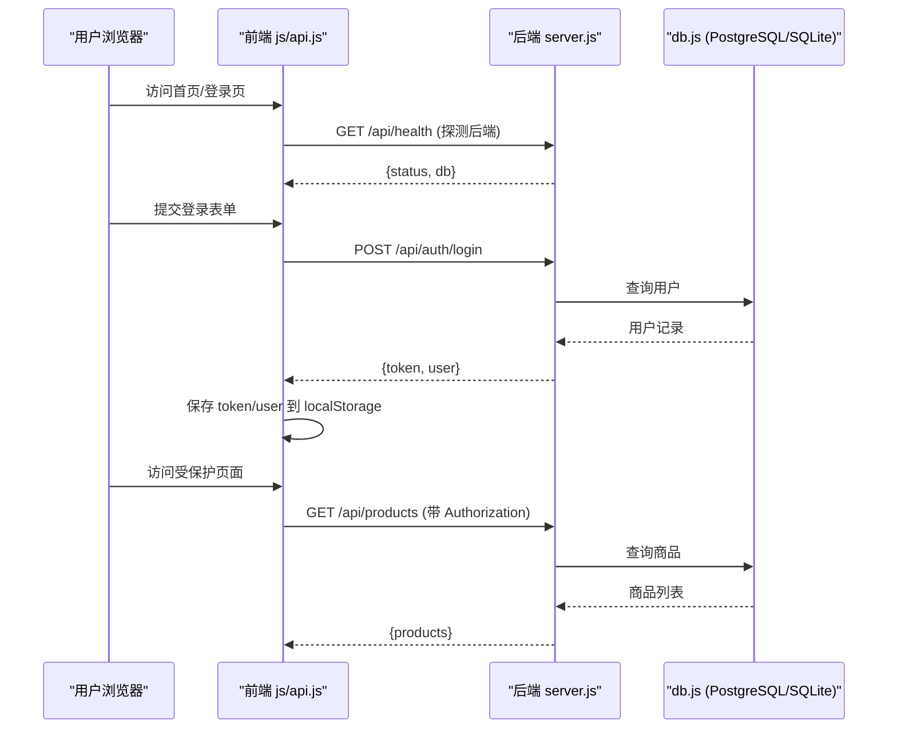
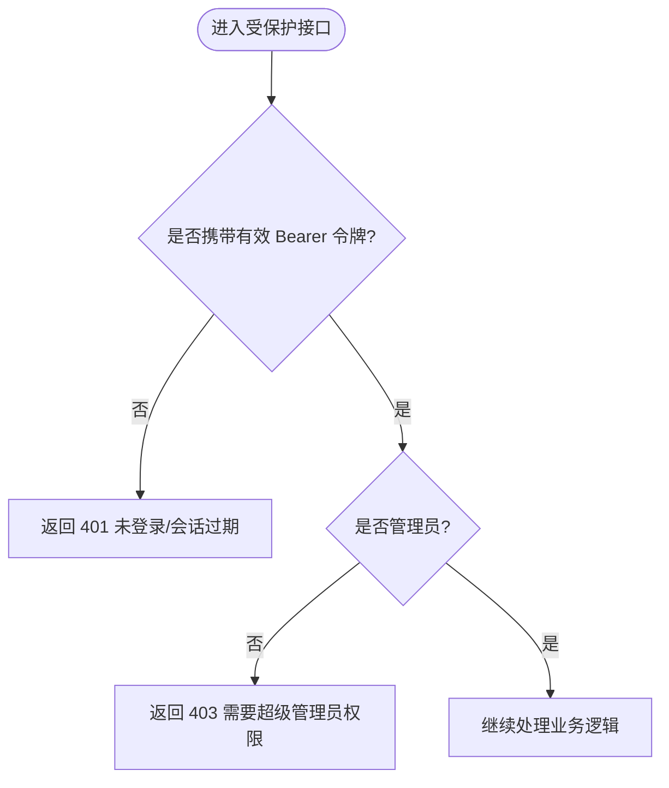
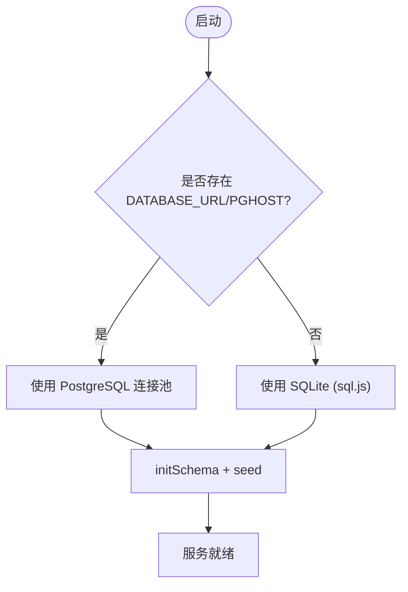
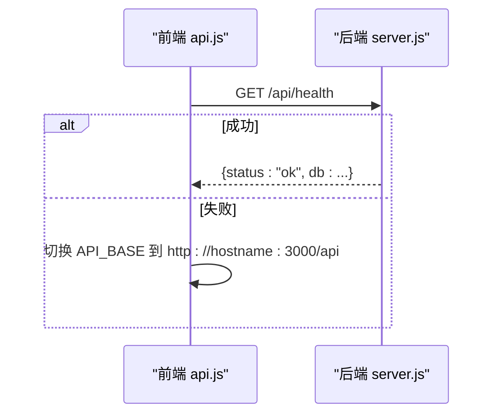
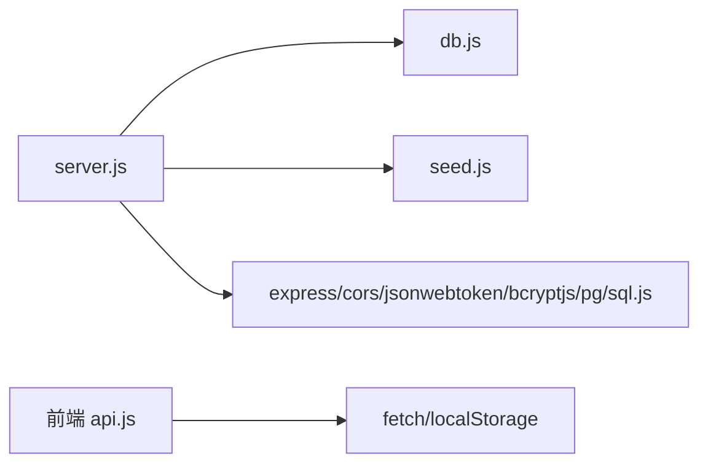

# 故障排除

<cite>
**本文引用的文件**
- [backend/server.js](file://backend/server.js)
- [backend/db.js](file://backend/db.js)
- [frontend/js/api.js](file://frontend/js/api.js)
- [frontend/js/auth.js](file://frontend/js/auth.js)
- [frontend/js/main.js](file://frontend/js/main.js)
- [frontend/js/admin.js](file://frontend/js/admin.js)
- [frontend/js/site.js](file://frontend/js/site.js)
- [frontend/js/store.js](file://frontend/js/store.js)
- [Dockerfile](file://Dockerfile)
- [backend/package.json](file://backend/package.json)
- [README.md](file://README.md)
</cite>

## 更新摘要
**变更内容**
- 新增设置管理系统故障排除章节
- 新增 BroadcastChannel 同步问题诊断指南
- 新增大型图片上传错误处理与客户端验证反馈
- 增强设置管理相关问题的排查步骤
- 更新前端设置同步机制的故障排除方法

## 目录
1. [简介](#简介)
2. [项目结构](#项目结构)
3. [核心组件](#核心组件)
4. [架构总览](#架构总览)
5. [详细组件分析](#详细组件分析)
6. [依赖关系分析](#依赖关系分析)
7. [性能注意事项](#性能注意事项)
8. [故障排除指南](#故障排除指南)
9. [结论](#结论)
10. [附录](#附录)

## 简介
本指南面向 LeapShop 项目的运维与开发者，聚焦常见技术问题的定位与解决，包括数据库连接、认证失败、CORS 跨域、部署与环境配置等。文档提供系统化的诊断方法（日志分析、错误信息解读、性能监控）、调试技巧（浏览器开发者工具、网络请求调试、后端日志查看）、性能优化建议与瓶颈分析方法，以及环境配置排查步骤与社区支持渠道。

## 项目结构
- 后端：Express 服务，统一暴露 /api/* 接口；内置 CORS、JSON 解析；可选托管前端静态资源；启动时连接数据库并初始化表结构与种子数据。
- 前端：单页应用，通过共享 API 客户端自动探测后端地址、携带 Token、渲染用户状态与商品列表。
- 容器化：Dockerfile 构建 Node 镜像，暴露端口，提供健康检查。

图表来源
- [backend/server.js:21-23](file://backend/server.js#L21-L23)
- [backend/db.js:12-109](file://backend/db.js#L12-L109)
- [frontend/js/api.js:10-16](file://frontend/js/api.js#L10-L16)

章节来源
- [backend/server.js:1-169](file://backend/server.js#L1-L169)
- [backend/db.js:1-176](file://backend/db.js#L1-L176)
- [frontend/js/api.js:1-76](file://frontend/js/api.js#L1-L76)
- [Dockerfile:1-26](file://Dockerfile#L1-L26)

## 核心组件
- 后端服务：Express 应用，启用 CORS、JSON 解析，定义认证与商品 CRUD 路由，健康检查端点，可选静态资源托管。
- 数据库抽象：根据环境变量选择 PostgreSQL 或 SQLite，统一 query/run 接口，自动建表与种子数据。
- 前端 API 客户端：自动探测后端地址、管理 Token、封装 fetch 请求、统一错误抛出、渲染导航用户状态。
- 认证流程：登录获取 JWT，后续请求携带 Authorization Bearer 头，服务端校验令牌与角色。

章节来源
- [backend/server.js:21-64](file://backend/server.js#L21-L64)
- [backend/db.js:44-109](file://backend/db.js#L44-L109)
- [frontend/js/api.js:18-49](file://frontend/js/api.js#L18-L49)
- [frontend/js/auth.js:9-25](file://frontend/js/auth.js#L9-L25)

## 架构总览

图表来源
- [frontend/js/api.js:10-16](file://frontend/js/api.js#L10-L16)
- [frontend/js/auth.js:9-25](file://frontend/js/auth.js#L9-L25)
- [backend/server.js:44-64](file://backend/server.js#L44-L64)
- [backend/server.js:67-84](file://backend/server.js#L67-L84)
- [backend/db.js:44-109](file://backend/db.js#L44-L109)

## 详细组件分析

### 认证与授权
- 登录流程：前端调用 /api/auth/login，后端验证用户名密码后签发 JWT，返回 token 和用户信息。
- 鉴权中间件：对需要认证的接口校验 Authorization 头中的 Bearer token，过期或无效返回 401；管理员操作需 role=admin，否则返回 403。
- 常见问题：
  - 未携带或错误的 Authorization 头导致 401。
  - 令牌过期导致会话失效。
  - 非管理员尝试写操作被拒绝。

图表来源
- [backend/server.js:25-41](file://backend/server.js#L25-L41)
- [backend/server.js:44-64](file://backend/server.js#L44-L64)

章节来源
- [backend/server.js:25-64](file://backend/server.js#L25-64)
- [frontend/js/auth.js:9-25](file://frontend/js/auth.js#L9-L25)
- [frontend/js/api.js:41-49](file://frontend/js/api.js#L41-L49)

### 数据库连接与切换
- 自动检测：存在 DATABASE_URL 或 PGHOST 时使用 PostgreSQL，否则回退到 SQLite。
- 连接参数：PostgreSQL 支持通过 DATABASE_URL 或 Zeabur 注入的 PG* 环境变量；SSL 策略默认关闭，可通过 PGSSL 或 URL 中 sslmode 开启。
- 初始化：启动时创建 users 与 products 表，并执行幂等的种子数据。
- 常见问题：
  - 未设置 DATABASE_URL 且文件系统无状态导致数据丢失（生产应使用 PostgreSQL）。
  - SSL 配置不当导致连接失败。
  - 未先 await connect() 直接调用 db.query/run 抛错。

图表来源
- [backend/db.js:12-42](file://backend/db.js#L12-L42)
- [backend/db.js:44-109](file://backend/db.js#L44-L109)
- [backend/db.js:112-158](file://backend/db.js#L112-L158)
- [backend/server.js:152-164](file://backend/server.js#L152-L164)

章节来源
- [backend/db.js:1-176](file://backend/db.js#L1-L176)
- [backend/server.js:152-164](file://backend/server.js#L152-L164)

### 前端 API 客户端与健康探测
- 自动探测：优先同源 /api/health，失败则回退到本地 3000 端口。
- 统一请求：自动附加 Authorization 头，统一错误抛出。
- 常见问题：
  - 后端未启动或端口不一致导致健康检查失败。
  - 跨域问题导致浏览器拦截请求。
  - 网络异常时前端显示"API Offline"。

图表来源
- [frontend/js/api.js:10-16](file://frontend/js/api.js#L10-L16)
- [backend/server.js:137-140](file://backend/server.js#L137-L140)

章节来源
- [frontend/js/api.js:10-16](file://frontend/js/api.js#L10-L16)
- [frontend/js/main.js:42-51](file://frontend/js/main.js#L42-L51)

### 部署与健康检查
- Dockerfile：基于 node:20-alpine，安装依赖，复制前后端代码，暴露 8080 端口，提供 /api/health 健康检查。
- 环境变量：PORT 由平台注入（Zeabur 默认 8080），NODE_ENV=production。
- 常见问题：
  - 健康检查失败导致平台判定服务不健康。
  - 端口映射或防火墙阻止外部访问。
  - 缺少 DATABASE_URL 导致生产环境数据不可持久。

章节来源
- [Dockerfile:1-26](file://Dockerfile#L1-L26)
- [backend/server.js:17-19](file://backend/server.js#L17-L19)

## 依赖关系分析
- 后端依赖：express、cors、bcryptjs、jsonwebtoken、pg、sql.js。
- 前端依赖：原生 fetch、localStorage。
- 运行时：Node >= 18。

图表来源
- [backend/server.js:7-15](file://backend/server.js#L7-L15)
- [backend/db.js:44-109](file://backend/db.js#L44-L109)
- [backend/package.json:14-21](file://backend/package.json#L14-L21)

章节来源
- [backend/package.json:1-23](file://backend/package.json#L1-L23)
- [backend/server.js:7-15](file://backend/server.js#L7-L15)

## 性能注意事项
- 数据库：
  - 生产环境务必使用 PostgreSQL，避免 SQLite 在容器无状态下的数据丢失与并发限制。
  - 合理设置连接池大小与超时，关注慢查询与索引缺失。
- 网络：
  - 控制请求体大小（当前 JSON 限制为 24MB），避免大图片直传；可考虑对象存储。
  - 启用 gzip/压缩与缓存策略减少带宽消耗。
- 前端：
  - 懒加载图片与分页加载商品列表，减少首屏压力。
  - 合理使用 IntersectionObserver 与节流防抖提升交互性能。
- 监控：
  - 利用 /api/health 进行存活探针与可用性监控。
  - 收集关键指标：QPS、响应时间、错误率、数据库连接数与慢查询。

[本节为通用指导，无需具体文件引用]

## 故障排除指南

### 一、数据库连接问题
症状
- 启动时报错无法连接数据库。
- 健康检查返回数据库类型异常或不可用。
- 写入失败或数据丢失。

排查步骤
- 确认运行模式：
  - 若未设置 DATABASE_URL/PGHOST，将回退到 SQLite；生产环境建议使用 PostgreSQL。
- 检查环境变量：
  - 确保 DATABASE_URL 正确包含主机、端口、数据库名、用户与密码。
  - 如需 SSL，设置 PGSSL=true 或在 DATABASE_URL 中包含 sslmode=require。
- 验证连接：
  - 调用 /api/health 查看返回的数据库类型与状态。
  - 检查后端日志是否有连接池错误或认证失败。
- 数据持久性：
  - 使用 SQLite 时注意文件系统无状态会导致重启后数据丢失；迁移至 PostgreSQL。

参考实现位置
- [backend/db.js:12-42](file://backend/db.js#L12-L42)
- [backend/db.js:44-109](file://backend/db.js#L44-L109)
- [backend/server.js:152-164](file://backend/server.js#L152-L164)

### 二、认证失败问题
症状
- 登录后立即被踢出或访问受保护接口返回 401。
- 管理员操作返回 403。

排查步骤
- 检查请求头：
  - 确认已携带 Authorization: Bearer <token>。
  - 前端 api.js 会自动附加，检查 localStorage 中 lc_token 是否存在。
- 检查令牌有效期：
  - 后端默认 TTL 为 12 小时，过期需重新登录。
- 检查角色权限：
  - 非管理员无法执行写操作，需使用管理员账号。
- 调试方法：
  - 浏览器开发者工具 -> Network 查看请求头与响应。
  - 后端日志查看认证中间件的错误输出。

参考实现位置
- [backend/server.js:25-41](file://backend/server.js#L25-L41)
- [backend/server.js:44-64](file://backend/server.js#L44-L64)
- [frontend/js/api.js:18-49](file://frontend/js/api.js#L18-L49)
- [frontend/js/auth.js:9-25](file://frontend/js/auth.js#L9-L25)

### 三、CORS 跨域问题
症状
- 浏览器控制台出现跨域错误，请求被拦截。
- 开发环境与生产环境域名不一致导致跨域。

排查步骤
- 后端已启用 cors() 中间件，允许所有来源；如自定义策略，请确保允许前端域名与方法。
- 检查前端 API_BASE 是否正确：
  - 自动探测 /api/health 失败时会回退到 localhost:3000。
- 代理与网关：
  - 若通过 Nginx/反向代理，确保转发 /api/* 到后端并保留 Host/CORS 头。
- 调试方法：
  - 浏览器开发者工具 -> Network 查看预检请求（OPTIONS）与响应头 Access-Control-Allow-*。

参考实现位置
- [backend/server.js:21-23](file://backend/server.js#L21-L23)
- [frontend/js/api.js:10-16](file://frontend/js/api.js#L10-L16)

### 四、部署相关问题
症状
- 容器启动后健康检查失败。
- 外部无法访问服务。
- 重启后数据丢失。

排查步骤
- 健康检查：
  - 确认 /api/health 可达，端口与 Dockerfile EXPOSE 一致。
- 环境变量：
  - 设置 PORT（平台可能覆盖），NODE_ENV=production。
  - 生产环境必须设置 DATABASE_URL 指向 PostgreSQL。
- 端口与网络：
  - 检查容器端口映射、安全组/防火墙规则。
- 数据持久化：
  - 使用卷挂载或外部数据库，避免 SQLite 数据丢失。

参考实现位置
- [Dockerfile:16-25](file://Dockerfile#L16-L25)
- [backend/server.js:17-19](file://backend/server.js#L17-L19)
- [backend/db.js:12-42](file://backend/db.js#L12-L42)

### 五、卷存储问题故障排除
症状
- 图片上传成功后无法访问或显示损坏。
- 重新部署后图片全部丢失。
- 存储空间不足导致上传失败。
- 图片文件路径错误或权限问题。

排查步骤
- 检查 UPLOAD_DIR 配置：
  - 确认环境变量 UPLOAD_DIR 已正确设置指向持久化卷。
  - 验证目录权限允许读写操作。
- 验证卷挂载：
  - 检查容器内 /data/uploads 目录是否存在且可写。
  - 确认卷挂载点与根文件系统不同（避免临时存储）。
- 诊断存储状态：
  - 调用 /api/stats/storage 查看 imageFileCount 和 imageFileBytes。
  - 检查 volumeTotalBytes 和 volumeFreeBytes 了解磁盘容量。
- 文件完整性检查：
  - 验证 /uploads/ 子目录结构是否符合预期。
  - 检查图片文件哈希命名是否正确。
- 权限问题：
  - 确保 Node.js 进程有足够权限访问卷目录。
  - 检查 SELinux 或 AppArmor 等安全模块限制。

参考实现位置
- [backend/server.js:22-24](file://backend/server.js#L22-L24)
- [backend/server.js:390-403](file://backend/server.js#L390-L403)
- [backend/server.js:330-350](file://backend/server.js#L330-L350)

### 六、UPLOAD_DIR 配置问题
症状
- 图片无法保存到指定目录。
- 启动时警告图片存储在临时文件系统。
- 重新部署后图片丢失。
- 目录不存在或权限不足。

排查步骤
- 环境变量验证：
  - 确认 UPLOAD_DIR 环境变量已正确设置。
  - 检查目录路径格式是否正确（绝对路径推荐）。
- 卷挂载检查：
  - 验证卷已正确挂载到指定目录。
  - 确认挂载点与根文件系统不同（dev 值不同）。
- 启动日志分析：
  - 查看启动时的警告信息关于 Volume 挂载状态。
  - 检查图片目录路径输出。
- 权限验证：
  - 测试目录读写权限。
  - 检查文件系统权限设置。
- 替代方案：
  - 如无法配置卷，考虑使用对象存储服务。
  - 临时方案可使用 DATA_DIR 配合 SQLite 持久化。

参考实现位置
- [backend/server.js:22-24](file://backend/server.js#L22-L24)
- [backend/server.js:389-403](file://backend/server.js#L389-L403)
- [backend/db.js:87-91](file://backend/db.js#L87-L91)

### 七、磁盘容量监控失败
症状
- 存储统计面板显示"Storage stats unavailable"。
- volumeTotalBytes 和 volumeFreeBytes 为 0。
- 磁盘空间告警无法触发。
- 存储使用率计算异常。

排查步骤
- 检查 Node.js 版本：
  - 确认 Node.js ≥ 18.15 以支持 fs.statfsSync。
  - 低版本不支持磁盘容量监控功能。
- 文件系统兼容性：
  - 某些容器环境可能不支持 statfs 系统调用。
  - 检查容器运行时权限设置。
- 降级处理：
  - 监控失败不影响基本功能，仅影响容量统计。
  - 使用其他监控工具补充磁盘容量检查。
- 手动验证：
  - 在容器内执行 df 命令检查磁盘状态。
  - 验证 /uploads 目录的实际使用情况。
- 替代监控方案：
  - 使用操作系统级别的磁盘监控。
  - 集成第三方监控服务。

参考实现位置
- [backend/server.js:155-162](file://backend/server.js#L155-L162)
- [frontend/js/admin.js:53-71](file://frontend/js/admin.js#L53-L71)

### 八、设置管理系统故障排除
症状
- 网站标题、LOGO、公告等设置无法保存或显示。
- 设置修改后前台页面没有实时更新。
- 设置数据丢失或恢复为默认值。
- LOGO 上传失败或显示不正确。

排查步骤
- 检查设置接口：
  - 调用 GET /api/settings 验证设置数据是否正确返回。
  - 调用 PUT /api/settings 验证设置更新是否成功。
  - 调用 POST /api/settings/logo 验证 LOGO 上传功能。
- 验证数据库设置表：
  - 检查 settings 表是否存在且包含正确的键值对。
  - 验证 site_title、logo_url、announcement_html、contact_email、contact_social 等字段。
- 检查前端设置加载：
  - 确认前端 store.js 中的 fetchSettings 函数正常工作。
  - 验证 site.js 中的 applySettings 函数是否正确应用设置。
- 调试设置同步：
  - 检查 BroadcastChannel 'leap_settings' 是否正常通信。
  - 验证后台设置修改后前台是否能收到同步通知。
- 权限验证：
  - 确认管理员权限正确配置。
  - 检查 Authorization 头是否正确传递。

参考实现位置
- [backend/server.js:442-490](file://backend/server.js#L442-L490)
- [frontend/js/store.js:61-68](file://frontend/js/store.js#L61-L68)
- [frontend/js/site.js:181-236](file://frontend/js/site.js#L181-L236)
- [frontend/js/admin.js:131-223](file://frontend/js/admin.js#L131-L223)

### 九、BroadcastChannel 同步问题
症状
- 后台修改设置后前台页面没有实时更新。
- 多个标签页之间设置不同步。
- BroadcastChannel 消息发送失败。
- 旧浏览器不支持 BroadcastChannel 导致功能异常。

排查步骤
- 检查 BroadcastChannel 支持：
  - 在浏览器控制台检查 `typeof BroadcastChannel` 是否为 'function'。
  - 对于不支持的环境，确认已正确降级到轮询机制。
- 验证频道名称：
  - 确认后台和前台都使用相同的频道名称 'leap_settings'。
  - 检查是否有拼写错误或大小写不一致。
- 调试消息传递：
  - 在浏览器开发者工具的 Console 中添加监听器查看消息。
  - 检查消息格式是否为 `{ type: 'settings' }`。
- 检查事件监听器：
  - 确认前台页面的 onmessage 事件处理器已正确注册。
  - 验证 fetchSettings(true) 是否在收到消息后被调用。
- 多标签页测试：
  - 打开多个标签页测试设置同步功能。
  - 在一个标签页修改设置，观察其他标签页是否实时更新。
- 降级处理验证：
  - 在不支持 BroadcastChannel 的环境中，确认设置了合理的轮询间隔。
  - 检查是否有备用同步机制。

参考实现位置
- [frontend/js/admin.js:132-136](file://frontend/js/admin.js#L132-L136)
- [frontend/js/site.js:231-236](file://frontend/js/site.js#L231-L236)

### 十、大型图片上传错误处理
症状
- 图片上传失败，提示文件大小超限。
- 客户端验证通过后服务器端仍然拒绝上传。
- 大量图片上传时内存溢出或性能问题。
- 图片预览显示异常或加载缓慢。

排查步骤
- 检查文件大小限制：
  - 确认单张图片不超过 8MB（MAX_IMAGE_SIZE = 8 * 1024 * 1024）。
  - 验证单个商品的图片总量不超过 50MB（MAX_TOTAL_IMAGE_SIZE = 50 * 1024 * 1024）。
  - 检查 JSON 请求体大小限制（MAX_BODY_CHARS = 75 * 1024 * 1024）。
- 验证客户端预处理：
  - 检查 FileReader 是否正确读取图片为 dataURL。
  - 验证 dataUrlBytes 函数是否正确估算二进制大小。
  - 确认 pendingImageBytes() 函数准确计算待上传图片总量。
- 检查服务器端处理：
  - 验证 saveDataUrl 函数是否正确处理 base64 数据。
  - 检查 materializeImages 函数是否正确转换 dataURL 为文件 URL。
  - 确认文件系统权限允许写入 /uploads 目录。
- 调试上传流程：
  - 在浏览器开发者工具的 Network 面板查看请求体和响应。
  - 检查 console 中的错误信息和警告。
  - 验证图片文件的哈希命名和存储路径。
- 性能优化：
  - 对于超大图片，考虑在前端进行压缩处理。
  - 使用合适的图片格式（WebP、JPEG）以减少文件大小。
  - 实施渐进式上传或分片上传机制。

参考实现位置
- [frontend/js/admin.js:15-17](file://frontend/js/admin.js#L15-L17)
- [frontend/js/admin.js:24-32](file://frontend/js/admin.js#L24-L32)
- [frontend/js/admin.js:172-181](file://frontend/js/admin.js#L172-L181)
- [frontend/js/admin.js:512-529](file://frontend/js/admin.js#L512-L529)
- [backend/server.js:95-112](file://backend/server.js#L95-L112)

### 十一、日志分析与错误信息解读
- 后端日志：
  - 启动阶段会输出使用的数据库类型与警告（如使用 SQLite 的生产风险）。
  - 认证失败与权限不足会返回明确错误消息。
  - 卷挂载检测和存储统计相关的警告信息。
  - 设置管理相关的数据库操作日志。
- 前端日志：
  - 首页健康徽章显示 API Online/Offline 与数据库类型。
  - 商品加载失败会提示后端未运行或端口问题。
  - 存储统计面板显示详细的磁盘使用信息。
  - 设置同步失败的错误信息。
- 调试技巧：
  - 浏览器开发者工具 -> Console/Network 查看错误详情与请求响应。
  - 后端进程日志（stdout/stderr）用于定位启动与运行时错误。
  - 管理后台存储统计面板提供实时存储使用情况。
  - 使用 BroadcastChannel 调试工具检查消息传递。

参考实现位置
- [backend/server.js:375-410](file://backend/server.js#L375-L410)
- [frontend/js/main.js:42-51](file://frontend/js/main.js#L42-L51)
- [frontend/js/admin.js:53-71](file://frontend/js/admin.js#L53-L71)

### 十二、性能监控与瓶颈分析
- 指标采集：
  - 使用 /api/health 作为存活探针与可用性监控。
  - 统计 QPS、P95/P99 延迟、错误率、数据库连接池使用率。
  - 通过 /api/stats/storage 监控存储使用情况和磁盘容量。
  - 监控设置管理的响应时间和成功率。
- 瓶颈定位：
  - 数据库慢查询：添加索引、优化 SQL。
  - 大请求体：限制上传大小，改用对象存储。
  - 前端首屏：懒加载、分页、压缩资源。
  - 存储瓶颈：监控磁盘使用率，及时清理无用文件。
  - BroadcastChannel 性能：监控消息传递延迟和失败率。
- 工具建议：
  - 浏览器 Performance 面板分析渲染与网络耗时。
  - 后端进程监控（CPU/内存/GC）与数据库监控（连接数、慢查询）。
  - 文件系统监控工具检查磁盘 I/O 性能。
  - 网络监控工具分析 API 调用性能。

[本节为通用指导，无需具体文件引用]

### 十三、环境配置问题排查
- Node 版本：要求 >= 18。
- 依赖安装：
  - 后端 package.json 声明了 express、cors、bcryptjs、jsonwebtoken、pg、sql.js。
- 环境变量：
  - DATABASE_URL/PGHOST：决定数据库类型与连接方式。
  - PORT：服务监听端口。
  - NODE_ENV：生产环境优化。
  - UPLOAD_DIR：图片存储目录（生产环境必需配置）。
  - DATA_DIR：SQLite 数据目录（可选，用于持久化）。
- 调试方法：
  - 本地开发：确保后端在 3000 端口运行，前端可探测 /api/health。
  - 容器环境：检查健康检查命令与端口映射。
  - 生产环境：验证卷挂载和环境变量配置。
  - 设置管理：验证 settings 表初始化和默认值配置。

参考实现位置
- [backend/package.json:11-21](file://backend/package.json#L11-L21)
- [backend/db.js:12-42](file://backend/db.js#L12-L42)
- [Dockerfile:16-25](file://Dockerfile#L16-L25)

### 十四、社区支持与获取帮助
- 项目仓库：提交 Issue 或 Pull Request，附上复现步骤、日志与环境信息。
- 平台支持：如使用 Zeabur，参考其文档与工单系统。
- 技术栈文档：
  - Express、CORS、JWT、PostgreSQL、SQLite 官方文档。
  - BroadcastChannel API 规范与兼容性说明。
- 调试清单：
  - 提供浏览器控制台截图、Network 请求详情、后端日志片段、环境变量（脱敏）。
  - 存储统计面板截图和磁盘使用情况报告。
  - BroadcastChannel 调试信息和错误日志。
  - 设置管理相关的数据库查询结果。

[本节为通用指导，无需具体文件引用]

## 结论
通过系统化的日志分析、错误信息解读与性能监控，结合浏览器开发者工具与后端日志，可以快速定位 LeapShop 的数据库连接、认证失败、CORS 跨域、卷存储、设置管理和部署环境问题。生产环境推荐使用 PostgreSQL 并完善环境变量与监控体系，特别是正确配置 UPLOAD_DIR 和卷挂载，同时确保 BroadcastChannel 同步机制正常工作，以提升稳定性与可维护性。

## 附录
- 常用端点
  - GET /api/health：健康检查
  - POST /api/auth/login：登录
  - GET /api/auth/me：当前用户信息（需认证）
  - GET /api/products：商品列表
  - GET /api/products/:id：商品详情
  - POST /api/products：新增商品（管理员）
  - PUT /api/products/:id：更新商品（管理员）
  - DELETE /api/products/:id：删除商品（管理员）
  - GET /api/stats/storage：存储统计（管理员）
  - GET /api/products/:id/storage：单商品存储明细（管理员）
  - GET /api/settings：获取全站设置
  - PUT /api/settings：更新设置项（管理员）
  - POST /api/settings/logo：上传 LOGO（管理员）

- 关键文件路径
  - 后端服务入口：[backend/server.js](file://backend/server.js)
  - 数据库抽象：[backend/db.js](file://backend/db.js)
  - 前端 API 客户端：[frontend/js/api.js](file://frontend/js/api.js)
  - 登录逻辑：[frontend/js/auth.js](file://frontend/js/auth.js)
  - 首页逻辑与健康检查：[frontend/js/main.js](file://frontend/js/main.js)
  - 管理后台与存储统计：[frontend/js/admin.js](file://frontend/js/admin.js)
  - 全站设置管理：[frontend/js/site.js](file://frontend/js/site.js)
  - 数据层与设置获取：[frontend/js/store.js](file://frontend/js/store.js)
  - 容器镜像构建：[Dockerfile](file://Dockerfile)
  - 后端依赖：[backend/package.json](file://backend/package.json)
  - 项目文档：[README.md](file://README.md)