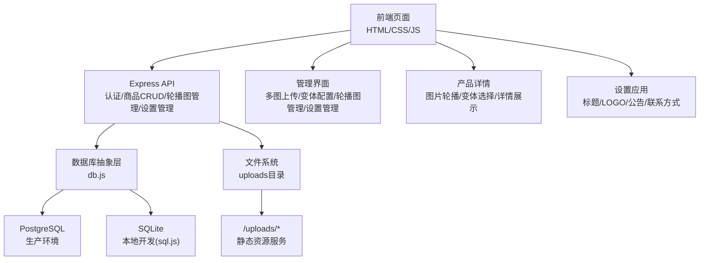
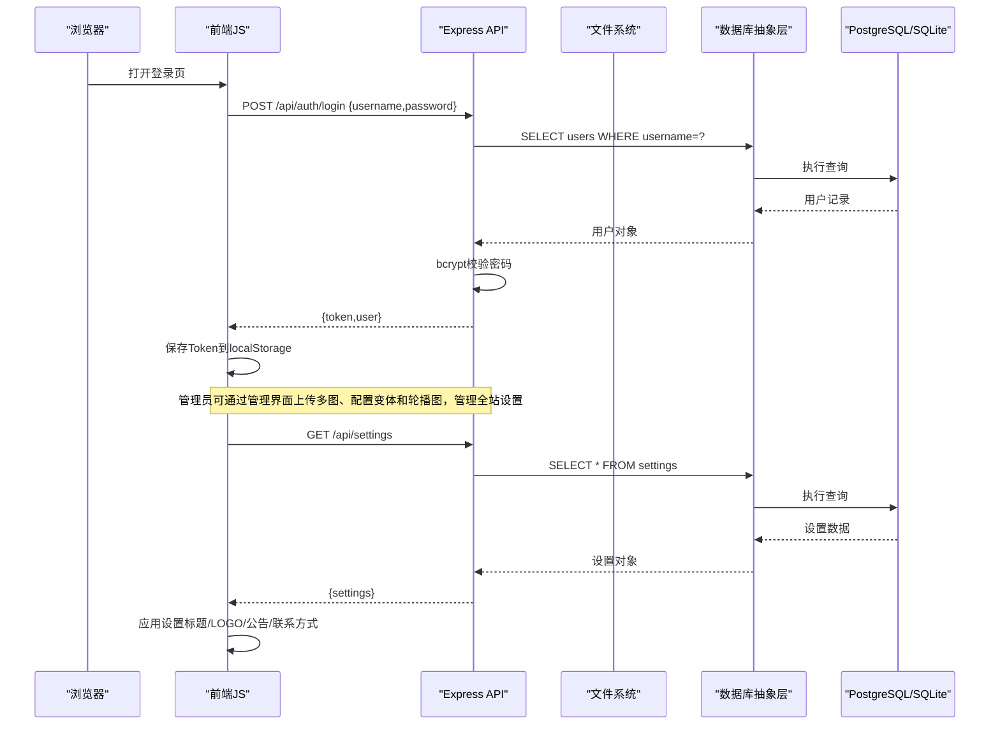
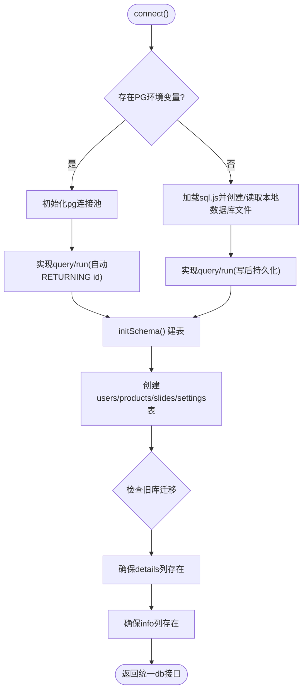
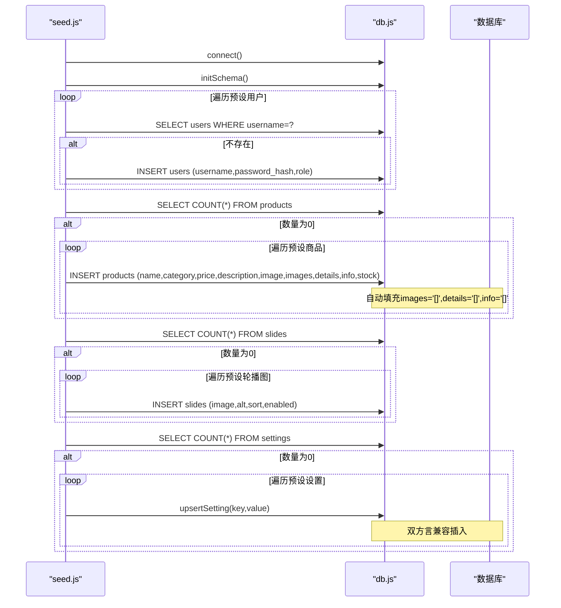
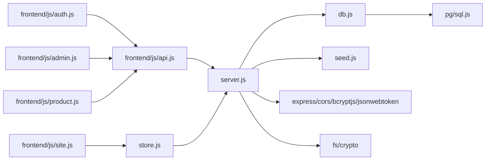

# 数据库设计

<cite>
**本文引用的文件**
- [backend/db.js](file://backend/db.js)
- [backend/server.js](file://backend/server.js)
- [backend/seed.js](file://backend/seed.js)
- [frontend/js/api.js](file://frontend/js/api.js)
- [frontend/js/admin.js](file://frontend/js/admin.js)
- [frontend/js/product.js](file://frontend/js/product.js)
- [frontend/js/site.js](file://frontend/js/site.js)
- [frontend/js/store.js](file://frontend/js/store.js)
- [README.md](file://README.md)
</cite>

## 更新摘要
**所做更改**
- **新增全站设置系统**：添加了settings表用于存储网站配置信息，包括站点标题、LOGO URL、公告HTML、联系邮箱和社交链接
- **实现跨数据库兼容的设置管理**：通过统一的upsertSetting()函数处理PostgreSQL和SQLite的语法差异
- **增强前端设置管理功能**：支持实时设置更新和BroadcastChannel通信机制
- **完善种子数据初始化**：包含默认设置值的预设数据

## 目录
1. [简介](#简介)
2. [项目结构](#项目结构)
3. [核心组件](#核心组件)
4. [架构总览](#架构总览)
5. [详细组件分析](#详细组件分析)
6. [依赖关系分析](#依赖关系分析)
7. [性能考虑](#性能考虑)
8. [故障排查指南](#故障排查指南)
9. [结论](#结论)
10. [附录](#附录)

## 简介
本文件为 LeapShop 项目的数据库设计文档，覆盖数据模型、表结构与约束、关系与业务规则、数据库抽象层实现（PostgreSQL 与 SQLite 双驱动）、连接管理与查询优化、种子数据结构与初始化流程、迁移策略与版本管理、性能优化建议与索引设计原则，以及数据安全（密码加密存储与访问控制）等主题。目标是为开发者与运维人员提供清晰、可操作的数据库设计与实践指南。

**最新更新**：系统已新增全站设置管理系统，支持动态配置网站标题、LOGO、公告信息和联系方式，并通过前后端实时同步机制确保设置变更即时生效。

## 项目结构
后端采用 Express 提供 REST API，数据库抽象层统一封装 PostgreSQL 与 SQLite；前端通过共享 API 客户端调用后端接口。启动时自动建表并写入种子数据，生产环境推荐 PostgreSQL，开发环境默认使用 SQLite。**新增**：独立的文件存储系统用于管理商品图片和变体图集，以及专门的轮播图管理功能。**重要更新**：新增全站设置管理系统，支持网站配置的动态管理和实时同步。

**图表来源**
- [backend/server.js:1-574](file://backend/server.js#L1-L574)
- [backend/db.js:1-272](file://backend/db.js#L1-L272)

**章节来源**
- [README.md:6-19](file://README.md#L6-L19)
- [backend/server.js:1-574](file://backend/server.js#L1-L574)
- [backend/db.js:1-272](file://backend/db.js#L1-L272)

## 核心组件
- 数据库抽象层：统一 query/run 接口，自动选择 PostgreSQL 或 SQLite，处理占位符转换、INSERT 返回主键、SQLite 持久化落盘等。
- 服务层：Express 路由提供认证与商品 CRUD，内置鉴权中间件与角色控制，新增轮播图管理功能和全站设置管理功能。
- 种子数据：幂等初始化用户与商品，确保首次运行即可演示，包含轮播图预设数据和全站设置默认值。
- 前端 API 客户端：自动探测后端地址、携带 Token、统一错误处理。
- **重大更新**：文件存储系统 - 将图片从数据库base64存储迁移到文件系统，通过内容哈希去重和URL引用机制优化存储，现已支持SVG格式。
- **新增**：多图片管理和变体配置系统，支持最多10张图片的图集和颜色/款式变体。
- **新增**：轮播图管理系统，支持图片上传、排序、启用/禁用等功能。
- **新增**：全站设置管理系统，支持网站配置的动态管理和实时同步。
- **重要改进**：增强的错误处理机制，防止在文件保存失败时将大型base64字符串存储到数据库中。

**章节来源**
- [backend/db.js:1-272](file://backend/db.js#L1-L272)
- [backend/server.js:1-574](file://backend/server.js#L1-L574)
- [backend/seed.js:1-189](file://backend/seed.js#L1-L189)
- [frontend/js/api.js:1-81](file://frontend/js/api.js#L1-L81)
- [frontend/js/admin.js:1-617](file://frontend/js/admin.js#L1-L617)

## 架构总览
系统由前端、后端 API、数据库和文件系统四层组成。后端根据环境变量自动选择数据库驱动；启动时执行建表与种子数据；API 暴露认证与商品管理接口，受 JWT 与角色权限保护。**新增**：图片数据现在存储在独立文件系统中，数据库仅保存URL引用，通过内容哈希实现去重和迁移幂等。轮播图数据存储在独立的slides表中，支持完整的CRUD操作。**重要更新**：新增全站设置管理系统，通过settings表存储网站配置，支持前后端实时同步。**重要改进**：增强了图像格式支持和错误处理机制。

**图表来源**
- [backend/server.js:298-325](file://backend/server.js#L298-L325)
- [backend/db.js:59-126](file://backend/db.js#L59-L126)
- [frontend/js/auth.js:9-25](file://frontend/js/auth.js#L9-L25)
- [frontend/js/api.js:40-49](file://frontend/js/api.js#L40-L49)

## 详细组件分析

### 数据模型与表结构
- 用户表 users
  - id: 自增主键
  - username: 文本，唯一且非空
  - password_hash: 文本，非空（bcrypt 哈希值）
  - role: 文本，非空，默认 customer
  - created_at: 时间戳，默认当前时间
- 商品表 products
  - id: 自增主键
  - name: 文本，非空
  - category: 文本，非空，默认 chess-timer
  - price: 数值，非空，默认 0
  - description: 文本，默认空串
  - image: 文本，默认空串（向后兼容，现存储/uploads/... URL）
  - images: 文本，默认 '[]'（JSON数组，存储图片URL引用）
  - variants: 文本，默认 '[]'（JSON数组，存储变体配置信息）
  - **details**: 文本，默认 '[]'（JSON数组，存储商品详情图片URL）
  - **info**: 文本，默认 '[]'（JSON数组，存储商品卖点文案）
  - stock: 整数，非空，默认 0
  - created_at: 时间戳，默认当前时间
  - updated_at: 时间戳，默认当前时间
- **新增** 轮播图表 slides
  - id: 自增主键
  - image: 文本，非空（轮播图URL）
  - alt: 文本，默认空串（图片描述）
  - sort: 整数，非空，默认 0（排序权重）
  - enabled: 整数，非空，默认 1（启用状态）
  - created_at: 时间戳，默认当前时间
- **新增** 全站设置表 settings
  - key: 文本，主键（设置项标识符）
  - value: 文本，非空，默认空串（设置值）
  - 支持的设置项：site_title（站点标题）、logo_url（LOGO URL）、announcement_html（公告HTML）、contact_email（联系邮箱）、contact_social（社交链接）

**重大更新说明**：`image`、`images`、`details` 字段现在存储的是 `/uploads/...` 格式的URL引用，而非base64编码的图片数据。`info` 字段存储商品卖点文案字符串数组。**重要更新**：新增的全站设置表支持网站配置的动态管理，所有设置项均为字符串类型，便于灵活扩展。**重要改进**：现在支持SVG格式图像，并在文件保存失败时提供更好的错误处理。

**字段详细说明**：
- `image`: 商品主图URL，格式为 `/uploads/{hash}.{ext}`，支持PNG、JPEG、WEBP、GIF、SVG格式
- `images`: 商品图集URL数组，每个元素是图片文件的URL路径
- `details`: 商品详情图片URL数组，用于商品详情页展示
- `info`: 商品卖点文案字符串数组，用于商品详情信息展示
- `variants`: 商品变体配置，包含颜色、款式和专属图片集
- `key`: 设置项的唯一标识符，用于区分不同的网站配置
- `value`: 设置项的值，统一为字符串格式，便于存储和传输

**章节来源**
- [backend/db.js:129-206](file://backend/db.js#L129-L206)
- [backend/server.js:298-325](file://backend/server.js#L298-L325)

### 表间关系与业务规则
- 关系映射
  - 用户与商品：当前模型未建立外键关联。管理员角色用于操作商品和轮播图，客户仅浏览。
  - 轮播图与商品：无直接关联，轮播图独立管理。
  - 全站设置与前端：通过API接口获取设置数据，前端应用设置到页面显示。
- 业务规则
  - 新增/更新/删除商品需管理员权限；未登录请求返回 401，非管理员返回 403。
  - 商品列表支持按分类过滤；详情按 ID 查询。
  - 价格与库存为数值型，输入会进行类型转换与默认值兜底。
  - 用户名唯一，重复创建会被跳过（种子数据幂等）。
  - **重大更新**：每件商品最多支持10张图片，单张图片最大1.5MB，图片存储到文件系统并通过URL引用。
  - **重大更新**：变体配置支持颜色+款式的组合，每个变体可有自己的图片集，图片同样存储到文件系统。
  - **新增**：轮播图支持排序、启用/禁用状态管理，管理员可通过后台界面管理。
  - **新增**：全站设置支持动态更新，管理员可通过后台界面修改网站配置。
  - **新增**：图片内容哈希去重，相同内容的图片只存储一次。
  - **新增**：自动清理不再被任何商品引用的图片文件。
  - **重要改进**：增强的错误处理机制，当图片文件保存失败时自动丢弃base64数据，防止数据库膨胀。
  - **新增**：设置值大小限制为64KB，防止恶意大值注入。

**章节来源**
- [backend/server.js:212-227](file://backend/server.js#L212-L227)
- [backend/server.js:298-368](file://backend/server.js#L298-L368)
- [backend/server.js:370-436](file://backend/server.js#L370-L436)
- [backend/server.js:442-490](file://backend/server.js#L442-L490)
- [backend/seed.js:94-148](file://backend/seed.js#L94-L148)

### 数据库抽象层实现原理
- 驱动选择
  - 检测到 DATABASE_URL 或 PGHOST 环境变量时使用 PostgreSQL；否则使用 SQLite（sql.js）。
- 连接管理
  - PostgreSQL：使用连接池，自动处理 SSL（Zeabur 内网默认不启用，外部库可通过 URL 或 PGSSL 开启）。
  - SQLite：内存数据库，每次写操作后导出到 data/leapchess.db 文件持久化。
- 查询与执行
  - 统一使用 ? 占位符，PostgreSQL 路径自动转换为 $n。
  - run() 对 INSERT 语句追加 RETURNING id，以便获取新记录主键；SQLite 通过 last_insert_rowid() 获取。
- 模式初始化
  - initSchema() 负责创建 users、products、slides 和 settings 表，兼容 PG 与 SQLite 语法差异。
  - **更新**：自动迁移机制，检测并添加缺失的 details 和 info 列。
- **新增**：存储统计增强，现在同时计算数据库和文件系统的存储占用。
- **新增**：跨数据库兼容的设置管理函数 upsertSetting()，处理不同数据库的插入语法差异。

**图表来源**
- [backend/db.js:59-126](file://backend/db.js#L59-L126)
- [backend/db.js:129-206](file://backend/db.js#L129-L206)

**章节来源**
- [backend/db.js:59-126](file://backend/db.js#L59-L126)
- [backend/db.js:129-206](file://backend/db.js#L129-L206)

### 文件存储系统设计
**重大架构变更**：全新的文件存储系统替代了数据库内嵌base64图片存储

- 存储位置
  - 默认目录：`backend/data/uploads`
  - 生产环境：可通过 `UPLOAD_DIR` 环境变量指向挂载的Volume
  - 子目录结构：按内容哈希前两位分目录，如 `/uploads/ab/cdef123.jpg`
  
- 文件命名策略
  - 使用SHA1内容哈希作为文件名，天然支持去重
  - **重要更新**：支持格式包括PNG、JPEG、WEBP、GIF和SVG
  - 自动扩展名识别和规范化，SVG格式特殊处理（svg+xml → svg）
  
- 核心功能
  - `saveDataUrl()`：将base64图片数据写入文件系统，返回URL路径，现在支持SVG格式
  - `materializeImages()`：批量处理图片URL，将data URL转换为文件URL，**重要改进**：失败时丢弃base64数据
  - `removeUnreferenced()`：清理不再被任何商品引用的图片文件
  - `productUploadUrls()`：收集商品引用的所有图片URL
  - **新增**：轮播图图片也使用相同的存储机制
  
- 静态资源服务
  - 通过 `express.static()` 提供 `/uploads/*` 访问
  - 启用30天缓存和不可变缓存头，提升性能
  - 支持CDN和浏览器缓存优化

**章节来源**
- [backend/server.js:21-24](file://backend/server.js#L21-L24)
- [backend/server.js:81-151](file://backend/server.js#L81-L151)
- [backend/server.js:521](file://backend/server.js#L521)

### 种子数据的结构与初始化流程
- 预设用户
  - 超级管理员 P001（role=admin）
  - 密码使用 bcrypt 哈希存储
- 预设商品
  - 多个国际象棋计时器与周边商品，包含名称、分类、价格、库存、描述与图片字段
  - **更新**：种子数据现在包含空的 images、details 和 info 字段，保持向后兼容
  - **新增**：商品详情图片和卖点文案的种子数据
- 预设轮播图
  - **新增**：3帧轮播图，包含品牌场景图和对应的alt描述
- **新增** 预设全站设置
  - site_title: 默认值为 "LEAP"
  - logo_url: 默认为空字符串
  - announcement_html: 默认为空字符串
  - contact_email: 默认为 "hello@leapchess.example"
  - contact_social: 默认为空字符串
- 初始化流程
  - 启动时先 connect()，再 initSchema() 建表
  - 检查用户是否存在，不存在则插入并输出日志
  - 若 products 表为空，批量插入占位商品
  - 若 slides 表为空，插入预设轮播图
  - **新增**：若 settings 表为空，插入预设全站设置
  - 整体幂等，重复执行不会重复写入

**图表来源**
- [backend/seed.js:101-148](file://backend/seed.js#L101-L148)
- [backend/seed.js:150-161](file://backend/seed.js#L150-L161)
- [backend/db.js:59-126](file://backend/db.js#L59-L126)

**章节来源**
- [backend/seed.js:1-189](file://backend/seed.js#L1-L189)

### 全站设置管理系统
**新增功能**：完整的全站设置管理系统，支持网站配置的动态管理和实时同步

- 设置数据存储
  - 使用settings表存储网站配置，key-value结构便于扩展
  - 支持的设置项：site_title（站点标题）、logo_url（LOGO URL）、announcement_html（公告HTML）、contact_email（联系邮箱）、contact_social（社交链接）
  - 所有设置值均为字符串类型，便于存储和传输
  - 设置值大小限制为64KB，防止恶意大值注入

- 后端API接口
  - GET /api/settings：获取全部设置（公开接口）
  - PUT /api/settings：更新单项设置（管理员权限）
  - POST /api/settings/logo：上传LOGO图片（管理员权限）
  - 支持跨数据库兼容的upsertSetting()函数

- 前端设置应用
  - 自动获取并应用设置到页面显示
  - 支持实时同步，通过BroadcastChannel实现跨标签页通信
  - 安全渲染公告HTML，防止XSS攻击
  - 动态更新页面标题、LOGO、公告栏和联系方式

- 管理界面功能
  - 设置表单：编辑站点标题、公告HTML、联系邮箱和社交链接
  - LOGO上传：支持图片文件选择和预览
  - 实时反馈：保存成功后的消息提示和广播通知
  - 错误处理：完善的输入验证和错误提示

**章节来源**
- [backend/server.js:442-490](file://backend/server.js#L442-L490)
- [backend/seed.js:150-174](file://backend/seed.js#L150-L174)
- [frontend/js/site.js:181-236](file://frontend/js/site.js#L181-L236)
- [frontend/js/store.js:61-68](file://frontend/js/store.js#L61-L68)
- [frontend/js/admin.js:131-223](file://frontend/js/admin.js#L131-L223)

### 数据迁移策略与版本管理方案
现状
- 当前通过 initSchema() 使用 CREATE TABLE IF NOT EXISTS 完成"幂等"建表，适合简单场景。
- **更新**：实现了自动迁移机制，通过 ensureColumn() 函数检测并添加缺失的列。
- **新增**：支持details和info字段的自动迁移。
- **新增**：settings表的跨数据库兼容插入逻辑。
- 未引入独立迁移工具（如 Knex migrations、Alembic 等），因此没有显式版本化的迁移脚本。

建议方案
- 引入迁移工具：将 schema 变更拆分为带版本的迁移脚本，按顺序执行，避免重复与回滚问题。
- 版本标记：在数据库中添加元数据表记录已应用迁移版本号，确保幂等与可追踪。
- 回滚策略：为关键迁移编写反向脚本，支持回滚到上一版本。
- 发布流程：CI/CD 中在执行应用前优先运行迁移，失败则中止部署。

**章节来源**
- [backend/db.js:129-206](file://backend/db.js#L129-L206)
- [backend/db.js:215-233](file://backend/db.js#L215-L233)
- [backend/seed.js:164-174](file://backend/seed.js#L164-L174)
- [README.md:106-127](file://README.md#L106-L127)

### 数据库性能优化建议与索引设计原则
- 查询优化
  - 使用参数化查询（已实现），避免注入与重复解析。
  - 减少全表扫描：为高频过滤字段添加索引（如 products.category）。
  - 分页与排序：列表接口可按 id 倒序，后续可扩展 LIMIT/OFFSET 或游标分页。
- 索引设计原则
  - 唯一性约束：users.username 已设置唯一约束，防止重复。
  - 常用过滤字段：products.category 建议加普通索引以提升按分类筛选性能。
  - 范围查询与排序：如需按价格或更新时间排序，可考虑复合索引。
  - **新增**：slides表的sort字段可考虑添加索引以优化排序查询。
  - **新增**：settings表的key字段已有主键索引，查询性能良好。
- 存储与I/O
  - SQLite：写操作后落盘，适合小规模演示；生产建议使用 PostgreSQL。
  - PostgreSQL：利用连接池与 WAL 机制提升并发与可靠性；合理配置 shared_buffers、work_mem 等。
  - **重大更新**：图片数据现在存储在文件系统中，数据库仅保存URL引用，显著减少数据库大小和提升查询性能。
  - **新增**：文件系统缓存优化，启用30天缓存和不可变缓存头。
  - **新增**：内容哈希去重，避免重复存储相同图片。
  - **重要改进**：增强的错误处理机制防止数据库膨胀。
  - **新增**：设置数据量小且查询频繁，适合存储在数据库中。
- 事务与一致性
  - 批量写入时可考虑事务包裹，提高一致性与性能。
  - 更新商品时注意并发冲突，必要时使用乐观锁（如 version 字段）。

**章节来源**
- [backend/db.js:59-126](file://backend/db.js#L59-L126)
- [backend/server.js:298-368](file://backend/server.js#L298-L368)
- [backend/server.js:521](file://backend/server.js#L521)

### 数据安全考虑
- 密码安全
  - 使用 bcryptjs 对用户密码进行哈希存储，登录时比较哈希值，不存储明文。
- 访问控制
  - 基于 JWT 的会话管理，登录成功后颁发 token，后续请求携带 Authorization: Bearer <token>。
  - 中间件 authRequired 校验 token，adminOnly 限制写操作仅管理员可用。
  - 未登录返回 401，非管理员返回 403。
- 传输安全
  - 生产环境建议启用 HTTPS，保障 Token 与敏感数据传输安全。
- 数据隔离
  - 当前模型未建立用户与商品的强关联，未来可按租户或组织维度扩展多租户隔离。
- **重大更新**：图片数据验证和安全
  - 限制每商品最多10张图片，单张图片最大1.5MB
  - 前端和后端的图片大小验证，防止恶意上传
  - 文件内容哈希去重，防止重复存储和潜在的安全风险
  - 静态资源服务启用缓存优化，减少服务器负载
  - **重要改进**：增强的错误处理机制防止大型base64字符串污染数据库
- **新增**：轮播图管理安全
  - 轮播图的CRUD操作需要管理员权限
  - 支持启用/禁用状态控制，避免显示未审核内容
- **新增**：全站设置安全
  - 设置更新需要管理员权限
  - 设置值大小限制为64KB，防止恶意大值注入
  - 公告HTML通过安全渲染处理，防止XSS攻击
  - 支持白名单标签过滤，仅允许安全的HTML标签

**章节来源**
- [backend/server.js:212-227](file://backend/server.js#L212-L227)
- [backend/seed.js:105-116](file://backend/seed.js#L105-L116)
- [frontend/js/api.js:40-49](file://frontend/js/api.js:40-L49)
- [backend/server.js:81-151](file://backend/server.js#L81-L151)
- [backend/server.js:370-436](file://backend/server.js#L370-L436)
- [backend/server.js:442-490](file://backend/server.js#L442-L490)
- [frontend/js/site.js:184-187](file://frontend/js/site.js#L184-L187)

### 多图片与变体管理系统
**重大更新**：完整的多图片展示和变体配置系统，现已集成文件存储

- 图片管理
  - 支持最多10张图片的商品图集
  - 第一张图片作为主图显示
  - **重大更新**：图片现在存储到文件系统，数据库仅保存URL引用
  - 前端支持拖拽上传、预览和管理
  - 内容哈希去重，相同图片只存储一次
  - **重要改进**：支持SVG格式图像，增强错误处理机制
- **新增**：详情图片管理
  - 商品详情页支持独立的详情图片集合
  - 详情图片与主图集分离，提供更好的展示效果
  - 详情图片同样使用文件系统存储和URL引用
- 变体系统
  - 支持颜色和款式的组合变体
  - 每个变体可拥有独立的图片集
  - 前端提供直观的变体选择界面
  - 变体信息以 JSON 格式存储，图片URL引用文件系统
- **新增**：卖点文案管理
  - 商品信息包含卖点文案数组
  - 文案内容直接存储在数据库中，无需额外存储
  - 支持富文本格式的卖点描述
- 数据处理
  - `toImages()` 函数：归一化处理图片数据，兼容旧单图字段
  - `toVariants()` 函数：处理和验证变体配置
  - `parseProduct()` 函数：出库前解析 JSON 字段为数组
  - **新增**：`toInfo()` 函数：处理和验证卖点文案
  - **新增**：`materializeImages()` 函数：将base64图片转换为文件系统存储，**重要改进**：失败时丢弃base64数据
  - **新增**：`removeUnreferenced()` 函数：自动清理不再使用的图片文件

**章节来源**
- [backend/server.js:30-79](file://backend/server.js#L30-L79)
- [backend/server.js:81-151](file://backend/server.js#L81-L151)
- [frontend/js/admin.js:351-409](file://frontend/js/admin.js#L351-L409)
- [frontend/js/product.js:23-47](file://frontend/js/product.js#L23-L47)

### 轮播图管理系统
**新增功能**：完整的轮播图管理功能，支持首页Hero区域的内容管理

- 轮播图管理
  - 支持图片上传、排序、启用/禁用状态管理
  - 每帧轮播图包含图片URL、alt描述和排序权重
  - 管理员可通过后台界面进行完整的CRUD操作
  - 轮播图图片同样使用文件系统存储和URL引用
  - **重要改进**：支持SVG格式，增强错误处理
- 前端展示
  - 首页Hero区域展示启用的轮播图
  - 支持按sort字段排序显示
  - 提供平滑的切换效果和用户体验
- 数据处理
  - 轮播图数据存储在独立的slides表中
  - 支持批量操作和排序调整
  - 自动清理不再使用的轮播图图片文件

**章节来源**
- [backend/server.js:370-436](file://backend/server.js#L370-L436)
- [backend/seed.js:94-148](file://backend/seed.js#L94-L148)
- [frontend/js/admin.js:120-245](file://frontend/js/admin.js#L120-L245)

### 存储统计计算逻辑
**重大更新**：增强的存储统计功能，现在同时计算数据库和文件系统占用

- 统计指标
  - 数据库总占用：PostgreSQL整库体积或SQLite文件大小
  - 商品数据占用：products表及相关索引的存储空间
  - 图片文件占用：uploads目录下的所有图片文件总大小
  - 总存储占用：数据库占用 + 图片文件占用
  - 数据库开销占比：非商品数据占总体存储的比例
  - 磁盘容量信息：Volume挂载点的总容量和剩余空间
- 单商品存储明细
  - 图片文件数量和磁盘字节数
  - JSON记录字节数
  - 合计存储占用
- 实时更新
  - 商品和轮播图的增删改操作都会影响统计结果
  - 自动清理无引用图片后更新统计信息

**章节来源**
- [backend/server.js:153-209](file://backend/server.js#L153-L209)
- [backend/server.js:492-513](file://backend/server.js#L492-L513)
- [backend/db.js:235-254](file://backend/db.js#L235-L254)

## 依赖关系分析
- 后端依赖
  - express：HTTP 服务与路由
  - cors：跨域支持
  - bcryptjs：密码哈希
  - jsonwebtoken：JWT 签发与验证
  - pg：PostgreSQL 驱动
  - sql.js：SQLite 纯 WASM 实现
- 前端依赖
  - 原生 fetch API 与 ES Module 模块导入

**图表来源**
- [backend/server.js:1-574](file://backend/server.js#L1-L574)
- [backend/db.js:1-272](file://backend/db.js#L1-L272)
- [backend/package.json:14-21](file://backend/package.json#L14-L21)
- [frontend/js/api.js:1-81](file://frontend/js/api.js#L1-L81)
- [frontend/js/auth.js:1-30](file://frontend/js/auth.js#L1-L30)
- [frontend/js/admin.js:1-617](file://frontend/js/admin.js#L1-L617)
- [frontend/js/product.js:1-100](file://frontend/js/product.js#L1-L100)
- [frontend/js/site.js:1-252](file://frontend/js/site.js#L1-L252)
- [frontend/js/store.js:1-69](file://frontend/js/store.js#L1-L69)

**章节来源**
- [backend/package.json:1-23](file://backend/package.json#L1-L23)
- [backend/server.js:1-574](file://backend/server.js#L1-L574)
- [backend/db.js:1-272](file://backend/db.js#L1-L272)
- [frontend/js/api.js:1-81](file://frontend/js/api.js#L1-L81)
- [frontend/js/auth.js:1-30](file://frontend/js/auth.js#L1-L30)

## 性能考虑
- 连接池与并发
  - PostgreSQL 使用连接池，合理设置最大连接数与超时，避免连接耗尽。
- 查询计划与索引
  - 针对高频查询（如按分类筛选）建立索引，定期分析慢查询。
- I/O 与存储
  - SQLite 写后即落盘，频繁写入会带来磁盘压力；生产切换至 PostgreSQL。
  - **重大更新**：图片数据现在存储在文件系统中，数据库仅保存URL引用，显著提升查询性能。
  - **新增**：文件系统缓存优化，启用30天缓存和不可变缓存头。
  - **新增**：内容哈希去重，避免重复存储相同图片。
  - **重要改进**：增强的错误处理机制防止数据库性能下降。
  - **新增**：设置数据量小且查询频繁，适合存储在数据库中。
- 缓存策略
  - 商品列表可考虑短期缓存（如 Redis），降低数据库压力。
  - **新增**：设置数据在前端进行模块级缓存，减少重复请求。
- 资源限制
  - 限制请求体大小（已配置 24MB），避免过大图片导致内存压力。
  - **更新**：单张图片限制1.5MB，每商品最多10张图片。
  - **新增**：自动清理不再使用的图片文件，释放存储空间。
  - **新增**：设置值大小限制为64KB，防止恶意大值注入。
- **新增**：轮播图查询优化
  - 默认只返回启用的轮播图，减少不必要的数据传输
  - 支持按sort字段排序，优化首页加载性能
- **新增**：BroadcastChannel通信优化
  - 设置变更通过BroadcastChannel实时同步，避免页面刷新
  - 支持跨标签页的设置同步，提升用户体验

**章节来源**
- [backend/server.js:27-28](file://backend/server.js#L27-L28)
- [backend/db.js:235-254](file://backend/db.js#L235-L254)
- [backend/server.js:521](file://backend/server.js#L521)
- [backend/server.js:370-378](file://backend/server.js#L370-L378)
- [frontend/js/site.js:231-236](file://frontend/js/site.js#L231-L236)
- [frontend/js/store.js:61-68](file://frontend/js/store.js#L61-L68)

## 故障排查指南
- 数据库未连接
  - 现象：调用 db.query/db.run 抛出"数据库尚未连接"错误。
  - 处理：确保在启动时执行了 connect() 与 initSchema()。
- 环境变量缺失
  - 现象：生产环境未注入 DATABASE_URL/PGHOST，回退到 SQLite 并输出警告。
  - 处理：在平台（如 Zeabur）注入 PG 相关变量或设置 DATABASE_URL。
- 认证失败
  - 现象：登录返回 401，提示无效用户名或密码。
  - 处理：检查用户名与密码是否正确，确认 seed 是否成功写入。
- 权限不足
  - 现象：写操作返回 403。
  - 处理：确认当前用户角色为 admin，并携带有效 Token。
- 健康检查
  - 使用 /api/health 查看当前数据库类型与服务状态。
- **重大更新**：图片上传失败
  - 现象：上传图片时报错或无法保存。
  - 处理：检查图片大小是否超过1.5MB限制，数量是否超过10张限制，确认uploads目录权限。
  - **重要改进**：现在会正确丢弃失败的base64数据，不会污染数据库。
- **重大更新**：图片文件访问问题
  - 现象：图片URL返回404或无法加载。
  - 处理：检查文件是否存在于uploads目录，确认静态资源服务是否正常配置。
- **新增**：轮播图管理问题
  - 现象：轮播图无法显示或排序异常。
  - 处理：检查slides表数据完整性，确认图片URL有效，验证sort字段设置。
- **新增**：详情图片显示问题
  - 现象：商品详情页详情图片无法加载。
  - 处理：检查details字段数据格式，确认图片文件存在且URL正确。
- **新增**：存储统计不准确
  - 现象：存储统计显示与实际不符。
  - 处理：检查数据库统计和文件系统统计的计算逻辑，确认目录权限。
- **重要改进**：SVG格式支持问题
  - 现象：SVG图片无法正常显示。
  - 处理：确认文件格式正确，检查扩展名处理逻辑（svg+xml → svg）。
- **新增**：全站设置问题
  - 现象：设置无法保存或前端未生效。
  - 处理：检查设置值大小是否超过64KB限制，确认管理员权限，验证BroadcastChannel通信。
  - **新增**：检查公告HTML是否包含不安全标签，确认安全渲染逻辑。
- **新增**：设置同步问题
  - 现象：多标签页设置不同步。
  - 处理：检查浏览器是否支持BroadcastChannel，确认通信频道名称一致。

**章节来源**
- [backend/db.js:256-269](file://backend/db.js#L256-L269)
- [backend/server.js:516-518](file://backend/server.js#L516-L518)
- [backend/server.js:298-368](file://backend/server.js#L298-L368)
- [backend/server.js:370-436](file://backend/server.js#L370-L436)
- [backend/server.js:442-490](file://backend/server.js#L442-L490)
- [frontend/js/site.js:231-236](file://frontend/js/site.js#L231-L236)

## 结论
LeapShop 的数据库设计以简洁实用为核心，通过统一的抽象层屏蔽了 PostgreSQL 与 SQLite 的差异，提供了稳定的连接管理与查询接口。结合 JWT 与角色权限，实现了安全的认证与访问控制。种子数据确保了快速演示与上线。

**重大更新**：系统已完成图像存储系统的重大改进，新增了SVG格式支持和更好的错误处理机制，确保在文件保存失败时不会将大型base64字符串存储到数据库中。**重要新增**：全站设置管理系统的加入，使得网站配置可以动态管理并通过前后端实时同步，大大提升了系统的灵活性和可维护性。这一系列变更显著提升了系统的功能性和用户体验，同时保持了良好的性能和可扩展性。面向生产环境，建议继续完善迁移工具链，为高频查询字段建立索引，并切换到 PostgreSQL 以获得更好的并发与可靠性。

## 附录
- API 与数据库交互要点
  - 登录：POST /api/auth/login，返回 JWT 与用户信息
  - 商品列表：GET /api/products?category=...
  - 商品详情：GET /api/products/:id（包含images主图集、details详情图集、info卖点文案）
  - 新增/更新/删除商品：需管理员权限与有效 Token
  - **重大更新**：图片上传：通过表单提交 base64 编码的图片数据，后端自动转换为文件系统存储，**重要改进**：支持SVG格式，增强错误处理
  - **新增**：轮播图管理：完整的CRUD操作，支持排序和启用/禁用状态
  - **新增**：全站设置管理：GET /api/settings（公开）、PUT /api/settings（管理员）、POST /api/settings/logo（管理员）
  - **新增**：存储统计：GET /api/stats/storage，返回数据库和文件系统的综合使用情况
- 环境变量
  - DATABASE_URL/PGHOST：决定使用 PostgreSQL
  - PORT：服务监听端口
  - JWT_SECRET：签名密钥（生产务必替换默认值）
  - **新增**：UPLOAD_DIR：图片存储目录，生产环境建议指向Volume挂载点
  - **新增**：DATA_DIR：SQLite数据目录，支持Volume持久化
- **重大更新**：数据存储统计
  - 管理员可通过 /api/stats/storage 查看数据库和文件系统的综合使用情况
  - 包含总存储大小、商品数据占用、商品数量、图片文件信息等
  - 现在同时计算数据库大小和uploads目录大小
- **新增**：轮播图API
  - GET /api/slides：获取启用的轮播图列表
  - POST /api/slides：新增轮播图（管理员）
  - PUT /api/slides/:id：更新轮播图（管理员）
  - DELETE /api/slides/:id：删除轮播图（管理员）
- **新增**：商品详情展示
  - 商品详情包含主图集、详情图集和卖点文案
  - 支持丰富的商品展示效果
  - 详情图片独立管理，提供更好的用户体验
- **重要改进**：图像格式支持
  - 现在支持PNG、JPEG、WEBP、GIF和SVG格式
  - SVG格式特殊处理（svg+xml → svg扩展名）
  - 增强的错误处理机制防止数据库膨胀
- **新增**：全站设置API
  - GET /api/settings：获取全部设置（公开接口）
  - PUT /api/settings：更新单项设置（管理员权限）
  - POST /api/settings/logo：上传LOGO图片（管理员权限）
  - 支持跨数据库兼容的upsertSetting()函数
- **新增**：前端设置应用
  - 自动获取并应用设置到页面显示
  - 支持实时同步，通过BroadcastChannel实现跨标签页通信
  - 安全渲染公告HTML，防止XSS攻击
  - 动态更新页面标题、LOGO、公告栏和联系方式

**章节来源**
- [README.md:57-78](file://README.md#L57-L78)
- [backend/server.js:17-24](file://backend/server.js#L17-L24)
- [backend/server.js:492-513](file://backend/server.js#L492-L513)
- [backend/server.js:370-436](file://backend/server.js#L370-L436)
- [backend/server.js:442-490](file://backend/server.js#L442-L490)
- [frontend/js/site.js:181-236](file://frontend/js/site.js#L181-L236)
- [frontend/js/store.js:61-68](file://frontend/js/store.js#L61-L68)