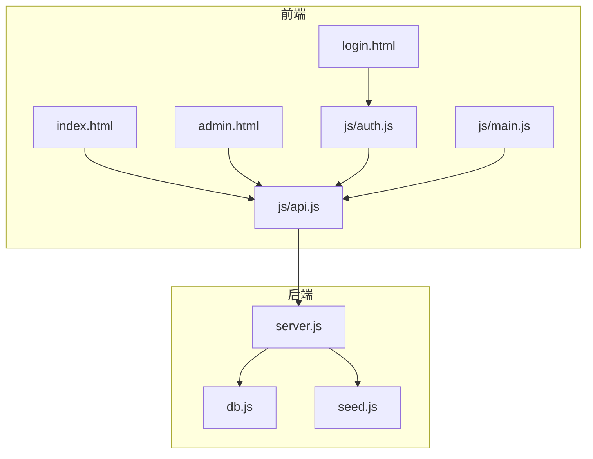
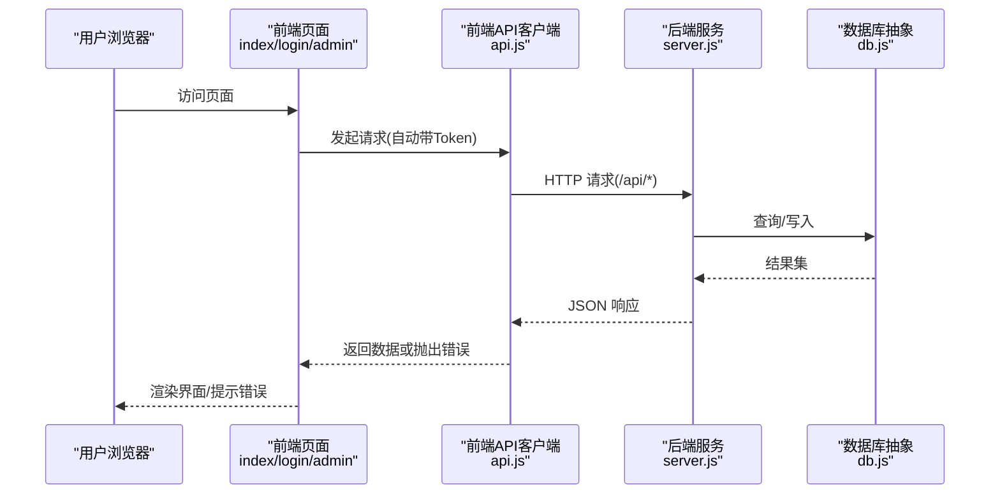
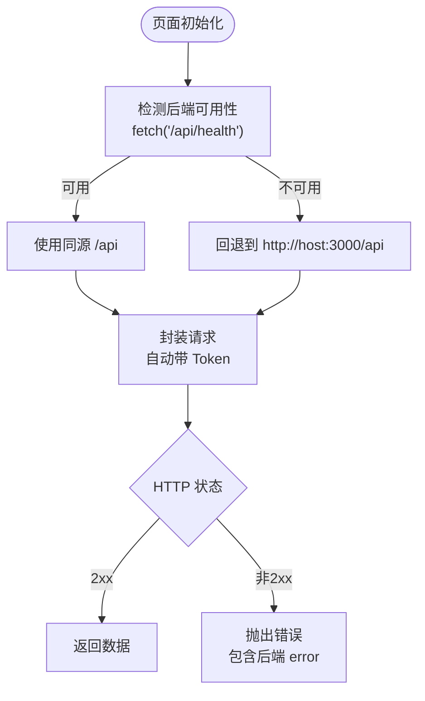
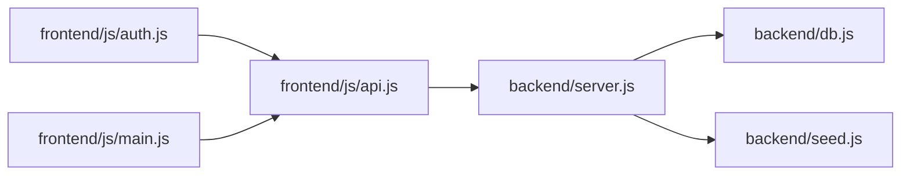

# 前后端分离设计

<cite>
**本文引用的文件**
- [backend/server.js](file://backend/server.js)
- [backend/db.js](file://backend/db.js)
- [backend/seed.js](file://backend/seed.js)
- [backend/package.json](file://backend/package.json)
- [frontend/index.html](file://frontend/index.html)
- [frontend/login.html](file://frontend/login.html)
- [frontend/admin.html](file://frontend/admin.html)
- [frontend/js/api.js](file://frontend/js/api.js)
- [frontend/js/auth.js](file://frontend/js/auth.js)
- [frontend/js/main.js](file://frontend/js/main.js)
</cite>

## 目录
1. [简介](#简介)
2. [项目结构](#项目结构)
3. [核心组件](#核心组件)
4. [架构总览](#架构总览)
5. [详细组件分析](#详细组件分析)
6. [依赖关系分析](#依赖关系分析)
7. [性能考虑](#性能考虑)
8. [故障排查指南](#故障排查指南)
9. [结论](#结论)
10. [附录：API 契约与示例](#附录api-契约与示例)

## 简介
本设计文档面向 LeapShop（LeapChess）项目的“前后端分离”实现，覆盖以下要点：
- 后端 RESTful API 设计与错误处理
- 前端 ES Modules 组织方式与原生 Fetch 通信
- CORS 跨域配置与安全策略
- 单服务模式下的静态资源托管方案
- 数据交换格式、认证令牌传递与会话管理
- 具体 API 调用示例与最佳实践

## 项目结构
项目采用典型的前后端分离布局：
- 后端：Express 服务提供 /api 接口，可选托管前端静态资源，支持 SQLite/PostgreSQL 双数据库回退。
- 前端：纯 HTML + CSS + JS（ES Modules），通过原生 fetch 调用后端 API；登录页、首页与管理后台页面分别由不同脚本驱动。

图表来源
- [backend/server.js:1-169](file://backend/server.js#L1-L169)
- [backend/db.js:1-176](file://backend/db.js#L1-L176)
- [backend/seed.js:1-129](file://backend/seed.js#L1-L129)
- [frontend/index.html:1-169](file://frontend/index.html#L1-L169)
- [frontend/login.html:1-39](file://frontend/login.html#L1-L39)
- [frontend/admin.html:1-97](file://frontend/admin.html#L1-L97)
- [frontend/js/api.js:1-76](file://frontend/js/api.js#L1-L76)
- [frontend/js/auth.js:1-30](file://frontend/js/auth.js#L1-L30)
- [frontend/js/main.js:1-90](file://frontend/js/main.js#L1-L90)

章节来源
- [backend/server.js:1-169](file://backend/server.js#L1-L169)
- [backend/db.js:1-176](file://backend/db.js#L1-L176)
- [backend/seed.js:1-129](file://backend/seed.js#L1-L129)
- [frontend/index.html:1-169](file://frontend/index.html#L1-L169)
- [frontend/login.html:1-39](file://frontend/login.html#L1-L39)
- [frontend/admin.html:1-97](file://frontend/admin.html#L1-L97)
- [frontend/js/api.js:1-76](file://frontend/js/api.js#L1-L76)
- [frontend/js/auth.js:1-30](file://frontend/js/auth.js#L1-L30)
- [frontend/js/main.js:1-90](file://frontend/js/main.js#L1-L90)

## 核心组件
- 后端服务（Express）：统一路由、鉴权中间件、CORS、JSON 解析、健康检查、静态资源托管。
- 数据库抽象层：自动选择 PostgreSQL 或 SQLite，统一 query/run 接口，建表与种子数据初始化。
- 前端 API 客户端：自动探测后端地址、统一请求封装、Token 注入、会话存取、HTML 转义。
- 认证流程：登录获取 JWT，前端存储并随请求携带 Authorization: Bearer <token>。
- 静态资源托管：开发/部署时可直接由后端托管 frontend 目录，实现单服务一键部署。

章节来源
- [backend/server.js:1-169](file://backend/server.js#L1-L169)
- [backend/db.js:1-176](file://backend/db.js#L1-L176)
- [frontend/js/api.js:1-76](file://frontend/js/api.js#L1-L76)
- [frontend/js/auth.js:1-30](file://frontend/js/auth.js#L1-L30)

## 架构总览
下图展示了浏览器到后端的完整交互链路，包括认证、商品读取与管理操作。

图表来源
- [frontend/js/api.js:40-49](file://frontend/js/api.js#L40-L49)
- [backend/server.js:43-140](file://backend/server.js#L43-L140)
- [backend/db.js:44-110](file://backend/db.js#L44-L110)

## 详细组件分析

### 后端 RESTful API 设计
- URL 命名规范
  - 资源名词复数：/api/products
  - 子资源：/api/products/:id
  - 认证相关：/api/auth/login, /api/auth/me
  - 健康检查：/api/health
- HTTP 方法与状态码
  - GET /api/products：列表（公开），支持 ?category=...
  - GET /api/products/:id：详情（公开），不存在返回 404
  - POST /api/products：新增（管理员），成功返回 201
  - PUT /api/products/:id：更新（管理员），不存在返回 404
  - DELETE /api/products/:id：删除（管理员），不存在返回 404
  - POST /api/auth/login：登录，失败返回 400/401
  - GET /api/auth/me：当前用户信息（需鉴权）
  - GET /api/health：健康检查
- 错误处理机制
  - 参数缺失：400，返回 { error }
  - 未认证：401，返回 { error }
  - 无权限：403，返回 { error }
  - 资源不存在：404，返回 { error }
  - 业务异常：保持语义化状态码，统一返回 { error }
- 鉴权与授权
  - 基于 JWT 的 Bearer Token 鉴权
  - 管理员角色校验（role === 'admin'）

章节来源
- [backend/server.js:25-140](file://backend/server.js#L25-L140)

### 前端 ES Modules 与 Fetch 通信
- 模块划分
  - api.js：统一请求封装、Token 注入、会话管理、HTML 转义、导航渲染
  - auth.js：登录表单提交、调用 /api/auth/login、保存会话并跳转
  - main.js：首页逻辑，加载商品列表、分类过滤、健康检查
- 自动探测后端地址
  - 优先同源 /api/health，失败则回退到本地 3000 端口
- 统一请求封装
  - 自动附加 Content-Type 与 Authorization
  - 非 2xx 统一抛错，错误消息来自后端 { error }
- 会话管理
  - localStorage 存储 token 与 user 信息
  - 登出清理本地会话并跳转

图表来源
- [frontend/js/api.js:10-49](file://frontend/js/api.js#L10-L49)
- [frontend/js/auth.js:9-25](file://frontend/js/auth.js#L9-L25)
- [frontend/js/main.js:9-51](file://frontend/js/main.js#L9-L51)

章节来源
- [frontend/js/api.js:1-76](file://frontend/js/api.js#L1-L76)
- [frontend/js/auth.js:1-30](file://frontend/js/auth.js#L1-L30)
- [frontend/js/main.js:1-90](file://frontend/js/main.js#L1-L90)

### 跨域配置与安全
- CORS
  - 后端启用 cors() 中间件，允许跨域请求
- 安全建议
  - 生产环境应限制允许的源（白名单）
  - 建议启用 HTTPS
  - JWT 密钥应从环境变量注入，避免硬编码
  - 对输入进行服务端校验（已实现基础校验）
  - 图片等二进制内容以 base64 存入数据库，注意体积控制

章节来源
- [backend/server.js:21-23](file://backend/server.js#L21-L23)
- [backend/server.js:17-19](file://backend/server.js#L17-L19)

### 静态资源托管策略（单服务模式）
- 当存在 frontend 目录时，后端直接托管该目录为静态资源
- 所有非 /api 前缀的路径回退到 index.html，支持 SPA 路由
- 便于在 Zeabur 等平台一键部署，无需额外 Nginx

章节来源
- [backend/server.js:142-149](file://backend/server.js#L142-L149)

### 数据模型与持久化
- 用户表 users：id、username、password_hash、role、created_at
- 商品表 products：id、name、category、price、description、image、stock、created_at、updated_at
- 数据库适配
  - 检测到 DATABASE_URL/PGHOST 使用 PostgreSQL，否则使用 SQLite（sql.js）
  - 统一使用 ? 占位符，内部自动转换为 $n（PostgreSQL）
  - 启动时执行 initSchema 与 seed，确保表结构与初始数据

章节来源
- [backend/db.js:112-158](file://backend/db.js#L112-L158)
- [backend/seed.js:87-114](file://backend/seed.js#L87-L114)

## 依赖关系分析

图表来源
- [frontend/js/api.js:1-76](file://frontend/js/api.js#L1-L76)
- [frontend/js/auth.js:1-30](file://frontend/js/auth.js#L1-L30)
- [frontend/js/main.js:1-90](file://frontend/js/main.js#L1-L90)
- [backend/server.js:1-169](file://backend/server.js#L1-L169)
- [backend/db.js:1-176](file://backend/db.js#L1-L176)
- [backend/seed.js:1-129](file://backend/seed.js#L1-L129)

章节来源
- [backend/package.json:1-23](file://backend/package.json#L1-L23)
- [backend/server.js:1-169](file://backend/server.js#L1-L169)

## 性能考虑
- 数据库连接池：PostgreSQL 使用连接池，减少连接开销
- 写操作落盘：SQLite 每次写后持久化，适合演示规模；生产建议使用 PostgreSQL
- 图片存储：base64 存入数据库，注意控制大小与缓存策略
- 前端懒加载：图片 loading="lazy"，提升首屏性能
- 健康检查：前端定期探测 /api/health，快速反馈服务状态

[本节为通用性能建议，不直接分析特定文件]

## 故障排查指南
- 无法连接后端
  - 检查前端是否可访问 /api/health；若失败将回退到 localhost:3000
  - 确认后端服务已启动且端口正确
- 认证失败
  - 检查 Authorization 头是否正确携带 Bearer Token
  - 确认 JWT 未过期，必要时重新登录
- 权限不足
  - 仅 admin 角色可执行写操作；普通用户会收到 403
- 资源不存在
  - 商品 ID 无效将返回 404
- 数据库问题
  - 查看日志中关于 SQLite/PostgreSQL 的提示信息
  - 生产环境请配置 DATABASE_URL 并使用 PostgreSQL

章节来源
- [frontend/js/api.js:10-49](file://frontend/js/api.js#L10-L49)
- [backend/server.js:25-64](file://backend/server.js#L25-L64)
- [backend/server.js:66-140](file://backend/server.js#L66-L140)
- [backend/server.js:152-168](file://backend/server.js#L152-L168)

## 结论
本项目实现了清晰的前后端分离架构：
- 后端提供标准化 RESTful API，具备完善的鉴权、错误处理与健康检查
- 前端通过 ES Modules 组织代码，使用原生 fetch 与后端通信，具备自动探测后端地址与统一错误处理
- 支持单服务模式静态资源托管，简化部署
- 通过 JWT 实现无状态认证，前后端职责清晰、扩展性强

[本节为总结性内容，不直接分析特定文件]

## 附录：API 契约与示例

### 认证
- 登录
  - 方法：POST /api/auth/login
  - 请求体：{ username, password }
  - 成功响应：{ token, user: { id, username, role } }
  - 失败：400/401，{ error }
- 当前用户
  - 方法：GET /api/auth/me
  - 头部：Authorization: Bearer <token>
  - 成功响应：{ user }
  - 失败：401，{ error }

章节来源
- [backend/server.js:43-64](file://backend/server.js#L43-L64)
- [frontend/js/auth.js:9-25](file://frontend/js/auth.js#L9-L25)

### 商品
- 列表
  - 方法：GET /api/products?category=...
  - 成功响应：{ products: [...] }
- 详情
  - 方法：GET /api/products/:id
  - 成功响应：{ product }
  - 失败：404，{ error }
- 新增（管理员）
  - 方法：POST /api/products
  - 头部：Authorization: Bearer <token>
  - 请求体：{ name, category, price, description, image, stock }
  - 成功响应：201 { product }
  - 失败：400/401/403，{ error }
- 更新（管理员）
  - 方法：PUT /api/products/:id
  - 头部：Authorization: Bearer <token>
  - 请求体：部分字段更新
  - 成功响应：{ product }
  - 失败：404/401/403，{ error }
- 删除（管理员）
  - 方法：DELETE /api/products/:id
  - 头部：Authorization: Bearer <token>
  - 成功响应：{ ok: true }
  - 失败：404/401/403，{ error }

章节来源
- [backend/server.js:66-135](file://backend/server.js#L66-L135)

### 健康检查
- 方法：GET /api/health
- 成功响应：{ status: "ok", db: "sqlite/postgresql", time: "ISO时间" }

章节来源
- [backend/server.js:137-140](file://backend/server.js#L137-L140)

### 前端调用示例（描述性）
- 登录
  - 前端调用 /api/auth/login，成功后将 token 与 user 保存到 localStorage，并根据角色跳转到管理后台或首页
- 获取商品列表
  - 前端调用 /api/products，根据 category 查询过滤，渲染商品卡片
- 管理商品
  - 管理员登录后，通过 /api/products 的 POST/PUT/DELETE 完成增删改

章节来源
- [frontend/js/auth.js:9-25](file://frontend/js/auth.js#L9-L25)
- [frontend/js/main.js:9-51](file://frontend/js/main.js#L9-L51)
- [frontend/js/api.js:40-49](file://frontend/js/api.js#L40-L49)