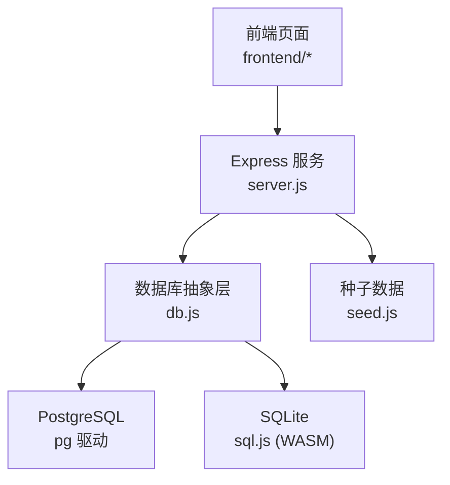
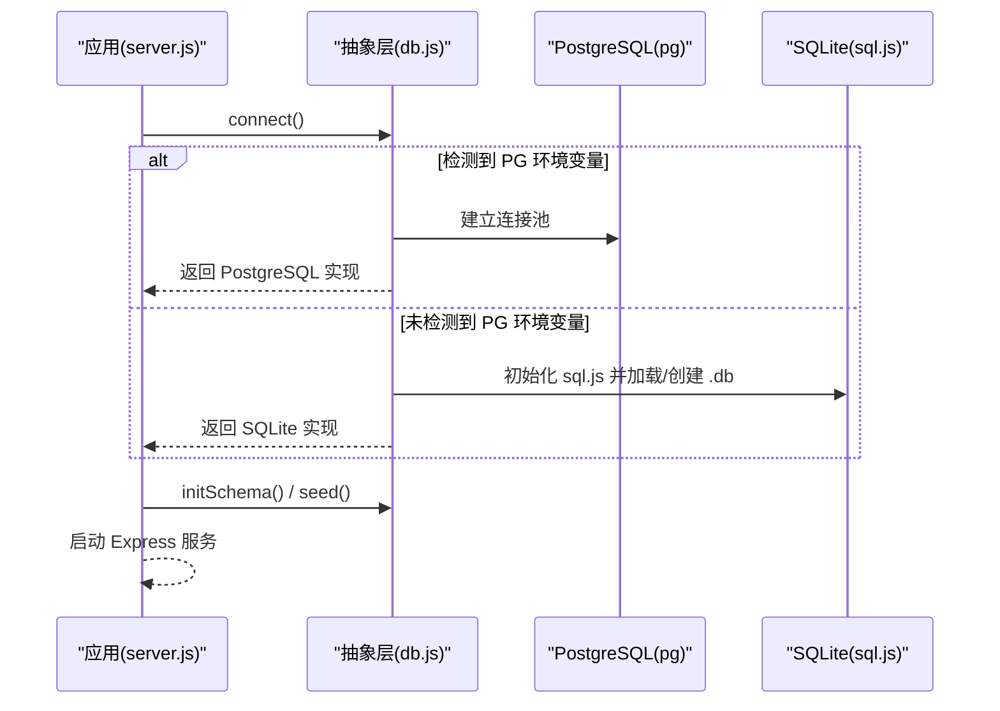
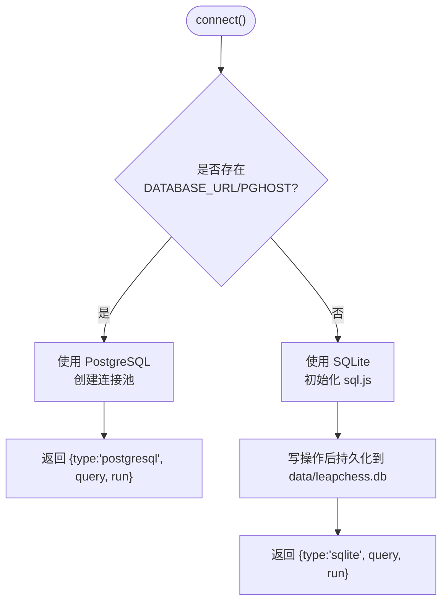
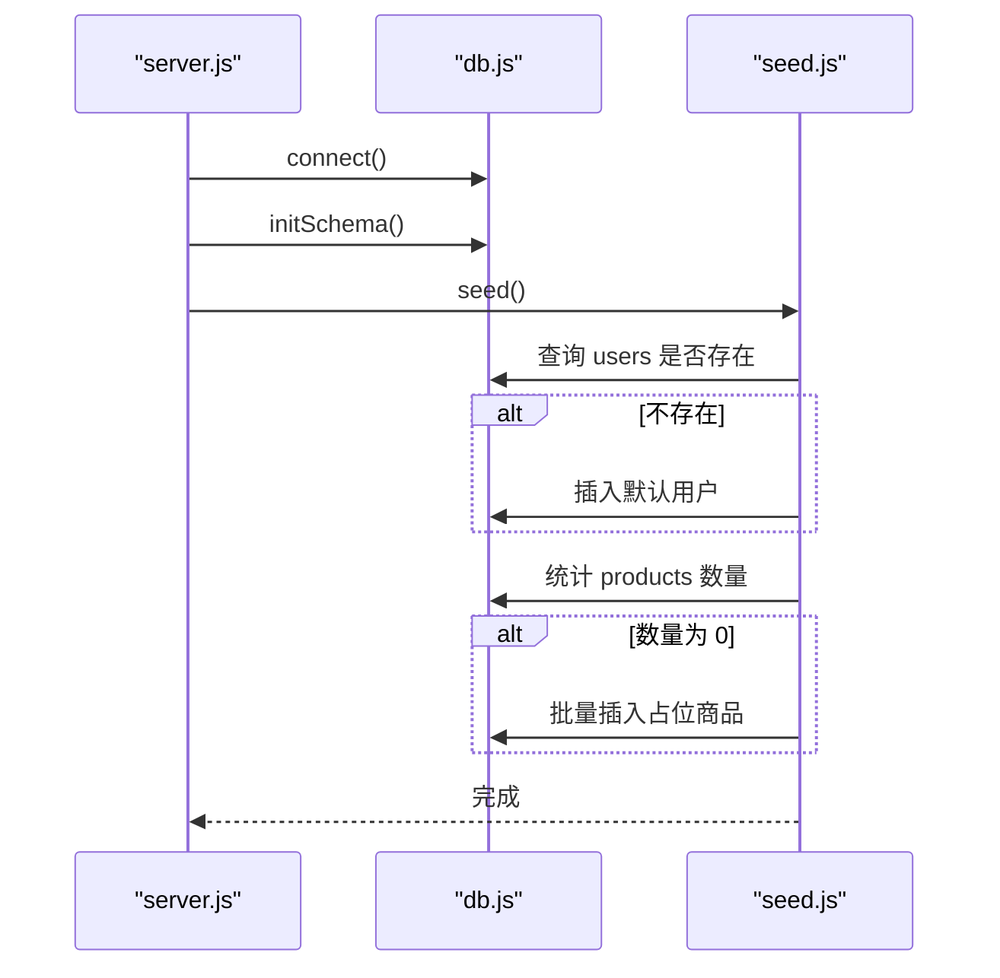
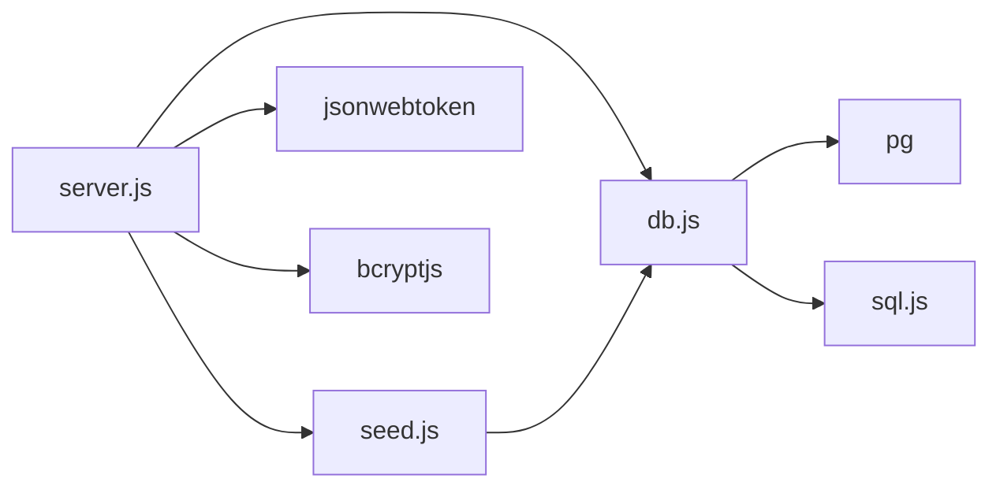

# 数据库抽象层设计

<cite>
**本文引用的文件**
- [backend/db.js](file://backend/db.js)
- [backend/server.js](file://backend/server.js)
- [backend/seed.js](file://backend/seed.js)
- [backend/package.json](file://backend/package.json)
- [README.md](file://README.md)
</cite>

## 目录
1. [简介](#简介)
2. [项目结构](#项目结构)
3. [核心组件](#核心组件)
4. [架构总览](#架构总览)
5. [详细组件分析](#详细组件分析)
6. [依赖关系分析](#依赖关系分析)
7. [性能与优化](#性能与优化)
8. [故障排查指南](#故障排查指南)
9. [结论](#结论)
10. [附录](#附录)

## 简介
本设计文档聚焦于 LeapShop 后端的数据库抽象层，说明其如何实现 PostgreSQL 与 SQLite 的双数据库支持、连接管理、环境切换、表结构设计、数据初始化流程、查询优化与 SQL 注入防护、迁移策略、备份恢复方案以及性能调优建议。目标是让读者在不深入源码的情况下也能理解并正确使用该抽象层。

## 项目结构
后端采用单服务模式：Express 提供 REST API，同时可选托管前端静态资源；数据库抽象层统一封装了 PostgreSQL（生产）与 SQLite（本地开发）两种实现，对外暴露一致的 query/run 接口。启动时自动建表并写入幂等种子数据。

图表来源
- [backend/server.js:1-169](file://backend/server.js#L1-L169)
- [backend/db.js:1-176](file://backend/db.js#L1-L176)
- [backend/seed.js:1-129](file://backend/seed.js#L1-L129)

章节来源
- [README.md:6-20](file://README.md#L6-L20)
- [backend/server.js:1-24](file://backend/server.js#L1-L24)

## 核心组件
- 数据库抽象层 db.js：根据环境变量选择 PostgreSQL 或 SQLite，统一 query/run 接口，处理占位符转换、INSERT 返回主键、持久化落盘等。
- 服务入口 server.js：注册路由、鉴权中间件、调用抽象层进行认证与商品 CRUD，并在启动时完成连接、建表、种子数据。
- 种子数据 seed.js：幂等创建默认账户与占位商品，确保首次运行即可用。
- 依赖声明 package.json：引入 pg、sql.js、bcryptjs、jsonwebtoken 等。

章节来源
- [backend/db.js:1-176](file://backend/db.js#L1-L176)
- [backend/server.js:14-169](file://backend/server.js#L14-L169)
- [backend/seed.js:1-129](file://backend/seed.js#L1-L129)
- [backend/package.json:14-21](file://backend/package.json#L14-L21)

## 架构总览
数据库抽象层通过环境变量决定使用哪种数据库实现：
- 若存在 DATABASE_URL 或 PGHOST，则使用 PostgreSQL，基于连接池执行 SQL。
- 否则使用 SQLite（sql.js），将内存数据库快照落盘到 data/leapchess.db。

图表来源
- [backend/db.js:12-110](file://backend/db.js#L12-L110)
- [backend/server.js:151-169](file://backend/server.js#L151-L169)

## 详细组件分析

### 数据库抽象层（db.js）
- 环境检测与驱动选择
  - 通过 DATABASE_URL 或 PGHOST 判断是否使用 PostgreSQL；否则回退到 SQLite。
  - PostgreSQL 连接选项会根据 DATABASE_URL 中的 sslmode 或 PGSSL 决定是否启用 SSL。
- 统一接口
  - query(sql, params)：返回行数组。
  - run(sql, params)：对 INSERT 语句自动追加 RETURNING id（PostgreSQL），SQLite 通过 last_insert_rowid() 获取新记录 ID。
- 占位符兼容
  - 所有 SQL 使用 ? 占位符；PostgreSQL 路径在运行时转换为 $1/$2...，保证跨库一致性。
- 建表逻辑
  - initSchema() 针对 users 与 products 分别定义字段、类型与约束，PostgreSQL 与 SQLite 语法差异在此处隔离。
- 代理对象
  - 对外暴露的 db.query/db.run 在未连接时会抛出明确错误，避免误用。

图表来源
- [backend/db.js:12-110](file://backend/db.js#L12-L110)

章节来源
- [backend/db.js:12-110](file://backend/db.js#L12-L110)
- [backend/db.js:112-158](file://backend/db.js#L112-L158)
- [backend/db.js:160-176](file://backend/db.js#L160-L176)

### 表结构设计
- users 表
  - id：自增主键（PostgreSQL SERIAL，SQLite INTEGER PRIMARY KEY AUTOINCREMENT）
  - username：TEXT，唯一且非空
  - password_hash：TEXT，非空
  - role：TEXT，非空，默认 'customer'
  - created_at：时间戳（PostgreSQL TIMESTAMPTZ 默认 NOW()；SQLite TEXT 默认 CURRENT_TIMESTAMP）
- products 表
  - id：自增主键
  - name：TEXT，非空
  - category：TEXT，非空，默认 'chess-timer'
  - price：数值型（PostgreSQL NUMERIC(10,2)，SQLite REAL），非空，默认 0
  - description：TEXT，默认 ''
  - image：TEXT，默认 ''（用于存储 base64 图片）
  - stock：INTEGER，非空，默认 0
  - created_at/updated_at：时间戳（语义同 users）

章节来源
- [backend/db.js:116-157](file://backend/db.js#L116-L157)

### 数据初始化流程（种子数据）
- 启动顺序
  - server.js 启动时先 connect()，再 initSchema()，最后 seed()。
- 幂等插入
  - 用户：按用户名查询，不存在则哈希密码后插入。
  - 商品：统计 products 数量，为空时才批量插入占位商品。
- 结果
  - 首次运行即具备管理员 P001 与客户 C001，以及若干示例商品。

图表来源
- [backend/server.js:151-169](file://backend/server.js#L151-L169)
- [backend/seed.js:87-114](file://backend/seed.js#L87-L114)

章节来源
- [backend/server.js:151-169](file://backend/server.js#L151-L169)
- [backend/seed.js:87-114](file://backend/seed.js#L87-L114)

### 查询优化策略
- 参数化查询
  - 所有 SQL 使用 ? 占位符并通过参数绑定，避免拼接字符串，提升性能与安全。
- 最小化读取
  - 列表接口仅按需 SELECT 必要字段；详情接口按主键精确查找。
- 索引建议（概念性）
  - 为频繁过滤的列添加索引，如 products.category、products.name。
  - 为认证查询 users.username 添加唯一索引（已存在）。
- 连接复用
  - PostgreSQL 使用连接池减少握手开销；SQLite 每次写操作后落盘，读操作走内存副本。

章节来源
- [backend/db.js:16-20](file://backend/db.js#L16-L20)
- [backend/server.js:44-135](file://backend/server.js#L44-L135)

### SQL 注入防护措施
- 参数化查询
  - 所有外部输入通过参数传入，不直接拼接到 SQL。
- 服务端校验
  - 对必填字段进行存在性与类型检查（如 name、price、stock）。
- 权限控制
  - 写操作需登录且角色为 admin，防止越权修改。

章节来源
- [backend/server.js:44-135](file://backend/server.js#L44-L135)

### 数据库迁移策略
- 当前实现
  - 使用 CREATE TABLE IF NOT EXISTS 保证幂等建表，适合轻量级演进。
- 建议实践
  - 引入版本化迁移脚本（例如按版本号命名），在启动时比对当前版本并执行增量变更。
  - 对破坏性变更（删除列、改类型）增加回滚脚本与灰度发布策略。
  - 在生产环境优先使用 PostgreSQL，避免 SQLite 的文件锁与并发限制。

[本节为通用建议，不直接分析具体文件]

### 备份与恢复方案
- PostgreSQL（生产）
  - 使用 pg_dump/pg_restore 或云厂商提供的备份工具定期全量与增量备份。
  - 制定 RPO/RTO 目标，验证恢复流程。
- SQLite（本地/演示）
  - 数据落盘至 data/leapchess.db，可直接复制该文件进行备份。
  - 注意在写操作期间拷贝可能导致不一致，建议在低峰期或短暂停写窗口进行。

[本节为通用建议，不直接分析具体文件]

### 性能调优建议
- 连接池
  - 调整 PostgreSQL 连接池大小以匹配并发负载，避免过多连接导致资源争用。
- 查询计划
  - 使用 EXPLAIN 分析慢查询，必要时增加索引或改写 SQL。
- 缓存
  - 对热点只读数据（如商品分类列表）可引入内存缓存（如 Redis）降低数据库压力。
- 日志与监控
  - 开启慢查询日志，结合 APM 监控数据库耗时与错误率。

[本节为通用建议，不直接分析具体文件]

## 依赖关系分析
- 运行时依赖
  - pg：PostgreSQL 客户端与连接池。
  - sql.js：纯 WASM 实现的 SQLite，无需编译。
  - bcryptjs：密码哈希。
  - jsonwebtoken：JWT 签发与校验。
  - express/cors：HTTP 服务与跨域。
- 模块耦合
  - server.js 依赖 db.js 与 seed.js。
  - seed.js 依赖 db.js 与 bcryptjs。
  - db.js 根据环境变量动态加载 pg 或 sql.js。

图表来源
- [backend/server.js:1-24](file://backend/server.js#L1-L24)
- [backend/db.js:12-110](file://backend/db.js#L12-L110)
- [backend/seed.js:1-12](file://backend/seed.js#L1-L12)
- [backend/package.json:14-21](file://backend/package.json#L14-L21)

章节来源
- [backend/package.json:14-21](file://backend/package.json#L14-L21)

## 性能与优化
- 连接管理
  - PostgreSQL 使用连接池，合理设置最大连接数与空闲超时。
  - SQLite 写操作后落盘，适合小规模数据；高并发场景应切换到 PostgreSQL。
- 查询优化
  - 使用参数化查询，避免字符串拼接。
  - 为高频过滤列加索引（如 products.category）。
- 资源控制
  - 限制请求体大小（已配置 JSON 解析上限），防止大图片上传拖垮服务。
- 可观测性
  - 健康检查接口返回数据库类型，便于监控与告警。

章节来源
- [backend/server.js:21-24](file://backend/server.js#L21-L24)
- [backend/server.js:137-140](file://backend/server.js#L137-L140)
- [backend/db.js:44-110](file://backend/db.js#L44-L110)

## 故障排查指南
- 常见错误
  - 未连接就调用 db.query/db.run：会抛出“数据库尚未连接”的错误。请确保先 await connect()。
  - 生产环境未注入 DATABASE_URL/PGHOST：将回退到 SQLite，并在启动日志中给出警告。
  - PostgreSQL SSL 连接失败：Zeabur 内网 PG 默认不走 SSL，如需外部托管库可通过 PGSSL=true 或在 URL 中添加 sslmode=require。
- 定位步骤
  - 查看 /api/health 返回的 db 字段确认当前数据库类型。
  - 检查环境变量是否正确注入。
  - 核对建表是否成功（initSchema 是否被调用）。
  - 检查种子数据是否写入（users/products 是否有记录）。

章节来源
- [backend/db.js:160-176](file://backend/db.js#L160-L176)
- [backend/server.js:151-169](file://backend/server.js#L151-L169)
- [backend/server.js:137-140](file://backend/server.js#L137-L140)

## 结论
该数据库抽象层以极简方式实现了 PostgreSQL 与 SQLite 的双驱动支持，屏蔽了底层差异，提供了统一的 query/run 接口。通过环境变量切换、参数化查询、幂等建表与种子数据，既满足本地快速开发，也适配生产部署。建议在生产环境中使用 PostgreSQL，并结合版本化迁移、备份恢复与监控告警，进一步提升稳定性与可维护性。

## 附录

### 环境变量与配置要点
- DATABASE_URL：PostgreSQL 连接串，支持在 URL 中携带 sslmode。
- PGHOST/PGPORT/PGUSER/PGPASSWORD/PGDATABASE：Zeabur 自动注入的 PG 环境变量。
- PGSSL：显式开启 SSL（true/1/on）。
- PORT：服务监听端口（Zeabur 注入）。
- JWT_SECRET：JWT 签名密钥，建议使用强随机值。

章节来源
- [backend/db.js:22-42](file://backend/db.js#L22-L42)
- [backend/server.js:17-19](file://backend/server.js#L17-L19)
- [README.md:70-90](file://README.md#L70-L90)

### API 与数据库交互示例（路径引用）
- 登录认证：POST /api/auth/login
  - 参考路径：[backend/server.js:44-60](file://backend/server.js#L44-L60)
- 商品列表：GET /api/products
  - 参考路径：[backend/server.js:67-77](file://backend/server.js#L67-L77)
- 新增商品：POST /api/products（需管理员）
  - 参考路径：[backend/server.js:87-105](file://backend/server.js#L87-L105)
- 更新商品：PUT /api/products/:id（需管理员）
  - 参考路径：[backend/server.js:107-127](file://backend/server.js#L107-L127)
- 删除商品：DELETE /api/products/:id（需管理员）
  - 参考路径：[backend/server.js:129-135](file://backend/server.js#L129-L135)

章节来源
- [backend/server.js:44-135](file://backend/server.js#L44-L135)