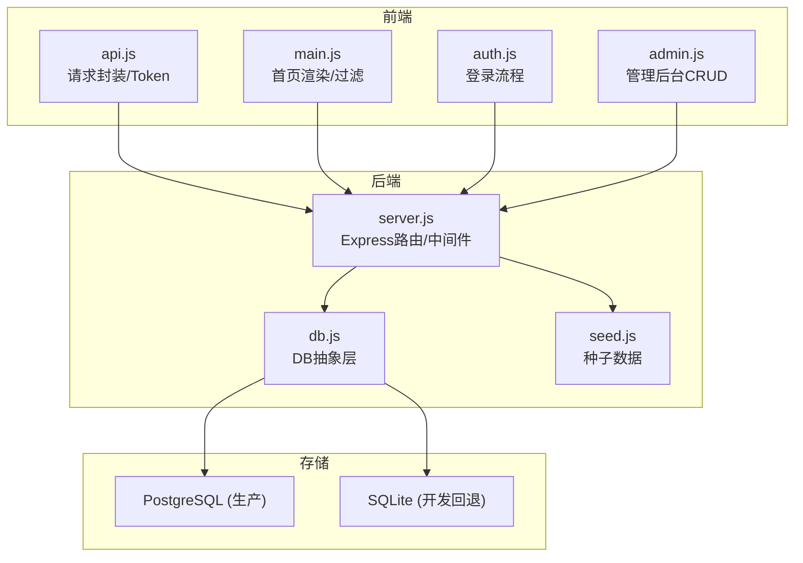
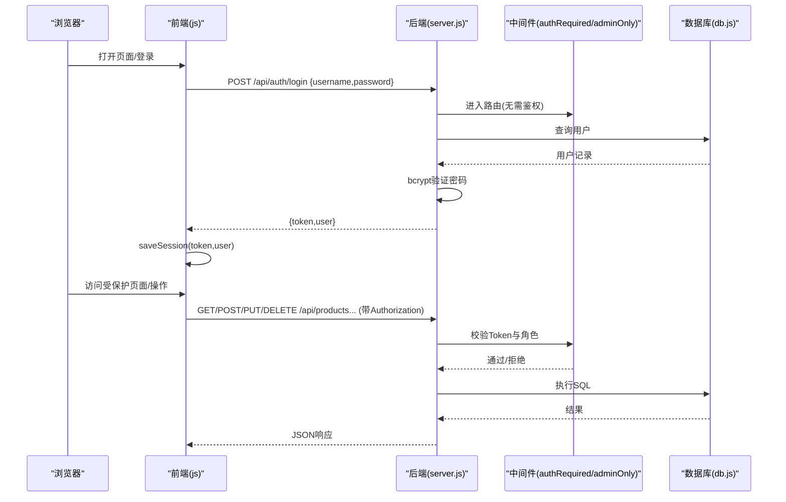
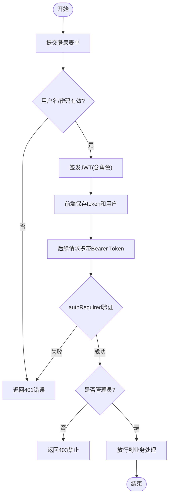
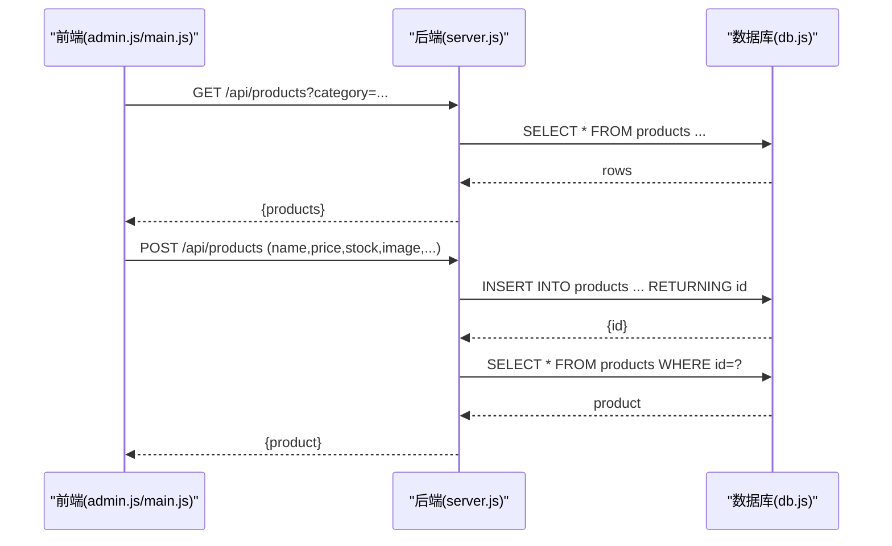
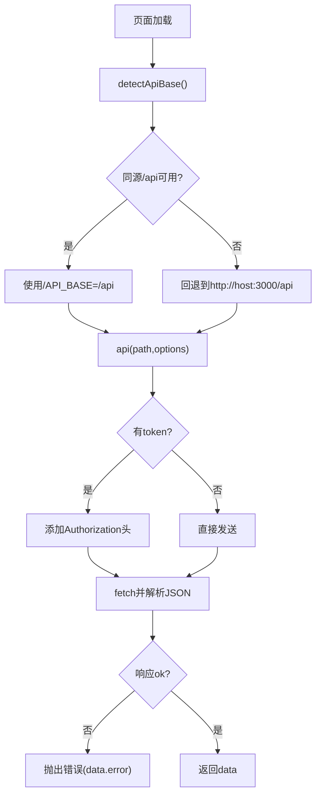
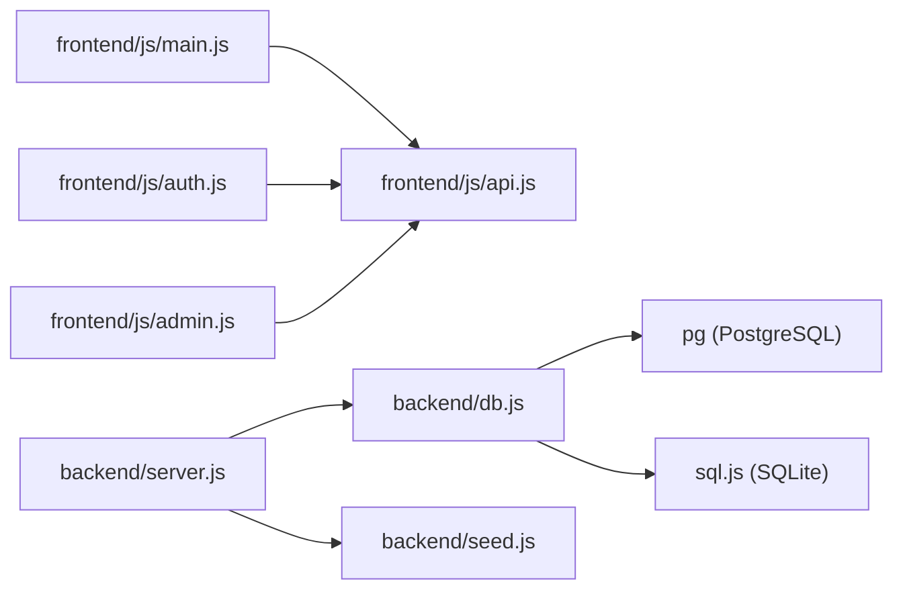
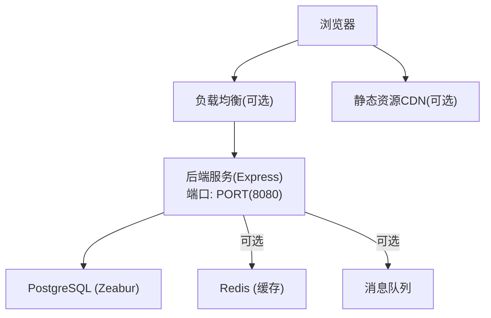

# 架构设计

<cite>
**本文引用的文件**
- [backend/server.js](file://backend/server.js)
- [backend/db.js](file://backend/db.js)
- [backend/seed.js](file://backend/seed.js)
- [frontend/js/api.js](file://frontend/js/api.js)
- [frontend/js/main.js](file://frontend/js/main.js)
- [frontend/js/auth.js](file://frontend/js/auth.js)
- [frontend/js/admin.js](file://frontend/js/admin.js)
- [Dockerfile](file://Dockerfile)
- [README.md](file://README.md)
- [backend/package.json](file://backend/package.json)
</cite>

## 目录
1. [简介](#简介)
2. [项目结构](#项目结构)
3. [核心组件](#核心组件)
4. [架构总览](#架构总览)
5. [详细组件分析](#详细组件分析)
6. [依赖关系分析](#依赖关系分析)
7. [性能与可扩展性](#性能与可扩展性)
8. [部署拓扑与基础设施](#部署拓扑与基础设施)
9. [故障排查指南](#故障排查指南)
10. [结论](#结论)

## 简介
本架构文档面向 LeapShop（基于 LeapChess 风格）全栈 Web 应用，说明其前后端分离、MVC 式路由组织与中间件鉴权的设计。系统包含：
- 前端：原生 HTML/CSS/JS，通过共享 API 客户端调用后端 REST 接口，实现商品浏览、登录认证与管理后台的 CRUD。
- 后端：Express 服务，提供 JWT 认证、角色权限中间件、商品资源接口与健康检查；支持 PostgreSQL（生产）与 SQLite（开发回退）。
- 数据库：抽象层统一 SQL 占位符，自动适配不同数据库方言；启动时建表并写入种子数据。

该设计兼顾开发便捷性与生产可用性，便于在单服务或前后端分离模式下部署。

## 项目结构
- 前端 frontend/
  - 页面：index.html、login.html、admin.html
  - 脚本：api.js（请求封装与 Token 管理）、main.js（首页逻辑）、auth.js（登录流程）、admin.js（管理后台）
- 后端 backend/
  - server.js：Express 入口，注册路由、中间件、静态托管
  - db.js：数据库抽象层（PostgreSQL / SQLite），连接池、建表、查询封装
  - seed.js：幂等种子数据（用户与商品）
- 根目录
  - Dockerfile：单服务镜像构建与健康检查
  - README.md：运行方式、API 清单、部署说明
  - package.json：后端依赖与脚本



图表来源
- [backend/server.js:1-169](file://backend/server.js#L1-L169)
- [backend/db.js:1-176](file://backend/db.js#L1-L176)
- [backend/seed.js:1-129](file://backend/seed.js#L1-L129)
- [frontend/js/api.js:1-76](file://frontend/js/api.js#L1-L76)
- [frontend/js/main.js:1-90](file://frontend/js/main.js#L1-L90)
- [frontend/js/auth.js:1-30](file://frontend/js/auth.js#L1-L30)
- [frontend/js/admin.js:1-182](file://frontend/js/admin.js#L1-L182)

章节来源
- [README.md:6-28](file://README.md#L6-L28)
- [backend/package.json:1-23](file://backend/package.json#L1-L23)

## 核心组件
- Express 服务与路由
  - 认证接口：POST /api/auth/login、GET /api/auth/me
  - 商品接口：GET /api/products、GET /api/products/:id、POST /api/products、PUT /api/products/:id、DELETE /api/products/:id
  - 健康检查：GET /api/health
  - 静态托管：单服务模式提供前端页面
- 中间件
  - authRequired：校验 Bearer Token，解析用户信息到 req.user
  - adminOnly：仅允许 role=admin 的管理员访问写接口
- 数据库抽象层
  - connect()：根据环境变量选择 PostgreSQL 或 SQLite
  - initSchema()：创建 users、products 表（兼容两种数据库）
  - query/run：统一 ? 占位符，内部转换为 $n（PG）或直接执行（SQLite）
- 前端 API 客户端
  - detectApiBase：自动探测同源 /api，失败回退本地 3000 端口
  - api(path, options)：统一请求封装，自动携带 Authorization 头，统一错误抛出
  - 会话管理：localStorage 存取 token 与 user
- 种子数据
  - 幂等初始化：确保管理员与普通用户存在，首次无商品时写入示例商品

章节来源
- [backend/server.js:21-149](file://backend/server.js#L21-L149)
- [backend/db.js:12-176](file://backend/db.js#L12-L176)
- [backend/seed.js:87-114](file://backend/seed.js#L87-L114)
- [frontend/js/api.js:9-49](file://frontend/js/api.js#L9-L49)

## 架构总览
系统采用前后端分离 + 单服务托管前端的混合模式。前端通过 REST API 与后端交互，后端使用 JWT 进行无状态认证，并通过数据库抽象层屏蔽底层存储差异。



图表来源
- [backend/server.js:44-135](file://backend/server.js#L44-L135)
- [backend/db.js:45-109](file://backend/db.js#L45-L109)
- [frontend/js/api.js:41-49](file://frontend/js/api.js#L41-L49)
- [frontend/js/auth.js:9-25](file://frontend/js/auth.js#L9-L25)

## 详细组件分析

### 认证与授权流程
- 登录
  - 前端提交用户名/密码至 /api/auth/login
  - 后端校验用户与密码哈希，签发 JWT（含 id、username、role，有效期固定）
  - 前端保存 token 与用户信息到 localStorage
- 鉴权
  - 受保护接口需携带 Authorization: Bearer <token>
  - authRequired 中间件解析并验证 token，将用户信息挂载到 req.user
  - adminOnly 中间件限制 role=admin 才能执行写操作
- 会话
  - 前端通过 getToken/getUser/clearSession 管理本地会话
  - 导航栏根据用户角色动态显示“管理面板”和“退出”按钮



图表来源
- [backend/server.js:26-64](file://backend/server.js#L26-L64)
- [frontend/js/api.js:18-49](file://frontend/js/api.js#L18-L49)
- [frontend/js/auth.js:9-25](file://frontend/js/auth.js#L9-L25)

章节来源
- [backend/server.js:26-64](file://backend/server.js#L26-L64)
- [frontend/js/api.js:18-49](file://frontend/js/api.js#L18-L49)
- [frontend/js/auth.js:9-25](file://frontend/js/auth.js#L9-L25)

### 商品模块（CRUD）
- 读接口
  - GET /api/products：支持按 category 过滤，返回列表
  - GET /api/products/:id：获取单个商品详情
- 写接口（管理员）
  - POST /api/products：新增商品（名称必填，其他字段可选）
  - PUT /api/products/:id：更新商品（部分字段可更新）
  - DELETE /api/products/:id：删除商品
- 图片存储
  - 图片以 base64 字符串存入 products.image 字段，前端限制大小（约 1.5MB）
- 数据流
  - 前端通过 api.js 发起请求，后端路由校验后调用 db.query/run 执行 SQL



图表来源
- [backend/server.js:67-135](file://backend/server.js#L67-L135)
- [backend/db.js:45-109](file://backend/db.js#L45-L109)
- [frontend/js/admin.js:128-152](file://frontend/js/admin.js#L128-L152)
- [frontend/js/main.js:9-40](file://frontend/js/main.js#L9-L40)

章节来源
- [backend/server.js:67-135](file://backend/server.js#L67-L135)
- [frontend/js/admin.js:36-176](file://frontend/js/admin.js#L36-L176)
- [frontend/js/main.js:9-40](file://frontend/js/main.js#L9-L40)

### 数据库抽象层
- 驱动选择
  - 检测到 DATABASE_URL 或 PGHOST 则使用 PostgreSQL，否则使用 SQLite（sql.js）
- 兼容性
  - 统一使用 ? 占位符，PostgreSQL 路径自动转换为 $n
  - INSERT 自动附加 RETURNING id（PG），SQLite 通过 last_insert_rowid() 获取
- 持久化
  - SQLite 每次写操作后将内存数据库快照落盘
- 初始化
  - initSchema() 创建 users、products 表（类型与默认值适配两种数据库）

```mermaid
classDiagram
class DBAbstract {
+type string
+query(sql,params) Promise~rows~
+run(sql,params) Promise~{id}~
}
class PgImpl {
+Pool pool
+query(sql,params)
+run(sql,params)
}
class SqliteImpl {
+Database db
+query(sql,params)
+run(sql,params)
}
DBAbstract <|.. PgImpl : "实现"
DBAbstract <|.. SqliteImpl : "实现"
```

图表来源
- [backend/db.js:12-109](file://backend/db.js#L12-L109)
- [backend/db.js:112-158](file://backend/db.js#L112-L158)

章节来源
- [backend/db.js:12-176](file://backend/db.js#L12-L176)

### 前端 API 客户端与会话
- 自动探测后端地址
  - 优先尝试同源 /api/health，失败则回退到 http://hostname:3000/api
- 统一请求封装
  - 自动注入 Authorization: Bearer <token>
  - 统一错误抛出（包含后端返回的 error 消息）
- 会话管理
  - 登录成功后保存 token 与用户信息
  - 导航栏渲染用户状态并提供退出功能



图表来源
- [frontend/js/api.js:9-49](file://frontend/js/api.js#L9-L49)

章节来源
- [frontend/js/api.js:9-49](file://frontend/js/api.js#L9-L49)

## 依赖关系分析
- 前端依赖
  - api.js 被 main.js、auth.js、admin.js 共同引用，负责网络与会话
- 后端依赖
  - server.js 依赖 db.js（数据库）、seed.js（种子数据）
  - db.js 根据环境变量动态引入 pg 或 sql.js
- 外部依赖
  - express、cors、bcryptjs、jsonwebtoken、pg、sql.js



图表来源
- [frontend/js/main.js:1-90](file://frontend/js/main.js#L1-L90)
- [frontend/js/auth.js:1-30](file://frontend/js/auth.js#L1-L30)
- [frontend/js/admin.js:1-182](file://frontend/js/admin.js#L1-L182)
- [backend/server.js:1-169](file://backend/server.js#L1-L169)
- [backend/db.js:1-176](file://backend/db.js#L1-L176)

章节来源
- [backend/package.json:14-21](file://backend/package.json#L14-L21)

## 性能与可扩展性
- 性能优化
  - 数据库连接池：PostgreSQL 使用连接池减少握手开销
  - 只读接口缓存：可按需引入 Redis 缓存热门商品列表
  - 图片压缩：前端限制上传大小并在服务端做二次校验与压缩
  - 分页与排序：对商品列表增加分页与索引优化（如按 category、updated_at）
- 可扩展性
  - 多实例水平扩展：无状态后端，配合负载均衡即可横向扩容
  - 独立静态资源：可将前端静态资源迁移至 CDN，降低后端压力
  - 异步任务：订单、邮件通知等可通过消息队列解耦
  - 配置外置：JWT_SECRET、数据库连接串等通过环境变量注入
- 安全加固
  - 输入校验：对 name、price、stock 等字段进行严格类型与范围校验
  - 速率限制：对登录与写接口增加限流防止暴力破解
  - 日志审计：记录关键操作（登录、增删改）以便追踪

[本节为通用指导，不直接分析具体文件]

## 部署拓扑与基础设施
- 单服务模式（推荐）
  - 后端同时托管前端静态资源，监听 PORT（Zeabur 注入）
  - 健康检查：/api/health
  - 数据库：PostgreSQL（生产），未注入变量时回退 SQLite（开发）
- 前后端分离模式
  - 后端服务：Node.js + Express
  - 前端服务：静态托管（Zeabur Prebuilt Static Hosting）
  - CORS：已全开，跨域访问无问题
- 容器化
  - Dockerfile 基于 node:20-alpine，安装依赖并暴露 8080 端口
  - HEALTHCHECK 定期探测 /api/health



图表来源
- [Dockerfile:1-26](file://Dockerfile#L1-L26)
- [backend/server.js:152-164](file://backend/server.js#L152-L164)
- [backend/db.js:29-42](file://backend/db.js#L29-L42)

章节来源
- [README.md:70-97](file://README.md#L70-L97)
- [Dockerfile:1-26](file://Dockerfile#L1-L26)

## 故障排查指南
- 登录失败
  - 检查用户名/密码是否正确，确认后端返回 401
  - 查看前端控制台错误信息（api.js 会抛出 data.error）
- 权限不足
  - 非管理员调用写接口将返回 403，确认角色为 admin
- 数据库连接异常
  - 生产环境未注入 DATABASE_URL/PGHOST 时会回退 SQLite 并输出警告
  - 检查环境变量与网络连通性（内网 PG 默认不启用 SSL）
- 健康检查失败
  - 确认 /api/health 可达，检查容器健康检查配置
- 图片上传失败
  - 前端限制大小（约 1.5MB），过大将被拒绝；检查 base64 编码与后端接收

章节来源
- [backend/server.js:26-64](file://backend/server.js#L26-L64)
- [backend/db.js:152-164](file://backend/db.js#L152-L164)
- [frontend/js/api.js:41-49](file://frontend/js/api.js#L41-L49)
- [frontend/js/admin.js:110-126](file://frontend/js/admin.js#L110-L126)

## 结论
LeapShop 采用清晰的前后端分离与中间件鉴权架构，结合数据库抽象层实现了开发与生产的平滑切换。JWT 无状态认证简化了会话管理，角色权限中间件保障了数据安全。通过单服务与分离部署两种模式，满足不同场景下的交付需求。未来可在缓存、分页、异步任务等方面进一步增强性能与可扩展性。