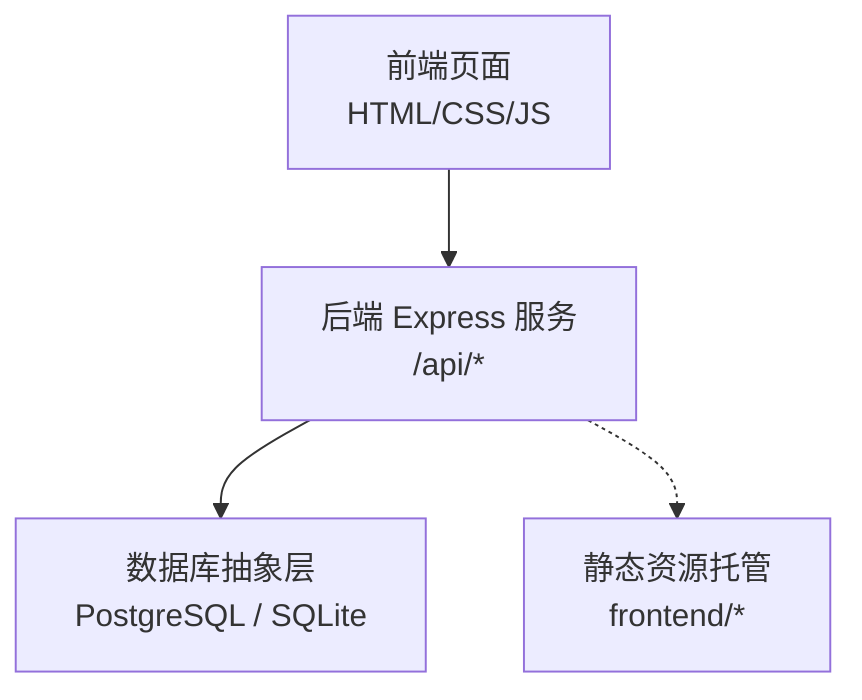
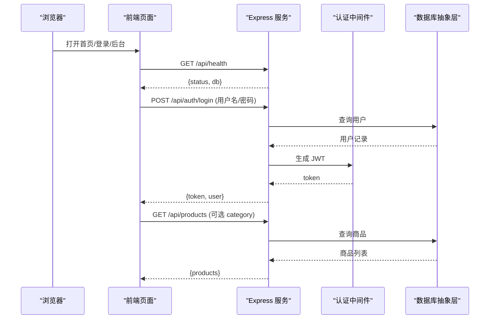
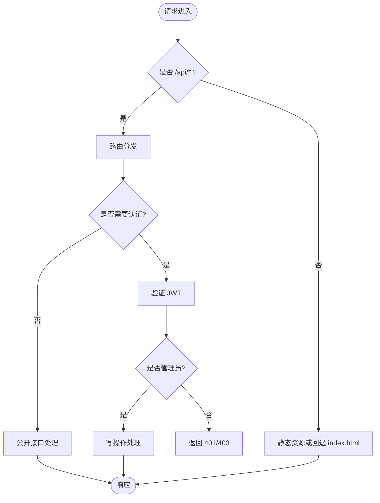
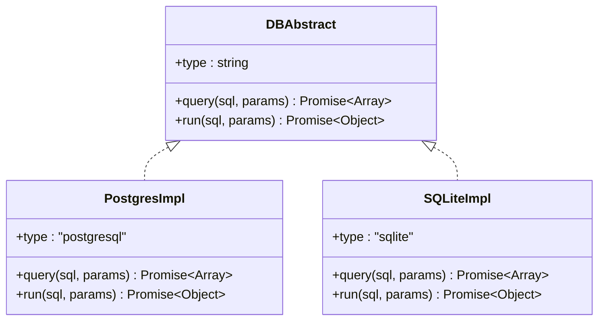
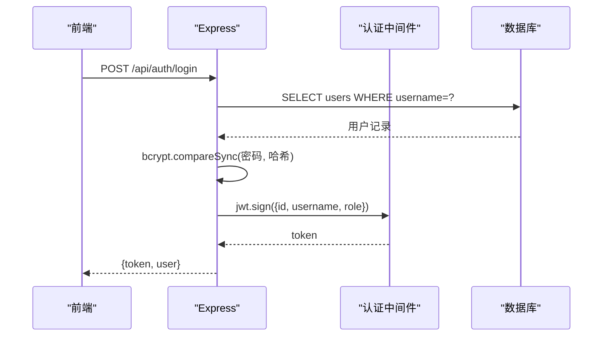
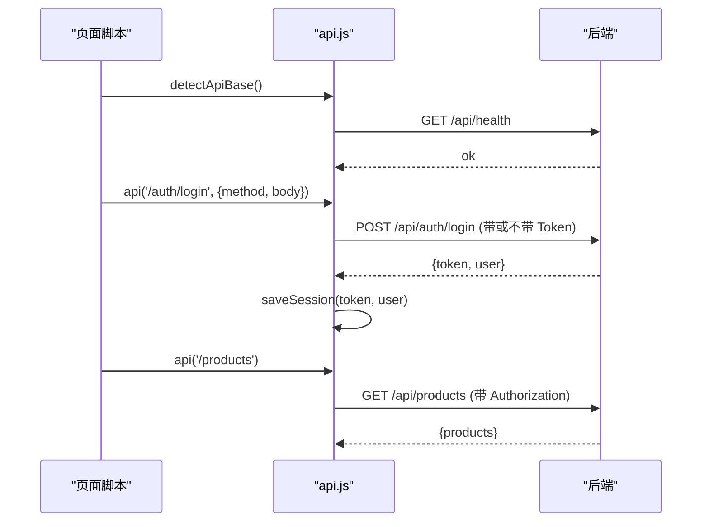
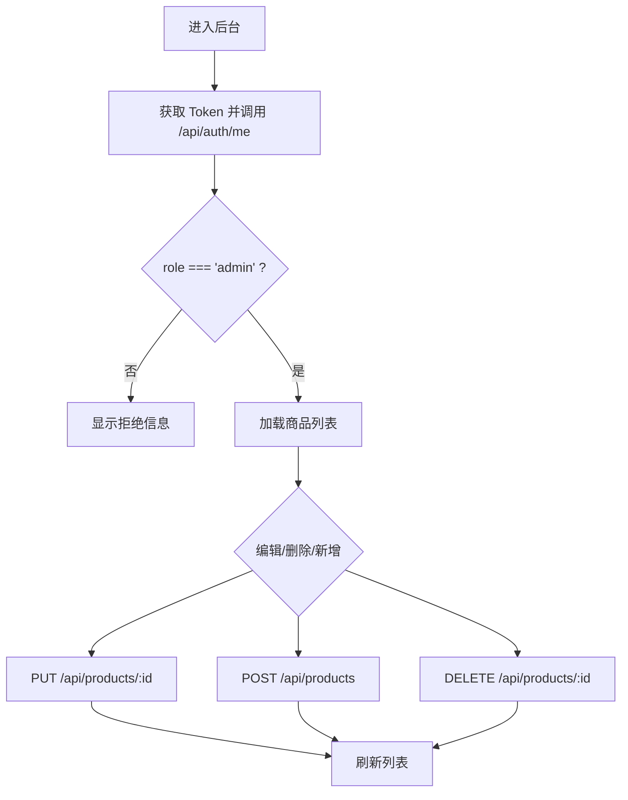
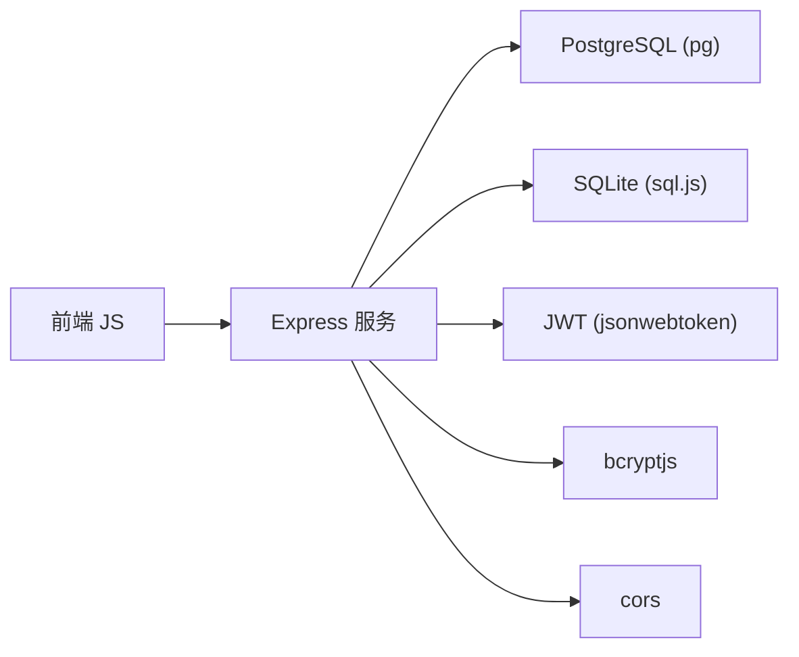
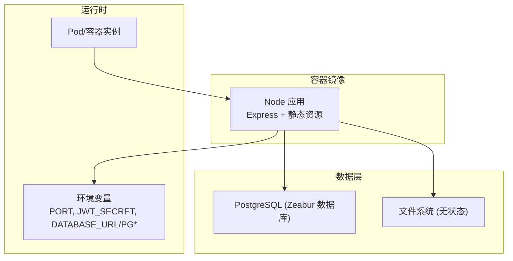

# 系统架构总览

<cite>
**本文引用的文件**
- [backend/server.js](file://backend/server.js)
- [backend/db.js](file://backend/db.js)
- [backend/seed.js](file://backend/seed.js)
- [frontend/js/api.js](file://frontend/js/api.js)
- [frontend/js/auth.js](file://frontend/js/auth.js)
- [frontend/js/main.js](file://frontend/js/main.js)
- [frontend/js/admin.js](file://frontend/js/admin.js)
- [Dockerfile](file://Dockerfile)
- [README.md](file://README.md)
- [backend/package.json](file://backend/package.json)
</cite>

## 目录
1. [简介](#简介)
2. [项目结构](#项目结构)
3. [核心组件](#核心组件)
4. [架构总览](#架构总览)
5. [详细组件分析](#详细组件分析)
6. [依赖关系分析](#依赖关系分析)
7. [性能与可扩展性](#性能与可扩展性)
8. [故障排查指南](#故障排查指南)
9. [结论](#结论)
10. [附录：部署拓扑与决策说明](#附录部署拓扑与决策说明)

## 简介
本文件为 LeapShop（基于原仓库的 LeapChess）系统架构总览，面向开发者快速理解整体设计。系统采用前后端分离的 API 模式，后端以单服务模式同时托管静态前端资源，便于在容器化平台（如 Zeabur）一键部署。认证采用 JWT，数据库抽象层支持 PostgreSQL 与 SQLite 双驱动，开发期默认使用 SQLite，生产环境通过环境变量自动切换至 PostgreSQL。

## 项目结构
- 后端 backend：Express 服务、JWT 认证、权限中间件、商品 CRUD、健康检查、静态资源托管入口。
- 前端 frontend：原生 HTML/CSS/JS，包含首页、登录页、管理后台；共享 API 客户端封装请求、Token 管理与会话存储。
- 数据库抽象层 db.js：根据环境变量选择 PostgreSQL 或 SQLite，统一 query/run 接口与建表逻辑。
- 容器化 Dockerfile：单镜像构建 Node 应用，暴露端口并配置健康检查。
- 种子数据 seed.js：幂等初始化用户与占位商品。

图表来源
- [backend/server.js:142-149](file://backend/server.js#L142-L149)
- [backend/db.js:44-110](file://backend/db.js#L44-L110)
- [Dockerfile:1-26](file://Dockerfile#L1-L26)

章节来源
- [README.md:106-127](file://README.md#L106-L127)
- [backend/server.js:1-169](file://backend/server.js#L1-L169)
- [backend/db.js:1-176](file://backend/db.js#L1-L176)
- [Dockerfile:1-26](file://Dockerfile#L1-L26)

## 核心组件
- Express 后端服务：提供 RESTful API（认证、商品 CRUD）、健康检查、静态资源托管。
- 认证中间件：基于 JWT 的鉴权与角色校验（adminOnly）。
- 数据库抽象层：统一 SQL 接口，自动适配 PostgreSQL 与 SQLite，处理占位符转换与连接策略。
- 前端 API 客户端：自动探测后端地址、注入 Authorization 头、统一错误抛出、本地会话管理。
- 种子数据：幂等创建演示账户与占位商品，保障首次启动可用。

章节来源
- [backend/server.js:25-64](file://backend/server.js#L25-L64)
- [backend/db.js:16-42](file://backend/db.js#L16-L42)
- [frontend/js/api.js:1-76](file://frontend/js/api.js#L1-L76)
- [backend/seed.js:87-114](file://backend/seed.js#L87-L114)

## 架构总览
系统采用“API + 静态资源”的单服务模式：后端监听端口，既提供 /api/* 接口，又托管 frontend 下的静态页面。前端通过同源 /api 访问，若不通则回退到本地 3000 端口。数据库抽象层根据环境变量选择 PostgreSQL（生产）或 SQLite（开发），保证零配置开发与生产一致性。

图表来源
- [backend/server.js:44-77](file://backend/server.js#L44-L77)
- [backend/db.js:44-110](file://backend/db.js#L44-L110)
- [frontend/js/api.js:10-16](file://frontend/js/api.js#L10-L16)
- [frontend/js/main.js:9-40](file://frontend/js/main.js#L9-L40)

## 详细组件分析

### Express 后端服务
- 路由与中间件：
  - 认证：POST /api/auth/login 返回 JWT；GET /api/auth/me 校验 Token。
  - 商品：公开读取（列表/详情），写操作需管理员（authRequired + adminOnly）。
  - 健康检查：GET /api/health 返回状态与数据库类型。
  - 静态托管：当存在 frontend 目录时，作为静态资源根目录，并将非 /api 路径回退到 index.html。
- 安全与健壮性：
  - CORS 全开，便于前后端分离部署。
  - JSON 体大小限制，支持 base64 图片上传。
  - 错误码规范：401 未登录、403 无权限、404 资源不存在。

图表来源
- [backend/server.js:25-41](file://backend/server.js#L25-L41)
- [backend/server.js:66-135](file://backend/server.js#L66-L135)
- [backend/server.js:142-149](file://backend/server.js#L142-L149)

章节来源
- [backend/server.js:1-169](file://backend/server.js#L1-L169)

### 数据库抽象层
- 双驱动策略：
  - 检测到 DATABASE_URL 或 PGHOST 时使用 PostgreSQL，否则使用 sql.js（SQLite）。
  - 将统一的 ? 占位符转换为 PostgreSQL 的 $n 占位符，屏蔽差异。
- 连接与持久化：
  - PostgreSQL：Pool 连接池，SSL 策略按环境变量控制。
  - SQLite：内存库 + 写后落盘，适合演示与无状态文件系统。
- 建表与初始化：
  - initSchema 针对两种数据库分别定义 users 与 products 表结构。
  - 幂等执行，避免重复建表。

图表来源
- [backend/db.js:16-42](file://backend/db.js#L16-L42)
- [backend/db.js:44-110](file://backend/db.js#L44-L110)
- [backend/db.js:112-158](file://backend/db.js#L112-L158)

章节来源
- [backend/db.js:1-176](file://backend/db.js#L1-L176)

### 认证中间件与权限控制
- authRequired：从 Authorization 头提取 Bearer Token，使用 JWT_SECRET 验证，失败返回 401。
- adminOnly：校验 req.user.role === 'admin'，否则返回 403。
- 登录流程：校验用户名/密码，比对 bcrypt 哈希，签发 JWT（含 id、username、role），设置过期时间。

图表来源
- [backend/server.js:44-64](file://backend/server.js#L44-L64)
- [backend/server.js:25-41](file://backend/server.js#L25-L41)

章节来源
- [backend/server.js:25-64](file://backend/server.js#L25-L64)

### 前端 API 客户端与会话管理
- 自动探测后端地址：优先同源 /api，失败回退到 http://localhost:3000/api。
- 统一请求封装：自动附加 Authorization 头，统一错误抛出。
- 会话管理：localStorage 存储 token 与用户信息，提供 saveSession/clearSession/getUser。
- 导航渲染：根据用户角色显示退出与管理入口。

图表来源
- [frontend/js/api.js:10-49](file://frontend/js/api.js#L10-L49)
- [frontend/js/auth.js:9-25](file://frontend/js/auth.js#L9-L25)
- [frontend/js/main.js:9-40](file://frontend/js/main.js#L9-L40)

章节来源
- [frontend/js/api.js:1-76](file://frontend/js/api.js#L1-L76)
- [frontend/js/auth.js:1-30](file://frontend/js/auth.js#L1-L30)
- [frontend/js/main.js:1-90](file://frontend/js/main.js#L1-L90)

### 管理后台与权限门控
- 访问守卫：检测 Token，调用 /api/auth/me 校验角色，仅 admin 可进入。
- 商品管理：列表加载、编辑表单、图片转 base64 上传、删除确认。
- 错误提示：网络异常或权限不足时给出友好提示。

图表来源
- [frontend/js/admin.js:11-34](file://frontend/js/admin.js#L11-L34)
- [frontend/js/admin.js:128-176](file://frontend/js/admin.js#L128-L176)

章节来源
- [frontend/js/admin.js:1-182](file://frontend/js/admin.js#L1-L182)

### 种子数据与初始化
- 幂等创建演示账户（P001 管理员、C001 客户）与占位商品。
- 首次启动自动建表并写入数据，确保开箱即用。

章节来源
- [backend/seed.js:87-114](file://backend/seed.js#L87-L114)
- [backend/server.js:152-164](file://backend/server.js#L152-L164)

## 依赖关系分析
- 后端依赖：
  - express：HTTP 服务与路由。
  - cors：跨域支持。
  - bcryptjs：密码哈希。
  - jsonwebtoken：JWT 签发与验证。
  - pg：PostgreSQL 连接池。
  - sql.js：SQLite 内存数据库（WASM）。
- 前端依赖：
  - 原生 Fetch API 与 localStorage。
- 容器化：
  - Dockerfile 基于 node:20-alpine，安装依赖并暴露端口，配置健康检查。

图表来源
- [backend/package.json:14-21](file://backend/package.json#L14-L21)
- [backend/server.js:9-15](file://backend/server.js#L9-L15)
- [backend/db.js:48-110](file://backend/db.js#L48-L110)

章节来源
- [backend/package.json:1-23](file://backend/package.json#L1-L23)
- [backend/server.js:9-15](file://backend/server.js#L9-L15)
- [backend/db.js:48-110](file://backend/db.js#L48-L110)

## 性能与可扩展性
- 数据库连接池：PostgreSQL 使用连接池，提升并发能力；SQLite 适用于小规模演示。
- 静态资源托管：单服务模式减少网关复杂度，适合小团队快速迭代。
- 图片存储：base64 内嵌数据库，简化部署但增加单条记录体积，建议后续迁移对象存储以提升扩展性。
- 缓存优化：可在商品列表接口引入缓存（如 Redis）以降低数据库压力。
- 水平扩展：后端无状态，可多实例部署；数据库独立于应用服务，便于扩容。

[本节为通用指导，不直接分析具体文件]

## 故障排查指南
- 无法连接数据库：
  - 检查环境变量 DATABASE_URL 或 PGHOST/PGPORT/PGUSER/PGPASSWORD/PGDATABASE。
  - 生产环境建议使用 PostgreSQL；若未注入变量会回退 SQLite 并输出警告。
- 认证失败：
  - 确认 Authorization 头格式为 Bearer <token>。
  - 检查 JWT_SECRET 是否与后端一致。
- 权限不足：
  - 写操作需要管理员角色；普通用户调用写接口返回 403。
- 健康检查失败：
  - 确认 /api/health 可达；容器编排依赖该接口进行存活探测。

章节来源
- [backend/server.js:137-140](file://backend/server.js#L137-L140)
- [backend/db.js:152-164](file://backend/db.js#L152-L164)
- [backend/server.js:25-41](file://backend/server.js#L25-L41)

## 结论
LeapShop 采用简洁清晰的单服务模式架构：Express 后端提供 REST API 与静态资源托管，JWT 认证与角色权限保障数据安全，数据库抽象层无缝切换 PostgreSQL 与 SQLite，满足开发与生产一致性需求。容器化部署简化运维，健康检查与端口注入适配云平台特性。该设计在保证易用的同时具备良好的扩展空间，适合中小规模电商或展示型站点。

[本节为总结性内容，不直接分析具体文件]

## 附录：部署拓扑与决策说明

### 部署拓扑

图表来源
- [Dockerfile:1-26](file://Dockerfile#L1-L26)
- [backend/server.js:152-164](file://backend/server.js#L152-L164)
- [backend/db.js:29-42](file://backend/db.js#L29-L42)

### 架构决策原因
- 为什么选择 JWT 认证：
  - 无状态、易于横向扩展；前端可持久化 Token，服务端无需维护会话。
  - 结合角色字段实现细粒度权限控制（adminOnly）。
- 为什么支持双数据库：
  - 开发期 SQLite 零配置、无需外部依赖；生产期 PostgreSQL 具备高可用与扩展能力。
  - 统一接口屏蔽差异，降低业务代码复杂度。
- 为什么采用单服务模式：
  - 简化部署与域名管理；适合 Zeabur 等平台的一键部署场景。
  - 前端自动探测 /api，失败回退本地开发后端，兼顾开发体验。

章节来源
- [backend/server.js:25-64](file://backend/server.js#L25-L64)
- [backend/db.js:12-42](file://backend/db.js#L12-L42)
- [README.md:70-97](file://README.md#L70-L97)
- [Dockerfile:16-23](file://Dockerfile#L16-L23)