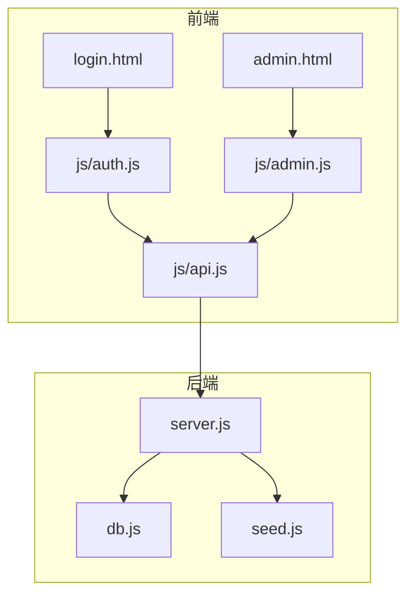
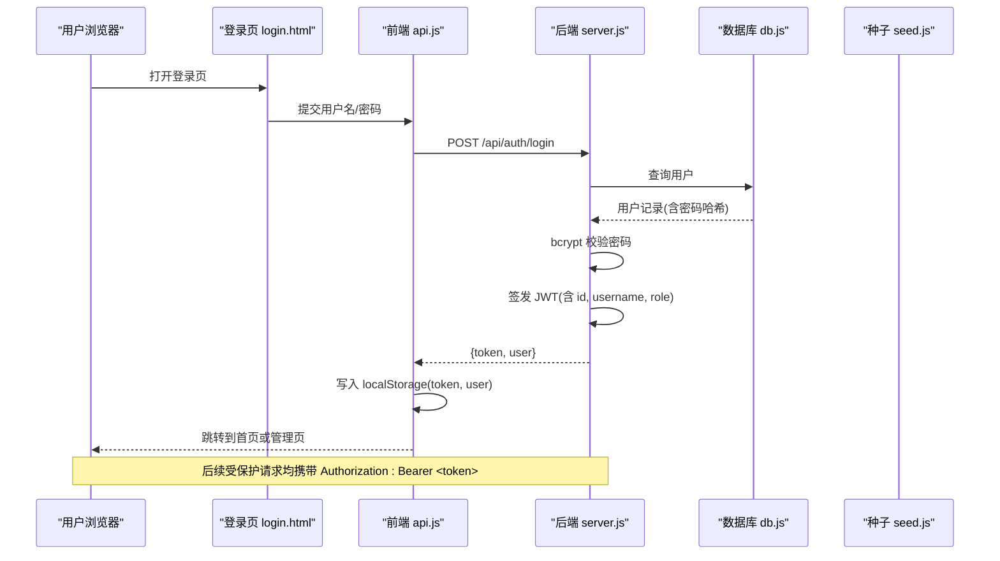
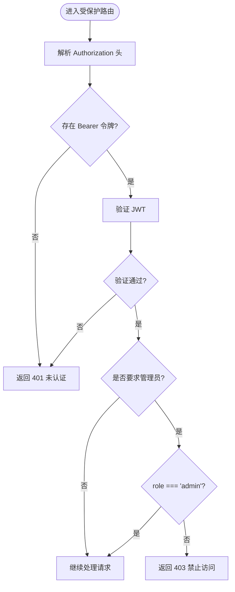
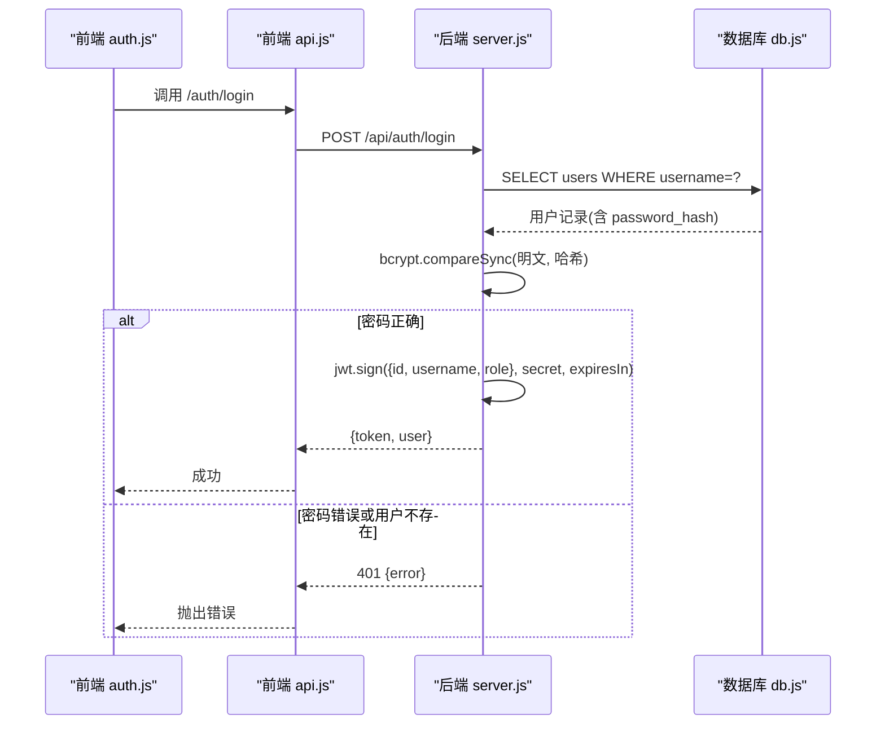
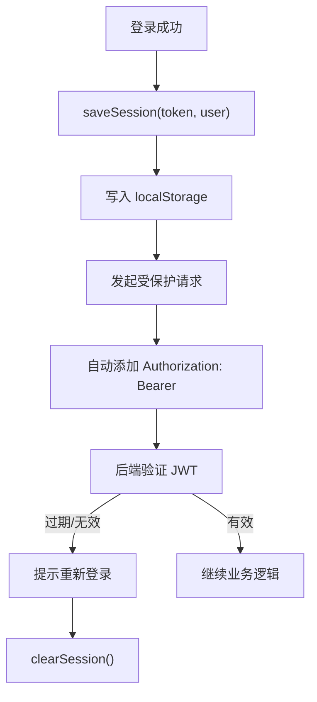
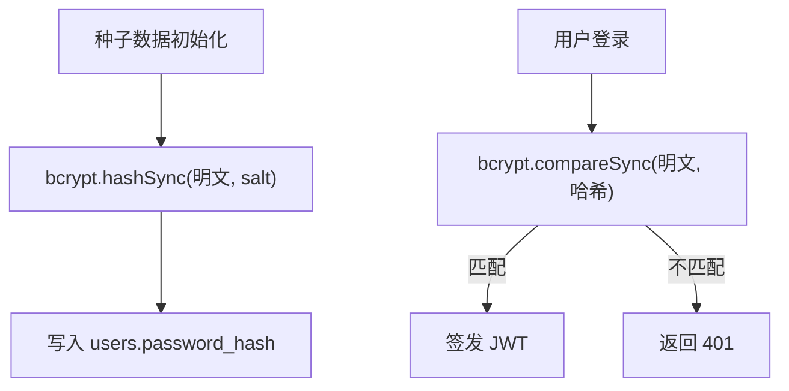
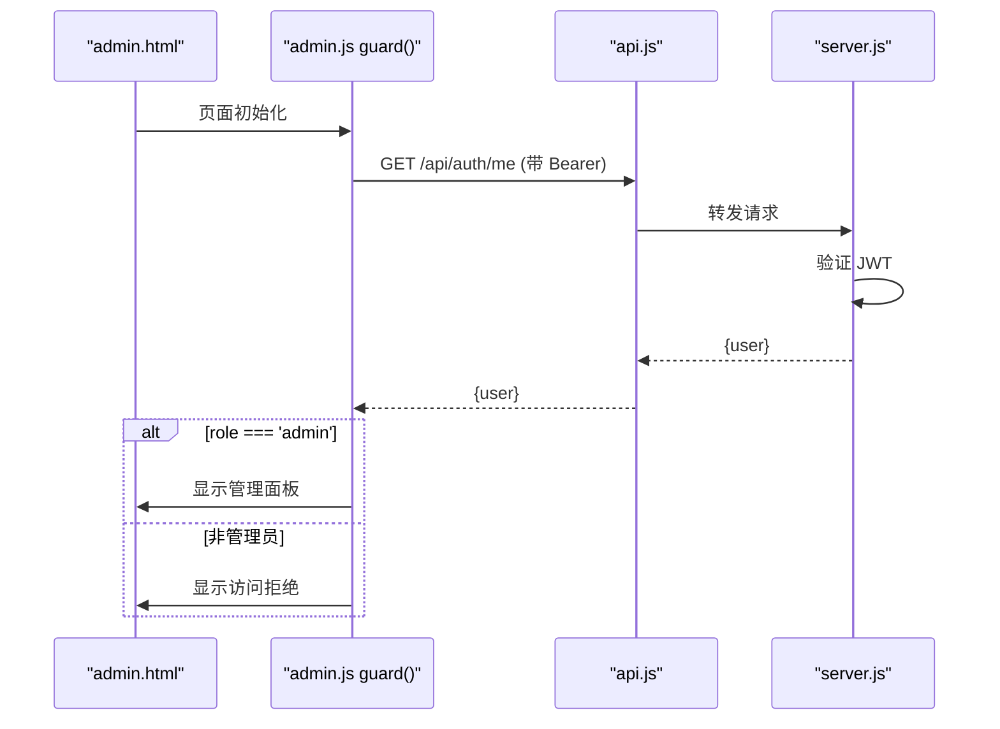
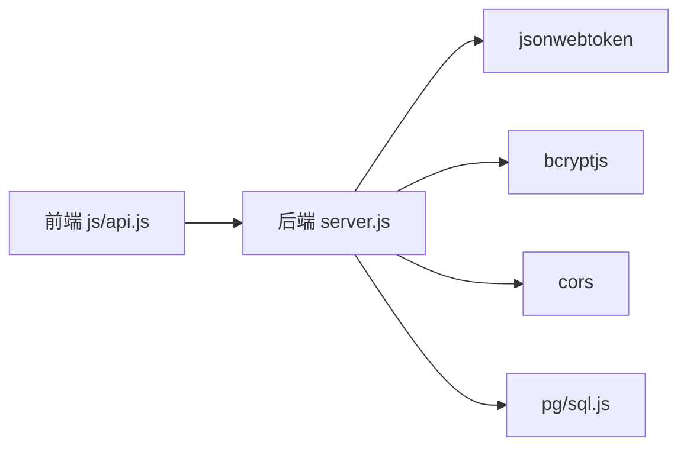

# 认证授权架构

<cite>
**本文引用的文件**
- [backend/server.js](file://backend/server.js)
- [backend/db.js](file://backend/db.js)
- [backend/seed.js](file://backend/seed.js)
- [backend/package.json](file://backend/package.json)
- [frontend/js/api.js](file://frontend/js/api.js)
- [frontend/js/auth.js](file://frontend/js/auth.js)
- [frontend/js/admin.js](file://frontend/js/admin.js)
- [frontend/login.html](file://frontend/login.html)
- [frontend/admin.html](file://frontend/admin.html)
</cite>

## 目录
1. [简介](#简介)
2. [项目结构](#项目结构)
3. [核心组件](#核心组件)
4. [架构总览](#架构总览)
5. [详细组件分析](#详细组件分析)
6. [依赖关系分析](#依赖关系分析)
7. [性能与可扩展性](#性能与可扩展性)
8. [故障排查指南](#故障排查指南)
9. [结论](#结论)
10. [附录](#附录)

## 简介
本文件为 LeapShop 项目的认证与授权架构文档，聚焦以下目标：
- 基于 JWT 的无状态认证机制：令牌生成、验证、刷新策略说明。
- 角色基础访问控制（RBAC）：普通用户与管理员权限划分。
- 认证中间件原理：Bearer 令牌解析、JWT 校验、用户信息提取。
- 前端令牌存储策略：localStorage 使用方式与安全注意事项。
- 密码加密存储：使用 bcryptjs 的安全哈希方案。
- 会话管理、令牌过期处理与统一错误响应格式。
- 完整认证流程图与权限检查示例，以及常见安全攻击防护建议。

## 项目结构
后端采用 Express 提供 REST API，包含认证、商品管理等接口；数据库抽象层支持 PostgreSQL（生产）与 SQLite（开发回退）。前端通过原生 JS 模块调用 API，使用 localStorage 保存令牌和用户信息，并在页面中执行鉴权守卫。

图表来源
- [backend/server.js:1-169](file://backend/server.js#L1-L169)
- [backend/db.js:1-176](file://backend/db.js#L1-L176)
- [backend/seed.js:1-129](file://backend/seed.js#L1-L129)
- [frontend/js/api.js:1-76](file://frontend/js/api.js#L1-L76)
- [frontend/js/auth.js:1-30](file://frontend/js/auth.js#L1-L30)
- [frontend/js/admin.js:1-182](file://frontend/js/admin.js#L1-L182)
- [frontend/login.html:1-39](file://frontend/login.html#L1-L39)
- [frontend/admin.html:1-97](file://frontend/admin.html#L1-L97)

章节来源
- [backend/server.js:1-169](file://backend/server.js#L1-L169)
- [backend/db.js:1-176](file://backend/db.js#L1-L176)
- [backend/seed.js:1-129](file://backend/seed.js#L1-L129)
- [frontend/js/api.js:1-76](file://frontend/js/api.js#L1-L76)
- [frontend/js/auth.js:1-30](file://frontend/js/auth.js#L1-L30)
- [frontend/js/admin.js:1-182](file://frontend/js/admin.js#L1-L182)
- [frontend/login.html:1-39](file://frontend/login.html#L1-L39)
- [frontend/admin.html:1-97](file://frontend/admin.html#L1-L97)

## 核心组件
- 认证服务（后端）
  - 登录接口：校验用户名与密码，返回 JWT 令牌与用户基本信息。
  - 当前用户接口：受保护，需携带有效 Bearer 令牌。
  - 认证中间件：从 Authorization 头解析 Bearer 令牌并验证 JWT。
  - 管理员中间件：仅允许 role 为 admin 的用户访问。
- 数据层
  - 数据库抽象：PostgreSQL 或 SQLite，统一 query/run 接口。
  - 种子数据：预置管理员与普通用户，密码经 bcrypt 哈希存储。
- 前端客户端
  - 统一请求封装：自动附加 Authorization 头，统一错误抛出。
  - 会话管理：在 localStorage 中持久化令牌与用户信息。
  - 页面守卫：登录页提交后跳转；管理后台入口进行角色校验。

章节来源
- [backend/server.js:25-64](file://backend/server.js#L25-L64)
- [backend/db.js:112-176](file://backend/db.js#L112-L176)
- [backend/seed.js:87-114](file://backend/seed.js#L87-L114)
- [frontend/js/api.js:18-49](file://frontend/js/api.js#L18-L49)
- [frontend/js/auth.js:9-25](file://frontend/js/auth.js#L9-L25)
- [frontend/js/admin.js:11-34](file://frontend/js/admin.js#L11-L34)

## 架构总览
下图展示了从前端登录到后端鉴权的端到端流程，包括令牌颁发、存储、后续请求携带与权限校验。

图表来源
- [frontend/login.html:16-33](file://frontend/login.html#L16-L33)
- [frontend/js/auth.js:9-25](file://frontend/js/auth.js#L9-L25)
- [frontend/js/api.js:40-49](file://frontend/js/api.js#L40-L49)
- [backend/server.js:44-64](file://backend/server.js#L44-L64)
- [backend/db.js:112-176](file://backend/db.js#L112-L176)
- [backend/seed.js:87-114](file://backend/seed.js#L87-L114)

## 详细组件分析

### 认证中间件与 RBAC
- 认证中间件
  - 从 Authorization 头提取 Bearer 令牌。
  - 使用服务端密钥验证 JWT，失败则返回未认证错误。
  - 将解码后的用户信息挂载到 req.user。
- 管理员中间件
  - 检查 req.user.role 是否为 admin，否则返回禁止访问错误。
- 路由级权限控制
  - 读接口公开（如商品列表、详情）。
  - 写接口（新增、更新、删除）需要 authRequired + adminOnly。

图表来源
- [backend/server.js:25-41](file://backend/server.js#L25-L41)
- [backend/server.js:86-135](file://backend/server.js#L86-L135)

章节来源
- [backend/server.js:25-41](file://backend/server.js#L25-L41)
- [backend/server.js:86-135](file://backend/server.js#L86-L135)

### 登录与令牌签发
- 登录流程
  - 前端提交用户名与密码。
  - 后端查询用户，使用 bcrypt 比对密码哈希。
  - 通过后签发 JWT，载荷包含 id、username、role，设置过期时间。
  - 返回 token 与精简用户信息给前端。
- 令牌有效期
  - 默认 12 小时（可配置环境变量）。
  - 过期后中间件会拒绝请求，前端应引导重新登录。

图表来源
- [frontend/js/auth.js:9-25](file://frontend/js/auth.js#L9-L25)
- [frontend/js/api.js:40-49](file://frontend/js/api.js#L40-L49)
- [backend/server.js:44-64](file://backend/server.js#L44-L64)
- [backend/db.js:112-176](file://backend/db.js#L112-L176)

章节来源
- [backend/server.js:44-64](file://backend/server.js#L44-L64)
- [backend/db.js:112-176](file://backend/db.js#L112-L176)
- [frontend/js/auth.js:9-25](file://frontend/js/auth.js#L9-L25)
- [frontend/js/api.js:40-49](file://frontend/js/api.js#L40-L49)

### 令牌存储与会话管理（前端）
- 存储位置
  - 使用 localStorage 保存令牌与用户信息键值对。
- 生命周期
  - 登录成功后写入；退出时清除。
  - 每次请求自动附加 Authorization 头。
- 安全注意
  - localStorage 易受 XSS 影响，应避免注入脚本。
  - 生产环境建议结合 SameSite Cookie + HttpOnly 提升安全性。
  - 令牌过期由后端强制拒绝，前端应在导航前检测有效性。

图表来源
- [frontend/js/api.js:18-49](file://frontend/js/api.js#L18-L49)
- [frontend/js/auth.js:9-25](file://frontend/js/auth.js#L9-L25)
- [backend/server.js:25-36](file://backend/server.js#L25-L36)

章节来源
- [frontend/js/api.js:18-49](file://frontend/js/api.js#L18-L49)
- [frontend/js/auth.js:9-25](file://frontend/js/auth.js#L9-L25)
- [backend/server.js:25-36](file://backend/server.js#L25-L36)

### 密码加密存储
- 算法
  - 使用 bcryptjs 对密码进行哈希存储。
- 注册/初始化
  - 种子脚本创建初始账户时，对明文密码进行哈希后再入库。
- 登录校验
  - 登录时使用 bcrypt.compareSync 比对明文与哈希。

图表来源
- [backend/seed.js:87-114](file://backend/seed.js#L87-L114)
- [backend/server.js:44-64](file://backend/server.js#L44-L64)

章节来源
- [backend/seed.js:87-114](file://backend/seed.js#L87-L114)
- [backend/server.js:44-64](file://backend/server.js#L44-L64)

### 管理员面板与权限守卫
- 前端守卫
  - 管理页面加载时先获取当前用户信息，校验 role 是否为 admin。
  - 非管理员显示“访问被拒绝”提示，阻止进入管理面板。
- 后端守卫
  - 所有写操作路由均挂载 authRequired 与 adminOnly 中间件。

图表来源
- [frontend/js/admin.js:11-34](file://frontend/js/admin.js#L11-L34)
- [frontend/js/api.js:40-49](file://frontend/js/api.js#L40-L49)
- [backend/server.js:62-64](file://backend/server.js#L62-L64)
- [backend/server.js:86-135](file://backend/server.js#L86-L135)

章节来源
- [frontend/js/admin.js:11-34](file://frontend/js/admin.js#L11-L34)
- [backend/server.js:86-135](file://backend/server.js#L86-L135)

### 错误响应格式
- 统一错误体
  - 后端返回 JSON 对象，包含 error 字段描述错误原因。
- 常见状态码
  - 400：参数缺失或非法。
  - 401：未认证或会话过期。
  - 403：权限不足（非管理员尝试写操作）。
  - 404：资源不存在。
- 前端处理
  - 统一请求封装在 res.ok 为 false 时抛出错误，错误消息来自 data.error。

章节来源
- [backend/server.js:44-64](file://backend/server.js#L44-L64)
- [backend/server.js:86-135](file://backend/server.js#L86-L135)
- [frontend/js/api.js:40-49](file://frontend/js/api.js#L40-L49)

### 令牌刷新策略
- 现状
  - 当前实现未提供专门的刷新接口；令牌有效期固定（默认 12 小时）。
- 建议方案
  - 引入 refresh_token 机制：访问令牌短时效，刷新令牌长时效且安全存储于 HttpOnly Cookie。
  - 提供 /api/auth/refresh 接口，使用刷新令牌换取新访问令牌。
  - 前端在收到 401 时尝试刷新，若仍失败则引导重新登录。

[本节为概念性建议，不直接分析具体代码文件]

## 依赖关系分析
- 后端依赖
  - express：Web 框架。
  - jsonwebtoken：JWT 签发与验证。
  - bcryptjs：密码哈希与校验。
  - cors：跨域支持。
  - pg/sql.js：数据库驱动（PostgreSQL 或 SQLite）。
- 前端依赖
  - 原生 fetch：网络请求。
  - localStorage：令牌与用户信息持久化。

图表来源
- [backend/package.json:14-21](file://backend/package.json#L14-L21)
- [backend/server.js:7-15](file://backend/server.js#L7-L15)
- [frontend/js/api.js:40-49](file://frontend/js/api.js#L40-L49)

章节来源
- [backend/package.json:14-21](file://backend/package.json#L14-L21)
- [backend/server.js:7-15](file://backend/server.js#L7-L15)
- [frontend/js/api.js:40-49](file://frontend/js/api.js#L40-L49)

## 性能与可扩展性
- 无状态认证
  - JWT 无需服务端会话存储，便于水平扩展。
- 数据库连接池
  - PostgreSQL 使用连接池，提高并发能力。
- 静态资源
  - 单服务模式可直接托管前端静态文件，减少部署复杂度。
- 优化建议
  - 增加速率限制防止暴力破解。
  - 引入刷新令牌机制降低频繁登录成本。
  - 对敏感接口增加审计日志。

[本节提供通用指导，不直接分析具体代码文件]

## 故障排查指南
- 无法登录
  - 检查用户名与密码是否正确，确认种子数据已初始化。
  - 查看后端日志与数据库记录是否存在对应用户。
- 401 未认证
  - 确认请求头包含正确的 Authorization: Bearer <token>。
  - 检查 JWT 是否过期或被篡改。
- 403 禁止访问
  - 确认当前用户 role 是否为 admin。
  - 检查路由是否挂载了 adminOnly 中间件。
- 前端报错
  - 查看 api.js 的错误抛出逻辑，定位后端返回的 error 字段。
  - 检查 localStorage 中是否存有有效的 token 与 user。

章节来源
- [backend/server.js:25-64](file://backend/server.js#L25-L64)
- [backend/server.js:86-135](file://backend/server.js#L86-L135)
- [frontend/js/api.js:40-49](file://frontend/js/api.js#L40-L49)
- [frontend/js/admin.js:11-34](file://frontend/js/admin.js#L11-L34)

## 结论
LeapShop 实现了基于 JWT 的无状态认证与基于角色的访问控制。后端通过中间件完成令牌解析与权限校验，前端通过统一的 API 客户端自动携带令牌并进行会话管理。密码采用 bcrypt 安全哈希存储。当前未实现刷新令牌机制，建议在生产环境中引入刷新令牌与更安全的存储策略以提升安全性与用户体验。

[本节总结性内容，不直接分析具体代码文件]

## 附录

### 安全攻击防护策略
- 防暴力破解
  - 增加登录频率限制与账号锁定策略。
- 防 XSS
  - 前端对用户输入进行转义渲染（已有 escapeHtml 工具）。
  - 避免在 localStorage 中存储敏感数据，必要时使用 HttpOnly Cookie。
- 防 CSRF
  - 使用 SameSite Cookie 与 CSRF Token（若切换为 Cookie 存储令牌）。
- 防重放攻击
  - 为关键操作增加一次性令牌或签名。
- 最小权限原则
  - 严格区分角色，仅授予必要权限。
- 安全传输
  - 生产环境强制 HTTPS，确保令牌与敏感数据传输安全。

[本节为通用安全建议，不直接分析具体代码文件]