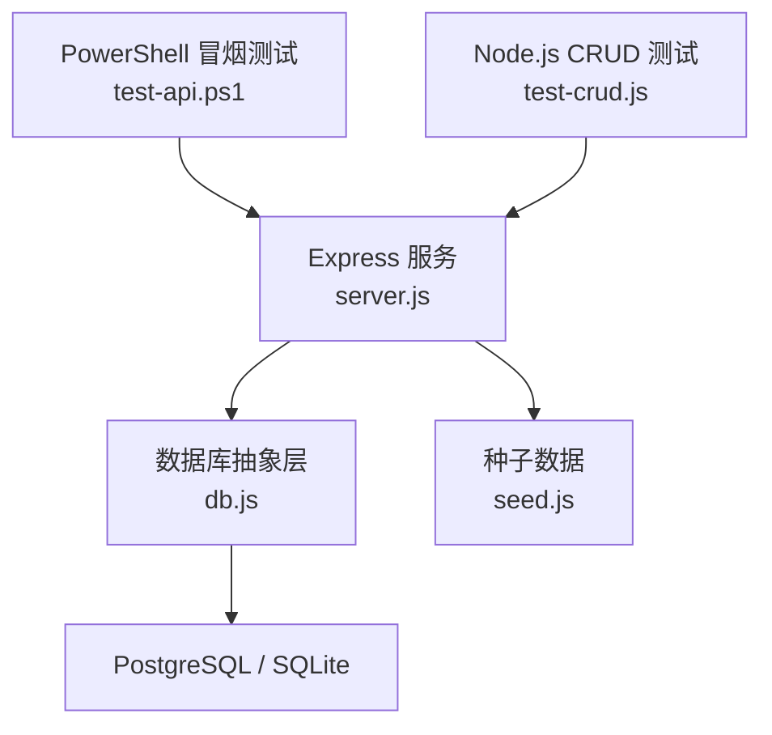
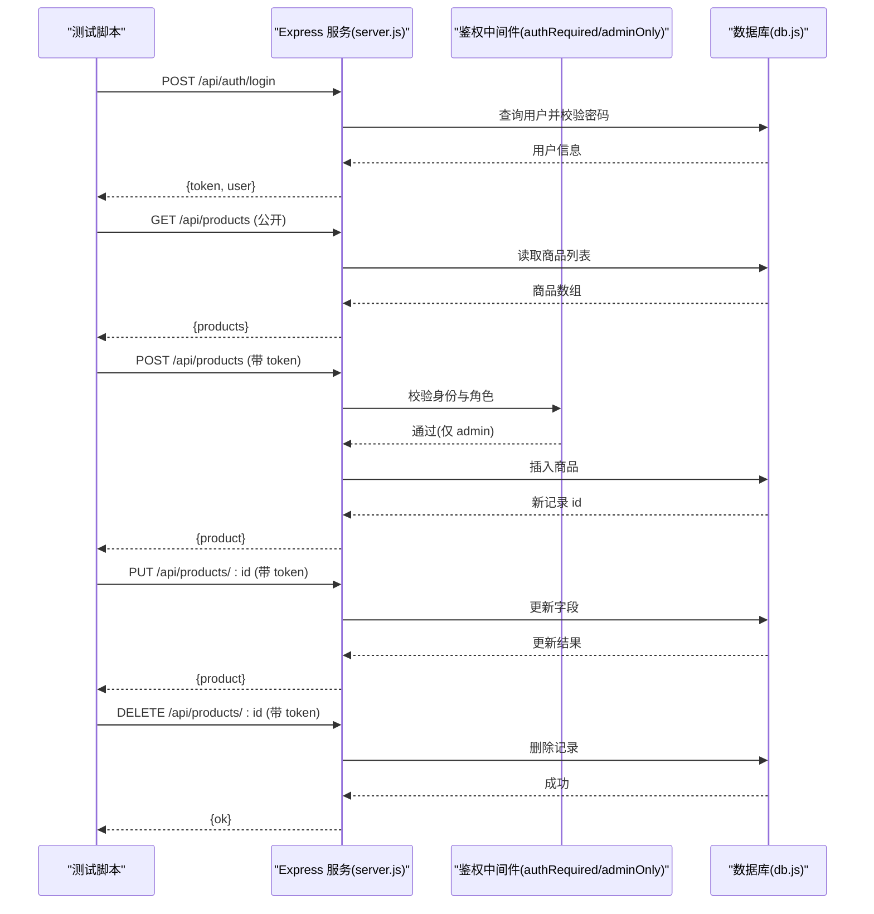
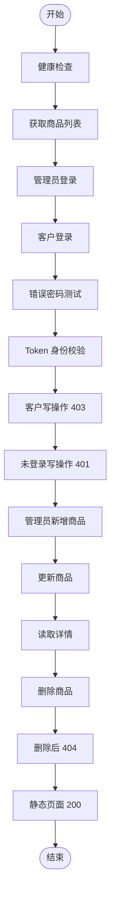
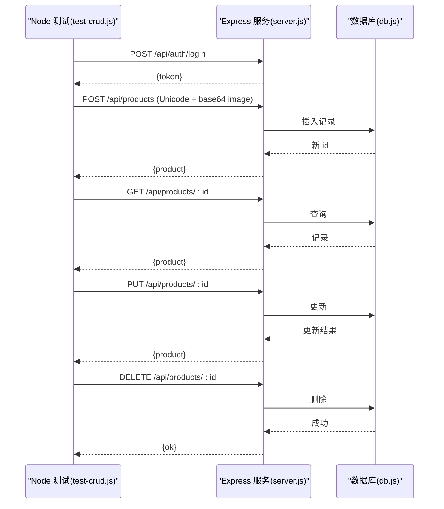
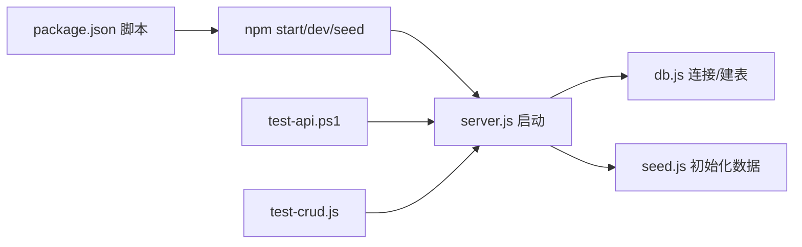

# 测试指南

<cite>
**本文引用的文件**
- [backend/test-api.ps1](file://backend/test-api.ps1)
- [backend/test-crud.js](file://backend/test-crud.js)
- [backend/server.js](file://backend/server.js)
- [backend/db.js](file://backend/db.js)
- [backend/seed.js](file://backend/seed.js)
- [backend/package.json](file://backend/package.json)
- [README.md](file://README.md)
</cite>

## 目录
1. [简介](#简介)
2. [项目结构](#项目结构)
3. [核心组件](#核心组件)
4. [架构总览](#架构总览)
5. [详细组件分析](#详细组件分析)
6. [依赖关系分析](#依赖关系分析)
7. [性能与负载测试建议](#性能与负载测试建议)
8. [故障排查指南](#故障排查指南)
9. [结论](#结论)
10. [附录：新测试用例编写指南](#附录：新测试用例编写指南)

## 简介
本指南面向 LeapShop（LeapChess）项目的测试实践，聚焦于现有 API 冒烟测试与 CRUD 测试脚本的使用方法、执行流程、覆盖范围与设计思路。文档同时提供扩展新测试用例的规范、自动化与持续集成配置建议，以及性能与负载测试方案、测试结果分析与问题定位方法，帮助团队在本地与 CI 环境中稳定、高效地验证后端服务。

## 项目结构
后端采用 Express + JWT 认证与角色权限中间件，数据库支持 PostgreSQL（生产）或 SQLite（开发回退）。测试相关脚本位于 backend 目录：
- PowerShell 冒烟测试：test-api.ps1
- Node.js 中文数据 CRUD 测试：test-crud.js
- 服务端入口：server.js（含路由、鉴权、静态托管）
- 数据库抽象层：db.js（PostgreSQL/sql.js 双驱动）
- 种子数据：seed.js（幂等初始化用户与商品）
- 包管理：package.json（启动脚本与环境要求）

图表来源
- [backend/test-api.ps1:1-101](file://backend/test-api.ps1#L1-L101)
- [backend/test-crud.js:1-54](file://backend/test-crud.js#L1-L54)
- [backend/server.js:1-169](file://backend/server.js#L1-L169)
- [backend/db.js:1-176](file://backend/db.js#L1-L176)
- [backend/seed.js:1-129](file://backend/seed.js#L1-L129)

章节来源
- [README.md:1-127](file://README.md#L1-L127)
- [backend/package.json:1-23](file://backend/package.json#L1-L23)

## 核心组件
- 认证与授权
  - 登录接口返回 JWT；后续写操作需携带 Authorization: Bearer <token>
  - 管理员角色可写；客户角色写操作返回 403；未登录写操作返回 401
- 商品 CRUD
  - 列表与详情公开可读；新增/更新/删除需管理员权限
- 健康检查
  - /api/health 返回状态与数据库类型，便于容器编排与健康探针
- 前端静态托管
  - 单服务模式同时托管 frontend 静态资源，便于端到端验证

章节来源
- [backend/server.js:25-135](file://backend/server.js#L25-L135)
- [backend/server.js:137-149](file://backend/server.js#L137-L149)

## 架构总览
下图展示了测试脚本与服务端的交互路径，包括认证、权限校验与数据持久化。

图表来源
- [backend/server.js:44-135](file://backend/server.js#L44-L135)
- [backend/db.js:44-109](file://backend/db.js#L44-L109)

## 详细组件分析

### 冒烟测试（PowerShell）
- 目标：快速验证服务可用性、认证流程、权限控制、基础 CRUD 与静态页面托管
- 关键步骤
  - 健康检查：确认服务与数据库连通
  - 公开读：获取商品列表并校验数量
  - 认证：管理员与客户分别登录，获取 token
  - 错误场景：错误密码拒绝访问
  - 身份校验：使用 token 获取当前用户
  - 权限控制：客户尝试写操作应被拒绝；未登录写操作应被拒绝
  - 管理员写：新增、更新、详情、删除商品，并验证删除后 404
  - 静态托管：首页、登录页、管理后台返回 200
- 断言策略
  - 以 HTTP 状态码与响应体关键字段作为断言依据
  - 统计通过/失败数，并以退出码反映整体结果

图表来源
- [backend/test-api.ps1:32-97](file://backend/test-api.ps1#L32-L97)

章节来源
- [backend/test-api.ps1:1-101](file://backend/test-api.ps1#L1-L101)

### 中文数据 CRUD 测试（Node.js）
- 目标：验证 Unicode 内容、base64 图片字段的读写一致性
- 关键步骤
  - 登录获取 token
  - 创建包含 Unicode 描述与 base64 图片的商品
  - 读取并校验内容与图片一致
  - 更新部分字段并校验
  - 删除并验证状态码
- 断言策略
  - 基于响应状态码与字段值进行精确匹配
  - 以退出码汇总测试结果

图表来源
- [backend/test-crud.js:1-54](file://backend/test-crud.js#L1-L54)
- [backend/server.js:87-135](file://backend/server.js#L87-L135)
- [backend/db.js:44-109](file://backend/db.js#L44-L109)

章节来源
- [backend/test-crud.js:1-54](file://backend/test-crud.js#L1-L54)

### 认证与权限设计
- 认证流程
  - 登录接口校验用户名与密码哈希，签发 JWT
  - 后续请求通过中间件解析 Authorization 头并验签
- 权限控制
  - 写操作需管理员角色；非管理员返回 403
  - 未携带有效 token 返回 401
- 测试覆盖
  - 正确登录、错误密码、Token 身份校验、角色差异（客户 vs 管理员）、未登录拦截

章节来源
- [backend/server.js:25-64](file://backend/server.js#L25-L64)
- [backend/server.js:87-135](file://backend/server.js#L87-L135)

### 数据模型与持久化
- 表结构
  - users：id、username、password_hash、role、created_at
  - products：id、name、category、price、description、image、stock、created_at、updated_at
- 驱动选择
  - 检测到 DATABASE_URL/PGHOST 使用 PostgreSQL；否则使用 SQLite（sql.js），并在写操作后落盘
- 测试影响
  - 两种数据库行为一致，测试无需区分；但需注意 SQLite 文件位置与持久化策略

章节来源
- [backend/db.js:112-158](file://backend/db.js#L112-L158)
- [backend/db.js:44-109](file://backend/db.js#L44-L109)

## 依赖关系分析
- 测试脚本依赖后端服务运行且端口可达
- 服务依赖数据库连接与种子数据
- 环境变量影响行为：PORT、JWT_SECRET、DATABASE_URL/PGHOST

图表来源
- [backend/package.json:6-9](file://backend/package.json#L6-L9)
- [backend/server.js:151-168](file://backend/server.js#L151-L168)
- [backend/db.js:44-109](file://backend/db.js#L44-L109)
- [backend/seed.js:87-114](file://backend/seed.js#L87-L114)

章节来源
- [backend/package.json:1-23](file://backend/package.json#L1-L23)

## 性能与负载测试建议
- 工具选型
  - k6：适合编写脚本化的负载与性能测试，易于集成到 CI
  - Artillery：轻量级 CLI 工具，适合快速压测
  - JMeter：图形化界面，适合复杂场景建模
- 关注指标
  - 吞吐量（RPS）、P95/P99 延迟、错误率、CPU/内存占用
- 建议场景
  - 并发登录与 Token 校验
  - 高并发商品列表读取
  - 混合读写（管理员批量写入 + 普通用户读取）
- 环境准备
  - 使用独立数据库实例与隔离网络
  - 预热缓存与连接池，避免冷启动偏差
- 结果采集
  - 导出 JSON/CSV 报告，结合监控（Prometheus/Grafana）观察系统资源

[本节为通用指导，不直接分析具体代码文件]

## 故障排查指南
- 常见问题
  - 端口冲突：确保 PORT 未被占用
  - 数据库不可用：检查 DATABASE_URL/PGHOST 或 SQLite 文件权限
  - 认证失败：核对 JWT_SECRET 与种子用户密码
  - 权限错误：确认角色与请求是否携带有效 token
- 定位方法
  - 查看服务日志输出（启动、健康检查、错误堆栈）
  - 使用 curl/浏览器直接调用接口，对比测试脚本行为
  - 逐步缩小范围：先健康检查，再认证，最后业务接口
- 参考实现
  - 健康检查与错误响应格式统一，便于自动化判断

章节来源
- [backend/server.js:137-168](file://backend/server.js#L137-L168)

## 结论
现有测试脚本覆盖了服务的核心路径：健康检查、认证、权限控制、商品 CRUD 与静态托管。建议在 CI 中引入这些脚本作为质量门禁，并结合性能与负载测试保障稳定性与可扩展性。通过统一的断言与退出码机制，可快速识别回归问题并定位根因。

[本节为总结性内容，不直接分析具体代码文件]

## 附录：新测试用例编写指南

### 测试环境搭建
- 安装依赖并启动服务
  - 进入 backend 目录，安装依赖并启动服务
  - 使用 npm 脚本启动服务与种子数据
- 验证服务可用
  - 调用健康检查接口确认数据库连通

章节来源
- [backend/package.json:6-9](file://backend/package.json#L6-L9)
- [backend/server.js:151-168](file://backend/server.js#L151-L168)

### 模拟数据准备
- 使用种子数据
  - 首次启动会自动创建演示账户与占位商品
- 自定义数据
  - 可在测试前通过 API 创建临时数据，或在测试后清理

章节来源
- [backend/seed.js:87-114](file://backend/seed.js#L87-L114)

### 断言与验证
- 状态码断言
  - 200/201/401/403/404 等按预期返回
- 响应体断言
  - 关键字段存在性与值匹配（如用户名、角色、商品名、价格等）
- 边界与异常
  - 空参数、非法字符、超长字段、重复提交等

### 编写新测试的步骤
- 明确需求与前置条件
- 选择合适脚本语言（PowerShell/Node.js）
- 封装请求函数，统一处理 headers 与错误
- 组织用例顺序，保证幂等与可恢复
- 添加断言与日志输出，统计通过/失败
- 在 CI 中执行并生成报告

### 持续集成配置建议
- 触发时机
  - push/PR 时运行冒烟与 CRUD 测试
- 环境准备
  - 安装 Node 依赖，启动服务，等待健康检查通过
- 执行与上报
  - 运行 test-api.ps1 与 test-crud.js，收集退出码与日志
  - 将结果上传至 CI 平台（如 GitHub Actions、GitLab CI）

[本节为通用指导，不直接分析具体代码文件]