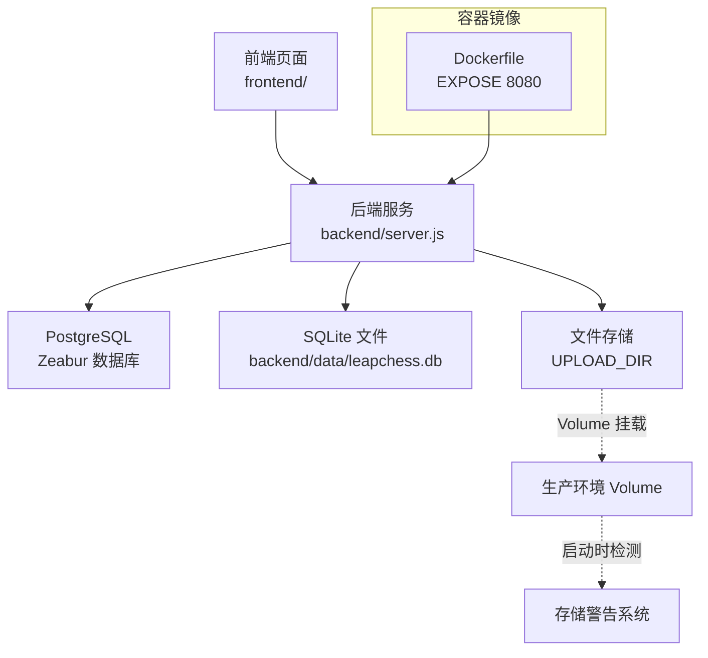
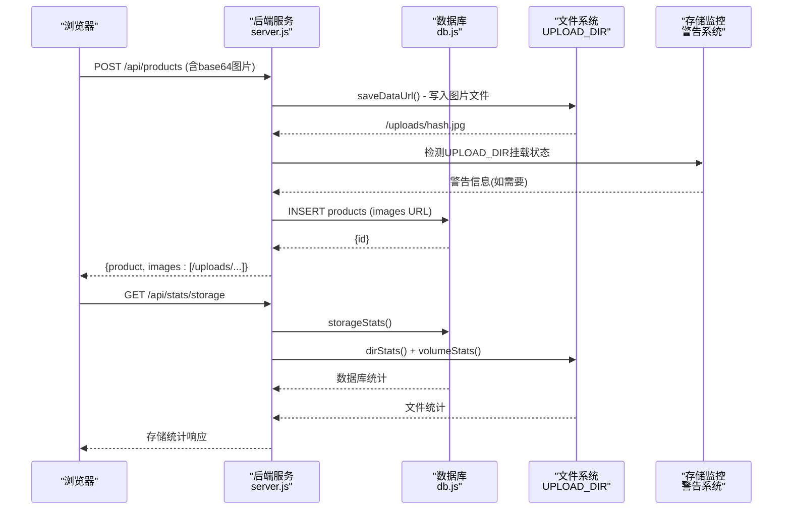
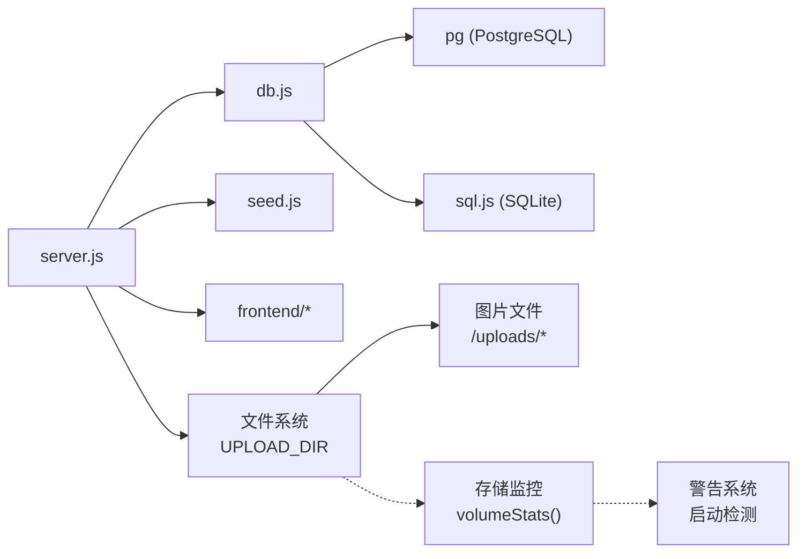

# 部署指南

<cite>
**本文引用的文件**
- [README.md](file://README.md)
- [Dockerfile](file://Dockerfile)
- [backend/package.json](file://backend/package.json)
- [backend/server.js](file://backend/server.js)
- [backend/db.js](file://backend/db.js)
- [backend/seed.js](file://backend/seed.js)
- [frontend/index.html](file://frontend/index.html)
- [frontend/login.html](file://frontend/login.html)
- [frontend/admin.html](file://frontend/admin.html)
- [frontend/js/api.js](file://frontend/js/api.js)
- [frontend/js/admin.js](file://frontend/js/admin.js)
</cite>

## 更新摘要
**所做更改**
- 增强了生产环境UPLOAD_DIR配置警告系统，新增临时文件系统检测和Volume挂载验证
- 完善了Zeabur平台部署流程，强调Volume挂载的重要性和配置步骤
- 增强了存储监控功能，支持图片文件和数据库的统一统计与可视化展示
- 更新了故障排除指南，包含新的存储监控指导和Volume配置问题解决方案
- 改进了前后端分离方案的存储配置说明

## 目录
1. [简介](#简介)
2. [项目结构](#项目结构)
3. [核心组件](#核心组件)
4. [架构总览](#架构总览)
5. [详细组件分析](#详细组件分析)
6. [依赖关系分析](#依赖关系分析)
7. [性能与安全建议](#性能与安全建议)
8. [故障排除指南](#故障排除指南)
9. [结论](#结论)
10. [附录：CI/CD与环境变量管理建议](#附录cicd与环境变量管理建议)

## 简介
本指南面向LeapShop（国际象棋主题全栈应用）的本地开发、容器化与Zeabur平台部署，覆盖Node.js环境搭建、依赖安装与服务启动；详细说明Docker镜像构建与健康检查；提供Zeabur环境变量配置、数据库连接、域名绑定与文件存储配置；并给出生产环境安全、性能与监控的最佳实践及常见问题排查方法。

**已更新** 新增了生产环境文件存储警告系统和增强的存储监控功能，帮助开发者及时发现和解决存储配置问题，确保数据持久化的安全性。

## 项目结构
- 前端：原生HTML/CSS/JS，单服务模式由后端托管静态资源，便于一键部署。
- 后端：Express + JWT认证与权限中间件，统一API路由，支持PostgreSQL或SQLite回退，集成文件存储服务。
- 数据库：检测到DATABASE_URL/PGHOST/POSTGRES_URI/POSTGRES_HOST则使用PostgreSQL；否则自动回退到本地SQLite（sql.js）。
- 文件存储：通过UPLOAD_DIR环境变量配置图片文件存储路径，支持本地开发和生产环境Volume挂载，具备智能警告机制。
- 容器化：基于node:20-alpine的单服务镜像，暴露端口8080，内置健康检查。



**图示来源**
- [Dockerfile:1-26](file://Dockerfile#L1-L26)
- [backend/server.js:22-24](file://backend/server.js#L22-L24)
- [backend/server.js:296](file://backend/server.js#L296)
- [backend/db.js:12-110](file://backend/db.js#L12-L110)
- [backend/server.js:392-403](file://backend/server.js#L392-L403)

**章节来源**
- [README.md:6-20](file://README.md#L6-L20)
- [Dockerfile:1-26](file://Dockerfile#L1-L26)

## 核心组件
- 后端入口与路由：Express应用、认证中间件、商品CRUD、健康检查、静态前端托管、文件存储服务。
- 数据库抽象层：根据环境变量选择PostgreSQL或SQLite，统一query/run接口，建表与种子数据初始化。
- 文件存储系统：支持base64图片上传、内容哈希命名、自动去重、URL访问、存储空间统计。
- 存储监控模块：实时统计数据库和图片文件占用，检测Volume挂载状态，提供容量监控。
- 前端API客户端：自动探测同源API地址、Token管理与请求封装。
- 容器镜像：多阶段缓存依赖、暴露端口、健康检查、启动命令。

**章节来源**
- [backend/server.js:1-411](file://backend/server.js#L1-L411)
- [backend/db.js:1-240](file://backend/db.js#L1-L240)
- [frontend/js/api.js:1-76](file://frontend/js/api.js#L1-L76)
- [frontend/js/admin.js:39-71](file://frontend/js/admin.js#L39-L71)
- [Dockerfile:1-26](file://Dockerfile#L1-L26)

## 架构总览
应用采用"单服务"模式：后端同时提供REST API与静态前端资源，简化部署。生产环境推荐PostgreSQL，本地开发可零配置使用SQLite。新增的文件存储系统支持图片等二进制文件的持久化存储，并具备智能警告机制和存储监控功能。



**图示来源**
- [backend/server.js:72-89](file://backend/server.js#L72-L89)
- [backend/server.js:208-233](file://backend/server.js#L208-L233)
- [backend/server.js:330-350](file://backend/server.js#L330-L350)
- [backend/server.js:392-403](file://backend/server.js#L392-L403)

## 详细组件分析

### 本地开发环境搭建
- Node.js版本要求：>=18（见package engines）。
- 进入backend目录，安装依赖并启动服务。
- 首次启动会自动建表并写入种子数据（管理员P001与客户C001）。
- 访问http://localhost:3000即可看到首页与管理后台入口。
- 图片文件默认存储在backend/data/uploads目录。

步骤要点
- 安装依赖：npm install
- 启动服务：npm start
- 验证健康检查：GET http://localhost:3000/api/health
- 冒烟测试：运行提供的测试脚本（可选）
- 图片存储：上传的图片保存在backend/data/uploads目录

**章节来源**
- [backend/package.json:11-12](file://backend/package.json#L11-L12)
- [backend/server.js:327-330](file://backend/server.js#L327-L330)
- [backend/seed.js:87-114](file://backend/seed.js#L87-L114)
- [README.md:30-52](file://README.md#L30-L52)

### Docker容器化与镜像管理
- 基础镜像：node:20-alpine
- 工作目录：/app/backend
- 依赖层缓存：先复制package.json与lock文件再安装依赖
- 代码与前端静态资源：分别复制到镜像中
- 环境变量：NODE_ENV=production，PORT=8080
- 健康检查：每30秒探测/api/health
- 启动命令：node server.js

构建与运行
- 构建镜像：docker build -t leapshop .
- 本地运行：docker run -p 8080:8080 --env DATABASE_URL=... -v leap-data:/data leapshop（挂载整个 /data：SQLite 库、uploads 图片、JWT 密钥一并持久化）
- 健康检查：容器内通过wget探测/api/health
- 文件持久化：通过Volume挂载实现图片文件持久化

**章节来源**
- [Dockerfile:1-26](file://Dockerfile#L1-L26)
- [backend/server.js:17-23](file://backend/server.js#L17-L23)

### Zeabur平台部署流程

**已更新** 增强了对Zeabur新版本的PostgreSQL环境变量支持和文件存储配置，新增生产环境存储警告系统和Volume挂载检测

#### 数据库服务配置
- 添加数据库服务：在控制台新增PostgreSQL服务。
- 环境变量自动注入支持：
  - **旧版变量**：PGHOST、PGPORT、PGUSER、PGPASSWORD、PGDATABASE
  - **新版变量**：POSTGRES_HOST、POSTGRES_PORT、POSTGRES_USERNAME、POSTGRES_PASSWORD、POSTGRES_DATABASE
  - **连接串变量**：POSTGRES_URI（完整连接字符串）
  - **端口变量**：PORT（默认8080）

#### 环境变量配置选项

**PostgreSQL连接配置**（按优先级排序）
1. `DATABASE_URL`：完整的PostgreSQL连接字符串
2. `POSTGRES_URI`：Zeabur提供的完整连接字符串
3. 分散变量组合：POSTGRES_HOST + POSTGRES_PORT + POSTGRES_USERNAME + POSTGRES_PASSWORD + POSTGRES_DATABASE
4. 兼容旧版：PGHOST + PGPORT + PGUSER + PGPASSWORD + PGDATABASE

**文件存储配置**
- `UPLOAD_DIR`：图片文件存储目录；Dockerfile 已内置 `ENV UPLOAD_DIR=/data/uploads`，通常无需另行配置
- 默认行为：未设置时回退到`backend/data/uploads`
- **重要**：Volume 挂载点必须是 `/data`（而非 `/data/uploads`），SQLite 库与 JWT 密钥才能随图片一同持久化
- 存储特性：内容哈希命名、SHA1 前两位分片目录、自动去重、支持最多10张图片/商品
- **警告**：启动时检测UPLOAD_DIR是否在独立挂载点上，不在则输出警告提示

**SQLite持久化存储**
- `DATA_DIR`：SQLite数据文件存储目录；Dockerfile 已内置 `ENV DATA_DIR=/data`
- 默认行为：未设置时回退到`backend/data/leapchess.db`
- PostgreSQL 模式下该目录仍承载 uploads 与密钥文件，挂载同样必需

**安全配置**
- `JWT_SECRET`：建议使用强随机值；未配置时生产启动自动生成48字节随机密钥并落盘 `/data/.jwt-secret`（0600权限、重启复用），不再拒绝启动
- `PGSSL`：外部托管PostgreSQL时启用SSL连接（true/1/on）

#### 部署步骤
1. Zeabur控制台新建项目 → **Add Service → Database → PostgreSQL**（可选；不建则运行于SQLite模式，依赖 /data 卷持久化）
2. **Add Service → Git**：选择仓库与分支，Zeabur自动识别根目录Dockerfile进行构建
3. 点开应用服务 → **Variables** 页签：配置环境变量（如 JWT_SECRET）
4. **Storage → Add Volume**：添加Volume，挂载点填 `/data`（SQLite 库、上传图片、JWT 密钥一次持久化）
5. **Networking → Generate Domain** 生成 `.zeabur.app` 域名，或绑定自定义域名（自动HTTPS）

#### 启动行为
应用启动时自动：建表 → 写入种子数据 → 创建图片目录 → 检测存储配置 → 监听PORT。每次git push自动重新部署，Volume 内数据不受影响。

**注意事项**
- 内网PG默认不启用SSL；外部托管库可通过PGSSL=true或在URL携带sslmode=require开启SSL。
- 持久化基线：Volume 挂载 `/data`。SQLite 模式下它是唯一持久层（库+图片+密钥）；PostgreSQL 模式下承载图片与密钥。
- 推荐使用新版POSTGRES_*变量以获得更好的兼容性和可维护性。
- 图片文件按内容哈希命名、前两位分片，天然支持去重和迁移幂等。
- **警告系统**：当UPLOAD_DIR不在Volume挂载点上时，启动时会输出警告信息提示数据可能丢失。
- **存储监控**：启动时会检测Volume挂载状态，并在管理界面显示存储使用情况。

#### /data 目录布局与备份机制
```
/data
├── leapchess.db        # SQLite 数据库文件（仅 SQLite 模式）
├── .jwt-secret         # JWT 密钥（未配置 JWT_SECRET 时生成，0600 权限）
└── uploads/            # 全部落盘图片（商品/变体/详情/轮播/LOGO 共用）
    └── <sha1前2位hex>/  # 哈希分片目录（256 桶）
        └── <sha1>.<ext>
```
- 权限策略：密钥文件以0600写入仅属主可读写；其余数据文件默认权限。
- 备份对象：数据库（leapchess.db 或 PG 库）为核心，uploads/ 为增量；图片按内容哈希命名，引用可跨环境幂等重建。
- 备份方式：优先启用 Zeabur 平台卷快照/数据库备份能力；平台无备份能力时以定期拷出 /data 全量为兜底；切换 PostgreSQL 后结构化数据以平台数据库备份策略为准。

**章节来源**
- [README.md:70-97](file://README.md#L70-L97)
- [backend/server.js:22-24](file://backend/server.js#L22-L24)
- [backend/server.js:330-350](file://backend/server.js#L330-L350)
- [backend/server.js:392-403](file://backend/server.js#L392-L403)
- [backend/db.js:13-56](file://backend/db.js#L13-L56)

### 前后端分离双服务方案（可选）
- 后端服务：Git来源，Root Directory设为backend，自动注入PG变量。
- 前端服务：Zeabur Prebuilt → Static Hosting，Root Directory设为frontend。
- CORS已全开，分离部署需保证后端域名可被浏览器访问。
- 文件存储：需要为后端服务配置UPLOAD_DIR Volume挂载。

**章节来源**
- [README.md:92-97](file://README.md#L92-L97)

### 数据库与模型
- 表结构：users（id、username、password_hash、role、created_at）、products（id、name、category、price、description、image、images、variants、stock、created_at、updated_at）。
- 驱动策略：
  - PostgreSQL：使用pg连接池，自动将?占位符转换为$1/$2...
  - SQLite：使用sql.js，写操作后持久化到backend/data/leapchess.db
- 建表逻辑：initSchema按usePg分支执行不同SQL语法。

**章节来源**
- [backend/db.js:112-158](file://backend/db.js#L112-L158)
- [backend/db.js:44-110](file://backend/db.js#L44-L110)

### 认证与权限
- 登录：POST /api/auth/login，校验用户名密码，返回JWT。
- 鉴权：authRequired中间件解析Authorization头，adminOnly限制写操作仅管理员。
- Token有效期：TOKEN_TTL为12小时。
- 前端：api.js自动附加Bearer Token，并提供会话存取与导航渲染。

**章节来源**
- [backend/server.js:147-182](file://backend/server.js#L147-L182)
- [frontend/js/api.js:18-49](file://frontend/js/api.js#L18-L49)

### 商品CRUD与文件存储
- 读：/api/products（支持category过滤）、/api/products/:id
- 写：/api/products（新增）、/api/products/:id（更新）、/api/products/:id（删除），均需管理员权限
- 图片处理：
  - base64图片自动保存到文件系统，数据库仅存储URL引用
  - 内容哈希命名，天然去重，支持PNG/JPEG/WebP/GIF格式
  - 每个商品最多支持10张图片（主图+变体图集）
  - 自动清理不再被引用的图片文件
- 文件访问：通过/ uploads路由提供静态文件服务，支持30天缓存

**章节来源**
- [backend/server.js:69-145](file://backend/server.js#L69-L145)
- [backend/server.js:208-275](file://backend/server.js#L208-L275)
- [backend/server.js:358](file://backend/server.js#L358)

### 存储统计与监控

**已更新** 增强了存储监控功能，支持图片和数据库的统一统计，新增Volume挂载检测和警告系统

- 存储统计接口：/api/stats/storage（管理员权限）
- 统计内容包括：数据库大小、商品数据大小、图片文件大小、商品数量、磁盘容量与剩余空间
- 支持PostgreSQL和SQLite两种模式的存储统计
- 图片文件占用空间实时计算
- Volume挂载状态检测：启动时检查UPLOAD_DIR是否在独立挂载点上
- 前端管理界面集成存储统计可视化展示，包括存储使用百分比和磁盘剩余空间
- **新增警告系统**：生产环境启动时检测UPLOAD_DIR配置，若发现临时文件系统使用会输出警告

**章节来源**
- [backend/server.js:330-350](file://backend/server.js#L330-L350)
- [backend/db.js:204-222](file://backend/db.js#L204-L222)
- [backend/server.js:392-403](file://backend/server.js#L392-L403)
- [frontend/js/admin.js:53-71](file://frontend/js/admin.js#L53-L71)

## 依赖关系分析
- 运行时依赖：express、cors、bcryptjs、jsonwebtoken、pg、sql.js
- 开发期：无native模块，纯JS/WASM依赖，构建无需C++工具链
- 容器层：node:20-alpine，依赖层缓存优化



**图示来源**
- [backend/server.js:14-15](file://backend/server.js#L14-L15)
- [backend/server.js:22-24](file://backend/server.js#L22-L24)
- [backend/db.js:48-110](file://backend/db.js#L48-L110)
- [backend/package.json:14-21](file://backend/package.json#L14-L21)
- [backend/server.js:155-162](file://backend/server.js#L155-L162)

**章节来源**
- [backend/package.json:14-21](file://backend/package.json#L14-L21)

## 性能与安全建议
- 安全
  - 设置强JWT_SECRET环境变量，避免使用默认值。
  - 生产环境强制使用PostgreSQL，禁用SQLite回退。
  - 对外部托管PG按需开启SSL（PGSSL=true或URL含sslmode=require）。
  - 限制请求体大小（当前允许24MB以支持base64图片）。
  - 设置UPLOAD_DIR指向安全的Volume挂载点，避免敏感信息泄露。
  - **新增**：关注启动时的存储警告信息，确保生产环境文件持久化配置正确。
- 性能
  - 利用Docker依赖层缓存加速构建。
  - 使用连接池（pg）提升并发查询能力。
  - 合理索引：建议在products.category、products.name等高频查询字段建立索引（视业务增长情况评估）。
  - 图片文件使用内容哈希命名，天然支持CDN缓存和去重。
  - 静态文件服务启用30天缓存（maxAge: '30d', immutable: true）。
  - **新增**：利用存储监控功能定期查看磁盘使用情况和Volume容量。
- 监控
  - 健康检查：/api/health返回数据库类型与时间戳，供平台探针探测。
  - 存储监控：/api/stats/storage提供数据库和图片文件占用统计。
  - 日志：关注启动时的警告信息（如未检测到数据库变量时使用SQLite）。
  - **新增**：关注UPLOAD_DIR警告信息和存储统计面板，确保生产环境稳定运行。

**章节来源**
- [backend/server.js:17-23](file://backend/server.js#L17-L23)
- [backend/server.js:358](file://backend/server.js#L358)
- [backend/db.js:22-42](file://backend/db.js#L22-L42)
- [Dockerfile:21-23](file://Dockerfile#L21-L23)
- [backend/server.js:392-403](file://backend/server.js#L392-L403)

## 故障排除指南

**已更新** 增强了存储监控相关的故障排除指导，新增Volume配置和存储警告问题的解决方案

- 无法连接数据库
  - 检查是否注入DATABASE_URL或PGHOST/PGPORT/PGUSER/PGPASSWORD/PGDATABASE。
  - 检查是否注入POSTGRES_URI或POSTGRES_HOST/POSTGRES_PORT/POSTGRES_USERNAME/POSTGRES_PASSWORD/POSTGRES_DATABASE。
  - 若使用外部PG，确认是否需要SSL（PGSSL或URL sslmode）。
  - 查看启动日志中的警告提示。
- 图片上传失败
  - 检查UPLOAD_DIR环境变量是否正确设置。
  - 确认Volume挂载点具有写入权限。
  - 检查磁盘空间是否充足。
  - 查看错误日志中的文件操作异常。
- 图片无法访问
  - 确认/ uploads路由正常工作。
  - 检查图片文件是否存在于UPLOAD_DIR目录。
  - 验证文件权限设置。
- 存储统计异常
  - 检查UPLOAD_DIR目录是否存在且可读。
  - 确认存储统计接口权限正确。
  - 查看前端管理界面的存储统计显示是否正常。
  - **新增**：如果存储统计显示"Storage stats unavailable"，检查网络连接和权限配置。
- 健康检查失败
  - 确认服务监听端口与HEALTHCHECK一致（默认8080）。
  - 检查/api/health是否可达。
- 登录失败
  - 确认种子数据已写入（首次启动自动创建P001/C001）。
  - 检查JWT_SECRET是否与前后端一致（服务端控制）。
- 前端无法调用API
  - 单服务模式：确保同源/api可用。
  - 分离部署：确认CORS与后端域名可访问。
- 数据丢失
  - 生产环境必须使用PostgreSQL；SQLite仅在本地开发使用。
  - 如需使用SQLite持久化，设置DATA_DIR环境变量指向卷挂载路径。
  - 图片文件必须通过UPLOAD_DIR Volume挂载实现持久化。
  - **新增**：关注启动时的UPLOAD_DIR警告信息，确保文件存储在持久化Volume上。
- **新增**：存储监控相关问题
  - 如果存储统计接口返回空数据，检查UPLOAD_DIR目录权限和路径配置。
  - 前端管理界面显示"Storage stats unavailable"时，检查网络连接和权限配置。
  - 存储百分比显示异常时，检查数据库和图片文件的实际占用情况。
  - **新增**：Volume容量显示为"-"时，检查fs.statfsSync函数是否可用（需要Node ≥18.15）。
- **新增**：Volume配置问题
  - 如果启动时出现"UPLOAD_DIR 不在 Volume 挂载点上"警告，检查Zeabur Volume挂载配置。
  - 确认UPLOAD_DIR环境变量指向正确的Volume挂载路径。
  - 检查Volume是否成功挂载到应用服务。
  - 重启应用以应用新的Volume配置。

**章节来源**
- [backend/server.js:313-330](file://backend/server.js#L313-L330)
- [backend/db.js:12-42](file://backend/db.js#L12-L42)
- [README.md:70-97](file://README.md#L70-L97)
- [backend/server.js:392-403](file://backend/server.js#L392-L403)
- [frontend/js/admin.js:53-71](file://frontend/js/admin.js#L53-L71)

## 结论
LeapShop采用单服务模式简化部署，结合PostgreSQL实现生产级数据持久化；新增的文件存储系统支持图片等二进制文件的可靠存储，并具备智能警告机制和存储监控功能；通过Docker镜像与健康检查满足云平台自动化运维需求。遵循本指南的环境变量配置、文件存储最佳实践、安全与性能建议，可在Zeabur等平台稳定上线并持续迭代。

**已更新** 新增的生产环境存储警告系统和增强的存储监控功能，能够帮助开发者及时发现和解决存储配置问题，确保生产环境的稳定性和数据安全。通过Volume挂载检测和存储统计面板，用户可以更好地监控和管理文件存储资源。

## 附录：CI/CD与环境变量管理建议
- CI/CD流水线建议
  - 触发条件：push到main分支或创建PR。
  - 步骤：
    - 安装依赖并运行测试（如有单元测试）。
    - 构建Docker镜像并推送至镜像仓库。
    - 部署到Zeabur（Git集成自动构建）。
- 环境变量管理策略
  - 敏感信息（JWT_SECRET、数据库凭据）通过平台Secrets管理，不提交到代码库。
  - 区分环境：开发/预发/生产分别配置不同的数据库与密钥。
  - 最小权限原则：为不同环境分配最小必要权限的数据库账号。
  - 变更审计：对关键环境变量变更进行审批与记录。
  - 环境变量命名规范：优先使用新版POSTGRES_*变量，保持向后兼容PG*变量。
  - 文件存储配置：生产环境必须设置UPLOAD_DIR指向Volume挂载路径。
  - 存储配额：为不同环境配置适当的Volume容量，避免磁盘耗尽。
  - **新增**：监控UPLOAD_DIR警告信息，确保生产环境文件持久化配置正确。
  - **新增**：定期检查存储统计面板，监控磁盘使用情况和Volume容量。
  - **新增**：在CI/CD流水线中添加存储配置验证步骤，确保Volume挂载正确。

[本节为通用实践建议，不直接分析具体文件]