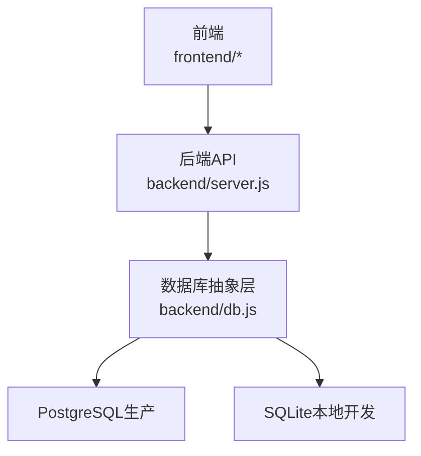
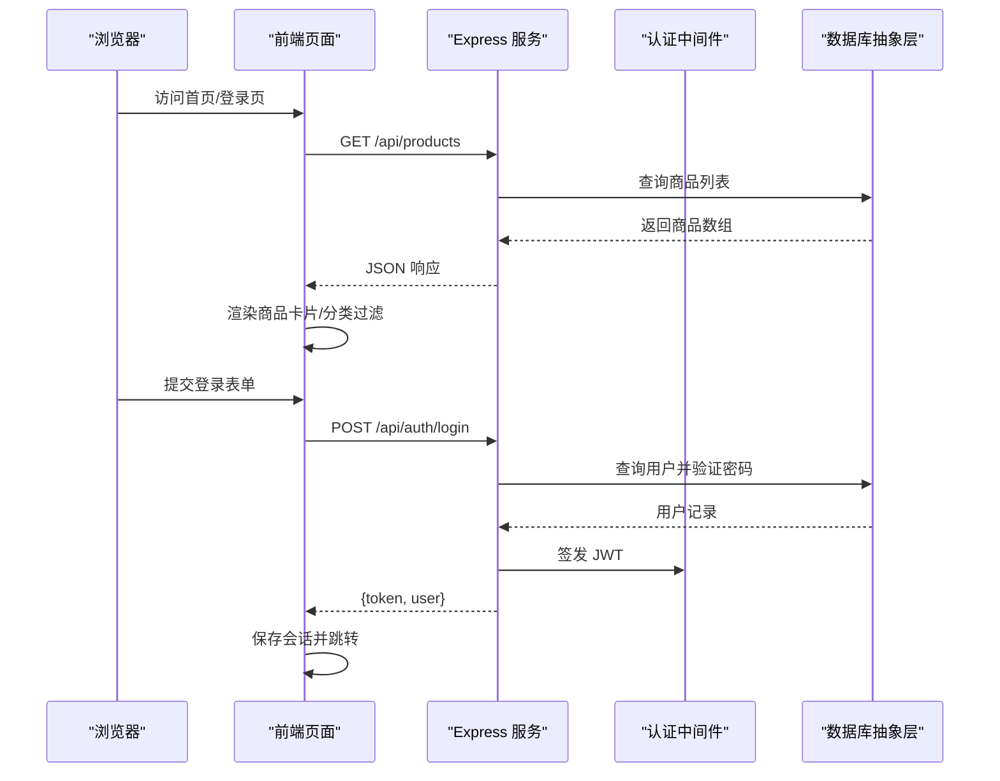
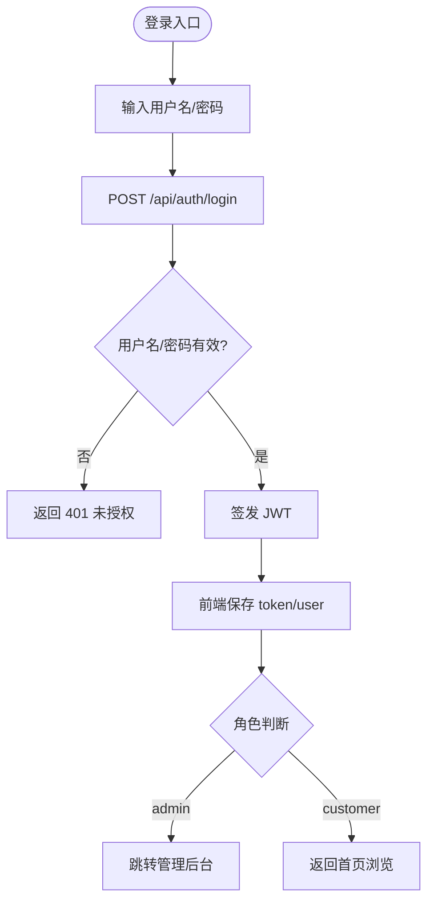
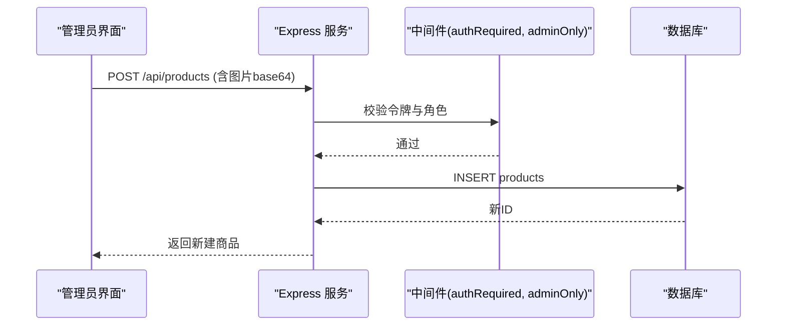
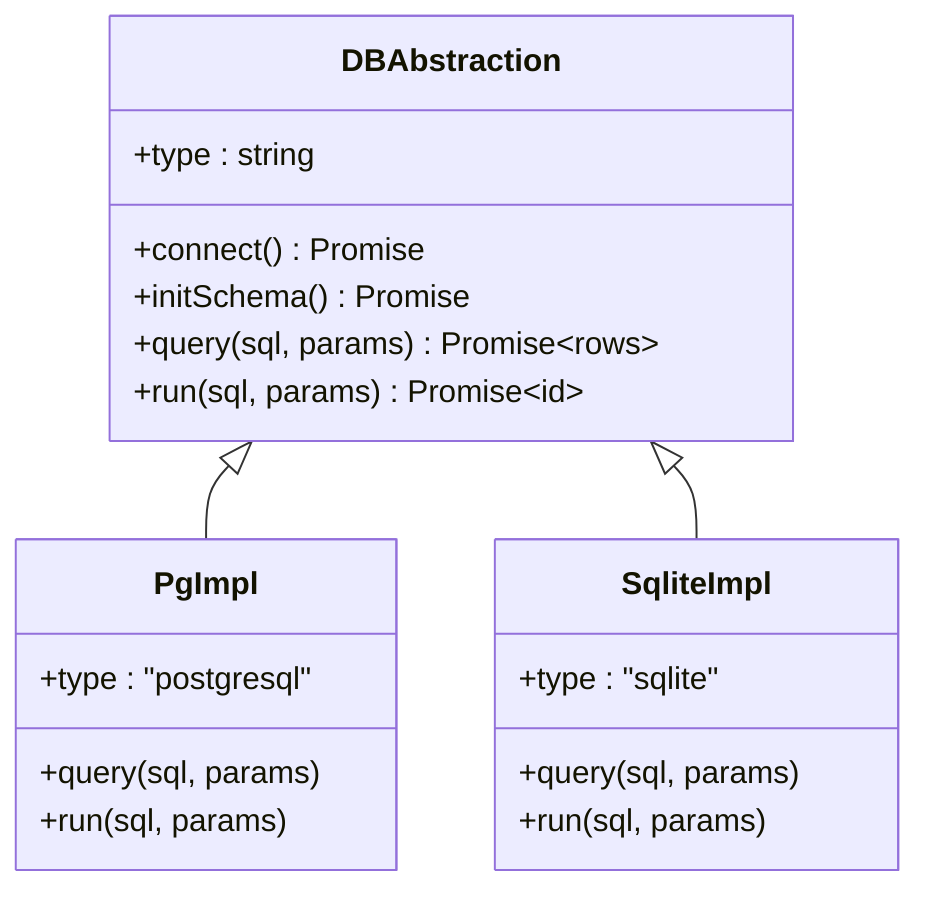
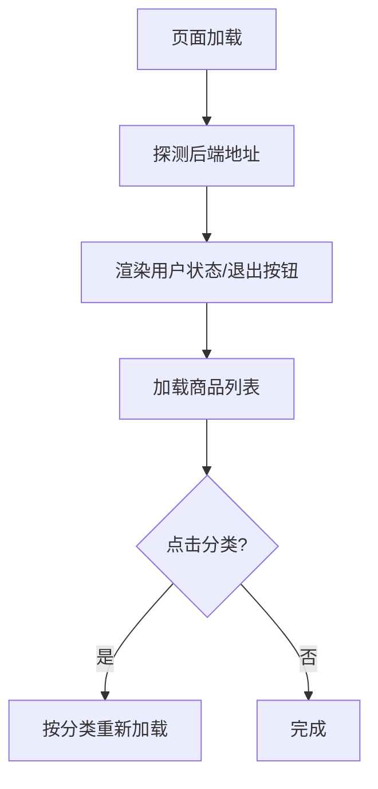
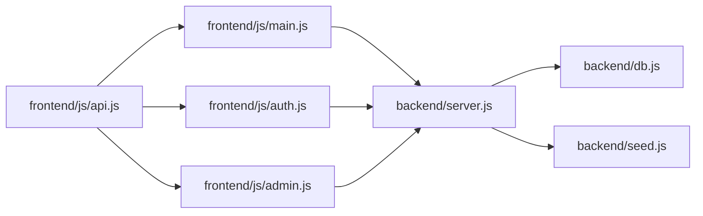

# 项目概述

<cite>
**本文引用的文件**
- [README.md](file://README.md)
- [server.js](file://backend/server.js)
- [db.js](file://backend/db.js)
- [seed.js](file://backend/seed.js)
- [index.html](file://frontend/index.html)
- [login.html](file://frontend/login.html)
- [admin.html](file://frontend/admin.html)
- [api.js](file://frontend/js/api.js)
- [auth.js](file://frontend/js/auth.js)
- [main.js](file://frontend/js/main.js)
- [admin.js](file://frontend/js/admin.js)
</cite>

## 目录
1. [简介](#简介)
2. [项目结构](#项目结构)
3. [核心组件](#核心组件)
4. [架构总览](#架构总览)
5. [详细组件分析](#详细组件分析)
6. [依赖关系分析](#依赖关系分析)
7. [性能与可扩展性](#性能与可扩展性)
8. [故障排查指南](#故障排查指南)
9. [快速开始](#快速开始)
10. [结论](#结论)

## 简介
LeapShop（LeapChess）国际象棋装备在线商店是一个前后端分离、支持角色权限管理的商品展示与管理应用。前端为静态页面（HTML/CSS/JS），后端基于 Express 提供 REST API，数据库层同时支持 PostgreSQL（生产）与 SQLite（本地开发）。系统包含用户认证、角色权限控制、商品列表与详情查询、以及管理员对商品的增删改查功能。首次启动会自动建表并写入演示账户与占位商品，开箱即用。

## 项目结构
- 前端：位于 frontend 目录，包含首页、登录页、管理后台页面及对应 JS 模块；通过共享的 API 客户端与后端交互。
- 后端：位于 backend 目录，Express 服务负责路由、鉴权中间件、静态资源托管（单服务模式）、健康检查等；数据库抽象层统一封装 PostgreSQL 与 SQLite。
- 部署：支持 Zeabur 平台一键部署，自动注入环境变量；默认监听 PORT，并提供 /api/health 健康检查。

**图表来源**
- [server.js:1-169](file://backend/server.js#L1-L169)
- [db.js:1-176](file://backend/db.js#L1-L176)

**章节来源**
- [README.md:1-127](file://README.md#L1-L127)

## 核心组件
- 认证与授权：JWT 令牌签发与校验，角色中间件限制写操作仅管理员可用。
- 商品数据：公开读取（支持分类过滤），管理员可新增、更新、删除商品；图片以 base64 内嵌存储。
- 数据库适配：根据环境变量选择 PostgreSQL 或 SQLite，统一 SQL 占位符转换与连接策略。
- 前端交互：动态加载商品、分类筛选、登录跳转、管理后台权限门控与表单提交。

**章节来源**
- [server.js:25-135](file://backend/server.js#L25-L135)
- [db.js:12-109](file://backend/db.js#L12-L109)
- [main.js:9-40](file://frontend/js/main.js#L9-L40)
- [admin.js:12-34](file://frontend/js/admin.js#L12-L34)

## 架构总览
系统采用三层架构：
- 前端层：原生 HTML/CSS/JS，ES Module 组织逻辑，通过共享 API 客户端调用后端接口。
- 后端层：Express 路由 + 中间件（CORS、JSON 解析、认证、角色校验），统一错误响应。
- 数据层：数据库抽象层屏蔽差异，自动检测环境并选择驱动；初始化 schema 与种子数据。

**图表来源**
- [server.js:44-64](file://backend/server.js#L44-L64)
- [server.js:67-84](file://backend/server.js#L67-L84)
- [db.js:45-67](file://backend/db.js#L45-L67)
- [auth.js:9-25](file://frontend/js/auth.js#L9-L25)
- [main.js:9-40](file://frontend/js/main.js#L9-L40)

## 详细组件分析

### 认证与权限
- 登录流程：前端收集用户名与密码，调用 /api/auth/login；后端校验用户与密码哈希，签发 JWT 并返回 token 与用户信息。
- 会话管理：前端将 token 与用户信息存入 localStorage，后续请求自动携带 Authorization 头。
- 权限控制：写操作需通过 authRequired 与 adminOnly 中间件；非管理员尝试写操作返回 403。

**图表来源**
- [server.js:44-64](file://backend/server.js#L44-L64)
- [auth.js:9-25](file://frontend/js/auth.js#L9-L25)
- [api.js:40-49](file://frontend/js/api.js#L40-L49)

**章节来源**
- [server.js:25-64](file://backend/server.js#L25-L64)
- [api.js:18-49](file://frontend/js/api.js#L18-L49)
- [auth.js:9-25](file://frontend/js/auth.js#L9-L25)

### 商品 CRUD
- 读：公开接口支持按分类过滤；详情接口按 ID 获取。
- 写：新增、更新、删除均需管理员权限；新增时校验名称必填，其他字段有默认值；更新时仅覆盖传入字段；删除前校验存在性。
- 图片：前端将图片转为 base64 字符串随请求体发送；后端直接入库，便于无状态部署。

**图表来源**
- [server.js:86-105](file://backend/server.js#L86-L105)
- [server.js:107-135](file://backend/server.js#L107-L135)
- [admin.js:128-152](file://frontend/js/admin.js#L128-L152)

**章节来源**
- [server.js:67-135](file://backend/server.js#L67-L135)
- [admin.js:36-66](file://frontend/js/admin.js#L36-L66)
- [admin.js:128-176](file://frontend/js/admin.js#L128-L176)

### 数据库抽象层
- 环境检测：优先使用 PostgreSQL（环境变量 DATABASE_URL 或 PGHOST），否则回退到 SQLite（sql.js）。
- SQL 兼容：统一使用 ? 占位符，PostgreSQL 路径自动转换为 $n；INSERT 自动追加 RETURNING id。
- 持久化：SQLite 模式每次写后落盘；生产建议使用 PostgreSQL 避免无状态文件系统丢失数据。

**图表来源**
- [db.js:45-109](file://backend/db.js#L45-L109)
- [db.js:112-158](file://backend/db.js#L112-L158)

**章节来源**
- [db.js:12-109](file://backend/db.js#L12-L109)
- [db.js:112-158](file://backend/db.js#L112-L158)

### 前端交互与导航
- 首页：动态加载商品、分类筛选、健康状态显示、滚动动画与移动端导航。
- 登录页：表单提交、错误提示、成功后根据角色跳转。
- 管理后台：权限门控、商品列表渲染、编辑/删除行操作、图片预览与上传。

**图表来源**
- [main.js:9-40](file://frontend/js/main.js#L9-L40)
- [main.js:69-78](file://frontend/js/main.js#L69-L78)
- [api.js:57-75](file://frontend/js/api.js#L57-L75)

**章节来源**
- [main.js:9-90](file://frontend/js/main.js#L9-L90)
- [api.js:57-75](file://frontend/js/api.js#L57-L75)

## 依赖关系分析
- 前端依赖：
  - api.js：统一请求封装、Token 管理、导航用户状态渲染。
  - auth.js：登录逻辑与跳转。
  - main.js：首页商品加载与交互。
  - admin.js：管理后台权限与 CRUD。
- 后端依赖：
  - server.js：Express 路由、中间件、静态托管、健康检查。
  - db.js：数据库抽象与驱动切换。
  - seed.js：幂等种子数据（账户与商品）。

**图表来源**
- [api.js:1-76](file://frontend/js/api.js#L1-L76)
- [auth.js:1-30](file://frontend/js/auth.js#L1-L30)
- [main.js:1-90](file://frontend/js/main.js#L1-L90)
- [admin.js:1-182](file://frontend/js/admin.js#L1-L182)
- [server.js:1-169](file://backend/server.js#L1-L169)
- [db.js:1-176](file://backend/db.js#L1-L176)
- [seed.js:1-129](file://backend/seed.js#L1-L129)

**章节来源**
- [README.md:106-127](file://README.md#L106-L127)

## 性能与可扩展性
- 图片存储：图片以 base64 内嵌数据库，适合演示规模；生产建议迁移至对象存储以减少数据库体积。
- 数据库选择：生产使用 PostgreSQL，具备更好的并发与扩展能力；本地开发使用 SQLite 零配置。
- 请求大小：后端允许较大 JSON 负载以支持 base64 图片；可根据业务调整限制。
- 缓存策略：当前未实现缓存；可按需引入 Redis 缓存热点商品列表。
- 水平扩展：无状态服务设计，易于多实例部署；结合外部数据库与对象存储提升吞吐。

[本节为通用指导，不直接分析具体文件]

## 故障排查指南
- 无法连接数据库：
  - 检查环境变量 DATABASE_URL 或 PGHOST 是否注入；若缺失将回退 SQLite 并输出警告。
  - 健康检查 /api/health 返回数据库类型，用于确认当前驱动。
- 登录失败：
  - 确认用户名与密码正确；错误返回 401 并提示“无效的用户名或密码”。
  - 前端会捕获错误并显示在登录页的错误区域。
- 权限不足：
  - 写操作需要管理员角色；非管理员调用返回 403。
  - 管理后台会进行前端权限门控，非管理员显示“访问被拒绝”。
- 图片上传失败：
  - 前端限制图片大小不超过 1.5MB；过大将提示压缩并重试。
  - 确保后端 JSON 解析限制足够大以容纳 base64 数据。

**章节来源**
- [server.js:137-140](file://backend/server.js#L137-L140)
- [server.js:44-64](file://backend/server.js#L44-L64)
- [server.js:86-135](file://backend/server.js#L86-L135)
- [admin.js:110-126](file://frontend/js/admin.js#L110-L126)

## 快速开始
- 本地运行：
  - 进入 backend 目录，安装依赖并启动服务；服务默认监听端口由环境变量决定，通常为 3000。
  - 单服务模式：后端同时托管 frontend 静态页面，可直接访问根路径查看首页。
- 演示账户：
  - 超级管理员：用户名 P001，密码 123456，拥有全部权限。
  - 客户：用户名 C001，密码 123456，仅能浏览基础内容。
- 基本使用示例：
  - 访问首页查看商品列表，点击分类按钮进行筛选。
  - 登录管理后台，新增/编辑/删除商品，上传图片预览并提交。
  - 使用 API 冒烟测试脚本验证接口连通性与数据读写。

**章节来源**
- [README.md:30-52](file://README.md#L30-L52)
- [README.md:21-28](file://README.md#L21-L28)
- [server.js:151-169](file://backend/server.js#L151-L169)
- [seed.js:87-114](file://backend/seed.js#L87-L114)

## 结论
LeapShop 提供了一个完整的全栈示例，涵盖用户认证、角色权限、商品管理与前后端分离架构。通过灵活的数据库适配与简洁的 API 设计，既适合本地开发体验，也便于在生产环境部署。对于初学者，项目提供了清晰的入门路径与演示账户；对于有经验开发者，代码结构清晰、扩展点明确，可作为进一步定制的基础。

[本节为总结性内容，不直接分析具体文件]